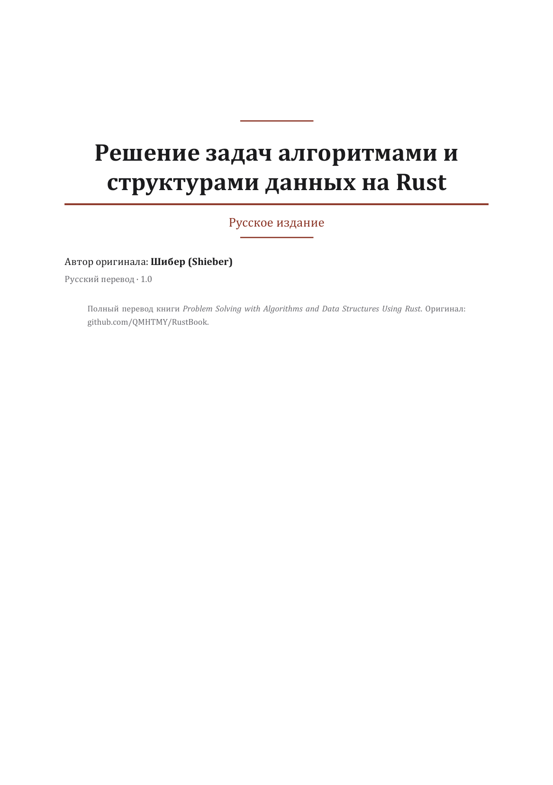

<div align="center">



# RustBook RU

### Решение задач алгоритмами и структурами данных на Rust

**Русское издание** книги *Problem Solving with Algorithms and Data Structures Using Rust*

[](LICENSE)
[](ru/RustBook-RU.md)
[](https://github.com/QMHTMY/RustBook)
[](https://github.com/QMHTMY/RustBook)
[](tools/)

*10 глав · 177 разделов · 69 иллюстраций · 467 листингов кода*

</div>

---

## ✨ О книге

> Книга о том, как **классические алгоритмы и структуры данных** выглядят
> на современном системном языке **Rust**: владение, заимствование и время
> жизни вплетены прямо в решение каждой задачи.

Каждая тема — это теория, иллюстрация и **полностью компилируемый код**
на Rust: от стеков и очередей до деревьев и графов. Оригинал написан
**Шибером (Shieber)** и опубликован в проекте
[QMHTMY/RustBook](https://github.com/QMHTMY/RustBook); этот репозиторий —
его **полный русский перевод**.

> ⚠️ Это **перевод**, а не самостоятельная книга. Авторство, название,
> состав и оформление оригинала принадлежат его правообладателю.
> Издание распространяется на тех же условиях — Apache License 2.0.

## 📖 Содержание

| # | Глава | |
|:-:|---|---|
| 01 | Основы Rust — синтаксис, владение, заимствование | [→](ru/chapters/01-rust-basics.md) |
| 02 | Компьютерные науки — абстракции и типы данных | [→](ru/chapters/02-computer-science.md) |
| 03 | Анализ алгоритмов — O-нотация и сложность | [→](ru/chapters/03-algorithm-analysis.md) |
| 04 | Структуры данных — списки, стеки, очереди, деки | [→](ru/chapters/04-data-structures.md) |
| 05 | Рекурсия — деревья рекурсии и динамическое программирование | [→](ru/chapters/05-recursion.md) |
| 06 | Поиск — линейный, бинарный, хеширование | [→](ru/chapters/06-search.md) |
| 07 | Сортировка — от пузырьковой до поразрядной | [→](ru/chapters/07-sorting.md) |
| 08 | Деревья — бинарные деревья, кучи, деревья поиска | [→](ru/chapters/08-trees.md) |
| 09 | Графы — обходы и кратчайшие пути | [→](ru/chapters/09-graphs.md) |
| 10 | Практика — разбор задач | [→](ru/chapters/10-practice.md) |

## 🚀 Быстрый старт

Читать в один клик:

- 📄 [Книга одним файлом](ru/RustBook-RU.md) — Markdown
- 🌐 [Готовый HTML](ru/build/index.html) — с оглавлением и навигацией
- 📕 [PDF](ru/build/rust-book-ru.pdf) — 341 страница, формат A5

Собрать самостоятельно:

```bash
pip install markdown pymupdf playwright
python -m playwright install chromium

python tools/build_book.py --pdf
# → ru/build/index.html + ru/build/rust-book-ru.pdf
```

Пример из книги (глава 06 «Поиск»):

```rust
// chapter06/binary_search.rs
fn binary_search1(nums: &[i32], num: i32) -> bool {
    let mut low = 0;
    let mut high = nums.len() - 1;
    let mut found = false;

    while low <= high && !found {
        let mid: usize = (low + high) >> 1;

        if num == nums[mid] {
            found = true;
        } else if num < nums[mid] {
            high = mid - 1; // num < 中间值，省去后半部数据
        } else {
            low = mid + 1;  // num >= 中间值，省去前半部数据
        }
    }

    found
}
```

Все 230 файлов примеров — в [`ru/code/`](ru/code), по одному каталогу на главу.

## 📁 Структура репозитория

```text
RustBook-RU/
├── README.md                 ← вы здесь
├── ABOUT.md                  ← что это за книга и кто её автор
├── NOTICE.md                 ← уведомление о переводе (условия Apache-2.0)
├── LICENSE                   ← Apache License 2.0 (копия лицензии оригинала)
├── TRANSLATION_PROGRESS.md   ← статус: 10/10 глав переведены
│
├── ru/                       ← 🇷🇺 русское издание
│   ├── RustBook-RU.md        ←   вся книга одним Markdown-файлом
│   ├── chapters/             ←   главы по отдельности
│   ├── images/               ←   69 иллюстраций (+ русские версии)
│   ├── code/                 ←   230 файлов исходников примеров
│   ├── assets/               ←   обложка и превью
│   └── build/                ←   index.html + rust-book-ru.pdf
│
├── original/                 ← оригинальные материалы (не изменялись)
│   ├── books/                ←   PDF-издания книги
│   ├── code/                 ←   исходники примеров
│   └── publication/          ←   актуальный код из печатного издания
│
└── tools/                    ← конвейер сборки и проверки перевода
```

## 🧪 Качество перевода

- ✅ Все **10 глав** переведены полностью
- ✅ **467 блоков кода** сверены с оригиналом побайтово — расхождений 0
- ✅ Единый глоссарий (~300 терминов) и правила перевода
- ✅ Иллюстрации переведены и перерисованы (оригиналы сохранены)

Подробности: [`TRANSLATION_PROGRESS.md`](TRANSLATION_PROGRESS.md) · [`ru/QA_REPORT.md`](ru/QA_REPORT.md)

## ⚖️ Авторство и лицензия

| | |
|---|---|
| **Автор оригинальной книги** | **Шибер (Shieber)** |
| Оригинальный проект | [QMHTMY/RustBook](https://github.com/QMHTMY/RustBook) |
| Русский перевод | сообщество — этот репозиторий |
| Лицензия | [Apache License 2.0](LICENSE) |

Apache-2.0 — свободная лицензия, прямо разрешающая переводы (§4).
Обязательные условия — копия лицензии, уведомление об изменениях и
сохранение авторства — выполнены; детали в [`NOTICE.md`](NOTICE.md).

---

<div align="center">

*Если книга оказалась полезной — поставьте ⭐ репозиторию и
оригиналу [QMHTMY/RustBook](https://github.com/QMHTMY/RustBook).*

</div>
