<!--
  Файл изменён по сравнению с оригиналом проекта QMHTMY/RustBook:
  текст переведён на русский язык. Лицензия: Apache License 2.0.
  Оригинал: https://github.com/QMHTMY/RustBook
-->

# Решение задач алгоритмами и структурами данных на Rust

### Русское издание

**Полный перевод** книги *Problem Solving with Algorithms and Data Structures
Using Rust* ([QMHTMY/RustBook](https://github.com/QMHTMY/RustBook)).

| | |
|---|---|
| Автор оригинала | **Шибер (Shieber)** |
| Оригинал | <https://github.com/QMHTMY/RustBook> |
| Лицензия | [Apache License 2.0](../LICENSE) |
| Перевод | RustBook RU — русскоязычное сообщество Rust |
| Объём | 10 глав, 181 раздел, 69 иллюстраций, 467 листингов кода |

> **Это перевод, а не самостоятельная книга.** Авторство, название, состав и
> оформление оригинала принадлежат его правообладателю. Русское издание
> распространяется на тех же условиях — Apache License 2.0; подробности в
> [`NOTICE.md`](../NOTICE.md). Все 467 блоков кода воспроизведены побайтово
> идентично оригиналу, иллюстрации — извлечены из оригинального PDF
> (оригиналы в [`images/`](images), русские версии с переведёнными надписями —
> в [`images/ru/`](images/ru)).

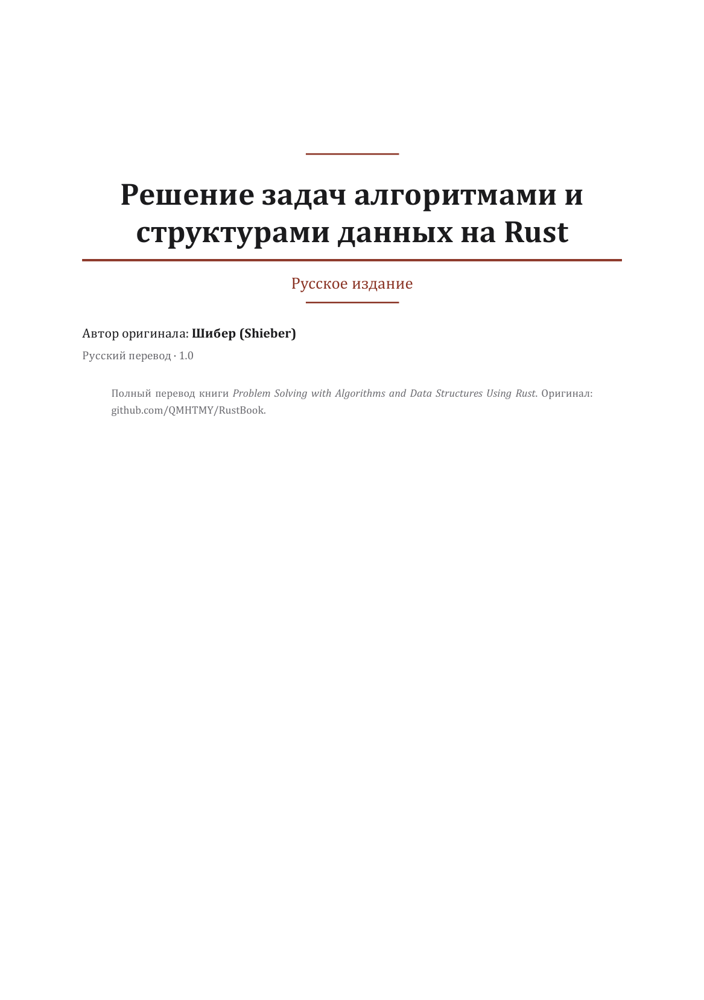

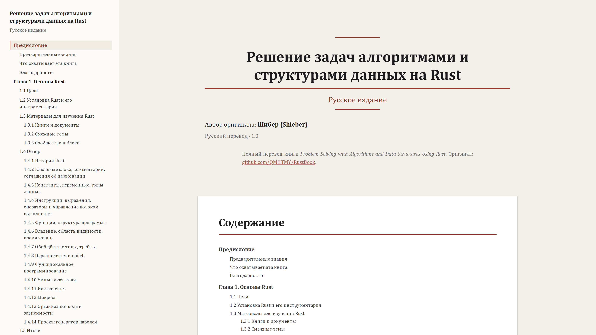

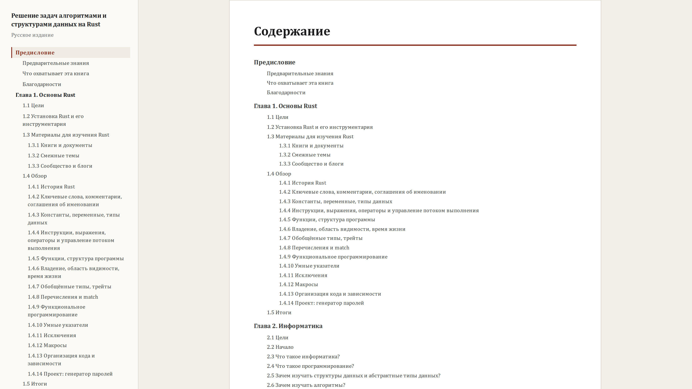

---

## Содержание

- [Предисловие](#preface)
  - [Предварительные знания](#preface-предварительные-знания)
  - [Что охватывает эта книга](#preface-что-охватывает-эта-книга)
  - [Благодарности](#preface-благодарности)
- [Глава 1. Основы Rust](#ch01)
  - [1.1 Цели](#ch01-1-1-цели)
  - [1.2 Установка Rust и его инструментария](#ch01-1-2-установка-rust-и-его-инструментария)
  - [1.3 Материалы для изучения Rust](#ch01-1-3-материалы-для-изучения-rust)
  - [1.3.1 Книги и документы](#ch01-1-3-1-книги-и-документы)
  - [1.3.2 Смежные темы](#ch01-1-3-2-смежные-темы)
  - [1.3.3 Сообщество и блоги](#ch01-1-3-3-сообщество-и-блоги)
  - [1.4 Обзор](#ch01-1-4-обзор)
  - [1.4.1 История Rust](#ch01-1-4-1-история-rust)
  - [1.4.2 Ключевые слова, комментарии, соглашения об именовании](#ch01-1-4-2-ключевые-слова-комментарии-соглашения-об-именовании)
  - [1.4.3 Константы, переменные, типы данных](#ch01-1-4-3-константы-переменные-типы-данных)
  - [1.4.4 Инструкции, выражения, операторы и управление потоком выполнения](#ch01-1-4-4-инструкции-выражения-операторы-и-управление-потоком-выполнения)
  - [1.4.5 Функции, структура программы](#ch01-1-4-5-функции-структура-программы)
  - [1.4.6 Владение, область видимости, время жизни](#ch01-1-4-6-владение-область-видимости-время-жизни)
  - [1.4.7 Обобщённые типы, трейты](#ch01-1-4-7-обобщенные-типы-трейты)
  - [1.4.8 Перечисления и match](#ch01-1-4-8-перечисления-и-match)
  - [1.4.9 Функциональное программирование](#ch01-1-4-9-функциональное-программирование)
  - [1.4.10 Умные указатели](#ch01-1-4-10-умные-указатели)
  - [1.4.11 Исключения](#ch01-1-4-11-исключения)
  - [1.4.12 Макросы](#ch01-1-4-12-макросы)
  - [1.4.13 Организация кода и зависимости](#ch01-1-4-13-организация-кода-и-зависимости)
  - [1.4.14 Проект: генератор паролей](#ch01-1-4-14-проект-генератор-паролей)
  - [1.5 Итоги](#ch01-1-5-итоги)
- [Глава 2. Информатика](#ch02)
  - [2.1 Цели](#ch02-2-1-цели)
  - [2.2 Начало](#ch02-2-2-начало)
  - [2.3 Что такое информатика?](#ch02-2-3-что-такое-информатика)
  - [2.4 Что такое программирование?](#ch02-2-4-что-такое-программирование)
  - [2.5 Зачем изучать структуры данных и абстрактные типы данных?](#ch02-2-5-зачем-изучать-структуры-данных-и-абстрактные-типы-данных)
  - [2.6 Зачем изучать алгоритмы?](#ch02-2-6-зачем-изучать-алгоритмы)
  - [2.7 Итоги](#ch02-2-7-итоги)
- [Глава 3. Анализ алгоритмов](#ch03)
  - [3.1 Цели](#ch03-3-1-цели)
  - [3.2 Что такое анализ алгоритмов?](#ch03-3-2-что-такое-анализ-алгоритмов)
  - [3.3 Анализ в нотации O](#ch03-3-3-анализ-в-нотации-o)
  - [3.4 Определение анаграмм](#ch03-3-4-определение-анаграмм)
  - [3.4.1 Полный перебор](#ch03-3-4-1-полный-перебор)
  - [3.4.2 Вычёркивание](#ch03-3-4-2-вычеркивание)
  - [3.4.3 Сортировка и сравнение](#ch03-3-4-3-сортировка-и-сравнение)
  - [3.4.4 Подсчёт и сравнение](#ch03-3-4-4-подсчет-и-сравнение)
  - [3.5 Производительность структур данных в Rust](#ch03-3-5-производительность-структур-данных-в-rust)
  - [3.5.1 Скалярные и составные структуры данных](#ch03-3-5-1-скалярные-и-составные-структуры-данных)
  - [3.5.2 Структуры данных коллекций](#ch03-3-5-2-структуры-данных-коллекций)
  - [3.6 Итоги](#ch03-3-6-итоги)
- [Глава 4. Базовые структуры данных](#ch04)
  - [4.1 Цели](#ch04-4-1-цели)
  - [4.2 Линейные структуры](#ch04-4-2-линейные-структуры)
  - [4.3 Стек](#ch04-4-3-стек)
  - [4.3.1 Абстрактный тип данных «стек»](#ch04-4-3-1-абстрактный-тип-данных-стек)
  - [4.3.2 Реализация стека на Rust](#ch04-4-3-2-реализация-стека-на-rust)
  - [4.3.3 Простые скобки](#ch04-4-3-3-простые-скобки)
  - [4.3.4 Перевод десятичных чисел в двоичные](#ch04-4-3-4-перевод-десятичных-чисел-в-двоичные)
  - [4.3.5 Префиксные, инфиксные и постфиксные выражения](#ch04-4-3-5-префиксные-инфиксные-и-постфиксные-выражения)
  - [4.3.6 Перевод инфиксных выражений в префиксные и постфиксные](#ch04-4-3-6-перевод-инфиксных-выражений-в-префиксные-и-постфиксные)
  - [4.4 Очередь](#ch04-4-4-очередь)
  - [4.4.1 Абстрактный тип данных «Очередь»](#ch04-4-4-1-абстрактный-тип-данных-очередь)
  - [4.4.2 Реализация очереди на Rust](#ch04-4-4-2-реализация-очереди-на-rust)
  - [4.4.3 Горячая картошка](#ch04-4-4-3-горячая-картошка)
  - [4.5 Дек](#ch04-4-5-дек)
  - [4.5.1 Абстрактный тип данных «дек»](#ch04-4-5-1-абстрактный-тип-данных-дек)
  - [4.5.2 Реализация дека на Rust](#ch04-4-5-2-реализация-дека-на-rust)
  - [4.5.3 Проверка палиндрома](#ch04-4-5-3-проверка-палиндрома)
  - [4.6 Связный список](#ch04-4-6-связный-список)
  - [4.6.1 Абстрактный тип данных «связный список»](#ch04-4-6-1-абстрактный-тип-данных-связный-список)
  - [4.6.2 Реализация связного списка на Rust](#ch04-4-6-2-реализация-связного-списка-на-rust)
  - [4.6.3 Стек на основе связного списка](#ch04-4-6-3-стек-на-основе-связного-списка)
  - [4.7 Vec](#ch04-4-7-vec)
  - [4.7.1 Абстрактный тип данных Vec](#ch04-4-7-1-абстрактный-тип-данных-vec)
  - [4.7.2 Реализация Vec на Rust](#ch04-4-7-2-реализация-vec-на-rust)
  - [4.8 Итоги](#ch04-4-8-итоги)
- [Глава 5. Рекурсия](#ch05)
  - [5.1 Цели](#ch05-5-1-цели)
  - [5.2 Что такое рекурсия?](#ch05-5-2-что-такое-рекурсия)
  - [5.2.1 Три закона рекурсии](#ch05-5-2-1-три-закона-рекурсии)
  - [5.2.2 Преобразование целого числа в строку в произвольной системе счисления](#ch05-5-2-2-преобразование-целого-числа-в-строку-в-произвольной-системе-счисления)
  - [5.2.3 Ханойская башня](#ch05-5-2-3-ханойская-башня)
  - [5.3 Хвостовая рекурсия](#ch05-5-3-хвостовая-рекурсия)
  - [5.3.1 Рекурсия и итерация](#ch05-5-3-1-рекурсия-и-итерация)
  - [5.4 Динамическое программирование](#ch05-5-4-динамическое-программирование)
  - [5.4.1 Что такое динамическое программирование?](#ch05-5-4-1-что-такое-динамическое-программирование)
  - [5.4.2 Динамическое программирование и рекурсия](#ch05-5-4-2-динамическое-программирование-и-рекурсия)
  - [5.5 Итоги](#ch05-5-5-итоги)
- [Глава 6. Поиск](#ch06)
  - [6.1 Цели](#ch06-6-1-цели)
  - [6.2 Что такое поиск?](#ch06-6-2-что-такое-поиск)
  - [6.3 Последовательный поиск](#ch06-6-3-последовательный-поиск)
  - [6.3.1 Реализация последовательного поиска на Rust](#ch06-6-3-1-реализация-последовательного-поиска-на-rust)
  - [6.3.2 Анализ последовательного поиска](#ch06-6-3-2-анализ-последовательного-поиска)
  - [6.4 Двоичный поиск](#ch06-6-4-двоичный-поиск)
  - [6.4.1 Реализация двоичного поиска](#ch06-6-4-1-реализация-двоичного-поиска)
  - [6.4.2 Анализ двоичного поиска](#ch06-6-4-2-анализ-двоичного-поиска)
  - [6.4.3 Интерполяционный поиск](#ch06-6-4-3-интерполяционный-поиск)
  - [6.4.4 Экспоненциальный поиск](#ch06-6-4-4-экспоненциальный-поиск)
  - [6.5 Поиск по хешу](#ch06-6-5-поиск-по-хешу)
  - [6.5.1 Хеш-функции](#ch06-6-5-1-хеш-функции)
  - [6.5.2 Разрешение коллизий](#ch06-6-5-2-разрешение-коллизий)
  - [6.5.3 Реализация HashMap в Rust](#ch06-6-5-3-реализация-hashmap-в-rust)
  - [6.5.4 Анализ HashMap](#ch06-6-5-4-анализ-hashmap)
  - [6.6 Итоги](#ch06-6-6-итоги)
- [Глава 7. Сортировка](#ch07)
  - [7.1 Цели](#ch07-7-1-цели)
  - [7.2 Что такое сортировка?](#ch07-7-2-что-такое-сортировка)
  - [7.3 Пузырьковая сортировка](#ch07-7-3-пузырьковая-сортировка)
  - [7.4 Быстрая сортировка](#ch07-7-4-быстрая-сортировка)
  - [7.5 Сортировка вставками](#ch07-7-5-сортировка-вставками)
  - [7.6 Сортировка Шелла](#ch07-7-6-сортировка-шелла)
  - [7.7 Сортировка слиянием](#ch07-7-7-сортировка-слиянием)
  - [7.8 Сортировка выбором](#ch07-7-8-сортировка-выбором)
  - [7.9 Сортировка кучей](#ch07-7-9-сортировка-кучей)
  - [7.10 Сортировка корзинами](#ch07-7-10-сортировка-корзинами)
  - [7.11 Сортировка подсчётом](#ch07-7-11-сортировка-подсчетом)
  - [7.12 Поразрядная сортировка](#ch07-7-12-поразрядная-сортировка)
  - [7.13 Сортировка Тимсорт (TimSort)](#ch07-7-13-сортировка-тимсорт-timsort)
  - [7.14 Итоги](#ch07-7-14-итоги)
- [Глава 8. Деревья](#ch08)
  - [8.1 Цели](#ch08-8-1-цели)
  - [8.2 Что такое дерево?](#ch08-8-2-что-такое-дерево)
  - [8.2.1 Терминология и определения дерева](#ch08-8-2-1-терминология-и-определения-дерева)
  - [8.2.2 Представление дерева](#ch08-8-2-2-представление-дерева)
  - [8.2.3 Дерево разбора](#ch08-8-2-3-дерево-разбора)
  - [8.2.4 Обходы дерева](#ch08-8-2-4-обходы-дерева)
  - [8.3 Двоичная куча](#ch08-8-3-двоичная-куча)
  - [8.3.1 Абстрактный тип данных двоичной кучи](#ch08-8-3-1-абстрактный-тип-данных-двоичной-кучи)
  - [8.3.2 Реализация двоичной кучи на Rust](#ch08-8-3-2-реализация-двоичной-кучи-на-rust)
  - [8.3.3 Анализ двоичной кучи](#ch08-8-3-3-анализ-двоичной-кучи)
  - [8.4 Binary Search Tree](#ch08-8-4-binary-search-tree)
  - [8.4.1 Абстрактный тип данных «двоичное дерево поиска»](#ch08-8-4-1-абстрактный-тип-данных-двоичное-дерево-поиска)
  - [8.4.2 Реализация двоичного дерева поиска в Rust](#ch08-8-4-2-реализация-двоичного-дерева-поиска-в-rust)
  - [8.4.3 Analysis of Binary Search Tree](#ch08-8-4-3-analysis-of-binary-search-tree)
  - [8.5 Сбалансированное двоичное дерево поиска](#ch08-8-5-сбалансированное-двоичное-дерево-поиска)
  - [8.5.1 Дерево AVL](#ch08-8-5-1-дерево-avl)
  - [8.5.2 Реализация дерева AVL на Rust](#ch08-8-5-2-реализация-дерева-avl-на-rust)
  - [8.5.3 Анализ дерева AVL](#ch08-8-5-3-анализ-дерева-avl)
  - [8.6 Итоги](#ch08-8-6-итоги)
- [Глава 9. Графы](#ch09)
  - [9.1 Цели](#ch09-9-1-цели)
  - [9.2 Что такое граф?](#ch09-9-2-что-такое-граф)
  - [9.2.1 Словарь и определения графа](#ch09-9-2-1-словарь-и-определения-графа)
  - [9.3 Формат хранения графа](#ch09-9-3-формат-хранения-графа)
  - [9.3.1 Матрица смежности](#ch09-9-3-1-матрица-смежности)
  - [9.3.2 Список смежности](#ch09-9-3-2-список-смежности)
  - [9.4 Абстрактный тип данных «Граф»](#ch09-9-4-абстрактный-тип-данных-граф)
  - [9.5 Реализация графа в Rust](#ch09-9-5-реализация-графа-в-rust)
  - [9.5.1 Задача о цепочке слов](#ch09-9-5-1-задача-о-цепочке-слов)
  - [9.6 Breadth First Search(BFS)](#ch09-9-6-breadth-first-search-bfs)
  - [9.6.1 Implementing a BFS](#ch09-9-6-1-implementing-a-bfs)
  - [9.6.2 Analysis of BFS](#ch09-9-6-2-analysis-of-bfs)
  - [9.6.3 The Knight’s Tour Problem](#ch09-9-6-3-the-knight-s-tour-problem)
  - [9.7 Depth First Search(DFS)](#ch09-9-7-depth-first-search-dfs)
  - [9.7.1 Implementing a DFS](#ch09-9-7-1-implementing-a-dfs)
  - [9.7.2 Analysis of DFS](#ch09-9-7-2-analysis-of-dfs)
  - [9.7.3 Topological Sorting](#ch09-9-7-3-topological-sorting)
  - [9.8 Компоненты сильной связности](#ch09-9-8-компоненты-сильной-связности)
  - [9.8.1 Алгоритм компонент сильной связности на основе BFS](#ch09-9-8-1-алгоритм-компонент-сильной-связности-на-основе-bfs)
  - [9.8.2 Алгоритм компонент сильной связности на основе DFS](#ch09-9-8-2-алгоритм-компонент-сильной-связности-на-основе-dfs)
  - [9.9 Задача о кратчайшем пути](#ch09-9-9-задача-о-кратчайшем-пути)
  - [9.9.1 Алгоритм Дейкстры](#ch09-9-9-1-алгоритм-дейкстры)
  - [9.9.2 Реализация алгоритма Дейкстры](#ch09-9-9-2-реализация-алгоритма-дейкстры)
  - [9.9.3 Анализ алгоритма Дейкстры](#ch09-9-9-3-анализ-алгоритма-дейкстры)
  - [9.10 Итоги](#ch09-9-10-итоги)
- [Глава 10. Практика](#ch10)
  - [10.1 Цели](#ch10-10-1-цели)
  - [10.2 Расстояние редактирования](#ch10-10-2-расстояние-редактирования)
  - [10.2.1 Расстояние Хэмминга](#ch10-10-2-1-расстояние-хэмминга)
  - [10.2.2 Расстояние Левенштейна](#ch10-10-2-2-расстояние-левенштейна)
  - [10.3 Бор (trie)](#ch10-10-3-бор-trie)
  - [10.4 Фильтры](#ch10-10-4-фильтры)
  - [10.4.1 Фильтр Блума](#ch10-10-4-1-фильтр-блума)
  - [10.4.2 Фильтр Кукушки](#ch10-10-4-2-фильтр-кукушки)
  - [10.5 Алгоритм LRU (наименее недавно использованный)](#ch10-10-5-алгоритм-lru-наименее-недавно-использованный)
  - [10.6 Согласованное хеширование](#ch10-10-6-согласованное-хеширование)
  - [10.7 Кодирование и декодирование Base58](#ch10-10-7-кодирование-и-декодирование-base58)
  - [10.8 Блокчейн](#ch10-10-8-блокчейн)
  - [10.8.1 Принципы блокчейна и биткойна](#ch10-10-8-1-принципы-блокчейна-и-биткойна)
  - [10.8.2 Простейший блокчейн](#ch10-10-8-2-простейший-блокчейн)
  - [10.9 Итоги](#ch10-10-9-итоги)

---


<a id="preface"></a>

<!--
  Файл изменён по сравнению с оригиналом проекта QMHTMY/RustBook:
  текст переведён на русский язык. Лицензия: Apache License 2.0.
  Оригинал: https://github.com/QMHTMY/RustBook
-->
Решение задач с помощью алгоритмов и структур данных на Rust Shieber 2023.03.28

# Предисловие

Появление транзистора вызвало революцию в развитии интегральных схем и чипов, приведшую к разработке центрального процессора, устройств хранения большой ёмкости и удобных средств связи. Unix [1] появился в результате неудачи проекта Multics [2], который впоследствии привёл к созданию ядра Linux [3] и его различных дистрибутивов [4]. Сочетание открытого исходного кода с сетевыми технологиями сделало возможным стремительное развитие ИТ. Технический прогресс даёт платформу и инструменты для воплощения практических идей, тогда как социальный прогресс порождает новые запросы и устремления, которые, в свою очередь, дополнительно продвигают технический прогресс. Хотя благодаря верхнему уровню компьютерного мира появились Интернет, облачные вычисления, блокчейн, ИИ и Интернет вещей, базовые принципы, лежащие в основе нижнего уровня, остаются неизменными. Основа вычислительной техники — это сочетание аппаратного обеспечения с его абстрактными типами данных и алгоритмами. Будь то обычный компьютер, суперкомпьютер или квантовый компьютер [5], их функции строятся на той или иной абстракции структур данных и алгоритмов. Эта книга посвящена проектированию, реализации и применению абстрактных типов данных, которым принадлежит важная роль в информатике. Научившись проектировать абстрактные типы данных, можно лучше реализовывать программы и глубже понимать их. Реализации алгоритмов в этой книге не являются ни наиболее оптимальными, ни универсальными инженерными решениями, поскольку такие решения обычно оказываются многословными и не сосредоточены на ключевых принципах, что может вредить изучению. Вместо этого код в этой книге использует разные приёмы упрощения в зависимости от случая: в одних местах применяются обобщённые типы, в других — конкретные типы. Эти приёмы реализации призваны упростить код и обеспечить возможность компиляции и запуска каждого его фрагмента по отдельности с получением результата.

<a id="preface-предварительные-знания"></a>

##  Предварительные знания

Понимание абстрактных типов данных не требует знания какого-либо конкретного языка, однако написание кода предполагает учёт особенностей конкретных форм, что, в свою очередь, требует определённого уровня владения Rust. Хотя степень знакомства читателей с Rust и стилем программирования может различаться, базовые требования остаются одинаковыми. Чтобы читать эту книгу, читателю желательно обладать следующими навыками и интересом:

- Умение реализовывать завершённые программы на Rust, включая использование `Cargo`, `rustc`, `test` и т. д.
- Умение использовать базовые типы данных и структуры, включая структуры, перечисления, циклы, сопоставления с образцом и т. д.
- Умение использовать обобщённые типы, времена жизни, систему владения, указатели, небезопасный код и макросы Rust и т. д.
- Умение использовать встроенные библиотеки (крейты) и внешние библиотеки, а также настраивать `Cargo.toml`.

Если читателю не хватает этих навыков, следует обратиться к разделу о материалах по изучению Rust в главе 1, подобрать себе рекомендуемые книги и ресурсы и сначала изучить Rust, а затем вернуться к этой книге. Код для этой книги доступен на Github и организован по главам и именам файлов. Читателей приглашают скачивать и использовать его, а также указывать на обнаруженные ими ошибки. Эта книга и весь код написаны в среде Ubuntu 20.04 с версией Rust 1.58. В оформлении кода используются два типа блоков: с номерами строк и без них. Первый служит для показа кода, а второй — для вывода результатов или иного содержимого. Весь код, кроме простого или пояснительного кода, который не даёт результатов, снабжён выводом. Короткие выводы приводятся комментарием внутри текущего блока кода, а более сложные выводы помещаются в отдельный блок кода без номеров строк.

<a id="preface-что-охватывает-эта-книга"></a>

##  Что охватывает эта книга

Чтобы дать читателю ясное представление о структуре книги и помочь подготовленным пользователям выбирать нужные главы, ниже приведено краткое изложение всего содержания книги. Книга разделена на десять глав. Глава 1 систематизирует материалы по изучению Rust и повторяет базовые знания. Главы 2 и 3 вводят понятия информатики и анализа алгоритмов, образуя фундамент книги. Главы с 4-й по 7-ю охватывают проектирование и реализацию простых структур данных и алгоритмов, тогда как главы 8 и 9 охватывают более сложные структуры данных — деревья и графы, которые широко используются. Эти две главы опираются на более общие темы, рассмотренные в предыдущих главах. Последняя глава содержит несколько практических проектов, в которых структуры данных и алгоритмы используются для решения реальных задач. Читателю рекомендуется начать с первых трёх глав, а затем последовательно перейти к промежуточным главам и практическому проекту. Вместе с тем читатель может выбрать для начала изучение отдельных глав, а затем освоить остальной материал. Глава 1. Основы Rust. Эта глава охватывает основы Rust, включая установку инструментария Rust, систематизацию ресурсов по изучению Rust, повторение базовых сведений о Rust и один проект. Читатели, уже знакомые с этими темами, могут пропустить эту главу. Итоговый проект обобщает изученные базовые знания и показывает, как организованы модули и код на Rust. Глава 2. Информатика. Эта глава вводит определение и понятия информатики, что поможет читателю анализировать реальные задачи. Это включает построение моделей абстрактных типов данных для структур данных, проектирование и реализацию алгоритмов, а также проверку производительности алгоритмов. Абстрактные типы данных описывают логику операций над данными и скрывают детали реализации, что позволяет точнее выделить суть задачи. Глава 3. Анализ алгоритмов. Анализ алгоритмов — это метод изучения времени выполнения программы и её пространственной эффективности, позволяющий определить эффективность работы алгоритма. Стандартным методом анализа алгоритмов является анализ в нотации O (big-O). Глава 4. Базовые структуры данных. Эта глава охватывает базовые структуры данных в Rust. К ним относятся массивы, срезы, `Vec`, а также производные от них стек и очередь и другие структуры, построенные на линейной модели памяти. Глава сосредоточена на реализации этих базовых структур данных с помощью `Vec`. Глава 5. Рекурсия. Рекурсия — это алгоритмическая техника, представляющая собой ещё одну форму итерации. Она должна удовлетворять трём законам рекурсии, а хвостовая рекурсия является оптимизацией рекурсии. Динамическое программирование — эффективная алгоритмическая техника, которую можно реализовать с помощью рекурсии или итерации. Глава 6. Поиск. Эта глава охватывает алгоритмы поиска, которые используются для нахождения элементов в наборе данных или для определения наличия элемента. Последовательные и непоследовательные алгоритмы поиска рассматриваются в зависимости от того, упорядочен набор данных или нет. Глава 7. Сортировка. В предыдущей главе алгоритм последовательного поиска требовал упорядоченных данных, однако данные в общем случае не упорядочены. Следовательно, необходимы алгоритмы сортировки. Эта глава охватывает десять распространённых алгоритмов сортировки, включая пузырьковую сортировку, быструю сортировку, сортировку вставками, сортировку Шелла, сортировку слиянием, сортировку выбором, сортировку кучей, сортировку корзинами, сортировку подсчётом и поразрядную сортировку. Алгоритм сортировки Тимсорт (TimSort), представляющий собой комбинацию нескольких распространённых алгоритмов сортировки и отличающийся высокой эффективностью, стал алгоритмом сортировки по умолчанию во многих языках программирования. Глава 8. Деревья. Эта глава объясняет, как нелинейные структуры данных могут строиться на линейных системах. Деревья — это нелинейные структуры данных, указывающие на поддеревья через указатели или ссылки. Разбираются двоичные деревья, двоичные кучи, двоичные деревья поиска и сбалансированные двоичные деревья. B-деревья, B+-деревья и красно-чёрные деревья представляют собой более сложные деревья. Глава 9. Графы. В отличие от деревьев, графы не имеют отношения «родитель — потомок» между узлами, а их связи могут вести в любом направлении. Эта глава объясняет, как графы — нелинейная структура данных — используются для решения задач с большим числом узлов и связей, например задач сетевого трафика и поиска пути. Также разбираются формы хранения графов, включая списки смежности и матрицы смежности. Глава 10. Практические проекты. Эта глава применяет знания, полученные в предыдущих главах, для решения практических задач. Рассматриваются алгоритмы вычисления расстояний, бор, фильтры, алгоритмы вытеснения из кеша, алгоритмы согласованного хеширования и блокчейн. Эти практические проекты помогают читателю углубить понимание структур данных и повысить качество своего кода на Rust.

<a id="preface-благодарности"></a>

##  Благодарности

Rust — превосходный язык, обеспечивающий эффективность, безопасность и удобные инструменты управления разработкой, и он постепенно интегрируется в ядро Linux, что делает его потенциальной заменой части работ на C/C++ в будущем. Хотя существует немало книг по Rust, автор обнаружил, что книг об алгоритмах на Rust нет, что порождало множество препятствий в процессе изучения. Поэтому автор решил создать простую и удобную книгу по Rust, способную помочь новичкам изучить алгоритмы и структуры данных. После обширных исследований [6], размышлений, систематизации и обобщения собственного опыта обучения эта книга была завершена. Несмотря на крутую кривую обучения Rust, при правильном направлении и хороших ресурсах этот язык можно освоить в совершенстве. Автор надеется, что эта книга внесёт небольшой вклад в сообщество изучающих Rust. Главная цель этой книги — изучение Rust и его продвижение, а также отдача долга всему сообществу открытого исходного кода, которое позволило автору учиться и развиваться. Автор выражает благодарность PingCap за разработку TiDB, действующему сообществу открытого исходного кода и онлайн-курсам. Автор также благодарит Чжан Хандон (Zhang Handong), Майка Тан (Mike Tang) и других участников китайского сообщества Rust за проведение конференций по Rust и поддержание сообщества, Лин Ху Ичжун (Ling Hu Yi Chong) за публикацию обучающих видео по Rust на сайте Bilibili Danmu, а также Чжан Хандон — за продвижение языка Rust с помощью своей книги «The Tao of Rust Programming» («Дао программирования на Rust») и ежемесячного журнала RustMagazine на китайском языке. Автор также признаёт заслуги Фонда Rust [7], учреждённого Mozilla, AWS, Facebook, Google, Microsoft и Huawei, в создании платформы, мотивировавшей автора написать эту книгу, поскольку обучающих ресурсов не хватало. Наконец, автор благодарит Университет электронных наук и технологий Китая (UESTC) за предоставленные ресурсы и среду. Он также благодарит своего наставника и сокурсников за заботу и помощь в учебно-исследовательской аудитории KC404, где автор осваивал различные технологии и культуры, рос и находил направление своего жизненного пути.

S h i e b e r

---


<a id="ch01"></a>

<!--
  Файл изменён по сравнению с оригиналом проекта QMHTMY/RustBook:
  текст переведён на русский язык. Лицензия: Apache License 2.0.
  Оригинал: https://github.com/QMHTMY/RustBook
-->
# Глава 1. Основы Rust

<a id="ch01-1-1-цели"></a>

## 1.1 Цели

- Установка Rust и освоение его инструментария
- Обзор учебных ресурсов по Rust в различных областях
- Повторение основ языка программирования Rust

<a id="ch01-1-2-установка-rust-и-его-инструментария"></a>

## 1.2 Установка Rust и его инструментария

В Ubuntu 22.04 и более поздних версиях дистрибутива Rust предустановлен, поэтому начать работать с ним можно сразу же. Если вы используете другие Unix-подобные системы, воспользуйтесь приведённой ниже командой для установки Rust. Для Windows обратитесь к официальному сайту. Поскольку код в этой книге написан под Linux, мы рекомендуем читателям использовать Linux или Mac OS, чтобы избежать несоответствий и ошибок, возникающих из-за различий между средами.

```bash
$ curl --proto '=https' --tlsv1.2 \
    -sSf https://sh.rustup.rs | sh
```

После установки Rust в Linux необходимо задать переменные окружения, чтобы система могла находить инструменты Rust, например компилятор rustc. Добавьте следующие три строки в конец файла ~/.bashrc.

```bash
# Rust env-path variables
export RUSTPATH=$HOME/.cargo/bin
export PATH=$PATH:$RUSTPATH
```

Затем сохраните внесённые изменения и выполните команду source ~/.bashrc. Если этот процесс покажется вам неудобным, можно загрузить скрипт install_rust.sh из первой главы исходного кода этой книги и запустить его, чтобы завершить установку инструментария Rust. Приведённые выше инструкции установят инструмент rustup, который выполняет управление и установку инструментария Rust, включающего компилятор rustc, инструмент управления проектами cargo, инструмент управления наборами инструментов rustup, инструмент документирования rustdoc, инструмент форматирования rustfmt и инструмент отладки rust-gdb. Для простых проектов при компиляции можно использовать компилятор rustc. Однако для более крупных проектов для управления ими необходим инструмент cargo, который при компиляции внутренним образом вызывает rustc. Cargo — отличный инструмент, который выполняет сборку проектов, тестирование, компиляцию и публикацию, что делает его исключительно эффективным. Программисты, работавшие с проектами на C/C++, по достоинству оценят превосходство инструмента cargo в работе с различными библиотеками и зависимостями. Большую часть времени мы используем компилятор rustc вместо инструмента cargo, поскольку проекты в этой книге не слишком сложны. Инструмент rustup управляет установкой, обновлением и удалением инструментов Rust. Обратите внимание, что язык Rust включает версии stable и nightly, которые могут сосуществовать. Установить версию nightly можно следующей командой.

```bash
$ rustup default nightly
```

После установки с помощью инструмента rustup можно проверить, какая версия используется в текущий момент.

```bash
$ rustup toolchain list
    stable-x86_64-unknown-linux-gnu
    nightly-x86_64-unknown-linux-gnu (default)
```

Для переключения между версиями stable и nightly используйте следующую команду.

```bash
$ rustup default stable # nightly
```

<a id="ch01-1-3-материалы-для-изучения-rust"></a>

## 1.3 Материалы для изучения Rust

Rust — это язык системного программирования, имеющий определённый уровень сложности. Изучить Rust без хороших ресурсов невозможно. Ниже приведена подборка учебных материалов по различным направлениям Rust, составленная автором. Подборка может быть неполной, однако большинство направлений охвачено.

<a id="ch01-1-3-1-книги-и-документы"></a>

### 1.3.1 Книги и документы

Базовые книги и документы по Rust: The Rust Programming Language, Easy to Understand Rust, Rustlings, Rust by Example, Rust Primer, Rust Cookbook, Rust in Action, Rust Course. Продвинутые книги и документы по Rust: Cargo Documentation, The Tao of Rust Programming, Learn Rust With Entirely Too Many Linked Lists, Rust Design Patterns. Высокоуровневые книги и документы по Rust: rustc book, The Little Book of Rust Macros, The Rustonomicon, Asynchronous Programming in Rust.

<a id="ch01-1-3-2-смежные-темы"></a>

### 1.3.2 Смежные темы

WebAssembly (Wasm): https://wasmer.io, https://wasmtime.dev, https://wasmedge.org. HTTP/3: https://github.com/cloudflare/quiche. Алгоритмы: https://github.com/TheAlgorithms/Rust. Игры: https://github.com/bevyengine/bevy. Инструменты: https://github.com/rustdesk/rustdesk, https://github.com/uutils/coreutils. Блокчейн: https://github.com/w3f/polkadot. Базы данных: https://github.com/tikv, https://github.com/tensorbase/tensorbase. Компиляторы: https://github.com/rust-lang/rustc_codegen_gcc. Операционные системы: https://github.com/Rust-for-Linux, https://github.com/rcore-os. Веб-фронтенд: https://github.com/yewstack/yew, https://github.com/denoland/deno. Веб-бэкенд: https://actix.rs/, https://github.com/tokio-rs/axum, https://github.com/poem-web/poem.

<a id="ch01-1-3-3-сообщество-и-блоги"></a>

### 1.3.3 Сообщество и блоги

Официальный сайт Rust: https://www.rust-lang.org. Исходный код Rust: https://github.com/rust-lang/rust. Документация Rust: https://doc.rust-lang.org/stable. Справочник Rust: https://doc.rust-lang.org/reference. Awesome Rust: https://github.com/rust-unofficial/awesome-rust. Библиотеки и крейты Rust: https://crates.io, https://lib.rs. Материалы по Rust: https://www.yuque.com/zhoujiping/programming/rust-materials. Шпаргалка по Rust: https://cheats.rs.

<a id="ch01-1-4-обзор"></a>

## 1.4 Обзор

Подобно C/C++, Rust является языком системного программирования. Это означает, что концепции, освоенные в этих языках, можно применить для более глубокого понимания Rust. Однако Rust вводит и уникальные понятия — изменяемость, владение, заимствование и время жизни, — которые могут быть как преимуществом, так и источником серьёзных трудностей.

<a id="ch01-1-4-1-история-rust"></a>

### 1.4.1 История Rust

Rust — это высокоэффективный и надёжный универсальный компилируемый язык программирования, использующий в качестве своего бэкенда инфраструктуру LLVM. Он обеспечивает удачный баланс между эффективностью разработки и эффективностью выполнения, благодаря чему занял прочное место среди языков, которыми пользуются разработчики. На протяжении многих лет подряд этот язык стабильно занимает первое место в рейтингах самых любимых языков по версии разработчиков на Stack Overflow. В 2021 году Google, Amazon, Huawei, Microsoft и Mozilla учредили специальный фонд поддержки Rust, а Google даже профинансировал переписывание интернет-инфраструктуры — Apache httpd и OpenSSL — на языке Rust. У Rust есть и собственный маскот — красный краб по имени Ferris. Изначально Rust был личным проектом сотрудника Mozilla Грейдона Хоара, а поддержку от Mozilla Research Institute он получил начиная с 2009 года. Публично Rust был выпущен в 2010 году. Mozilla поддерживала Rust, поскольку движок Gecko браузера Firefox отставал от времени из-за множества уязвимостей, наследия прошлого и узких мест в производительности. В 2010–2011 годах Rust заменил написанную на OCaml реализацию компилятора, что позволило ему использовать самого себя для сборки, а версия 1.0 вышла в 2015 году. У Rust сильное и активное сообщество: стабильная и тестовая версии выходят каждые шесть недель, а крупное издание — каждые три года. Rust использует современный инструмент управления разработкой Cargo, а на crates.io опубликовано более 100 000 пакетов. Помимо высокой эффективности разработки, Rust демонстрирует и превосходную производительность при выполнении. В 2017 году группа из шести португальских исследователей провела исследование [8] производительности различных языков программирования, и Rust оказался весьма производительным языком. Они написали решения десяти задач, используя один и тот же алгоритм, основанный на 27 языках, а затем запустили эти решения, фиксируя потребление электроэнергии, скорость и расход памяти для каждого языка.

Приведённый выше рисунок даёт читателям наглядное представление о расходе ресурсов, который требуется различным языкам программирования. Все показатели Rust — потребление энергии, потребление времени и потребление памяти — выглядят весьма благоприятно. Хотя это сравнение может быть не абсолютно точным, общая тенденция остаётся вполне очевидной: Rust экономит энергию и отличается высокой эффективностью. Учитывая остроту проблемы изменения климата, стоящей сегодня перед человечеством, разработка программного обеспечения на энергоэффективных и производительных языках вроде Rust полностью отвечает курсу на достижение пиковых и нейтральных показателей выбросов углерода, провозглашённому мировым сообществом. Я полагаю, что это может стать важным инструментом трансформации предприятий и цифровизации экономики в целом, и рассчитываю на достижение консенсуса между отраслью и обществом. Область применения Rust чрезвычайно широка: инструменты командной строки, инструменты DevOps, обработка аудио и видео, игровые движки, поисковые системы, блокчейн, Интернет вещей, браузеры, нативные облачные приложения, сетевые серверы, базы данных и операционные системы. Многие университеты и компании как в нашей стране, так и за рубежом активно используют Rust в своих проектах. Например, Университет Цинхуа применяет Rust в новых операционных системах rCore и zCore, разработанных для студентов своего университета, а также в Feishu от ByteDance, программе удалённого рабочего стола RustDesk, базе данных TiDB от PingCap, среде выполнения js/ts Deno и операционной системе Fuchsia от Google.

<a id="ch01-1-4-2-ключевые-слова-комментарии-соглашения-об-именовании"></a>

### 1.4.2 Ключевые слова, комментарии, соглашения об именовании

Rust использует 39 ключевых слов (в будущем их количество может увеличиться), причём некоторые из них, например Self и self, даются непросто и требуют определённых усилий при освоении.

```text
Self
          enum
                   match
                             super
as
          extern
                   mod
                             trait
async
          false
                   move
                             true
await
          fn
                   mut
                             type
break
          for
                   pub
                             union
const
          if
                   ref
                             unsafe
continue
          impl
                   return
                             use
crate
          in
                   self
                             where
dyn
          let
                   static
                             while
else
          loop
                   struct
```

Ключевые слова имеют принципиальное значение для языков программирования и отражают ход мысли разработчиков языка при проектировании программ. Разные ключевые слова отражают разные компромиссы и соображения при решении различных задач. Например, match в Rust значительно мощнее, чем аналогичная по назначению конструкция switch в C, что приводит к различиям в стиле программирования и в способе мышления. Чтобы облегчить понимание кода и объяснить сложную логику, в программе необходимо давать надлежащие пояснения. Комментарии служат удобным местом для таких пояснений. Rust поддерживает два вида комментариев: обычные комментарии и комментарии документации. Для обычных комментариев предусмотрено три формата записи.

```text
// comment style 1

/* comment style 2 */

/*
 * comment style 3
 * multi-line-comments
 * multi-line-comments
 * multi-line-comments
 */
```

В Rust документации и тестированию уделяется повышенное внимание, поэтому в языке предусмотрена специальная возможность комментариев документации. Благодаря этому можно писать и документацию, и тестовый код прямо в комментариях, что даёт возможность тестировать код командой cargo test и генерировать документацию командой cargo doc.

```text
//! This symbol placed at the top of a module file to control
//! the generation of library documentation and to describe
//! the functionality of the entire module.
/// This symbol is placed above the object being described to
/// control the generation of library documentation and to
/// describe functions or structures.
```

Документация в Rust использует синтаксис Markdown, поэтому символ # здесь принципиально важен.

```rust
//! Math mod
               <-- doc comment, describe mode
//!
/// # Add <-- doc comment, discribe function, test case
/// This function sum the inputs
///
/// # Example <-- test code, use case
/// use math::add;
/// assert_eq!(3, add(1, 2));
fn add(x: i32, y: i32) -> i32 {
    // sum <-- regular comment
    x + y
}
```

Соглашения об именовании — давняя тема интереса в программировании, и для Rust существуют свои рекомендуемые практики. Rust предлагает использовать UpperCamelCase для содержимого уровня классов, а snake_case — для содержимого уровня значений.

```text
Item
                Convention
Crate
                snake_case
Type
                UpperCamelCase
Trait
                UpperCamelCase
Enum
                UpperCamelCase
Function
                snake_case
Method
                snake_case
Constructor
                new / with_more_details
Converter
                from_other_type
Macros
                snake_case!
Local variable
                snake_case
Static variable SCREAMING_SNAKE_CASE
Constants
                SCREAMING_SNAKE_CASE
Type Param
                The alphabeta of UpperCamelCase, like T, U, K
Lifetime
                lowercase,such as 'a, 'src, 'dest
```

В UpperCamelCase инициализмы и сокращения внутри составных слов считаются одним словом. Например, следует использовать Usize, а не USize. В snake_case или SCREAMING_SNAKE_CASE слова не должны состоять из одиночных букв, если только это не последнее слово. Поэтому следует использовать btree_map, а не b_tree_map, и PI_2, а не PI2. Следующий код иллюстрирует соглашения об именовании в Rust, которых придерживается и эта книга; читателям также рекомендуется их соблюдать.

```rust
// Enum
enum Result<T, E> {
    Ok(T),
    Err(E),
}
```

```rust
// Trait
pub trait From<T> {
    fn from<T> -> Self;
}

// Struct
struct Rectangle {
    height: i32,
    width: i32,
}
impl Rectangle {
    // constructor
    fn new(height: i32, width: i32) -> Self {
        Self { height, width }
    }

    // function
    fn calc_area(&self) -> i32 {
        self.height * self.width
    }
}

// static and constant variables
static NAME: &str = "kew";
const AGE: i32 = 25;

// Macro definition
macro_rules! add {
    ($a:expr, $b:expr) => {
        {
            $a + $b
        }
    }
}

// variable and macro call
let sum_of_nums = add!(1, 2);
```

По мере того как растёт популярность Rust и расширяется область его применения, возникает необходимость в едином стандарте написания кода. Сейчас профессор Чжан Хандон возглавляет работу над качественным стандартом написания кода на Rust, с которым могут ознакомиться читатели.

<a id="ch01-1-4-3-константы-переменные-типы-данных"></a>

### 1.4.3 Константы, переменные, типы данных

Переменные и константы — фундаментальные понятия программирования, и Rust не является исключением. Однако Rust вводит понятия изменяемости и неизменяемости, которые могут сбивать с толку, особенно новичков, переходящих из других языков программирования. В Rust существует три вида значений: константы, переменные и статические переменные. Новички могут испытывать трудности при работе с изменяемостью и неизменяемостью и вынуждены будут «договариваться» с компилятором, чтобы их код компилировался. Понимая различия между константами, переменными и статическими переменными, программисты на Rust смогут писать более краткий и эффективный код. Константы определяются с помощью const и привязываются к имени, которое нельзя изменить или переприсвоить.

```text
// define constant(like #define used in C/C++)
const AGE: i32 = 1984;
// AGE = 1995; error, mutation not allowed

const NUM: f64 = 233.0;
// const NUM: f64 = 211.0; error, defined
```

Переменные определяются с помощью let, и их значение может быть изменяемым или неизменяемым в зависимости от того, указан ли модификатор mut при их определении.

```rust
let x: f64 = 3.14; // let defines x which can be reassigned
                   // but not mutated.
// x = 6.28; error, x is unmutable
let x: f64 = 2.71 // reassign x

let mut y = 985; // let mut defines y which can be reassigned
                 // and mutated.
y = 996; // y is mutable
let y = 2019; // reassign y
```

Наконец, статические переменные определяются с помощью static, и они могут быть изменяемыми или неизменяемыми в зависимости от того, использован ли модификатор mut при их определении.

```rust
static NAME: &str = "shieber" // static variable which can be
                              // used as a constant
// NAME = "kew"; error,NAME is unmutable

static mut NUM: i32 = 100; // static mutable variable
unsafe {
    NUM += 1; // NUM is mutable
    println!("Num:{}",NUM);
}
```

Ключевое слово «mut» в программировании на Rust задаёт ограничение: оно запрещает изменять переменные, если модификатор mut не указан перед их именем. Во всех остальных случаях переменная является неизменяемой. Это отличает Rust от других языков программирования. Хотя у статических переменных и констант есть сходства, в действительности это совершенно разные сущности. Константы подставляются на месте столько раз, сколько они используются, тогда как статические переменные адресуются по ссылке, причём существует всего один их глобальный экземпляр. Статические переменные, определённые как «static mut», помещаются в блок «unsafe», что указывает на их небезопасность. Рекомендуется использовать вместо них константы и обычные переменные, забыть про статические переменные и тем самым избежать ошибок при написании кода. Типы данных — строительные блоки языка, и типы данных в Rust во многом похожи на типы в C, а некоторые из них — на типы в Go. В Rust есть два вида базовых типов данных: скалярные и составные. Скалярные типы представляют одиночное значение, например целые числа, числа с плавающей точкой, логический тип и символы. Составные типы объединяют несколько значений в одно, например кортежи и массивы, — это два встроенных составных типа Rust. Целые числа в Rust — это числа без дробной части, разделяемые на 12 типов в зависимости от знаковости и длины: буквой «i» обозначаются знаковые типы, а буквой «u» — беззнаковые. 64-битная машина способна работать с 128-битным числом, сохраняя его по частям и обрабатывая с помощью нескольких регистров. Типы «isize» и «usize» — целочисленные типы, соответствующие архитектуре машины. Так, на 64-битной машине «isize» и «usize» представляют собой соответственно «i64» и «u64», а на 32-битной машине — «i32» и «u32».

```text
Size
        Signed
                  Unsigned
8
        i8
                  u8
```

```text
16
        i16
                  u16
32
        i32
                  u32
64
        i64
                  u64
128
        i128
                  u128
arch
        isize
                  usize
```

Числа с плавающей точкой в Rust — это числа с дробной частью; у них два типа: «f32» и «f64», причём типом по умолчанию является «f64», а оба типа являются знаковыми.

```text
Size
         Signed
32
         f32
64
         f64
               (default)
```

Логический тип в Rust обозначается «bool» и имеет всего два значения: true и false, что согласуется с другими языками программирования. Тип символа «char» в Rust — самый примитивный из типов, во многом напоминающий язык C. Символы объявляются в одинарных кавычках, тогда как строковые литералы — в двойных. Переменные «c» и «c_str» имеют совершенно разные типы: символ представляет собой четырёхбайтовое скалярное значение Unicode, а строка представляется в виде массива.

```rust
// unicode scalar value
let c = 's';

// dynamic arrays
let c_str = "s";
```

Кортеж представляет собой составное значение, которое объединяет в себе несколько значений других типов. После того как кортеж объявлен, его длина уже не может быть увеличена или уменьшена. Значения кортежа заключаются в круглые скобки и отделяются друг от друга запятыми. Для получения отдельных значений из кортежа можно использовать сопоставление с образцом и точечную нотацию, причём индексы элементов начинаются с нуля.

```rust
let tup1: (i8, f32, i64) = (-1, 2.33, 8000_0000);
// pattern match
let (x, y, z) = tup1;

let tup2 = (0, 100, 2.4);
let zero = tup2.0; // use symbol . to get value
let one_hundred = tup2.1;
```

В Rust ключевое слово let используется не только для определения переменных, но и для деструктуризации значений с помощью сопоставления с образцом. Например, x, y и z могут получить соответственно значения -1, 2.33 и 80000000 в результате сопоставления с образцом. Определение переменных само по себе является формой сопоставления с образцом, поскольку let по сути представляет собой операцию сопоставления с образцом. Тип unit в Rust представлен пустым кортежем (), и когда значение единственное, оно записывается как (). Значение unit — особое значение этого типа; оно неявно возвращается, когда выражение не возвращает никакого значения. В отличие от кортежей, массивы в Rust должны содержать элементы одного типа, а их длина не может быть изменена после объявления. Если нужна изменяемая коллекция, вместо этого можно использовать Vec: он допускает динамическое изменение размера и является предпочтительным вариантом в большинстве ситуаций.

```rust
// define arrays
let genders = ["Female", "Male", "Bigender"];
let gender_f = genders[0]; // indice element

// [type; num] define an array
```

```rust
let digits: [i32; 5] = [0, 1, 2, 3, 4];
let zeros = [0; 10]; // define an array which holds ten '0'
```

Rust допускает явное преобразование типов данных с помощью ключевого слова as, но не предоставляет неявного преобразования между примитивными типами. Преобразования целых чисел в Rust следуют соглашениям языка C, и все такие преобразования определены однозначно. Например, преобразование i8 в i32 — разумное преобразование, которое можно выполнить явно.

```bash
// type_transfer.rs
#![allow(overflowing_literals)] // Ignore overflow warnings
                                   // for type conversion.
fn main() {
    let decimal = 61.3214_f32;
    // let integer: u8 = decimal; // Error, f32 cannot be
                                   // converted to u8.
    let integer = decimal as u8; // Correct, use as
    let character = integer as char;
    println!("1000 as a u16: {}", 1000 as u16);
    println!("1000 as a u8: {}", 1000 as u8);
}
```

Для некоторых сложных типов Rust также предоставляет два трейта — From и Into, — предназначенных для преобразования.

```rust
pub trait From<T> {
    fn from<T> -> Self;
}
pub trait Into<T> {
    fn into<T> -> T;
}
```

С помощью этих двух трейтов можно обеспечить функциональность преобразования для различных типов.

```rust
// integer_to_complex.rs
#[derive(Debug)]
struct Complex {
    real: i32, // real quantity
    imag: i32 // imaginary quantity
}

// Implement a conversion from i32 to a complex number, where
// the i32 is converted to the real part and the imaginary
// part is set to 0.
impl From<i32> for Complex {
    fn from(real: i32) -> Self {
        Self { real, imag: 0 }
    }
}

fn main() {
    let c1: Complex = Complex::from(2_i32);
    // implemented Into by default
    let c2: Complex = 2_i32.into();
    println!("c1: {:?}, c2: {:?}", c1, c2);
}
```

<a id="ch01-1-4-4-инструкции-выражения-операторы-и-управление-потоком-выполнения"></a>

### 1.4.4 Инструкции, выражения, операторы и управление потоком выполнения

В Rust существует две основные синтаксические категории: инструкции и выражения. Инструкция обозначает операцию, которую необходимо выполнить, тогда как выражение — это просто способ вычисления значения. К инструкциям в Rust относятся инструкции объявления (declaration statements) и инструкции-выражения (expression statements). Инструкции объявления применяются для объявления переменных, статических переменных, констант, структур, функций, внешних пакетов и внешних модулей. Все инструкции, которые заканчиваются точкой с запятой, считаются инструкциями-выражениями.

```rust
// Declaration statement for function
fn sum_of_nums(nums: &[i32]) -> i32{
    nums.iter().sum::<i32>()
}

let x = 5; // The entire line is a statement, x = 5 is an
               // expression that calculates the value of x
x + 1; // The entire line is an expression
let y = x + 1; // The entire line is a statement, y = x + 1
               // is an expression
println!("{y}");

let z = [1,2,3];
println!("sum is {:?}", sum_of_nums(&z));
```

Операторы — это символы, задающие тип вычисления, выполняемого выражением. Rust поддерживает основные виды операторов: арифметические, реляционные, логические, присваивания и работы со ссылками. Ниже перечислены некоторые операторы Rust и их назначение:

```rust
Operator
          Example
                                    Explanation
+
          expr + expr
                                    addition
+
          trait + trait, 'a + trait compound type constraint
-
          expr - expr
                                    subtraction
-
          - expr
                                    negation
*
          expr * expr
                                    multiply
*
          *expr
                                    dereference
*
          *const type, *mut type
                                    raw pointer
/
          expr / expr
                                    division
%
          expr % expr
                                    remainder
=
          var = expr, ident = type
                                    asignmen/equality
+=
          var += expr
                                    addition and assignment
-=
          var -= expr
                                    subtraction and assignment
*=
          var *= expr
                                    multiply and assignment
/=
          var /= expr
                                    division and assignment
%=
          var %= expr
                                    remainder and assignment
==
          expr == expr
                                    equality comparison
!=
          var != expr
                                    inequality comparison
>
          expr > expr
                                    greater-than comparison
<
          expr < expr
                                    less-than comparison
>=
          expr >= expr
                                    >= comparison
<=
          expr <= expr
                                    <= comparison
&&
          expr && expr
                                    logical AND
||
          expr || expr
                                    logical OR
!
          !expr
                                    bitwise NOT or logical NOT
```

```rust
&
          expr & expr
                                    bitwise AND
&
          &expr, &mut expr
                                    borrow
&
          &type, &mut type,
                                    pointer/reference
|
          pat | pat
                                    pattern matching
|
          expr | expr
                                    bitwise OR
^
          expr ^ expr
                                    bitwise XOR
<<
          expr << expr
                                    left shift
>>
          expr >> expr
                                    right shift
&=
          var &= expr
                                    bitwise AND and assignment
|=
          var |= expr
                                    bitwise OR and assignment
^=
          var ^= expr
                                    bitwise XOR and assignment
<<=
          var <<= expr
                                    left shift and assignment
>>=
          var >>= expr
                                    right shift and assignment
.
          expr.ident
                                    member access
..
          .., expr..,
          ..expr, expr..expr
                                    right-exclusive range
..
          ..expr
                                    struct update syntax
..=
          ..=expr, expr..=expr
                                    right-inclusive range
:
          pat: type, ident: type
                                    type constraint
:
          ident: expr
                                    struct field initialization
:
          'a: loop {...}
                                    loop label
;
          [type; len]
                                    fixed-size array type
=>
          pat => expr
                                    match arm
@
          ident @ pat
                                    pattern binding
?
          expr?
                                    error propagation
->
          fn(...) -> type,
          |...| -> type
                                    function or closure
                                    return type
```

Возможность решать по условию, следует ли выполнить фрагмент кода, или многократно выполнять фрагмент кода до тех пор, пока условие не будет выполнено, — характерная черта большинства языков программирования. В Rust для управления потоком выполнения чаще всего используются выражения if и циклы.

```rust
let a = 3;

if a > 5 {
    println!("Greater than 5");
} else if a > 3 {
    println!("Greater than 3");
} else {
    println!("less or equal to 3");
}
```

Конструкции if и let можно также комбинировать между собой, чтобы управлять выполнением кода. Один из таких способов — оператор let if, который передаёт полученный результат в раздел let, если соответствующее условие выполнено. Обратите внимание на точку с запятой в конце записи: конструкция let c = ..; является инструкцией, а не выражением, возвращающим значение.

```rust
let a = 3; let b = 2;
let c = if a > b {
            true
```

```text
        } else {
            false
        };
```

Другой способ — оператор if let, который выполняет код, производя сопоставление с образцом значения, расположенного в правой части выражения.

```rust
let some_value = Some(100);
if let Some(value) = some_value {
    println!("value: {value}");
} else {
    println!("no value");
}
```

Помимо оператора сопоставления if let, для управления выполнением кода можно использовать и match.

```rust
let a = 10;
match a {
    0 => println!("0 == a"),
    1..=9 => println!("1 <= a <= 9"),
    _ => println!("10 <= a"),
}
```

Rust предоставляет несколько видов циклов, в том числе loop, while и for in. С помощью ключевых слов continue и break можно по требованию прервать или остановить выполнение кода. Ключевое слово loop управляет повторным выполнением кода до тех пор, пока не будет выполнено условие.

```rust
let mut val = 10;
let res = loop {
    // break loop and return value
    if val < 0 {
        break val;
    }

    val -= 1;
    if 0 == val % 2 {
        continue;
    }

    println!("val = {val}");
}; // a semi-colon here

// dead loop
loop {
    if res > 0 { break; }

    println!("{res}");
} // no semi-colon here
```

В отличие от него, цикл while вычисляет условие цикла внешним образом.

```rust
let num = 10;
while num > 0 {
    println!("{}", num);
    num -= 1;
```

```rust
}

let nums = [1,2,3,4,5,6];
let mut index = 0;
while index < 6 {
    println!("val: {}", nums[index]);
    index += 1;
}
```

Перебор элементов массива в Rust выполняется при помощи цикла for in, что значительно удобнее, чем работа с индексом и с длиной массива.

```rust
let nums = [1,2,3,4,5,6];

// iterate over array
for num in nums {
    println!("val: {num}");
}

// iterate over array in reverse order
for num in nums.iter().rev() {
    println!("val: {num}");
}
```

Такой подход не только краток и удобен, но и заметно снижает вероятность ошибок, поскольку отпадает необходимость явно задавать длину массива. Кроме того, для обхода массива в обратном порядке можно использовать iter().rev(), не прибегая к индексации. Комбинация while и let позволяет составить сопоставление с образцом и тем самым избавляет от необходимости писать отдельное условие остановки цикла. Синтаксис let автоматически определяет, выполнено ли условие, прежде чем продолжить выполнение цикла while, — поэтому вручную писать условие остановки не требуется.

```rust
let mut v = vec![1,2,3,4,5,6];
while let Some(x) = v.pop() {
    println!("{x}");
}
```

В целом Rust предоставляет множество полезных способов управления потоком выполнения, включая match, if let, let if и while let, которые соответствуют соглашениям по написанию кода на Rust и рекомендуются к использованию.

<a id="ch01-1-4-5-функции-структура-программы"></a>

### 1.4.5 Функции, структура программы

Функции — важнейший строительный блок языков программирования, и в Rust они определяются ключевым словом fn, за которым следует имя функции в стиле snake_case. Аргументы функции заключаются в круглые скобки и записываются в виде val: type, например x: i32. Тип возвращаемого значения задаётся с помощью -> res, причём значение может как возвращаться, так и отсутствовать. Тело функции заключается в фигурные скобки. Подобно C, Rust имеет функцию main.

```rust
// define a function
fn func_name(parameters) -> return_types {
    code_body;
                // code body
    return_value // return value, no semi-colon here
}
```

Определим функцию, выполняющую суммирование.

```rust
// main function
fn main() {
    let res = add(1, 2);
    println!("1 + 2 = {res}");
}

fn add(a: i32, b: i32) -> i32 {
    a + b
}
```

Важно отметить, что определения функций могут располагаться как до функции main, так и после неё, а возвращаемое значение можно записать прямо в строке с выражением, не добавляя точку с запятой, хотя такой синтаксис уникален для Rust и добавлять точку с запятой не рекомендуется. Функции в модулях Rust по умолчанию являются приватными, и для экспорта их в другие программы требуется ключевое слово pub. В Rust программа состоит из нескольких частей.

```text
package/lib/crate/mod
variable
statement/expression
function
trait
label
comment
```

Приведённый ниже пример показывает различные элементы, из которых может состоять программа.

```rust
// rust_example.rs

// import module from standard library
use std::cmp::max;

// public module
pub mod math {
    // public function
    pub fn add(x: i32, y: i32) -> i32 { x + y }

    // private function
    fn is_zero(num: i32) -> bool { 0 == num }
}

// struct
#[derive(Debug)]
struct Circle { radius: f32, // radius }

// implement a converter to convert f32 to Circle
impl From<f32> for Circle {
    fn from(radius: f32) -> Self {
        Self { radius }
    }
}

// comment: custom function
```

```rust
fn calc_func(num1:i32, num2:i32) -> i32 {
    let x = 5;
    let y = {
        let x = 3;
        x + 1 // expression
    }; // statement

    max(x, y)
}

// use function from math module
use math::add;

// main function
fn main() {
    let num1 = 1; let num2 = 2;

    // call function
    println!("num1 + num2 = {}", add(num1, num2));
    println!("res = {}", calc_func(num1, num2));

    let f: f32 = 9.85;
    let c: Circle = Circle::from(f);
    println!("{:?}", c);
}
```

<a id="ch01-1-4-6-владение-область-видимости-время-жизни"></a>

### 1.4.6 Владение, область видимости, время жизни

Система владения в Rust — это ключевое понятие, которое занимается управлением ресурсами, висячими ссылками и другими сложностями, присущими системе типов. Она вводит в язык понятия владения, заимствования и времени жизни, с помощью которых ограничиваются состояние и область видимости различных величин. Правила области видимости в Rust являются самыми строгими среди всех существующих языков программирования. В Rust память управляется через систему владения, что заметно отличает этот подход от сборки мусора и от ручного освобождения памяти, применяемых в других языках. Компилятор проверяет набор правил владения во время компиляции, и если нарушено хотя бы одно из этих правил, программа попросту не компилируется. Сами правила владения на самом деле очень просты:

- У каждого значения есть владелец (переменная).
- В любой момент времени у значения есть только один владелец.
- Когда владелец выходит за границы своей области видимости, значение освобождается.

Это означает, что значениями в Rust управляет единственный объект — переменная, а память освобождается сразу же, как только эти значения перестают использоваться. Правила владения в Rust делают работу с памятью заметно более эффективной, поскольку неиспользуемая память освобождается немедленно, как только она больше не нужна, и её затем может повторно использовать та переменная, которая объявлена позже. Напротив, языки, использующие сборку мусора, например Go, где память освобождается так называемым методом «три цвета», могут приводить к проблемам остановки мира и к заметным задержкам работы программы. Ручное же освобождение памяти способно приводить к утечкам памяти, поскольку неиспользуемая память иногда так и остаётся неосвобождённой. Механизм владения реализуется через автоматический вызов метода drop в тот момент, когда переменная покидает свою область видимости, — и всё это происходит без участия программиста.

```rust
fn main() {
    let long = 10; <--- long enters scope (main)

    { // this is a new temp scope
        let short = 5; <--- short enters scope (temp)
```

```rust
        println!("inner short: {}", short);

        let long = 3.14; <--- long enters scope (temp)
        println!("inner long: {}", long);
    } <--- long and short leave scope (temp)

    let long = 'a'; <--- long reassigns to a char
    println!("outer long: {}", long);
} <--- long leaves scope (main)
```

Приведённый выше код показывает область видимости каждой из переменных, объявленных в программе. Механизм владения реализуется автоматическим вызовом метода drop у переменной в тот момент, когда она выходит за пределы своей области видимости (в данном случае — за фигурную скобку }). Обратите внимание, что внутренняя long и внешняя long — это две совершенно разные переменные, и внутренняя long не перекрывает и не заменяет внешнюю long. Чтобы проиллюстрировать механизм владения в Rust, его можно сравнить с тем, как устроено общество людей. Например, когда читатель покупает книгу, он становится её полноправным владельцем. Если друг занимает эту книгу на какое-то время, то владение по-прежнему остаётся у читателя. Но если читатель отдаёт книгу другу, то владение переходит к другу. В Rust есть также понятия «заимствование» (borrow) и «перемещение» (move), которые подробно проиллюстрированы в примере, приведённом ниже.

```rust
fn main() {
    let x = "Shieber".to_string(); // create a string
    let y = x; // move ownership of x to y
    // println!("{x}"); // x is no longer valid
} <--- y calls drop
```

Конструкция let y = x; выполняет перемещение, передавая владение x переменной y. У некоторых читателей может возникнуть вопрос: «Разве значение освобождается только при выходе из области видимости? Ведь x и y всё ещё находятся в области видимости main — почему тогда возникает ошибка?» На самом деле второе правило механизма владения сформулировано вполне ясно: в любой момент времени у значения может быть только один владелец. Поэтому после перемещения переменной x она немедленно освобождается и не может использоваться далее. Её область видимости заканчивается на строке let y = x;, а не на строке }. Кроме того, такой механизм гарантирует, что в закрывающей скобке } будет освобождено только y, а не x, что снимает проблему безопасности памяти, связанную с повторным освобождением. Чтобы использовать и x, и y одновременно, можно написать примерно так:

```rust
fn main() {
    let x = "Shieber".to_string(); // create a string
    let y = &x; // borrow x
    println!("{x}"); // x is still valid
} <--- y calls drop
```

Конструкция let y = &x; называется заимствованием, а выражение &x — ссылкой на x. Ссылка подобна указателю (адресу), по которому можно обратиться к данным, которые хранятся по этому адресу и принадлежат другой переменной; такая ссылка создаётся для того, чтобы её затем мог занять кто-то ещё. Заимствованную книгу по определению нельзя никак изменять, то есть она является неизменяемой. Однако друг, который нацарапает на ней пометки, ничего плохого тем самым не делает. Аналогично, в Rust существуют изменяемые и неизменяемые заимствования, и приведённая выше конструкция let y = &x; показывает, что y — это просто неизменяемая переменная, заимствованная у x. Если же требуется изменяемость, необходимо добавить модификатор mut — и тогда заимствованные данные можно будет изменять.

```rust
fn main() {
    let x = "Shieber".to_string(); // create a string
    let y = &mut x; // borrow x mutably
    y.push_str(", handsome!");
    // let z = &mut x; // cannot borrow x mutably twice
    println!("{x}"); // x is still valid
}
```

В строке let z = &mut x; компилятор сообщает об ошибке, указывая, что заимствовать переменную можно только один раз. Это сделано для того, чтобы избежать гонок данных, например одновременной записи данных. Несколько неизменяемых ссылок могут существовать одновременно, поскольку множественные неизменяемые ссылки не влияют на переменную; ошибки вызывает только множество изменяемых ссылок. Теперь рассмотрим другую ситуацию. Если читатель купит электронную версию этой книги, то копию можно отдать другу простым копированием (пожалуйста, соблюдайте законы об интеллектуальной собственности), и тогда у вас обоих будет по экземпляру книги, и оба будут владеть этой книгой. Развитие этой идеи в Rust даёт нам «copy» и «clone».

```rust
fn main() {
    let x = "Shieber".to_string(); // create a string
    let y = x.clone(); // clone x
    println!("{x}, {y}"); // x and y both are valid
}
```

Функция clone, как и следует из самого слова, выполняет глубокое копирование данных в y, то есть создаёт полностью независимую копию. Заимствование же — это лишь получение корректного указателя, что происходит быстро, тогда как клонирование требует копирования самих данных, что менее эффективно и вдвое увеличивает расход памяти. Если читатель попробует написать приведённый ниже код, не используя функцию clone, и обнаружит, что он компилируется и выполняется без каких-либо ошибок, — не нарушает ли это правило владения?

```rust
fn main() {
    let x = 10; // create an integer on the stack
    let y = x;
    println!("{x}, {y}"); // x and y both are valid. paradox?
}
```

Фактически конструкция let y = x; не отдаёт значение 10 переменной y, а автоматически копирует новое значение 10 в y, так что и x, и y имеют по единице 10, и конфликта с правилом владения не возникает. Поскольку такие простые переменные располагаются на стеке, Rust реализует для подобных данных единый трейт Copy, который позволяет быстро копировать значение, не освобождая старую переменную x. В Rust трейт Copy реализуют значения, логические типы, символы и т. д., поэтому перемещение таких переменных эквивалентно копированию. Здесь можно вызвать и clone, но в этом нет необходимости. Как уже отмечалось выше, ссылка — это корректный указатель. Однако нередко встречаются и некорректные указатели, подобно висячим указателям в других языках программирования.

```rust
fn dangle() -> &String {
    let s = "Shieber".to_string();
    &s
}

fn main() {
    let ref_to_nothing = dangle();
}
```

Приведённый выше код не скомпилируется и выдаст сообщение об ошибке, похожее на следующее (с сокращениями).

```rust
error[E0106]: missing lifetime specifier
 --> dangle.rs:1:16
1 | fn dangle() -> &String {
  |
                   ^ expected named lifetime parameter
  | help: function's return type contains a borrowed value,
  | but there is no value for it to be borrowed from
  | help: consider using the 'static lifetime
1 | fn dangle() -> &'static String {
  |
                   ~~~~~~~~
```

На самом деле проблема обнаруживается при анализе кода или сообщения об ошибке: функция вернула некорректную ссылку.

```rust
fn dangle() -> &String { <--- return a reference to a String
    let s = "Shieber".to_string();
    &s <---- return a reference to s
} <---- s is dropped here, and it's memory goes away
```

Согласно анализу владения требование об освобождении s считается выполненным, &s — это указатель, который возвращается наружу, и всё выглядит вполне корректно; самое большее, что не так, — адрес указателя оказывается недействителен. s и &s — это две разные сущности, а система владения умеет проверять данные только в соответствии с тремя правилами, поэтому она не может знать, что адрес, на который указывает &s, действительно недействителен. Так почему же тогда возникает ошибка компиляции? Что именно проверяет компилятор в этом случае? Сообщение об ошибке прямо указывает, что в коде отсутствует спецификатор времени жизни. Видно, что подвисшая ссылка и время жизни находятся в противоречии друг с другом, и именно поэтому и сообщается об ошибке. Это означает, что даже если правила владения соблюдены, но время жизни — нет, ошибка всё равно будет сообщена. На самом деле у каждой ссылки в Rust есть своё собственное время жизни, то есть та область действия, в течение которой эта ссылка остаётся корректной. Система владения не гарантирует абсолютной корректности данных и полагается на время жизни, которое как раз и обеспечивает эту корректность. Большую часть времени время жизни подразумевается неявно и может быть выведено компилятором, точно так же, как в большинстве случаев автоматически определяется и тип самих данных. Когда в области видимости присутствует ссылка, необходимо указать её время жизни, чтобы показать взаимосвязь этих понятий и тем самым гарантировать, что реально используемая во время выполнения ссылка абсолютно корректна.

```rust
fn main() {
    let a; // ----------+'a, a lifetime begins
                          // |
    { // |
        let b = 10; // --+'b | b lifetime begins
                          // | |
        a = &b; // -+ | b lifetime ends
    } // |
                          // |
    println!("a: {}", a); // ----------+ a lifetime ends
}
```

Здесь a ссылается на b, и время жизни 'a у a длиннее времени жизни 'b у b, поэтому компилятор сообщает об ошибке. Чтобы a корректно ссылалась на b, время жизни b должно быть не короче конца времени жизни a. Сравнивая времена жизни, Rust находит бессмысленные ссылки и тем самым предотвращает проблемы висячих ссылок. Для законного использования переменных Rust требует, чтобы все данные сопровождались спецификатором времени жизни. Времена жизни обозначаются одинарной кавычкой ' , за которой следует буква, например &'a, &mut 't. Ссылки в функциях также требуют маркеров времени жизни.

```rust
fn longest<'a>(x: &'a String, y: &'a String) -> &'a String {
    if x.len() < y.len() {
        y
    } else {
        x
    }
}
```

Угловые скобки, как видите, содержат аргументы времени жизни (lifetime arguments) — это обобщённые аргументы, которые необходимо объявить в угловых скобках после имени функции и в списке аргументов, чтобы указать, что и сами аргументы, и возвращаемая ссылка живут ровно столько же, сколько и они сами. Поскольку Rust умеет автоматически выводить время жизни по телу функции, рекомендуется опускать спецификатор времени жизни, чтобы не перегружать код лишними деталями.

```rust
fn main() {
    // static lifetime, lives for the entire duration
    let s: &' static str = "Shieber";

    let x = 10;
    let y = &x; // can rewrite as let y = &'a x;
    println!("y: {}", y);
}
```

В этом разделе мы познакомились с системой владения, заимствованием, клонированием, правилами области видимости и временем жизни. Система владения — механизм управления памятью; заимствование и клонирование — способы использования переменных, расширяющие систему владения; а время жизни дополняет систему владения и используется для решения задач, которые система владения решить не может, например проблем висячих ссылок.

<a id="ch01-1-4-7-обобщенные-типы-трейты"></a>

### 1.4.7 Обобщённые типы, трейты

Чтобы сложить два значения типа i64, можно реализовать функцию сложения типа i64 с именем add_i64.

```rust
fn add_i64(x: i64, y: i64) -> i64 {
    x + y
}
```

Однако если попытаться реализовать отдельные функции сложения для всех числовых типов, код станет объёмным, а именование функций — по-настоящему громоздким: появятся имена вроде add_i8, add_i16, add_i32 и так далее. Операция сложения при этом должна оставаться универсальной для любого числового типа, и писать несколько наборов одного и того же кода попросту не требуется. Для решения этой задачи Rust использует обобщённые типы (generics). Обобщённый тип — это, по сути, абстрактная замена конкретного типа или свойства, которая позволяет разработчику выражать свойства обобщённого типа, не зная его фактического типа в момент написания кода.

```rust
// generic function: add
fn add<T>(x: T, y: T) -> T {
    x + y
}
```

Функция add использует обобщённый тип, а обобщённый параметр T помещается в круглые скобки сразу после add в объявлении функции, что указывает на то, что это обобщённая функция. Обобщённый параметр T представляет любой числовой тип; и тип возвращаемого значения, и типы аргументов функции — это T, что позволяет функции работать со всеми числовыми типами. Помимо функций, обобщённые типы применяются и к другим компонентам программы, например к перечислениям. Result в Rust — это тип перечисления, обрабатывающий ошибки; он использует обобщённые параметры T и E, где T представляет тип возвращаемого значения при успехе, а E — тип возвращаемого значения при ошибке.

```rust
enum Result<T, E> {
    Ok(T),
    Err(E),
}
```

Обобщённые типы можно использовать также и для широко применяемых структур данных

```rust
struct Point<T> {
    x: T,
    y: T,
}
```

```rust
let point_i = Point { x: 3, y: 4 };
let point_f = Point { x: 2.1, y: 3.2 };
// let point_m = Point { x: 2_i32, y: 3.2_f32 }; Error
```

Обобщённый параметр T используется для ограничения входных параметров, тем самым гарантируя, что оба переданных в функцию параметра имеют один и тот же тип. Например, для структуры Point было бы совершенно неверно, если бы поле x имело тип i32, а поле y — тип f32. Хотя для функции add с помощью обобщённых типов реализован обобщённый набор кода, здесь всё же остаются некоторые проблемы, которые необходимо решить. Ничто не гарантирует, что параметр T является числовым типом, поэтому вызов add для типа, который вовсе не поддерживает операцию сложения, окажется некорректным. Предпочтительнее было бы ограничить тип обобщённого аргумента add исключительно числовыми типами, и Rust предоставляет для этого специальный инструмент. Трейт в Rust — это способ определить и ограничить поведение обобщённого типа, инкапсулируя в себе ту функциональность, которая является общей для каждого из типов. С помощью трейтов поведение каждого типа можно хорошо контролировать, причём сам трейт может состоять из трёх частей: метода, типа и константы. Трейт задаёт абстрактный интерфейс, который может быть реализован конкретным типом или унаследован непосредственно из его реализации по умолчанию. Например, если у вас есть два типа — teacher и student, — у которых обоих есть общее поведение приветствия, то для них можно реализовать следующий трейт:

```rust
trait Greete {
    // default implementation
    fn say_hello(&self) {
        println!("Hello!");
    }
}

// contains different properties
struct Student {
    education: i32, // education years
}
struct Teacher {
    education: i32, // education years
    teaching: i32, // teaching years
}

impl Greete for Student {}

impl Greete for Teacher {
    // override default implementation
    fn say_hello(&self) {
        println!("Hello, I am teacher Zhang!");
    }
}

// generic constraint
fn outer_say_hello<T: Greete>(t: &T) {
    t.say_hello();
}

fn main() {
    let s = Student{ education: 3 };
    s.say_hello();

    let t = Teacher{ education: 20, teaching: 2 };
    outer_say_hello(&t);
}
```

Приведённая выше функция outer_say_hello добавляет обобщённое ограничение T: Greete, известное как trait bound (ограничение по трейту), и указывает, что вызывать функцию say_hello может только тип T, реализующий Greete. Предыдущую функцию add можно переписать следующим образом:

```rust
fn add<T: Addable>(x: T, y: T) -> T {
    x + y
}
```

Трейт Addable — это ограничение, гарантирующее, что складывать вместе можно только те типы, которые реализуют трейт Addable, и никакие другие. Благодаря этому любой тип, не удовлетворяющий этому ограничению, будет отмечен ошибкой на этапе компиляции, а не во время выполнения программы, что существенно упрощает отладку. Другой способ записать ограничение трейта — использовать ключевое слово impl, как показано в следующем примере. Здесь t должно быть ссылкой, реализующей трейт Greete, — то есть на вход ожидается именно ссылка.

```rust
fn outer_say_hello(t: &impl Greete) {
    t.say_hello();
}
```

Несколько ограничений трейтов и несколько типов аргументов можно объединять с помощью запятой и знака плюс.

```rust
fn some_func<T: trait1 + trait2, U: trait1> (x: T, y: U) {
    do_some_work();
}
```

Чтобы не помещать несколько ограничений трейтов в круглые скобки, Rust ввёл специальный синтаксис where, который отделяет ограничения трейтов от самих скобок и делает запись более читаемой.

```rust
// where clause
fn some_func<T, U> (x: T, y: U)
    where T: trait1 + trait2,
          U: trait1,
{
    do_some_work();
}
```

Реализация метода say_hello трейта Greete для Student и Teacher позволяет каждому типу инкапсулировать собственные уникальные свойства. Если Student скорее наследует Greete напрямую, то Teacher переопределяет Greete. Хотя они используют один и тот же метод say_hello, Student и Teacher отображают разное состояние. Здесь присутствуют понятия инкапсуляции, наследования и полиморфизма, что, по-видимому, означает, что концепция классов реализована средствами impl и трейтов, то есть с помощью объектно-ориентированного программирования.

<a id="ch01-1-4-8-перечисления-и-match"></a>

### 1.4.8 Перечисления и match

При разработке анкеты, требующей ответа с выбором одного варианта из нескольких для вопросов о поле, образовании, семейном положении и других параметрах, необходимо предоставить участникам разнообразные варианты ответа. Перечисления в языках программирования позволяют определить тип, перечислив все возможные его варианты, — примерно так же, как определяется структура. Например, с помощью перечисления можно представить пол.

```rust
enum Gender {
    Male,
    Female,
    TransGender,
}
```

Чтобы использовать перечисление в Rust, достаточно указать «enum имя_типа::имя_перечисления».

```rust
let male = Gender::Male;
```

Распространённым типом-перечислением в Rust является Option, где Some обозначает значение, а None — отсутствие значения.

```rust
enum Option<T> {
    Some(T),
    None
}
```

Перечисления можно также сочетать с match для управления выполнением программы. Выражение match сравнивает значение с последовательностью образцов и выполняет соответствующий код в зависимости от совпавшего образца. Образцами могут быть литеральные значения, переменные, подстановочные знаки и прочие конструкции. Сопоставляемое значение последовательно проверяется по каждому образцу match, и как только встречается первый совпавший образец, происходит переход в соответствующий блок кода. Выражения match подобны классификатору или решету, отсеивающему значения по образцам. В Rust сопоставляемые значения можно разделять на более мелкие классы. Например, перечисление может представлять различные достоинства денежных сумм.

```rust
enum Cash { // US dollar($)
    One,
    Two,
    Five,
    Ten,
    Twenty,
    Fifty,
    Hundred,
}

fn cash_value(cash: Cash) -> u8 {
    match cash {
        Cash::One => 1,
        Cash::Two => 2,
        Cash::Five => 5,
        Cash::Ten => 10,
        Cash::Twenty => 20,
        Cash::Fifty => 50,
        Cash::Hundred => 100,
    }
}
```

Кроме того, match поддерживает сопоставление с подстановочным знаком и с заполнителем _.

```rust
match cash {
    Cash::One => 1,
    Cash::Two => 2,
    Cash::Five => 5,
    Cash::Ten => 10,
    other => 0, // _ => 0,
}
```

Например, «other» можно заменить на _, если значение не требуется использовать напрямую. Здесь other используется вместо всех достоинств, больших 10.

Выражение match должно быть исчерпывающим, то есть охватывать все возможные образцы сопоставления. Однако если требуется сопоставить только конкретный образец, использование match может оказаться громоздким. К счастью, Rust обобщает механизм сопоставления match и вводит шаблон сопоставления if let. Сопоставление if let учитывает все банкноты номиналом больше $1.

```rust
let mut greater_than_one = 0;
if let Cash::One = cash { // only match Cash::One
    println!("cash is one");
} else {
    greater_than_one += 1;
}
```

<a id="ch01-1-4-9-функциональное-программирование"></a>

### 1.4.9 Функциональное программирование

В Rust приоритет отдаётся функциональному программированию, а не методам решения задач на основе классов, применяемым в объектно-ориентированных языках. Эта парадигма программирования предполагает использование функций в качестве значений параметров или возвращение их в качестве результата других функций. Ключевыми составляющими функционального программирования являются замыкания и итераторы. Замыкания — это анонимные функции, которые можно передавать в качестве параметров другим функциям и которые захватывают переменные. Их можно создать в одном месте, а выполнить в другом контексте. Замыкания позволяют захватывать значения из области видимости вызывающего кода, благодаря чему они особенно удобны для определения функций, используемых только один раз.

```rust
// define a function
fn function_name(parameters) -> return_types {
    code_body;
    return_value
}

// define closure
|parameters| {
    cody_body;
    return_value
}
```

Замыкания могут быть без параметров и могут как возвращать значение, так и не возвращать его. Rust выводит типы параметров и возвращаемого значения замыкания, избавляя от необходимости указывать их явно. Чтобы воспользоваться замыканием, его нужно присвоить переменной и вызвать как обычную функцию. Например, можно определить замыкание, определяющее чётность числа.

```rust
let is_even = |x| { 0 == x % 2 };

let num = 10;
println!("{num} is even: {}", is_even(num));
```

В замыканиях можно также использовать внешние переменные.

```rust
let val = 2;
let add_val = |x| { x + val };

let num = 2;
let res = add_val(num);
println!("{num} + {val} = {res}")
```

Замыкание add_val захватывает внешнюю переменную val. Замыкания могут захватывать внешние переменные, забирая их во владение, заимствуя или заимствуя изменяемо; Rust описывает эти три варианта с помощью трёх трейтов функций: FnOnce, FnMut, Fn.

- Трейт FnOnce забирает захваченную переменную из внешней области видимости и перемещает её в замыкание в момент его определения. Этот трейт означает, что замыкание можно вызвать только один раз.
- Трейт FnMut получает изменяемую заимствованную ссылку, позволяя изменять внешнюю переменную.
- Трейт Fn получает неизменяемую заимствованную ссылку из своего окружения.

Эти трейты соответствуют вариантам перемещения, изменяемой ссылки и ссылки в системе владения. Все замыкания можно вызвать как минимум один раз, поэтому они реализуют трейт FnOnce. Замыкания, которые используют изменяемые ссылки, но не перемещают владение переменной внутрь замыкания, реализуют трейт FnMut, а те, которым не требуется изменяемый доступ к переменным, реализуют трейт Fn. Ключевое слово move используется для принудительного перемещения владения внешней переменной внутрь замыкания.

```rust
let val = 2;
let add_val = move |x| { x + val };
// println!("{val}"); error: use of moved value: val
```

В Rust цикл «for in» используется для обхода массива, который по умолчанию является итератором, реализующим функциональность итерации. Итераторы последовательно передают каждый элемент коллекции в логику обработки, позволяя выполнять определённые операции над элементами последовательности. Они отвечают за обход каждого элемента последовательности и за определение момента остановки. По умолчанию итераторы должны реализовывать трейт Iterator, у которого есть два метода: iter() и next().

```text
iter(), return a iterator
next(), return the next element
```

Метод iter() можно разделить на три разновидности в зависимости от того, могут ли данные изменяться во время итерации.

```rust
method
                  return type
iter()
                  return a immutable iterator
                  whose element type is &T
iter_mut()
                  return a mutable iterator
                  whose element type is &mut T
into_iter()
                  return a immutable iterator
                  whose element type is T, original data
                     consummed
```

В Rust итераторы можно разделить на «повторно используемые» (reentrant) и «неповторно используемые» (non-reentrant) типы по тому, как они поступают с исходными данными после итерации. «Повторно используемый» итератор позволяет снова использовать исходные данные после обхода, тогда как «неповторно используемый» итератор поглощает исходные данные. Методы iter(), iter_mut() и into_iter() используются для создания итераторов соответственно для чтения значений, изменения значений и получения владения исходными данными.

```rust
let nums = vec![1,2,3,4,5,6];

// 1.iter immutable
for num in nums.iter() {
    println!("num: {num}")
};
println!("{:?}", nums); // use nums after iter

// 2.iter_mut mutable
for num in nums.iter_mut() {
```

```rust
    *num += 1;
}
println!("{:?}", nums); // use nums after iter_mut

// 3.into_iter transfer nums into iterator and consume nums
for num in nums.into_iter() {
    println!("num: {num}");
}
// println!("{:?}", nums); error: use of moved value "nums"
```

Помимо передачи владения исходными данными, итераторы можно также поглощать или порождать заново. Потребители — это специальные операции над итератором, преобразующие его в значение другого типа. Примерами потребителей являются sum, collect, nth, find, next и fold. Они выполняют операции над итератором и получают итоговое значение. Производители, напротив, — это адаптеры, которые обходят итератор и порождают новый итератор. Примерами адаптеров являются take, skip, rev, filter, map, zip и enumerate. В Rust сам итератор считается адаптером.

```rust
// adapter_consumer.rs

fn main() {
    let nums = vec![1,2,3,4,5,6];
    let nums_iter = nums.iter();
    let total = nums_iter.sum::<i32>(); // sum is a consumer

    let new_nums: Vec<i32> = (0..100).filter(|&n| 0 == n % 2)
                                     .collect(); // Adapter
    println!("{:?}", new_nums);

    // calculate the sum of all numbers less than 1000
    // that are divisible by 3 or 5
    let sum = (1..1000).filter(|n| n % 3 == 0 || n % 5 == 0)
                       .sum::<u32>();
                       // conbine adapter and consumer
    println!("{sum}");
}
```

Следующий код объединяет адаптеры, замыкания и потребителей, чтобы найти сумму всех целых чисел меньше 1000, делящихся на 3 или 5, тем самым демонстрируя возможности функционального программирования. Такой подход позволяет выполнять сложные вычисления кратко и эффективно. Для сравнения, императивное программирование может привести к громоздкому и трудному для понимания коду. Поэтому для функционального программирования рекомендуется использовать замыкания вместе с итераторами, адаптерами и потребителями.

```rust
fn main() {
    let mut nums: Vec<u32> = Vec::new();
    for i in 1..1000 {
        if i % 3 == 0 || i % 5 == 0 {
            nums.push(i);
        }
    }

    let sum = nums.iter().sum::<u32>();
    println!("{sum}");
}
```

Функциональное программирование — это парадигма программирования, отличная от других парадигм, таких как императивное и декларативное программирование. Императивное программирование представляет собой абстракцию аппаратного обеспечения компьютера и оперирует переменными, операторами присваивания, выражениями, управляющими операторами и т. п. Структурное и объектно-ориентированное программирование, получившие наибольшее распространение, относятся именно к этой парадигме. Основное внимание уделяется шагам, которые выполняет компьютер, — ему предписывается, что и как делать по порядку. Декларативное программирование, напротив, выражает логику программы в виде структур данных и сосредоточивается на том, что нужно сделать, а не на том, как именно это сделать. Примером декларативного программирования служат SQL-запросы. Хотя функциональное и декларативное программирование объединяет общая идея сосредоточения на том, что нужно сделать, функциональное программирование не ограничивается декларативным. Оно является абстракцией математики, описывая вычисления как вычисление выражений. Иными словами, функциональная программа — это математическое выражение. Функции в функциональном программировании — это математические функции, отображающие независимую переменную в зависимую: y = f(x). Выход функции зависит исключительно от значения входного параметра и ни от какого-либо другого состояния. Например, функция sin() в математике вычисляет значение синуса x. Пока x остаётся неизменным, итоговый результат всегда будет одинаковым, независимо от того, как и когда она вызывается.

<a id="ch01-1-4-10-умные-указатели"></a>

### 1.4.10 Умные указатели

Rust, будучи языком системного программирования, всё же требует использования указателей. Указатели ссылаются на другие данные или указывают на них, содержащие адрес в памяти. Самым распространённым указателем в Rust является ссылка, похожая на понятие указателя в C, но не обладающая никакой иной функциональностью, кроме как ссылаться на данные. Умные же указатели — это структуры данных, которые ведут себя подобно указателям и содержат метаданные. Они предоставляют дополнительные возможности, такие как управление памятью или проверка связей, — например, управление дескрипторами файлов и сетевыми соединениями. В Rust к умным указателям можно отнести Vec и String. Умные указатели впервые появились в C++, а позже были заимствованы Rust. Rust объединяет два основных трейта умных указателей: Deref и Drop. Когда переменная реализует Deref и Drop, она становится больше, чем обычная переменная. После реализации Deref переменная перегружает оператор разыменования «*», который можно использовать как обычную ссылку и который при необходимости разыменовывается автоматически или вручную. После реализации Drop переменная автоматически освобождается из кучи при выходе из области видимости. Можно настроить и другие действия, например освобождение файлов или сетевых соединений, — аналогично деструкторам в некоторых языках. Ниже перечислены основные особенности умных указателей: 1. Умные указатели обычно владеют данными, на которые указывают. 2. Умные указатели — это структуры данных, которые обычно реализуются с помощью структур. 3. Умные указатели реализуют два основных трейта: Deref и Drop. Доступно множество распространённых умных указателей, кроме того пользователь может реализовать нужные ему умные указатели. Ниже приведены часто используемые умные указатели или структуры данных. Обратите внимание, что, хотя Cell и RefCell имеют сходство с умными указателями, согласно перечисленным выше признакам они не считаются умными указателями.

- Box<T>: умный указатель с уникальным владением, указывающий на данные типа T, хранящиеся в куче.
- Rc<T>: умный указатель с подсчётом ссылок, разделяющий владение и используемый для отслеживания количества ссылок на значение, хранящееся в куче.
- Arc<T>: потокобезопасный умный указатель с подсчётом ссылок, разделяющий владение и пригодный для многопоточности.
- Cell<T>: контейнер, обеспечивающий внутреннюю изменяемость и не являющийся умным указателем. Он позволяет заимствовать изменяемые данные с проверками на этапе компиляции и требует, чтобы T реализовывал трейт Copy.
- RefCell<T>: контейнер, обеспечивающий внутреннюю изменяемость и не являющийся умным указателем. Он позволяет заимствовать изменяемые данные с проверками во время выполнения, причём требования реализовать трейт Copy для T нет.
- Weak<T>: тип слабой ссылки, соответствующий Rc и используемый для решения проблемы циклических ссылок в RefCell.
- Cow<T>: умный указатель-перечисление с копированием при записи, предназначенный прежде всего для сокращения выделений памяти и копирования. Он подходит для сценариев с частыми чтениями и редкими записями.

В Rust Deref и Drop — два самых важных трейта для умных указателей. Реализовав Deref и Drop для собственного типа данных, подобного Box, мы сможем лучше понять разницу между ссылками и умными указателями.

```rust
// define tuple struct
struct SBox<T>(T);
impl<T> SBox<T> {
    fn new(x: T) -> Self {
        Self(x)
    }
}

fn main() {
    let x = 10;
    let y = SBox::new(x);
    println!("x = {x}");
    // println!("y = {}", *y); cannot dereference a raw pointer
} <--- x, y call drop
```

Ниже приведён пример реализации Deref и Drop для SBox.

```rust
use std::ops::Deref;

// implement Deref for SBox
impl<T> Deref for SBox<T> {
    type Target = T; // define associated type,
                     // which is the type that Deref is
                        targeting to fn deref(&sefl) -> &Self::Target {
        &self.0 // .0 means the first element of tuple struct
    }
}

// implement Drop for SBox
impl<T> Drop for SBox<T> {
    fn drop(&mut self) {
        println("SBox drop itself!"); // just print a message
    }
}
```

Если Deref не реализован, переменную нашего собственного типа данных нельзя разыменовать. С другой стороны, если Drop не реализован, переменная освобождается из кучи только при выходе из области видимости. Однако если переменная содержит другие ссылки или умные указатели, они не будут освобождены до завершения программы, что приводит к утечке памяти. Поэтому крайне важно корректно реализовать Drop, чтобы избежать утечек памяти.

```rust
fn main() {
    let x = 10;
    let y = SBox::new(x);
    println!("x = {x}");
    println!("y = {}", *y); // *y equals *(y.deref())
    // y.drop(); error: drop twice
} <--- x, y call drop and y prints "SBox drop itself!"
```

Box хранит свои данные в куче, а после реализации Deref его можно разыменовать автоматически.

```rust
fn main() {
    let num = 10; // num stored in stack
    let n_box = Box::new(num); // n_box stored in heap
    println!("n_box = {}", n_box); // n_box deref to num
                                   // automatically
    println!("{}", 10 == *n_box); // n_box deref to num
                                   // manually
}
```

Правила системы владения гласят, что в любой момент у значения может быть только один владелец, однако в некоторых сценариях значениям необходимо иметь нескольких владельцев. Для решения этой задачи Rust предоставляет умный указатель Rc. Rc — это разделяемый умный указатель с подсчётом ссылок, позволяющий создавать несколько значений владения. Подсчёт ссылок означает, что он определяет, используется ли значение ещё, отслеживая число ссылок на него, и если счётчик ссылок становится нулевым, значение можно освободить. Система владения Rust требует, чтобы в любой момент у значения был только один владелец. Однако в некоторых случаях множественное владение необходимо. Для решения этой проблемы Rust предоставляет умный указатель Rc, который представляет собой умный указатель с подсчётом ссылок, позволяющий создавать несколько значений владения. Он отслеживает, используется ли значение ещё, подсчитывая число ссылок на него. Как только счётчик ссылок становится нулевым, значение можно освободить.

b 2 None 3 4 a 1

В приведённом примере значение 3 разделяется переменными a(1) и b(2), а клонирование Rc увеличивает счётчик ссылок. Разделение владения похоже на выключение света в аудитории: выключить свет должен лишь последний уходящий. Аналогично, каждый пользователь Rc освобождает данные только при последнем обращении к ним. Клонирование Rc увеличивает счётчик ссылок — точно так же, как в аудиторию входит новый человек.

```rust
use std::rc::Rc;
fn main() {
    let one = Rc::new(1);
    // increase reference count
    let one_1 = one.clone();
    // display reference count
    println!("sc:{}", Rc::strong_count(one_1));
}
```

Rc можно использовать для разделяемого владения только в однопоточной среде. Для многопоточной среды Rust предоставляет Arc (атомарный подсчёт ссылок) — потокобезопасную версию Rc. Он выделяет в куче значение типа T с разделяемым владением. Клонирование Arc увеличивает счётчик ссылок и создаёт новый экземпляр Arc, указывающий на ту же кучу, что и исходный Arc. По умолчанию Arc неизменяем, и для его изменения между несколькими потоками требуются механизмы блокировки, такие как Mutex. По умолчанию Rc и Arc не допускают изменения внутренних данных. Rust предоставляет два контейнера с внутренней изменяемостью — Cell и RefCell — для сценариев, в которых необходимо изменять внутренние значения. Внутренняя изменяемость — это паттерн проектирования Rust, позволяющий изменять данные при наличии неизменяемых ссылок. Cell предоставляет методы для получения и изменения внутренних значений. Для типов данных, реализующих Copy, метод get используется для просмотра внутреннего значения, а метод take заменяет внутреннее значение на

значение по умолчанию и возвращает заменённое значение. Для всех типов данных метод replace заменяет и возвращает заменённое значение, а метод into_inner поглощает Cell и возвращает внутреннее значение.

```rust
// use_cell.rs

use std::cell::Cell;

struct Fields {
    regular_field: u8,
    special_field: Cell<u8>,
}

fn main() {
    let fields = Fields {
        regular_field: 0,
        special_field: Cell::new(1),
    };

    let value = 10;
    // fields.regular_field = value;
    // error[E0594]: cannot assign to immutable field

    fields.special_field.set(value);
    // although fields is immutable,
    // we can still change the value of special_field

    println!("special: {}", fields.special_field.get());
}
```

Чтобы обеспечить внутреннее изменение отдельных полей, Cell предоставляет обходной путь для неизменяемой структуры Fields. RefCell имеет сходные с Cell характеристики, но вместо использования методов get и set для изменения внутренних данных он напрямую получает изменяемую ссылку на данные. Например, с помощью RefMut<_> можно изменять HashMap через RefCell. Здесь shared_map напрямую получает карту типа RefMut<_> с помощью borrow_mut(), а затем добавляет элемент в карту через insert, тем самым изменяя shared_map.

```rust
// use_refcell.rs

use std::cell::{RefCell, RefMut};
use std::collections::HashMap;
use std::rc::Rc;

fn main() {
    let shared_map: Rc<RefCell<_>> =
        Rc::new(RefCell::new(HashMap::new()));
    {
        let mut map: RefMut<_> = shared_map.borrow_mut();
        map.insert("kew", 1);
        map.insert("shieber", 2);
        map.insert("mon", 3);
        map.insert("hon", 4);
    }
```

```rust
    let total: i32 = shared_map.borrow().values().sum();
    println!("{}", total);
}
```

Хотя и Cell, и RefCell позволяют изменять внутренние значения, делают они это по-разному. Cell заменяет значения напрямую, тогда как RefCell изменяет их через изменяемые ссылки. Поскольку Cell требуется заменять и перемещать значения, он должен реализовывать Copy, тогда как RefCell подходит для типов данных, не реализующих Copy. Cell проверяется на этапе компиляции, а RefCell — во время выполнения, и неправильное использование может привести к панике. Хотя Rust гарантирует безопасность памяти, RefCell всё же может приводить к циклическим ссылкам и утечкам памяти. Для предотвращения этого Rust предоставляет умный указатель Weak, который позволяет освободить значение даже при наличии циклических ссылок. С помощью метода upgrade можно проверить, действительно ли ссылаемое значение ещё существует. При каждом клонировании Rc увеличивается счётчик сильных ссылок strong_count у экземпляра, а экземпляр освобождается только тогда, когда strong_count равен 0. При циклических ссылках strong_count никогда не станет равным 0. При использовании умного указателя Weak значение strong_count не увеличивается, зато увеличивается значение weak_count. weak_count может стать нулевым без всяких препятствий, и это решает проблему циклических ссылок. Что касается умного указателя Weak, то для того чтобы убедиться, что ссылаемое значение всё ещё существует, можно вызвать его метод upgrade, возвращающий Option<Rc<T>>. Если значение Rc<T> не было уничтожено, результатом будет Some. Если уничтожено — результатом будет None. Ниже приведён пример использования Weak для решения проблемы циклических ссылок. Структуры Car и Wheel ссылаются друг на друга, и циклические ссылки возникнут, если обе будут использованы вместе с Rc.

```rust
// use_weak.rs
use std::cell::RefCell;
use std::rc::{Rc, Weak};

struct Car {
    name: String,
    wheels: RefCell<Vec<Weak<Wheel>>>,
}
struct Wheel {
    id: i32,
    car: Weak<Car>, // Weak ref Car
}

fn main() {
    let car: Rc<Car> = Rc::new(
        Car { name: "Tesla".to_string(),
                wheels: RefCell::new(vec![]),
        }
    );
    let wl1 = Rc::new(Wheel{ id:1, car: Rc::downgrade(&car) });
    let wl2 = Rc::new(Wheel{ id:2, car: Rc::downgrade(&car) });

    {
        let mut wheels = car.wheels.borrow_mut();
        wheels.push(Rc::downgrade(&wl1)); // downgrade to Weak
        wheels.push(Rc::downgrade(&wl2));
    } // make sure ref is ended

    for wheel_weak in car.wheels.borrow().iter() {
        if let Some(wl) = wheel_weak.upgrade() {
            println!("wheel {} owned by {}", wl.id,
                wl.car.upgrade().unwrap().name);
```

```rust
        } else {
            println!("wheel weak reference has been dropped");
        }
    }
}
```

Теперь рассмотрим умный указатель Cow (Copy on Write, копирование при записи).

```rust
pub enum Cow<'a, B>
    where B: 'a + ToOwned + 'a + ?Sized {
    Borrowed(&'a B), // wrap a reference
    Owned(<B as ToOwned>::Owned), // wrap a onwed value
}
```

Идея заимствования предполагает доступ к заимствованному содержимому неизменяемым образом, тогда как владение означает клонирование данных, когда требуется изменяемое заимствование. Чтобы удалить из строки все пробелы, можно воспользоваться следующим кодом.

```rust
// use_cow.rs
fn delete_spaces(src: &str) -> String {
    let mut dest = String::with_capacity(src.len());
    for c in src.chars() {
        if ' ' != c {
            dest.push(c);
        }
    }
    dest
}
```

Хотя этот код работает, его эффективность не является оптимальной. Сначала необходимо решить, использовать ли для параметра &str или String. Если мы используем String, а передаём &str, то перед вызовом функции строку нужно клонировать. Если же мы используем String, то после вызова строка будет перемещена внутрь, и во внешней области ею уже нельзя будет воспользоваться. В любом случае внутри функции выполняется создание и копирование строки. Если строка не содержит пробельных символов, лучше вернуть её как есть, без копирования. Именно здесь пригодится Cow, который сокращает копирование и повышает эффективность.

```rust
// use_cow.rs
use std::borrow::Cow;
fn delete_spaces2<'a>(src: &'a str) -> Cow<'a, str> {
    if src.contains(' ') {
        let mut dest = String::with_capacity(src.len());
        for c in src.chars() {
            if ' ' != c { dest.push(c); }
        }
        // capture the ownership and drop dest
        return Cow::Owned(dest);
    }
    return Cow::Borrowed(src); // borrow the src
}
```

Ниже приведён пример, использующий Cow.

```rust
// use_cow.rs
fn main() {
    let s = "i love you";
```

```rust
    let res1 = delete_spaces(s);
    let res2 = delete_spaces2(s);
    println!("{res1}, {res2}");
}
```

Когда в строке нет пробельных символов, функция возвращает её напрямую, избегая копирования и повышая эффективность.

```rust
// more_cow_usage.rs

use std::borrow::Cow;
fn abs_all(input: &mut Cow<[i32]>) {
    for i in 0..input.len() {
        let v = input[i];
        if v < 0 { input.to_mut()[i] = -v; }
    }
}
fn main() {
    // read only, no write, no copy
    let a = [0, 1, 2];
    let mut input = Cow::from(&a[..]);
    abs_all(&mut input);
    assert_eq!(input, Cow::Borrowed(a.as_ref()));
    // copy on write, copy when read -1
    let b = [0, -1, -2];
    let mut input = Cow::from(&b[..]);
    abs_all(&mut input);
    assert_eq!(input, Cow::Owned(vec![0,1,2]) as Cow<[i32]>);
    // no copy on write, because already owned
    let mut c = Cow::from(vec![0, -1, -2]);
    abs_all(&mut c);
    assert_eq!(c, Cow::Owned(vec![0,1,2]) as Cow<[i32]>);
}
```

Этот раздел содержит много разнообразного материала, и читателям рекомендуется изучить его подробнее совместно с другими специализированными книгами. Приведённая здесь информация носит краткий характер и не рассматривается глубоко.

<a id="ch01-1-4-11-исключения"></a>

### 1.4.11 Исключения

В Rust реализован собственный механизм обработки исключений, поскольку в нём нет блоков try-catch, как в других языках. Раздел озаглавлен «Исключения», но автор использует этот термин для совместного обозначения отказов, ошибок и исключений. В Rust различают четыре вида исключений: Option, Result, паника и аварийное завершение (abort). Option используется для обработки возможных отказов и показывает с помощью Some и None, завершилась операция успешно или нет. Например, при попытке получить значение, которого может не оказаться, результатом может быть None; это не должно приводить к ошибке, но требует надлежащей обработки. Отказ отличается от ошибки: отказ — это ожидаемый исход, который не создаёт проблем для программы. Ниже приведено определение Option, которое мы уже изучили.

```rust
enum Option<T> {
    Some(T),
    None,
}
```

Result используется для обработки восстанавливаемых ошибок и представляет успех и неудачу. Ошибка не обязательно приводит к аварийному завершению программы, но её необходимо специально обработать, чтобы позволить программе продолжить выполнение. Определение Result выглядит следующим образом:

```rust
enum Result<T,E> {
    Ok(T),
    Err(E),
}
```

Открытие несуществующего файла, обращение к файлу без разрешения на доступ или попытка преобразовать нечисловую строку в число приводят к результату Err(E).

```rust
use std::fs::File;
use std::io::ErrorKind;

let f = File::open("kw.txt");
let f = match f {
    Ok(file) => file,
    Err(err) => match err.kind() {
    ErrorKind::NotFound => match File::create("kw.txt"){
        Ok(fc) => fc,
        Err(e) => panic("Error while creating file!"),
    }
    ErrorKind::PermissionDenied => panic("No permission!"),
    other => panic!("Error while openning file"),
}
```

В Rust обработка ошибок играет ключевую роль, и для её реализации существует множество механизмов. Один из них — механизм паники, который следует применять только тогда, когда иного решения нет. При встрече невосстанавливаемой ошибки паника немедленно останавливает выполнение программы, давая программисту возможность определить проблему. Этот механизм также полезен для освобождения памяти. Однако если использовать панику для очистки при таких ошибках не хочется, можно воспользоваться механизмом abort и передать его обработку операционной системе. Хотя обработка ошибок в Rust с использованием match может выглядеть многословно, существуют и более краткие варианты. Например, для обработки ошибок можно использовать методы unwrap или expect.

```rust
use std::fs::File;
use std::io;
use std::io::Read;

fn main() {
   let f = File::open("kew.txt").unwrap();
   let f = File::open("mon.txt").expect("Open file failed!");
   // expect gives more specific error message than unwrap
}
```

Если требуется только передать ошибку дальше, не обрабатывая её, можно воспользоваться оператором «?». В этом случае тип возвращаемого значения — Result, который возвращает String при успехе и io::Error при неудаче.

```rust
fn main() {
    let s = read_from_file();
    match s {
        Err(e) => println!("{}", e),
        Ok(s) => println!("{}", s),
    }
```

```rust
}

fn read_from_file() -> Result<String, io::Error> {
    let f = File::open("kew.txt")?; // if error, throw it
    let mut s = String::new();
    f.read_to_string(&mut s);

    Ok(s)
}
```

При работе с ошибками в Rust приходится выбирать между Option и Result в зависимости от типа обрабатываемого отказа или ошибки. Option предназначен для обработки возможных отказов и представляет успех или неудачу значениями Some или None. Result, напротив, используется для обработки восстанавливаемых ошибок и представляет успех и неудачу значениями Ok или Err. Ошибки необходимо обрабатывать надлежащим образом, чтобы избежать аварийного завершения программы. И наконец, обратите внимание, что Option и Result очень похожи: Option<T> можно рассматривать как Result<T, ()>.

<a id="ch01-1-4-12-макросы"></a>

### 1.4.12 Макросы

В Rust нет встроенных функций библиотеки, то есть программистам приходится определять всё самостоятельно. Однако Rust предоставляет набор мощных макросов — декларативных и процедурных, — позволяющих решить множество задач. В отличие от макросов C, макросы Rust значительно мощнее и получили более широкое распространение. Например, с помощью макроса «derive» к структурам можно добавлять новую функциональность, а часто используемые «println!», «vec!» и «panic!» тоже являются макросами. В Rust есть две основные категории макросов: декларативные макросы, объявляемые с помощью «macro_rules!», и процедурные макросы, которые, в свою очередь, делятся на пользовательские макросы derive, макросы в форме функций и макросы-атрибуты. Декларативные макросы и пользовательские макросы derive мы уже рассмотрели, поэтому этот раздел по-прежнему будет сосредоточен на них. Читатели могут обратиться к дополнительным материалам по остальным видам макросов. Формат декларативного макроса — «macro_name!()», «macro_name![]» или «macro_name!». Все эти макросы используют имя макроса, за которым следует восклицательный знак, и различаются только типом скобок: (), [], {}. Разные назначения макросов требуют разных скобок, причём «vec![]» — не то же самое, что «vec!()». Последний выглядит больше как вызов функции, и именно поэтому «println!()» использует круглые скобки. Впрочем, можно использовать и любые из этих скобок — различие между ними продиктовано лишь единством смысла и формы.

```text
macro_rules! macro_name {
    ($matcher) => {
        $code_body;
        return_value
    };
}
```

В определении макроса «$matcher» помечает такие элементы синтаксиса, как пусто, идентификаторы, литералы, ключевые слова, символы, образцы и регулярные выражения. Символ «$» захватывает значения, которые затем используются в «$code_body» для обработки и, возможно, возврата значения. Например, приведённый ниже макрос можно использовать для вычисления левого и правого дочерних узлов родительского узла бинарного дерева «p», где индексы левого и правого дочерних узлов равны соответственно «2p» и «2p+1».

```text
macro_rules! left_child {
    ($parent:ident) => {
        $parent << 1
    };
}
macro_rules! right_child {
```

```text
    ($parent:ident) => {
        ($parent << 1) + 1
    };
}
```

При вычислении левого и правого дочерних узлов можно использовать макросы вида «left_child!(p)» и «right_child!(p)» вместо выражений вида «2 * p» и «2 * p + 1». Это упрощает код и делает его смысл яснее. «ident» и двоеточие в макросе — это спецификаторы метапеременных. «ident» — атрибут «$parent», указывающий, что «$parent» является значением. Макросы Rust полагаются на эти спецификаторы для корректной работы. Вторая форма макросов называется процедурными макросами, поскольку они больше похожи на процесс или функцию. Они принимают код на вход и порождают на выходе другой код. Макросы derive — один из видов процедурных макросов — напрямую добавляют к коду новую функциональность. В примере ниже макрос «derive» используется для добавления метода «Clone» к «Student», чтобы «Student» мог напрямую вызывать «clone()» для копирования. Это сокращённая запись «impl Clone for Student».

```rust
#[derive(Clone)]
struct Student;
```

В «derive» можно одновременно указывать несколько трейтов, что позволяет реализовать сразу множество функций.

```rust
#[derive(Debug, Clone, Copy)]
struct Student;
```

Макросы — сложная тема, и их следует применять только тогда, когда это необходимо и когда они упрощают код. Использовать макросы ради самих макросов не рекомендуется.

<a id="ch01-1-4-13-организация-кода-и-зависимости"></a>

### 1.4.13 Организация кода и зависимости

В Rust существует несколько понятий, которые необходимо понимать для организации кода: пакеты, крейты, библиотеки и модули. При выполнении команды «cargo new» Rust создаёт пакет, содержащий несколько каталогов, каждый из которых является крейтом. После компиляции крейт может быть либо исполняемым бинарным файлом, либо библиотекой, которую могут использовать другие функции. Внутри крейта обычно находится несколько файлов .rs, которые называются модулями и к которым обращаются с помощью ключевого слова «use». В таблице ниже приведён подробный обзор этих понятий и соответствующих им терминов в Rust.

```rust
package --> crates
                    (dirs)
                               a package have multiple crates
crate
        --> modules (lib/EFL)
                               a crate have multiple modules
                               which can be compiled into a
                               library or executable file
module
        --> file.rs (file)
                               a module can contain one or
                               more .rs files
package
                   <-- package name
|-- Cargo.toml
|-- src
                   <-- crate
|
     |-- main.rs
                   <-- main module
|
     |-- lib.rs
                   <-- module, library module
|
     |-- math
                   <-- module, math module
|
         |- mod.rs <-- module, import add/sub from modules
|
         |- add.rs <-- module, implement add of math module
|
         |- sub.rs <-- module, implement sub of math module
|-- file
                   <-- crate
     |-- core
                   <-- module, file operation module
     |-- clear
                   <-- module, clear module
```

Для организации крупного проекта рекомендуется придерживаться этого подхода при работе с библиотеками Rust. Хорошим образцом для подражания служит кодовая база TiKV. Rust также предлагает множество стандартных библиотек для решения общих задач программирования. Изучая эти библиотеки, разработчики могут углубить своё понимание Rust и получить вдохновение для решения практических задач. Стандартные библиотеки Rust включают:

```text
alloc
             env
                       i64
                                 pin
                                             task
any
             error
                       i128
                                 prelude
                                             thread
array
             f32
                       io
                                 primitive
                                             time
ascii
             f64
                       isize
                                 process
                                             u8
borrow
             ffi
                       iter
                                 raw
                                             u16
boxed
             fmt
                       marker
                                 mem
                                             u32
cell
             fs
                       net
                                 ptr
                                             u64
char
             future
                       num
                                 rc
                                             u128
clone
             hash
                       ops
                                 result
                                             usize
cmp
             hint
                       option
                                 slice
                                             vec
collections
             i8
                       os
                                 str
                                             backtrace
convert
             i16
                       panic
                                 string
                                             intrinsics
default
             i32
                       path
                                 sync
                                             lazy
```

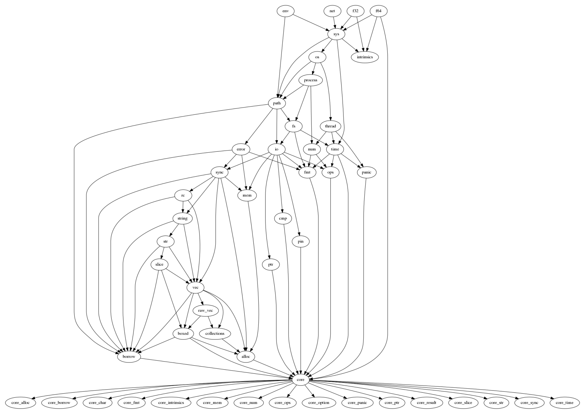

*Рисунок 1.1: Зависимости пакетов Rust*

Изображение на рисунке представляет собой упрощённый граф зависимостей библиотек Rust. Оно создано для того, чтобы показать, как устроен Rust как язык и как взаимосвязаны библиотеки этого языка. Эти библиотеки считаются фактическими стандартами Rust, причём некоторые из них являются фундаментальными и служат зависимостями для остальных библиотек.

Анализ стандартных библиотек Rust показал, что их можно разделить на три уровня: core, alloc и std. Каждый уровень опирается на предыдущий: std образует верхний уровень, alloc находится посередине, а core служит наиболее критичным уровнем. Модуль core отвечает за определение и реализацию базовых понятий синтаксиса Rust, таких как переменные, числа, символы и логические типы. Это те фундаментальные понятия, которые новички осваивают при изучении основ Rust.

<a id="ch01-1-4-14-проект-генератор-паролей"></a>

### 1.4.14 Проект: генератор паролей

В предыдущих разделах мы рассмотрели множество базовых понятий Rust. Теперь применим их к всеобъемлющему проекту. В этом проекте читатели научатся организовывать код проекта на Rust, импортировать модули, использовать различные аннотации, писать тесты и создавать инструменты командной строки. В эпоху интернета людям приходится помнить множество учётных записей и паролей. К сожалению, запомнить уникальный пароль для каждой учётной записи непросто, и люди зачастую задают похожие или одинаковые пароли, подвергая себя риску взлома. Хотя программы для управления паролями могут помочь, зависимость от чужой программы для хранения собственных паролей вызывает у вас определённое беспокойство. Чтобы решить эту проблему, автор создал PasswdGenerator — инструмент командной строки, который генерирует пароли длиной не менее 16 символов, выглядящие как случайные строки, например 9KbAM4QWMCcyXAar. PasswdGenerator может генерировать сложные пароли стандартной длины 16, управляя параметром seed, а параметр length позволяет регулировать длину пароля. Этот инструмент упрощает генерацию различных паролей для всевозможных учётных записей, позволяя пользователю ввести цифру или символ, известный только ему, чтобы получить сложный пароль. С помощью PasswdGenerator автор сгенерировал различные пароли для всех своих учётных записей и, поскольку seed придумал сам, не беспокоился о том, что забудет его. PasswdGenerator используется уже несколько лет, и автор даже не знает своих паролей от учётных записей WeChat, Alipay, Twitter, Youtube, Github и т. д. PasswdGenerator — это инструмент командной строки, способ использования которого аналогичен инструментам командной строки в Unix-подобных системах. Поэтому первое его применение выглядит как «PasswdGenerator -h» или «PasswdGenerator –help».

```text
shieber@kew $ PasswdGenerator -h
PasswdGenerator 0.1.0
A simple password generator for any account
USAGE:
    PasswdGenerator [OPTIONS] --seed <SEED>
OPTIONS:
    -h, --help
                             Prints help information
    -l, --length <LENGTH>
                             Length of password [default: 16]
    -s, --seed <SEED>
                             Seed to generate password
    -V, --version
                             Prints version information
```

Раздел USAGE содержит инструкции по использованию инструмента, а раздел OPTIONS отображает управляющие параметры.

```text
shieber@kew $ PasswdGenerator -s wechat
wechat: GQnaoXobRwrgW21A
```

Вывод инструмента PasswdGenerator начинается с короткой строки seed, например «wechat», которую можно дополнить префиксом или суффиксом, чтобы связать её с конкретной учётной записью. Seed служит указанием на то, что пароль был сгенерирован именно для этой учётной записи.

```text
shieber@kew $ PasswdGenerator -s wechat -l 20
wechat: GQnaoXobRwrgW21Ac2Pb
```

Длина пароля управляется параметром «-l». Если этот параметр не задан, длина пароля по умолчанию составляет 16 символов, чего достаточно в подавляющем большинстве случаев. Для обработки аргументов командной строки можно использовать библиотеку clap, как показано ниже.

```rust
use clap::Parser;
/// A simple password generator for any account
#[derive(Parser, Debug)]
#[clap(version, about, long_about= None)]
struct Args {
    /// Seed to generate password
    #[clap(short, long)]
    seed: String,
    /// Length of password
    #[clap(short, long, default_value_t = 16)]
    length: usize,
}
```

«seed» и «length» — это два аргумента командной строки, у каждого из которых есть краткая и полная формы, причём «length» имеет значение по умолчанию 16. Аргументы командной строки можно получить, вызвав Args::parse(). После получения аргументов следующим шагом будет генерация пароля. Мой подход заключался в использовании комбинации алгоритма хеширования и кодирования base64. Хотя существует множество типов алгоритмов хеширования и различных библиотек для вычисления хешей, практично написать алгоритм хеширования самостоятельно. Здесь я выбрал простые числа Мерсена для генерации хеш-значений. Для вычисления хеш-значения ASCII-код каждого символа seed умножается на соответствующее значение индекса, а результат берётся по модулю простого числа Мерсена 127. Затем остаток возводится в третью степень, и получается хеш-значение seed. Простые числа Мерсена — это простые числа вида Mn = 2n −1, где n также является простым числом. Хотя 2n−1 не всегда является простым числом, как, например, для простых чисел 11, 23 и 29, простые числа Мерсена обладают свойством, что и n, и Mn должны быть простыми, что делает их пригодными для вычисления хеш-значения в нашем случае. Ниже приведены некоторые примеры простых чисел Мерсена: 3, 7, 31 и 127, причём 127 — четвёртое простое число Мерсена.

```text
No
         n
                 Mn
1
         2
                 3
2
         3
                 7
3
         5
                 31
4
         7
                 127
5
         13
                 8191
6
         17
                 131071
7
         19
                 524287
8
         31
                 2147483647
9
         61
                 2305843009213693951
10
         89
                 618970019642690137449562111
```

Один из способов преобразовать хеш-значение в строку — замена символов. Сначала от хеш-значения берётся остаток по модулю длины строки фиксированной длины (пароля), и полученный остаток используется как индекс для получения символа. Циклическое повторение этого процесса порождает строку символов, которую можно соединить для формирования пароля. Для большей сложности seed можно разбить и соединить с полученным паролем.

```rust
// conbine seed and passwd
let interval = passwd.clone();
for c in seed.chars() {
    passwd.push(c);
    passwd += &interval;
}
```

Чтобы пароль стал пригодным для использования, любые недопустимые символы в строке пароля можно преобразовать в кодировку Base64, использующую 64 видимых символа. Кроме того, символы «+» и «/» в Base64 можно заменить на «*» в пароле.

```text
// encode passwd (base64)
passwd = encode(passwd);
passwd = passwd.replace("+", "*").replace("/", "*");
```

Если пароль всё ещё недостаточно длинный, его можно циклически дописать в самого себя и обернуть seed и паролем с помощью format, а затем вернуть.

```rust
let interval = passwd.clone();
while passwd.len() < length {
    passwd += &interval;
}
format!("{}: {}", seed, &passwd[..length])
```

Инструмент использует три компонента: крейт «hash» для вычисления хеш-значения по простым числам Мерсена, крейт «encryptor» для генерации пароля и главный модуль для получения аргументов командной строки. Главный модуль вызывает функцию «generate_password» из крейта «encryptor», которая, в свою очередь, вызывает функцию «mersenne_hash» из крейта «hash» для вычисления хеш-значения. Для организации кода можно использовать механизм рабочего пространства Cargo, создав соответствующие крейты с указанием их имён. Первый шаг — создать каталог и перейти в него.

```text
shieber@kew $ mkdir PasswdGenerator && cd PasswdGenerator
```

Затем нужно написать файл «Cargo.toml», определяющий имена создаваемых крейтов.

```text
[workspace]
members = [
    "hash",
    "encryptor",
    "main",
]
```

После этого можно использовать «cargo», чтобы создать три крейта. Обратите внимание, что для создания библиотеки и главной программы следует использовать разные параметры.

```text
shieber@kew $ cargo new hash --lib
    Created library hash package
shieber@kew $ cargo new encryptor --lib
    Created library encryptor package
shieber@kew $ cargo new main
    Created binary (application) main package
```

После создания структура каталогов должна выглядеть следующим образом.

```text
.
|-- Cargo.toml
|-- encryptor
|   |-- Cargo.toml
|   |-- src
|
        |-- lib.rs
|-- hash
|   |-- Cargo.toml
|   |-- src
|
        |-- lib.rs
|-- main
    |-- Cargo.toml
    |-- src
        |-- main.rs
6 directories, 7 files
```

В каждом крейте модули необходимо экспортировать для использования главной программой. Например, в библиотеке «hash» можно реализовать функцию «mersenne_hash» в файле «merhash.rs» и экспортировать её в «lib.rs». Аналогично, в библиотеке «encryptor» можно реализовать функцию генерации паролей в файле «password.rs» и экспортировать её в «lib.rs». Файлы «lib.rs» каждого крейта следует использовать только для экспорта функций. Функция mersenne_hash может быть инкапсулирована в merhash.rs, а функция генерации паролей — в password.rs. Итоговая структура каталогов выглядит так:

```text
|-- Cargo.toml
|-- encryptor
|   |-- Cargo.toml
|   |-- src
|
        |-- lib.rs
|
        |-- password.rs
|-- hash
|   |-- Cargo.toml
|   |-- src
|
        |-- lib.rs
|
        |-- merhash.rs
|-- main
    |-- Cargo.toml
    |-- src
        |-- main.rs
6 directories, 9 files
```

Важно отметить, что библиотека «hash» не зависит от внешних библиотек и может быть реализована первой.

```rust
// hash/src/lib.rs

pub mod merhash; // export module merhash

#[cft(test)] // test module
mod tests {
```

```rust
    use crate::merhash::mersenne_hash;

    #[test]
    fn mersenne_hash_works() {
        let seed = String::from("jdxjp");
        let hash = mersenne_hash(&seed);
        assert_eq!(2000375, hash);
    }
}
```

Затем реализуем merhash.

```rust
// hash/src/merhash.rs

//! Mersenne Hash
//!
/// calculate hash value with mersenne prime 127
///
/// # Example
/// use hash::merhash::mersenne_hash;
///
/// let seed = "jdxjp";
/// let hash = mersenne_hash(&seed);
/// assert_eq!(2000375, hash);
pub fn mersenne_hash(seed: &str) -> usize {
    let mut hash: usize = 0;

    for (i, c) in seed.chars().enumerate() {
        hash += (i + 1) * (c as usize);
    }

    (hash % 127).pow(3) - 1
}
```

Чтобы код был хорошо документирован и удобен в сопровождении, по всему проекту используются комментарии документации и комментарии модулей. В комментарии документации включены и тесты, что очень удобно для тестирования и последующего сопровождения документации. Для завершения библиотеки «encryptor» нам понадобится только внешняя библиотека «base64». Кроме того, для обработки ошибочных ситуаций подключается библиотека «anyhow». Для этого открываем файл «Cargo.toml» в каталоге «encryptor» и добавляем необходимые зависимости в раздел «[dependencies]», включая библиотеки «anyhow» и «base64», а также ранее написанную библиотеку «hash».

```text
[package]
name = "encryptor"
authors = ["shieber"]
version = "0.1.0"
edition = "2021"

[dependencies]
anyhow = "1.0.56"
base64 = "0.13.0"
hash = { path = "../hash" }
```

Ниже показана реализация модуля «password.rs».

```rust
// encryptor/src/lib.rs

pub mod password; // export module password

// encryptor/src/password.rs
use anyhow::{bail, Error, Result};
use base64::encode;
use hash::merhash::mersenne_hash;

/// crypto(length=100), you can exchange/add/delete characters
const CRYPTO: &str = "!pqHr$*+ST1Vst_uv:?wWS%X&Y-/Z01_2.34<ABl
9ECo|x#yDE^F{GHEI[]JK>LM#NOBWPQ:RaKU@}cde56R7=8f/9gIhi,jkzmn";

/// Password generator with hash value, use hash value's high
/// power to get character from CRYPTO
///
/// #Example
/// use encryptor::password::generate_password;
/// let seed = "jdwnp";
/// let length = 16;
/// let passwd = generate_password(seed, length);
/// match passwd {
/// Ok(val) => println!("{:#?}", val),
/// Err(err) => println!("{:#?}", err),
/// }
pub fn generate_password(seed: &str, length: usize)
    -> Result<String, Error>
{
    // check password length
    if length < 6 {
        bail!("length must >= 6"); // return error
    }

    // calculate mer_hash
    let p = match length {
        6..=10 => 1,
        11..=15 => 2,
        16..=20 => 3,
        _ => 3,
    };
    let mut mer_hash = mersenne_hash(seed).pow(p);

    // calculate password by mer_hash
    let mut passwd = String::new();
    let crypto_len = CRYPTO.len();
    while mer_hash > 9 {
        let loc = mer_hash % crypto_len;
        let nthc = CRYPTO.chars()
                         .nth(loc)
                         .expect("Error while getting char!");
```

```rust
        passwd.push(nthc);
        mer_hash /= crypto_len;
    }

    // combine seed and passwd
    let interval = passwd.clone();
    for c in seed.chars() {
        passwd.push(c);
        passwd += &interval;
    }

    // encode passwd to base64
    passwd = encode(passwd);
    passwd = passwd.replace("+", "*").replace("/", "*");

    // length is not enough, use interval to fill
    let interval = passwd.clone();
    while passwd.len() < length {
        passwd += &interval;
    }

    // return first length characters as password
    Ok(format!("{}: {}", seed, &passwd[..length]))
}
```

В «Cargo.toml» главного модуля мы подключаем необходимые библиотеки и указываем, что имя пакета — «PasswdGenerator».

```text
[package]
name = "PasswdGenerator"
authors = ["shieber"]
version = "0.1.0"
edition = "2021"

[dependencies]
anyhow = "1.0.56"
clap = { version= "3.1.6", features= ["derive"] }
encryptor = { path = "../encryptor"}
```

Наконец, в функции main мы вызываем «encryptor» и структуру командной строки, чтобы сгенерировать пароли и вернуть их.

```rust
// passwdgenerate/src/main.rs

use anyhow::{bail, Result};
use clap::Parser;
use encryptor::password::generate_password;

/// A simple password generator for any account
#[derive(Parser, Debug)]
#[clap(version, about, long_about= None)]
struct Args {
    /// Seed to generate password
```

```rust
    #[clap(short, long)]
    seed: String,

    /// Length of password
    #[clap(short, long, default_value_t = 16)]
    length: usize,
}

fn main() -> Result<()> {
    let args = Args::parse();

    // seed must be longer than 4 characters
    if args.seed.len() < 4 {
        bail!("seed {} length must >= 4", &args.seed);
    }

    let (seed, length) = (args.seed, args.length);
    let passwd = generate_password(&seed[..], length);
    match passwd {
        Ok(val) => println!("{}", val),
        Err(err) => println!("{}", err),
    }

    Ok(())
}
```

После того как программа готова, скомпилируйте её командой «cargo build –release», чтобы получить инструмент командной строки «PasswdGenerator» в каталоге «target/release/». Его можно поместить в каталог «/usr/local/bin», чтобы использовать в любом месте системы. Разумеется, команда «cargo doc» также позволяет сгенерировать каталог «doc» с подробной документацией по проекту. На этом небольшом проекте читатели познакомились с организацией кода на Rust, использованием модулей, методами тестирования и стилем программирования. Хотя этот генератор паролей прост, для личного использования он полностью достаточен.

<a id="ch01-1-5-итоги"></a>

## 1.5 Итоги

В этой главе мы даём обзор основных понятий языка Rust. Сначала мы знакомимся с установкой инструментария Rust и кратко обобщаем некоторые учебные ресурсы. Затем мы повторяем основы Rust, охватывая переменные, функции, владение, времена жизни, обобщённые типы, трейты, умные указатели, обработку ошибок и системы макросов. После этого мы представляем всеобъемлющий проект, в котором средствами Rust реализуется инструмент командной строки. Хотя содержание этой главы сравнительно простое, без понимания перечисленных концепций невозможно создавать более сложные проекты на Rust. Читателям, которым потребуются дополнительные разъяснения, рекомендуется обращаться к официальной документации по Rust. К концу этой главы читатели получат общее представление о языке Rust. В следующих главах мы перейдём к изучению структур данных и алгоритмов.

---


<a id="ch02"></a>

<!--
  Файл изменён по сравнению с оригиналом проекта QMHTMY/RustBook:
  текст переведён на русский язык. Лицензия: Apache License 2.0.
  Оригинал: https://github.com/QMHTMY/RustBook
-->
# Информатика

<a id="ch02-2-1-цели"></a>

## 2.1 Цели

- Понимать основные идеи информатики.
- Понимать концепцию абстрактных типов данных.
- Повторить основы языка программирования Rust.

<a id="ch02-2-2-начало"></a>

## 2.2 Начало

В области вычислительной техники прочное понимание основ критически важно для эффективного решения задач. Однако даже при наличии такой базы решение некоторых задач всё ещё может быть непростым. Сложность задачи и соответствующего ей решения зачастую заслоняет ключевые идеи, необходимые для достижения результата. Кроме того, поскольку у задачи может быть несколько решений, каждое со своими ограничениями и логикой, попытка соединить структуру одной задачи с логикой решения другой может привести к затруднениям. Настоящая глава посвящена информатике, алгоритмам и структурам данных; в ней в частности рассматривается, почему изучение этих тем так важно. Понимая структуру и логику постановки задачи, мы можем осознаннее подходить к решению задач.

<a id="ch02-2-3-что-такое-информатика"></a>

## 2.3 Что такое информатика?

Определить информатику — задача непростая, и, возможно, связано это со словом «компьютер» в её названии. Однако информатика не ограничивается изучением одних лишь компьютеров: она охватывает изучение задач, решений и процесса выработки решений. Цель специалиста по информатике — создать алгоритм, то есть набор инструкций, решающий конкретный экземпляр задачи. Следование этому алгоритму позволяет решать аналогичные задачи за конечное время. Хотя информатику можно считать наукой об алгоритмах, важно понимать, что для некоторых задач алгоритмов не существует, — например, для NP-полных задач [9]. Несмотря на то что в настоящее время эти задачи не решаются, их исследование по-прежнему необходимо, поскольку их решение могло бы привести к технологическим прорывам. Как и в случае с «гипотезой Гольдбаха [10]», исследования в этой области дали множество инструментов. Поэтому информатику можно определить как изучение решений разрешимых задач и идей по неразрешимым задачам. Описывая задачи и решения, следует иметь в виду, что вычислимой называется задача, для которой существует алгоритм решения. Напротив, информатику можно определить как «изучение того, существует ли решение у вычислимых и невычислимых задач». Заметим, что в этом определении не употребляется слово «компьютер». Решения не зависят от машины и состоят из идей, независимо от того, используется ли компьютер.

Информатика занимается искусством решения задач, которое достигается средствами абстракции. Абстракция позволяет рассматривать задачи и их решения с логической точки зрения, не увязняя в физических деталях. Обычный пример этого — вождение автомобиля. Как водитель, вы взаимодействуете с автомобилем, чтобы добраться до пункта назначения, пользуясь функциями, предусмотренными его конструктором, такими как ключ, двигатель, передачи, тормоза, акселератор и руль. Эти функции представляют собой интерфейсы, которые упрощают процесс вождения. Автомобильный механик, напротив, смотрит на вещи иначе. Он понимает внутреннее устройство автомобиля, включая двигатель, трансмиссию, систему регулирования температуры и дворники. Эти подробности действуют на физическом уровне и происходят «под капотом». Аналогичным образом пользователи взаимодействуют с компьютером с логической точки зрения, используя такие программы, как почтовые клиенты, текстовые редакторы и медиаплееры. Специалисты по информатике, программисты и системные администраторы, напротив, работают на более низком уровне, понимая, как устроена операционная система, как настраивать сетевые протоколы и как писать сценарии управляющих функций. Ключевая идея, лежащая в основе обоих примеров, — абстракция. Скрывая сложные подробности системы, интерфейс упрощает взаимодействие пользователя с компьютером. Математические вычислительные функции Rust служат хорошим примером этого.

```rust
// sin_cos_function.rs

fn main() {
    let x: f32 = 1.0;
    let y = x.sin();
    let z = x.cos();
    println!("sin(1) = {y}, cos(1) = {z}");
    // sin(1) = 0.84147096, cos(1) = 0.5403023
}
```

Возможно, мы и не знаем, как вычисляются значения синуса и косинуса, но достаточно понимать, как пользоваться функцией. Кто-то уже реализовал алгоритм вычисления синуса и косинуса, и мы можем доверять тому, что функция вернёт правильный результат. В этом и состоит идея «чёрного ящика». Интерфейс описывает входные и выходные данные функции, а подробности алгоритма скрыты внутри.

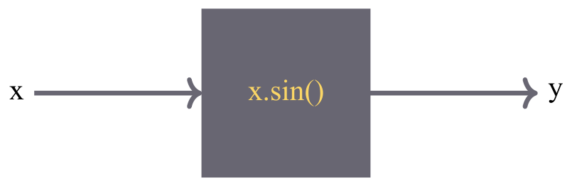

*Рисунок 2.1: вычисление значения синуса*

<a id="ch02-2-4-что-такое-программирование"></a>

## 2.4 Что такое программирование?

Программирование — это процесс преобразования алгоритмов в инструкции для компьютера. Алгоритм представляет собой набор шагов, который на основе данных и ожидаемых результатов порождает решение. Наличие решения — обязательное условие написания программы. Хотя информатика занимается не только программированием, само программирование является важнейшим навыком специалиста по информатике. Занимаясь программированием, человек мысленно организует структуру постановки задачи и чётко выражает её для эффективной обработки на компьютере. Чтобы представить процессы и данные, языки программирования должны предоставлять методы управления и различные типы данных. Методы управления позволяют записывать алгоритмы ясно и однозначно, причём минимальные требования к ним — последовательное выполнение, выбор и итеративное повторение. Все элементы данных в компьютере представлены в двоичной форме, а типы данных задают интерпретацию и представление этих двоичных данных. Типы данных являются абстракциями физического мира, служащими для представления объектов задачи.

Основанием для разработки алгоритмов служат лежащие в основе примитивные типы данных — целочисленные и предназначенные для чисел с плавающей точкой. Операции, которые можно выполнять над данными, также описываются типом данных. Например, наиболее фундаментальными операциями над числами являются сложение, вычитание, умножение и деление. Однако простых структур и типов данных языков программирования не всегда достаточно, чтобы представить сложные решения. Чтобы управиться с этой сложностью, требуются более разумные методы управления данными (структуры данных) и процессы выполнения операций (алгоритмы).

<a id="ch02-2-5-зачем-изучать-структуры-данных-и-абстрактные-типы-данных"></a>

## 2.5 Зачем изучать структуры данных и абстрактные типы данных?

Специалисты по информатике используют абстракцию, чтобы управлять сложностью задач и получать конкретные шаги по их решению. Абстракция позволяет им сосредоточиться на главном, не теряясь в деталях. Построение предметной модели позволяет компьютеру решать задачи более эффективно, а алгоритмы — описываться более единообразно.

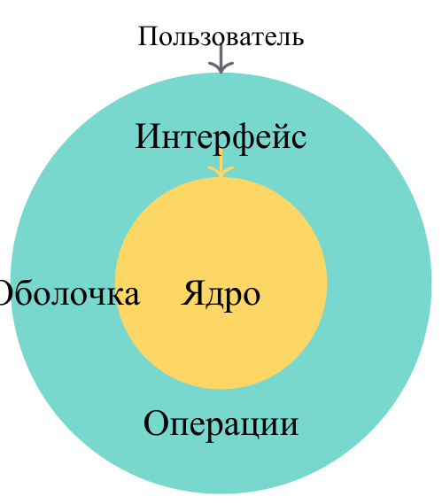

*Рисунок 2.2: диаграмма системных уровней*

Абстрактный тип данных (ADT) — это логическое описание способа представления данных и работы с ними. Он задаёт уровень абстракции, на котором важно только значение данных, но не их окончательная форма хранения. Благодаря такой упаковке данных детали реализации можно скрыть. Взаимодействие пользователя с интерфейсом представляет собой абстрактную операцию, тогда как сам пользователь и оболочка являются абстрактными типами данных. Хотя конкретные операции неизвестны, понять механизм их взаимодействия всё же возможно. В этом и состоит польза абстрактных типов данных при проектировании алгоритмов. Для реализации абстрактных типов данных используются примитивные типы данных, из которых с физической точки зрения строятся новые типы данных, именуемые структурами данных. Обычно существует множество различных способов реализации абстрактного типа данных, но разные реализации должны предоставлять одну и ту же физическую точку зрения. Это позволяет программистам менять детали реализации, не изменяя способ взаимодействия, а пользователям — продолжать сосредоточиваться на самой задаче. Общая логика абстрактных типов данных включает создание новых типов данных, получение данных, добавление, удаление, поиск, изменение, проверку на пустоту и вычисление размера. Например, чтобы реализовать очередь, логика её абстрактного типа данных должна как минимум включать: new(), is_empty(), len(), clear(), enqueue() и dequeue(). Как только известна конкретная операционная логика, реализация становится простой, и вариантов её реализации множество, пока существует эта абстрактная логика.

<a id="ch02-2-6-зачем-изучать-алгоритмы"></a>

## 2.6 Зачем изучать алгоритмы?

В вычислительном мире цель состоит в применении алгоритмов, эффективных с точки зрения скорости работы и расхода памяти. Однако некоторые задачи могут оказаться трудными, и ни один алгоритм не способен дать ответ в приемлемые сроки. В таких случаях важно различать задачи, имеющие решения, и задачи, решений не имеющие.

Следует также отличать задачи, имеющие решение, но требующие значительного времени или ресурсов. Как специалисты по информатике, мы должны оценивать и сравнивать различные решения, чтобы определить наиболее подходящее. Перенимать подходы к решению задач, применяемые другими, — эффективный способ развития собственных навыков. Изучая различные решения, мы получаем представление о том, как те или иные конструкции алгоритмов помогают нам браться за сложные задачи. Изучая разные алгоритмы, мы раскрываем их внутренние принципы и вырабатываем универсальный алгоритм, применимый в будущем к аналогичным задачам. Однако для одной и той же задачи разные люди могут предложить разные реализации алгоритма. Как мы видели ранее на примере вычисления синуса и косинуса, существует множество различных вариантов реализации. Если один алгоритм даёт тот же результат, что и другой, но за меньшее время, то, разумеется, он предпочтительнее.

<a id="ch02-2-7-итоги"></a>

## 2.7 Итоги

Настоящая глава подробно рассмотрела понятия информатики и абстрактных типов данных, дала чёткие определения и подчеркнула роль алгоритмов и структур данных. Абстрагируя типы данных, мы избавляемся от конкретной логики реализации и операций, что позволяет чётче очертить границы между структурами данных и алгоритмами и заметно упростить процесс проектирования алгоритмов. В следующих главах мы продолжим использовать абстрактные типы данных для проектирования различных структур данных.

---


<a id="ch03"></a>

<!--
  Файл изменён по сравнению с оригиналом проекта QMHTMY/RustBook:
  текст переведён на русский язык. Лицензия: Apache License 2.0.
  Оригинал: https://github.com/QMHTMY/RustBook
-->
# Анализ алгоритмов

<a id="ch03-3-1-цели"></a>

## 3.1 Цели

- Понимание важности анализа алгоритмов.
- Освоение проведения тестов производительности программ, написанных на Rust.
- Умение использовать нотацию O для анализа сложности алгоритмов.
- Понимание результатов анализа в нотации O для структур данных Rust, таких как массивы.
- Понимание того, как реализации структур данных в Rust влияют на анализ алгоритмов.

<a id="ch03-3-2-что-такое-анализ-алгоритмов"></a>

## 3.2 Что такое анализ алгоритмов?

В главе 2 мы определили алгоритм как набор инструкций, решающих конкретную задачу путём получения ожидаемого результата для заданного входа. Программа — это тот же алгоритм, но записанный на языке программирования. Поскольку программисты используют разные языки программирования и обладают разным уровнем знаний, разные программы могут описывать один и тот же алгоритм. Студенты, только начинающие изучать информатику, могут сравнивать написанные ими программы с программами других. Чтобы изучить различия между программами, решающими одну и ту же задачу, рассмотрим функции `sum_of_n` и `tik_tok`, которые обе вычисляют сумму первых n целых чисел. Первая функция использует переменную-аккумулятор, инициализированную значением 0, и перебирает n целых чисел, прибавляя каждое значение к аккумулятору. Функция `tik_tok` делает то же самое, но использует невнятные имена идентификаторов и лишнее присваивание.

```rust
// sum_of_n.rs
fn sum_of_n(n: i32) -> i32 {
    let mut sum: i32 = 0;
    for i in 1..=n { sum += i; }
    sum
}

// tiktok.rs
fn tiktok(tik: i32) -> i32 {
    let mut tok = 0;
    for k in 1..=tik {
        let ggg = k;
        tok = tok + ggg;
    }
    tok
}
```

При оценке этих двух функций ответ во многом зависит от критериев, которые применяет читатель. Если на первом месте стоит читаемость, то лучше `sum_of_n`. Однако в этой книге мы уделяем больше внимания самим инструкциям алгоритмов, а чистый код в предмет обсуждения не входит. Анализ алгоритмов сравнивает объём ресурсов, которые используются алгоритмами. Алгоритм считается лучше другого алгоритма, если он использует меньше ресурсов или расходует их более эффективным образом. При сравнении функций `sum_of_n` и `tik_tok` они выглядят очень похожими с точки зрения расхода ресурсов. Выявление же ресурсов, задействованных при вычислениях, имеет самое решающее значение и требует рассмотрения как с временной, так и с пространственной перспективы.

- Пространство, используемое алгоритмом, определяется потреблением им памяти, которое обычно зависит от размера и характера задачи. Однако у некоторых алгоритмов есть особые требования к памяти.
- Время выполнения алгоритма — это время, которое требуется алгоритму для выполнения всех своих шагов.

Например, время выполнения функции `sum_of_n` можно проанализировать с помощью теста производительности. В Rust время выполнения кода можно вычислить, зафиксировав системное время непосредственно до и непосредственно после выполнения функции. Функция `SystemTime`, доступная в модуле `std::time`, при вызове возвращает текущее системное время, а затем позволяет получить время, прошедшее с момента этого вызова. Вызывая эту функцию в начале и в конце выполнения функции, мы получаем время её выполнения.

```rust
// static_func_call.rs

use std::time::SystemTime;

fn sum_of_n(n: i64) -> i64 {
    let mut sum: i64 = 0;
    for i in 1..=n {
        sum += i;
    }
    sum
}

fn main() {
    for _i in 0..5 {
        let now = SystemTime::now();
        let _sum = sum_of_n(500000);
        let duration = now.elapsed().unwrap();
        let time = duration.as_millis();
        println!("func used {time} ms");
    }
}
```

Чтобы это проиллюстрировать, мы пять раз выполнили функцию `sum_of_n`, каждый раз вычисляя сумму первых 500 000 целых чисел и сумму первых 1 000 000 целых чисел. Результаты получились следующими:

```text
func used 10 ms
func used 6 ms
func used 6 ms
func used 6 ms
func used 6 ms
func used 17 ms
func used 12 ms
func used 12 ms
func used 12 ms
func used 12 ms
```

После сравнения результатов двух выполнений оказалось, что время, затрачиваемое функцией на выполнение, в основном одинаково. В среднем функция выполняется примерно за 6 миллисекунд. Первое выполнение занимает больше времени — 10 миллисекунд, — поскольку функции требуется инициализация и подготовка. Последующие четыре выполнения уже не требуют инициализации, и потому их времена точнее — вот почему необходимо выполнять алгоритм многократно. При вычислении суммы первых 1 000 000 целых чисел видно, что первое выполнение занимает больше времени, а последующие — ровно вдвое больше времени, чем вычисление суммы первых 500 000 целых чисел. Это показывает, что время выполнения алгоритма пропорционально объёму самих вычислений. Чтобы ещё глубже изучить эту идею, рассмотрим следующую функцию: она тоже вычисляет сумму первых n целых чисел, но использует математическую формулу ∑_{i=0}^{n} i = n(n + 1) / 2

для вычисления этой суммы.

```rust
// static_func_call2.rs
fn sum_of_n2(n: i64) -> i64 {
    n * (n + 1) / 2
}
```

Функция `sum_of_n` из файла `static_func_call.rs` изменена так, чтобы использовать эту формулу, и проводится тест производительности с тремя различными значениями n (100 000, 500 000, 1 000 000). Каждое вычисление повторяется пять раз, и фиксируется среднее время выполнения. Результаты получились следующими:

```text
func used 1396 ns
func used 1313 ns
func used 1341 ns
```

В приведённом выводе следует отметить два важных момента. Во-первых, зафиксированное время выполнения задано в наносекундах, что значительно меньше, чем в предыдущих примерах. Времена выполнения всех трёх вычислений составляют примерно 0,0013 миллисекунды, то есть на несколько порядков величины меньше прежних 6 миллисекунд. Во-вторых, время выполнения не зависит от n. По мере увеличения n время вычисления остаётся прежним, что говорит о том, что вычисление практически не зависит от n. Этот тест производительности показывает, что итеративное решение `sum_of_n` выполняет больше работы, поскольку часть шагов программы повторяется, — вот почему оно занимает больше времени. Кроме того, время выполнения итеративного решения растёт вместе с n. Следует также отметить, что запуск подобных функций на разных компьютерах или с использованием разных языков программирования может давать несколько разные результаты. Упомянутое в тексте значение 1341 наносекунды относится к тому компьютеру, который был использован в данном исследовании: это Lenovo Legion R7000P с 16-ядерным процессором AMD R7-4800H. На более старых компьютерах выполнение `sum_of_n2` может занять больше времени. Необходимо найти лучший способ описывать время выполнения алгоритмов. Хотя тесты производительности измеряют фактическое время выполнения программы, они не дают полезной меры, поскольку время выполнения зависит от конкретной машины, а кроме того, между миллисекундами и наносекундами есть перевод порядков величины. Нам нужна такая мера, которая не зависит от используемой программы или компьютера и с помощью которой можно сравнивать эффективность разных реализаций алгоритмов. Нотация O — хороший метод измерения алгоритмической эффективности в области анализа алгоритмов; точно так же, как ускорение измеряет изменение скорости за секунду, она позволяет сопоставлять алгоритмы между собой.

<a id="ch03-3-3-анализ-в-нотации-o"></a>

## 3.3 Анализ в нотации O

Чтобы оценить производительность алгоритма, необходимо количественно выразить число выполняемых операций и требуемое пространство хранения — независимо от конкретной программы или компьютера. Для алгоритма суммирования хорошей мерой служит подсчёт числа выполняемых инструкций. В функции `sum_of_n` есть одна инструкция присваивания (`the_sum = 0`) и n инструкций сложения (`the_sum += i`), поэтому число инструкций функции равно n + 1. Используемое пространство хранения — это две переменные, n и sum, поэтому их количество равно двум.

Функцией T мы обозначаем общее число выполнений, которым измеряется временная сложность алгоритма: T(n) = 1 + n. Параметр n обозначает размер задачи, а T(n) — время, затрачиваемое на решение задачи с размером не меньше n. Использование n для обозначения размера задачи осмысленно для функции суммирования: сложить 100 000 целых чисел — большая задача, чем сложить 1000 целых чисел, а значит, и времени она занимает больше. Наша цель — показать, как время выполнения алгоритма меняется в зависимости от размера задачи. Для измерения пространственной сложности алгоритма мы используем функцию S, которая обозначает суммарный объём потребляемой памяти: S(n) = 2. Параметр n по-прежнему обозначает размер задачи, но в отличие от T(n) функция S(n) не зависит от n. Чтобы проанализировать производительность алгоритма, важно определить главные составляющие его функции временной сложности T(n) и функции пространственной сложности S(n), а не просто подсчитывать число операций и расход памяти. По мере роста размера задачи некоторые составляющие этих функций становятся определяющими. Быстро растущие по n части этих функций описываются нотацией O, обозначаемой как O(f(n)). Функция f(n) означает главную часть T(n) или S(n). Например, в предыдущем примере T(n) = n + 1. По мере увеличения n постоянная 1 становится менее существенной. Поэтому время выполнения T(n) можно приближённо записать в виде O(T(n)) = O(n + 1) = O(n). Безусловно, постоянная 1 важна для T(n), однако её вклад становится пренебрежимо малым, когда n велико. Однако при T(n) = n^3 + 1 (n = 1) отбрасывать постоянную 1 неразумно: это означало бы отбросить значительную часть времени выполнения. В этом случае для малых значений n уместно использовать O(T(n)) = O(n^3 + 1). Но по мере увеличения n единица становится менее существенной, и T(n) можно приближённо записать как O(T(n)) = O(n^3). Для S(n), поскольку это константа, O(S(n)) = O(2) = O(1). Нотация O передаёт лишь порядок величины, то есть её порядок роста. Поэтому, хотя фактическая сложность S(n) равна O(2), при записи результата мы используем O(1). Пусть число операций некоторого алгоритма задаётся функцией T(n) = 6n^2 + 37n + 996. Когда n мало (например, 1 или 2), постоянный член 996 может казаться основной частью функции. Однако по мере роста n значимость члена n^2 возрастает. Более того, когда n становится очень большим, два других члена в итоговом результате становятся пренебрежимо малыми по сравнению с главным. Поэтому T(n) можно приближённо записать, отбросив остальные члены и оставив только 6n^2. Кроме того, коэффициент 6 также становится несущественным по мере роста n. Таким образом, мы говорим, что T(n) имеет порядок сложности n^2, то есть O(n^2), и никакой другой член на это не влияет. Однако сложность некоторых алгоритмов зависит от конкретных значений данных, а не от размера задачи. Для таких алгоритмов производительность следует характеризовать сценариями лучшего, худшего или среднего случая. Худший случай — это конкретный набор данных, при котором производительность алгоритма оказывается особенно низкой, тогда как на других наборах данных тот же алгоритм может давать значительно отличающиеся результаты. В большинстве случаев эффективность выполнения алгоритма лежит между двумя крайностями — худшим и лучшим случаями, — то есть соответствует именно среднему случаю. Поэтому программистам важно понимать эти различия и не поддаваться на вводящее в заблуждение впечатление от одного-единственного случая. При изучении алгоритмов некоторые типичные функции порядка встречаются постоянно, что показано в таблице и на рисунке ниже. Чтобы определить, какая из этих функций является главной частью, нужно посмотреть, как они соотносятся друг с другом по мере роста n.

**Таблица 3.1: Функции сложности**

| O(1) | O(log n) | O(n) | O(n log n) | O(n^2) | O(n^3) | O(2^n) |
| --- | --- | --- | --- | --- | --- | --- |
| постоянная | логарифмическая | линейная | линейно-логарифмическая | квадратичная | кубическая | степенная экспоненциальная |

Рисунок ниже иллюстрирует рост различных функций. При малых значениях n трудно различить, какая именно функция превосходит остальные. Однако по мере увеличения n взаимные соотношения функций становятся ясными. Стоит отметить, что при n = 10 значение 2^n превышает n^3, хотя на графике этот случай не показан. Рисунок также подчёркивает различия между разными порядками величины. В общем случае при n > 10 имеем O(2^n) > O(n^3) > O(n^2) > O(n log n) > O(n) > O(log n) > O(1). Эта информация полезна при проектировании алгоритмов, поскольку позволяет вычислять сложность алгоритма. Если мы определили, что, например, сложность алгоритма близка к O(2^n), то мы понимаем, что такой алгоритм непригоден для практического применения, и можем заняться его оптимизацией ради достижения лучшей производительности.

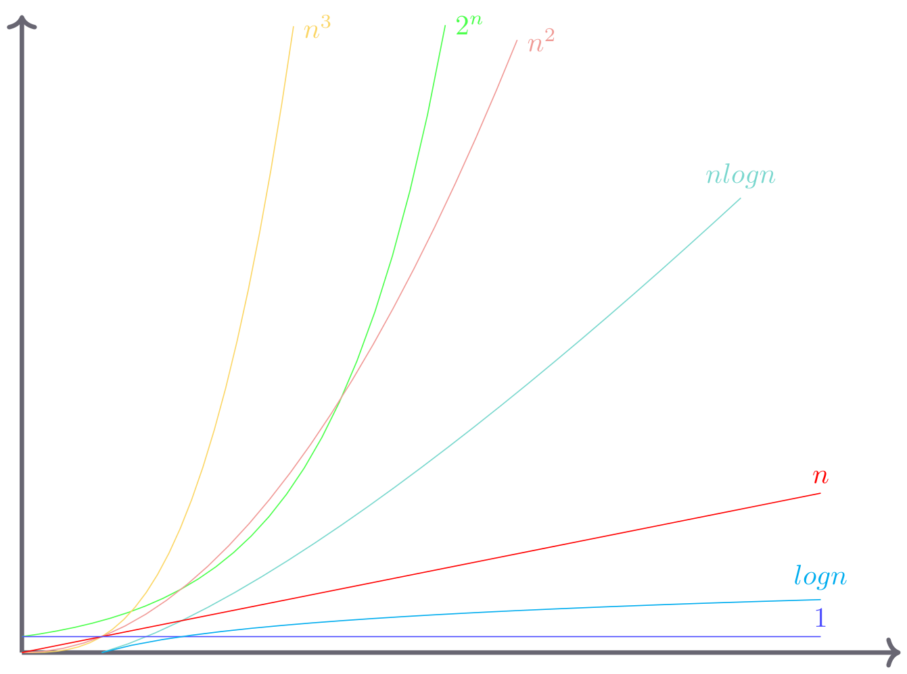

*Рисунок 3.1: Кривая сложности*

Выше мы рассмотрели временную и пространственную сложность, однако чаще всего на первом плане стоит именно временная сложность, поскольку пространство, как правило, трудно оптимизировать. Например, пространственная сложность входного массива ограничена изначально, но разные алгоритмы могут давать значительно разное время работы с этим массивом. Кроме того, по мере того как хранение данных становится дешевле и доступнее, время превращается в важнейший фактор, потому что его, в отличие от объёма памяти, нельзя увеличить. Поэтому большинство анализов сложности в этой книге посвящено временной сложности, если не указано иное. В приведённом ниже коде используются только сложение, вычитание, умножение и деление. С его помощью мы применим наше новое понимание анализа сложности алгоритмов.

```rust
// big_o_analysis.rs
fn main() {
    let a = 1; let b = 2;
    let c = 3; let n = 1000000;

    for i in 0..n {
        for j in 0..n {
            let x = i * i;
            let y = j * j;
            let z = i * j;
         }
    }

    for k in 0..n {
        let w = a*b + 45;
        let v = b*b;
    }

    let d = 996;
}
```

Временная сложность приведённого выше кода равна O(n^2), и это можно получить, проанализировав сам код. Во-первых, время, затрачиваемое на операции присваивания a, b, c и n, — постоянная величина 4. Затем второй член равен 3n^2 и возникает из-за выполнения трёх инструкций n^2 раз из-за вложенных циклов. Третий член равен 2n, поскольку две инструкции выполняются итеративно n раз. Наконец, четвёртый член — постоянная 1, соответствующая заключительной инструкции присваивания d = 996. Таким образом, функция, определяющая число операций, имеет вид T(n) = 4 + 3n^2 + 2n + 1 = 3n^2 + 2n + 5. Рассмотрев показатели степеней, мы видим, что наиболее значим член n^2, что говорит о том, что временная сложность этого кода равна O(n^2).

<a id="ch03-3-4-определение-анаграмм"></a>

## 3.4 Определение анаграмм

Задача проверки того, являются ли две строки перестановками друг друга, послужит нам примером, демонстрирующим различные уровни сложности. Перестановкой называется ситуация, когда одна строка, s1, является перегруппировкой другой строки, s2. Например, `heart` и `earth` являются перестановками друг друга, как и `rust` и `trus`. Будем считать, что обе строки имеют одинаковую длину и состоят только из 26 строчных букв. Наша цель — написать функцию, которая принимает на вход две строки и возвращает, являются ли они перестановками друг друга или нет.

<a id="ch03-3-4-1-полный-перебор"></a>

### 3.4.1 Полный перебор

Наиболее наивное решение этой задачи — применить полный перебор и проверить все возможные перестановки s1, одну за другой. Этот метод крайне требователен к ресурсам: он потребляет и время, и память одновременно. При генерации всех возможных строк из s1 для первой позиции есть n вариантов, для второй — n − 1, для третьей — n − 2 и так далее, что в итоге даёт n! = n × (n − 1) × (n − 2) × ... × 3 × 2 × 1 возможных вариантов. Хотя некоторые из полученных строк могут оказаться дубликатами, программа не может знать об этом заранее, поэтому она всё равно сгенерирует n! строк. Например, если длина s1 равна 20, то возможных строк будет 20! = 2 432 902 008 176 640 000. Если обрабатывать по одной возможной строке в секунду, то на исчерпание всего списка уйдёт 77 146 816 596 лет. Более того, n! растёт даже быстрее, чем n^2, что делает полный перебор непригодным решением ни для учебного, ни для реального программного проекта. Тем не менее важно знать о его существовании и прилагать усилия к тому, чтобы по возможности избегать подобных ситуаций.

<a id="ch03-3-4-2-вычеркивание"></a>

### 3.4.2 Вычёркивание

Более эффективное решение этой задачи состоит в том, чтобы для каждого символа первой строки проверить, присутствует ли такой же символ во второй строке. Если будут найдены все символы, то две строки являются перестановками друг друга. Для того чтобы отметить символ, который уже проверен, мы можем заменить его символом пробела (’ ’).

```rust
// anagram_solution2.rs

fn anagram_solution2(s1: &str, s2: &str) -> bool {
    if s1.len() != s2.len() {
        return false;
    }

    // put the characters of s1 and s2 into
    // vec_a and vec_b respectively
    let mut vec_a = Vec::new();
    let mut vec_b = Vec::new();
    for c in s1.chars() {
        vec_a.push(c);
    }
    for c in s2.chars() {
```

```rust
        vec_b.push(c);
    }

    // index: pos1, pos2
    let mut pos1: usize = 0;
    let mut pos2: usize;

    // loop controlling
    let mut is_anagram = true;
    let mut found: bool;
    while pos1 < s1.len() && is_anagram {
        pos2 = 0;
        found = false;
        while pos2 < vec_b.len() && !found {
            if vec_a[pos1] == vec_b[pos2] {
                found = true;
            } else {
                pos2 += 1;
            }
        }

        // replace a character with ' '
        if found {
            vec_b[pos2]= ' ';
        } else {
            is_anagram = false;
        }

        // tackle the next character of s1
        pos1 += 1;
    }

    is_anagram
}

fn main() {
    let s1 = "rust";
    let s2 = "trus";
    let result = anagram_solution2(s1, s2);
    println!("s1 and s2 is anagram: {result}");
    // s1 and s2 is anagram: true
}
```

Анализируя этот алгоритм, мы замечаем, что каждый символ s1 сравнивается со всеми символами s2, а значит, на каждый символ s1 приходится не более n сравнений. В результате этого n позиций списка `blist` будут посещены по одному разу, чтобы сопоставить символы, взятые из s1. Общее число посещений можно выразить как сумму целых чисел от 1 до n.

1 + 2 + · · · + n = ∑_{i=1}^{n} i

= n(n + 1) / 2

= n^2 / 2 + n / 2   (3.1)

Временная сложность этого алгоритма равна O(n^2), поскольку при росте n определяющим становится член n^2. Это намного лучше, чем алгоритм полного перебора, сложность которого равна O(n!).

<a id="ch03-3-4-3-сортировка-и-сравнение"></a>

### 3.4.3 Сортировка и сравнение

Альтернативное решение для перемешанных строк состоит в том, чтобы воспользоваться тем фактом, что даже если s1 и s2 различаются, они состоят ровно из одних и тех же символов. Поэтому можно отсортировать каждую строку в алфавитном порядке от a до z, и если две отсортированные строки совпадут друг с другом, то исходные строки являются перемешанными.

```rust
// anagram_solution3.rs

fn anagram_solution3(s1: &str, s2: &str) -> bool {
    if s1.len() != s2.len() {
        return false;
    }

    // put the characters of s1 and s2 into
    // vec_a and vec_b respectively then sorting
    let mut vec_a = Vec::new();
    let mut vec_b = Vec::new();
    for c in s1.chars() {
        vec_a.push(c);
    }
    for c in s2.chars() {
        vec_b.push(c);
    }
    vec_a.sort();
    vec_b.sort();

    // compare vec_a and vec_b, if thers is any mismatch of
    // any character then break the loop
    let mut pos: usize = 0;
    let mut is_anagram = true;
    while pos < vec_a.len() && is_anagram {
        if vec_a[pos] == vec_b[pos] {
            pos += 1;
        } else {
            is_anagram = false;
        }
    }

    is_anagram
}

fn main() {
    let s1 = "rust";
    let s2 = "trus";
    let result = anagram_solution3(s1, s2);
    println!("s1 and s2 is anagram: {result}");
    // s1 and s2 is anagram: true
}
```

На первый взгляд, временная сложность алгоритма, проверяющего перемешанные строки, кажется равной O(n), поскольку в нём всего один цикл `while`. Однако сложность вызова функции `sort()` не пренебрежимо мала: обычно она равна O(n^2) или O(n log n), а это означает, что сложность нашего алгоритма имеет тот же порядок величины, что и сложность алгоритмов сортировки, которые к ней приводят.

<a id="ch03-3-4-4-подсчет-и-сравнение"></a>

### 3.4.4 Подсчёт и сравнение

Предыдущие методы всегда создают `vec_a` и `vec_b`, что требует много памяти, когда s1 и s2 длинные. Чтобы решить эту задачу, можно использовать два списка длиной 26, подсчитывая в них частоту каждого символа в s1 и s2. Этот подход предполагает несколько итераций, но итерации не вложены друг в друга. Более того, третья итерация, сравнивающая два списка частот, требует всего 26 итераций, поскольку строчных букв лишь 26. Таким образом, временная сложность этого алгоритма равна O(n), где n — это длина s1 или s2. Это алгоритм с линейной временной сложностью, и обе его характеристики — как по времени, так и по памяти — достаточно эффективны.

```rust
// anagram_solution4.rs

fn anagram_solution4(s1: &str, s2: &str) -> bool {
    if s1.len() != s2.len() { return false; }

    // with the size of 26, c1 and c2 are storage
    // for saving ASCII charaters
    let mut c1 = [0; 26];
    let mut c2 = [0; 26];
    for c in s1.chars() {
        let pos = (c as usize) - 97; // 97: ASCII value of a
        c1[pos] += 1;
    }
    for c in s2.chars() {
        let pos = (c as usize) - 97;
        c2[pos] += 1;
    }

    // compare the value of ASCII
    let mut pos = 0;
    let mut is_anagram = true;
    while pos < 26 && is_anagram {
        if c1[pos] == c2[pos] {
            pos += 1;
        } else {
            is_anagram = false;
        }
    }

    is_anagram
}

fn main() {
    let s1 = "rust";
    let s2 = "trus";
    let result = anagram_solution4(s1, s2);
    println!("s1 and s2 is anagram: {result}");
    // s1 and s2 is anagram: true
}
```

Однако если s1 и s2 короткие и используют не все 26 символов, этот алгоритм жертвует некоторым объёмом памяти в пользу экономии времени. При выборе того или иного алгоритма важно сознательно идти на компромисс между памятью и временем и учитывать те реальные сценарии, с которыми столкнётся ваш алгоритм на практике.

<a id="ch03-3-5-производительность-структур-данных-в-rust"></a>

## 3.5 Производительность структур данных в Rust

<a id="ch03-3-5-1-скалярные-и-составные-структуры-данных"></a>

### 3.5.1 Скалярные и составные структуры данных

В этом разделе мы рассмотрим производительность базовых типов данных Rust в нотации O. Понимание производительности этих структур данных имеет решающее значение, поскольку именно они служат базовыми блоками в Rust, из которых строятся более сложные структуры данных. Базовые типы данных Rust делятся на две большие категории: на скалярные и на составные типы. Скалярные типы представляют одно значение, а составные типы являются комбинациями скалярных типов. В Rust есть четыре базовых скалярных типа: целочисленный, вещественный с плавающей точкой, логический и символьный. С другой стороны, в Rust есть два составных типа: кортеж и массив. Скалярные типы — это самые простые и самые тесно связанные с памятью примитивные типы, вычислительная эффективность которых, как правило, равна O(1). Составные типы, напротив, сложнее, и их сложность меняется в зависимости от объёма данных. Посмотрим на несколько примеров использования базовых типов данных.

```rust
let a: i8 = -2;
let b: f32 = 2.34;
let c: bool = true;
let d: char = 'a';

// tuple with various types
let x: (i32, f64, u8) = (200, 5.32, 1);
let xi32 = x.0;
let xf64 = x.1;
let xu8 = x.2;
```

Кортеж — это составная структура данных, объединяющая несколько значений разных типов и имеющая фиксированную длину. После объявления его длину нельзя ни увеличить, ни уменьшить. Индексация кортежа начинается с 0, а к его значениям можно обращаться напрямую, без промежуточных переменных, с помощью точечной нотации (`.`). Массивы, с другой стороны, должны иметь одинаковый тип у всех элементов, и после объявления их длину тоже нельзя ни увеличить, ни уменьшить.

```rust
let months = ["January","February","March","April",
              "May","June","July","August","September",
              "October","November","December"
             ];

let first_month = months[0]
let halfyear = &months[..6];

let mut monthsv = Vec::new();
for month in months { monthsv.push(month); }
```

В Rust есть и различные типы данных, образованные из скалярных и составных типов, — например, такие, как `Vec` и `HashMap`. `Vec` — это тип коллекции, подобный массиву, который позволяет добавлять элементы, уменьшать его размер и ограничивать его длину. Он обеспечивает гораздо большую масштабируемость и может использоваться везде, где используется массив.

<a id="ch03-3-5-2-структуры-данных-коллекций"></a>

### 3.5.2 Структуры данных коллекций

Типы коллекций в Rust делятся на линейные и нелинейные, построенные на базе скалярных и составных типов. К линейным типам коллекций относятся `String`, `Vec`, `VecDeque` и `LinkedList`, а к нелинейным — `HashMap`, `BTreeMap`, `HashSet`, `BTreeSet` и `BinaryHeap`. С этими типами коллекций связаны операции индексирования, добавления и удаления, и соответствующие сложности этих операций часто составляют O(1), O(n) и так далее, в зависимости от конкретного типа коллекции.

Тип `String` в Rust основан на `Vec`, что позволяет изменять `String` так же, как `Vec`. Чтобы использовать часть строки `String`, можно взять `&str` — срез типа `String`, к которому легко обращаться по индексу. Однако поскольку `&str` основан на `String`, изменить его нельзя: изменение среза изменило бы и данные в `String`, которые могут использоваться в другом месте. В Rust изменяемые строки представлены типом `String`, а неизменяемые — типом `&str`. `Vec` подобен спискам в других языках, а `VecDeque` расширяет `Vec`, поддерживая вставку данных в оба конца последовательности, что превращает его в двустороннюю очередь. `LinkedList` — это связный список; его используют, когда нужен `Vec` неизвестного размера. `HashMap` в Rust подобен словарям в других языках, а `BTreeMap` — это B-дерево, узлы которого содержат данные и указатели. Его часто используют для реализации баз данных, файловых систем и других приложений для хранения данных. `HashSet` и `BTreeSet` в Rust подобны коллекции `Set` в других языках, которые используются для записи значений, встретившихся ровно один раз. `HashSet` реализован на основе `HashMap`, используемой в качестве базовой структуры данных, а `BTreeSet` — на основе `BTreeMap`. `BinaryHeap` — это очередь с приоритетом, хранящая набор элементов, из которой в любой момент можно извлечь максимальное значение. Типы коллекций в Rust весьма эффективны, что видно из приведённых ниже таблиц, показывающих производительность различных структур данных. Наибольшая сложность этих структур данных равна O(n).

**Таблица 3.2: Временная сложность линейных составных типов**

| Тип | get | insert | remove | append | split_off |
| --- | --- | --- | --- | --- | --- |
| `Vec` | O(1) | O(n − i) | O(n − i) | O(m) | O(n − i) |
| `VecDeque` | O(1) | O(min(i, n − i)) | O(min(i, n − i)) | O(m) | O(min(i, n − i)) |
| `LinkedList` | O(min(i, n − i)) | O(min(i, n − i)) | O(min(i, n − i)) | O(1) | O(min(i, n − i)) |

**Таблица 3.3: Временная сложность нелинейных составных типов**

| Тип | get | insert | remove | predecessor | append |
| --- | --- | --- | --- | --- | --- |
| `HashMap` | O(1) | O(1) | O(1) | N/A | N/A |
| `HashSet` | O(1) | O(1) | O(1) | N/A | N/A |
| `BTreeMap` | O(log n) | O(log n) | O(log n) | O(log n) | O(n + m) |
| `BTreeSet` | O(log n) | O(log n) | O(log n) | O(log n) | O(n + m) |
| Тип | push | pop | peek | peek_mut | append |
| `BinaryHeap` | O(1) | O(log n) | O(1) | O(1) | O(n + m) |

<a id="ch03-3-6-итоги"></a>

## 3.6 Итоги

В этой главе был представлен метод анализа в нотации O для оценки сложности алгоритмов, который предполагает подсчёт числа шагов выполнения кода и определение максимального порядка величины. Затем мы рассмотрели сложность базовых типов данных Rust, а также типов коллекций. По результатам сравнения и анализа становится ясно, что встроенные в Rust скалярные и составные типы, равно как и типы коллекций, весьма эффективны. Кроме того, собственные структуры данных, реализованные на основе этих типов коллекций, тоже могут быть эффективными.

---


<a id="ch04"></a>

<!--
  Файл изменён по сравнению с оригиналом проекта QMHTMY/RustBook:
  текст переведён на русский язык. Лицензия: Apache License 2.0.
  Оригинал: https://github.com/QMHTMY/RustBook
-->
# Глава 4. Базовые структуры данных

<a id="ch04-4-1-цели"></a>

## 4.1 Цели

- Понимание абстрактных типов данных `Vec`, стек, очередь, дек и связный список
- Умение реализовать стек, очередь, дек и связный список средствами Rust
- Понимание производительности (сложности) базовых линейных структур данных
- Понимание форматов префиксных, инфиксных и постфиксных выражений
- Использование стека для вычисления постфиксного выражения и получения его значения
- Использование стека для преобразования инфиксных выражений в постфиксные
- Умение определять, какую структуру — стек, очередь, дек или связный список — следует использовать для конкретной задачи
- Умение реализовывать абстрактные типы данных в виде связных списков с использованием узлов и ссылок
- Умение сравнивать производительность собственной реализации `Vec` со встроенным в Rust `Vec`.

<a id="ch04-4-2-линейные-структуры"></a>

## 4.2 Линейные структуры

Структуры данных используются для хранения данных в контейнере, при этом существует несколько типов структур данных, например массивы, стеки, очереди, деки и связные списки. Такие структуры данных называются линейными, поскольку они сохраняют порядок, в котором элементы данных добавляются или удаляются. У линейных структур данных два конца, которые можно назвать левым и правым либо передним и задним. Сами названия несущественны, однако они показывают, что организация данных является линейной, и эта линейная характеристика связана с памятью, представляющей собой линейное аппаратное устройство. Понимание этой связи между программным обеспечением и аппаратным обеспечением имеет важное значение. Важно отметить, что термин «линейный» применительно к линейным структурам данных указывает не на способ хранения данных, а на способ доступа к ним. Например, в связном списке элементы данных могут не располагаться рядом в памяти, но доступ к ним всё равно остаётся линейным. Чтобы различать линейные структуры данных, необходимо учитывать способ добавления и удаления элементов, в первую очередь их позиции. Одни структуры данных допускают добавление элементов только с одного конца, тогда как другие — удаление элементов только с противоположного конца. Некоторые структуры данных позволяют оперировать элементами данных с обоих концов. Именно эти различия и их комбинации привели к появлению в информатике множества полезных структур данных, которые используются в самых разных алгоритмах для решения важных и практических задач.

<a id="ch04-4-3-стек"></a>

## 4.3 Стек

Стек — это линейная структура данных, имеющая множество применений, например при вызове функций и записи данных веб-страниц. Это упорядоченная коллекция элементов данных, в которой новые элементы добавляются или удаляются

с вершины, тогда как дном называется противоположный конец. Дно значимо, поскольку элементы, ближайшие к нему, хранятся дольше всего, а последний добавленный элемент будет удалён первым. Это называется принципом «последним пришёл — первым ушёл» (Last In First Out, LIFO) или «первым пришёл — последним ушёл» (First In Last Out, FILO) и означает, что более новые элементы располагаются ближе к вершине, а более старые — ближе ко дну. Стеки встречаются повсеместно в повседневной жизни: это кирпичи на строительной площадке, книги на столе и тарелки в ресторане. Чтобы добраться до самого нижнего кирпича, книги или тарелки, нужно сначала убрать те, что лежат сверху. Ниже приведена схематическая диаграмма стека с некоторыми концептуальными названиями.

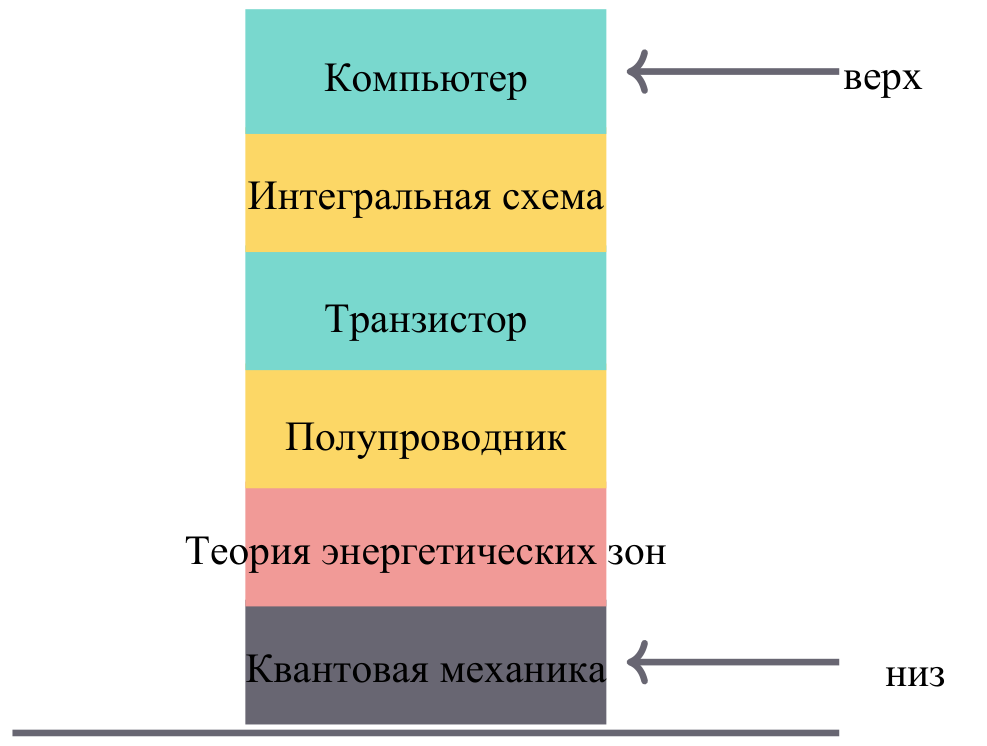

*Рисунок 4.1: Стек*

Чтобы понять назначение стеков, лучше всего понаблюдать, как они формируются и опустошаются. Предположим, мы складываем книги на чистый стол одну за другой — тем самым создаём стек. Теперь, если мы убираем книгу, порядок извлечения оказывается противоположным порядку, в котором книги размещались. Значимость стеков заключается в их способности обращать порядок элементов, вставляя и удаляя их в обратном порядке. На следующей диаграмме показан процесс создания и удаления объектов данных с особым вниманием к порядку данных.

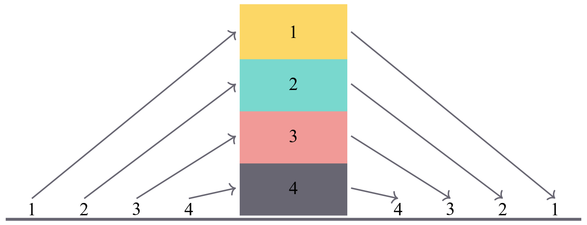

*Рисунок 4.2: Обратный порядок стека*

Способность обращать порядок элементов делает свойство разворота стеков особенно полезным, что демонстрируют различные компьютерные приложения. Например, при просмотре новостей в веб-браузере функция «назад» реализована с помощью стека. По мере того как пользователь открывает веб-страницы, они складываются в стек: текущая страница оказывается на вершине, а первая открытая — на дне. Нажатие кнопки «назад» возвращает пользователя на предыдущую страницу в обратном порядке. Без возможностей стека реализовать эту функцию «назад» было бы практически невозможно. Этот пример подчёркивает важность структур данных для упрощения отдельных функций: правильный выбор структуры данных может дать существенную разницу.

<a id="ch04-4-3-1-абстрактный-тип-данных-стек"></a>

### 4.3.1 Абстрактный тип данных «стек»

Стек — это абстрактный тип данных (ADT), определяемый своей структурой и операциями. Это упорядоченная коллекция элементов, в которой новые элементы добавляются и удаляются с вершины. Над стеком можно выполнять следующие операции:

- new(): создаёт пустой стек без аргументов и возвращает пустой стек.
- push(item): добавляет элемент данных `item` на вершину стека, принимая `item` в качестве аргумента и ничего не возвращая.
- pop(): удаляет верхний элемент данных из стека, не принимая аргументов и возвращая этот элемент данных. Стек при этом изменяется.
- peek(): возвращает верхний элемент данных из стека, не удаляя его, не принимает аргументов и не изменяет стек.
- is_empty(): проверяет, пуст ли стек, не принимая аргументов и возвращает логическое значение.
- size(): возвращает число элементов данных в стеке в виде целого числа типа `usize`, не принимая аргументов.
- iter(): возвращает неизменяемую форму итерации по стеку; стек при этом не изменяется, аргументы не принимаются.
- iter_mut(): возвращает изменяемую форму итерации по стеку; стек при этом может изменяться, аргументы не принимаются.
- into_iter(): превращает стек в итерируемую форму, потребляя стек и не принимая аргументов.

Чтобы проиллюстрировать операции над стеком, предположим, что `s` — это уже созданный пустой стек (здесь он обозначен как `[]`); в таблице ниже показаны результаты операций над стеком, причём вершина стека находится справа.

**Таблица 4.1: Операции над стеком**

| Операция | Значение | Возвращаемое значение |
| --- | --- | --- |
| s.is_empty() | [] | true |
| s.push(1) | [1] |  |
| s.push(2) | [1,2] |  |
| s.peek() | [1,2] | 2 |
| s.push(3) | [1,2,3] |  |
| s.size() | [1,2,3] | 3 |
| s.is_empty() | [1,2,3] | false |
| s.push(4) | [1,2,3,4] |  |
| s.push(5) | [1,2,3,4,5] |  |
| s.size() | [1,2,3,4,5] | 5 |
| s.pop() | [1,2,3,4] | 5 |
| s.push(6) | [1,2,3,4,6] |  |
| s.peek() | [1,2,3,4,6] | 6 |

<a id="ch04-4-3-2-реализация-стека-на-rust"></a>

### 4.3.2 Реализация стека на Rust

Абстрактный тип данных «стек» был определён выше, и теперь мы реализуем его на Rust как структуру данных. В Rust абстрактные типы данных реализуются созданием новой структуры и воплощением операций в виде функций этой структуры. Использование базовых структур данных, предоставляемых Rust, для реализации стека и его операций очень удобно. В качестве базовой реализации стека мы используем контейнер-коллекцию `Vec`, поскольку он предоставляет механизм упорядоченного хранения и набор методов операций. Для реализации остальных операций достаточно лишь выбрать, какой конец `Vec` будет вершиной стека. Реализация исходит из того, что хвост `Vec` хранит верхний элемент, а по мере роста стека новые элементы добавляются в конец `Vec`. Поскольку тип вставляемых данных неизвестен, мы используем обобщённый тип данных `T`. Мы также добавили три структуры — `IntoIter`, `Iter` и `IterMut`, — чтобы обеспечить три вида итерации.

```rust
// stack.rs

#[derive(Debug)]
struct Stack<T> {
    size: usize, // stack size
    data: Vec<T>, // stack data
}

impl<T> Stack<T> {
    // initialize a stack
    fn new() -> Self {
        Self {
            size: 0,
            data: Vec::new()
        }
    }

    fn is_empty(&self) -> bool {
        0 == self.size
    }

    fn len(&self) -> usize {
        self.size
    }

    // clear stack
    fn clear(&mut self) {
        self.size = 0;
        self.data.clear();
    }

    // put the item into the tail of Vec
    fn push(&mut self, val: T) {
        self.data.push(val);
        self.size += 1;
    }

    // size decrease by 1 and then return the value
    fn pop(&mut self) -> Option<T> {
        if 0 == self.size {
            return None;
        }
        self.size -= 1;
        self.data.pop()
    }

    // return reference to the top value
    fn peek(&self) -> Option<&T> {
        if 0 == self.size {
            return None;
        }
```

```rust
        self.data.get(self.size - 1)
    }

    fn peek_mut(&mut self) -> Option<&mut T> {
        if 0 == self.size {
            return None;
        }

        self.data.get_mut(self.size - 1)
    }

    // Implementing iteration for stack
    // into_iter: stack modified and becomes a iterator
    // iter: stack unmodified and get a unmutable iterator
    // iter_mut: stack unmodified and get a mutable iterator
    fn into_iter(self) -> IntoIter<T> {
        IntoIter(self)
    }

    fn iter(&self) -> Iter<T> {
        let mut iterator = Iter { stack: Vec::new() };
        for item in self.data.iter() {
            iterator.stack.push(item);
        }

        iterator
    }

    fn iter_mut(&mut self) -> IterMut<T> {
        let mut iterator = IterMut { stack: Vec::new() };
        for item in self.data.iter_mut() {
            iterator.stack.push(item);
        }

        iterator
    }
}

// Implementation of 3 iterations
struct IntoIter<T>(Stack<T>);
impl<T: Clone> Iterator for IntoIter<T> {
    type Item = T;
    fn next(&mut self) -> Option<Self::Item> {
        if !self.0.is_empty() {
            self.0.size -= 1;
            self.0.data.pop()
        } else {
            None
        }
    }
}
```

```rust
struct Iter<'a, T: 'a> { stack: Vec<&'a T>, }
impl<'a, T> Iterator for Iter<'a, T> {
    type Item = &'a T;
    fn next(&mut self) -> Option<Self::Item> {
        self.stack.pop()
    }
}

struct IterMut<'a, T: 'a> { stack: Vec<&'a mut T> }
impl<'a, T> Iterator for IterMut<'a, T> {
    type Item = &'a mut T;
    fn next(&mut self) -> Option<Self::Item> {
        self.stack.pop()
    }
}

fn main() {
    basic();
    peek();
    iter();

    fn basic() {
        let mut s = Stack::new();
        s.push(1); s.push(2); s.push(3);

        println!("size: {}, {:?}", s.len(), s);
        println!("pop {:?}, size {}",s.pop().unwrap(), s.len())
           ; println!("empty: {}, {:?}", s.is_empty(), s);

        s.clear();
        println!("{:?}", s);
    }

    fn peek() {
        let mut s = Stack::new();
        s.push(1); s.push(2); s.push(3);

        println!("{:?}", s);
        let peek_mut = s.peek_mut();
        if let Some(top) = peek_mut {
            *top = 4;
        }

        println!("top {:?}", s.peek().unwrap());
        println!("{:?}", s);
    }

    fn iter() {
        let mut s = Stack::new();
        s.push(1); s.push(2); s.push(3);
```

```rust
        let sum1 = s.iter().sum::<i32>();
        let mut addend = 0;
        for item in s.iter_mut() {
            *item += 1;
            addend += 1;
        }

        let sum2 = s.iter().sum::<i32>();
        println!("{sum1} + {addend} = {sum2}");
        assert_eq!(9, s.into_iter().sum::<i32>());
    }
}
```

После выполнения кода получаются следующие результаты.

```text
size: 3, Stack { size: 3, data: [1, 2, 3] }
pop 3, size 2
empty: false, Stack { size: 2, data: [1, 2] }
Stack { size: 0, data: [] }
Stack { size: 3, data: [1, 2, 3] }
top 4
Stack { size: 3, data: [1, 2, 4] }
6 + 3 = 9
```

<a id="ch04-4-3-3-простые-скобки"></a>

### 4.3.3 Простые скобки

Ранее мы реализовали структуру данных «стек», и теперь воспользуемся ею для решения задачи сопоставления скобок. Вычисляемые арифметические выражения содержат скобки, как показано ниже. (5 + 6) × (7 + 8)/(4 + 3) Аналогично, показанная ниже функция умножения в языке Lisp тоже содержит скобки.

```text
(defun multiply(n)
    (* n n))
```

Здесь главное — скобки, поскольку они изменяют порядок выполнения операций и ограничивают семантику языка. Чрезвычайно важно следить за тем, чтобы скобки были парными; иначе всё выражение окажется некорректным. Человек быстро замечает незакрытые скобки, но как это сделать компьютеру? Очевидно, компьютер должен проверять, совпадают ли скобки, и сообщать об ошибке, если это не так. В обоих приведённых выше примерах скобки должны встречаться парами. Сопоставление скобок означает, что каждому открывающему символу соответствует закрывающий символ и что скобки вложены друг в друга правильно, чтобы компьютер мог корректно их обработать. Рассмотрим следующие правильно сопоставленные строки скобок и эти несопоставленные скобки.

```text
(()()()())
(((())))
(()((())()))
((((((())
()))
(()()(()
```

Чтобы решить задачу сопоставления скобок, необходимо более глубокое понимание самих скобок и правил их сопоставления. При обработке символов слева направо ближайшая встретившаяся открывающая скобка `(` должна сопоставляться со следующей закрывающей скобкой `)` (как показано на рисунке 4.3). Кроме того, первая обработанная открывающая скобка должна ждать своего соответствия до последней закрывающей скобки. Закрывающие скобки сопоставляются с открывающими в обратном порядке — изнутри наружу. Это задача, которую можно решить с помощью стека.

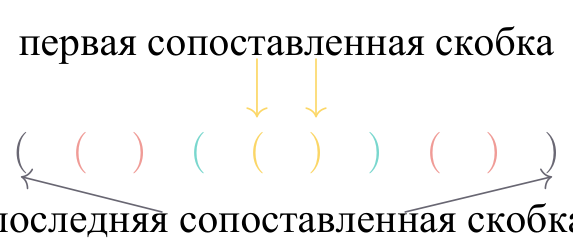

*Рисунок 4.3: Сопоставление скобок*

Сопоставление скобок имеет первостепенное значение в компьютерных программах, поскольку определяет следующую операцию. Задача состоит в том, чтобы написать алгоритм, способный прочитать строку символов слева направо и определить, совпадают ли скобки. Скобки и их сопоставление существенны для компьютерных программ, поскольку скобки и вложенность встречаются в программах повсеместно. Реализация алгоритма сопоставления скобок с помощью стека довольно проста, поскольку предполагает лишь операции `push`, `pop` и сравнение над стеком. Для начала обработаем строку скобок слева направо, используя пустой стек. Если символ является открывающей скобкой, помещаем её в стек; если это закрывающая скобка, извлекаем верхний элемент стека и сопоставляем эти два символа. Если они совпадают, продолжаем обрабатывать следующую скобку до тех пор, пока строка не будет обработана целиком. По окончании обработки стек должен быть пуст; если это не так, это означает, что остались несопоставленные скобки. Ниже приведена реализация программы сопоставления скобок на Rust.

```rust
// par_checker1.rs

fn par_checker1(par: &str) -> bool {
    // adding characters into Vec
    let mut char_list = Vec::new();
    for c in par.chars() {
        char_list.push(c);
    }

    let mut index = 0;
    let mut balance = true; // determine if balanced
    let mut stack = Stack::new();
    while index < char_list.len() && balance {
        let c = char_list[index];

        if '(' == c { // if is '(', put data into stack
            stack.push(c);
        } else { // if is ')', determine if stack is empty
            if stack.is_empty() { // empty stack, matched
                balance = false;
            } else {
                let _r = stack.pop();
            }
        }

        index += 1;
    }
```

```rust
    // parenthesis matched: balanced and empty stack
    balance && stack.is_empty()
}

fn main() {
    let sa = "()(())";
    let sb = "()((()";
    let res1 = par_checker1(sa);
    let res2 = par_checker1(sb);
    println!("{sa} balanced:{res1}, {sb} balanced:{res2}");
    // ()(()) balanced:true, ()((() balanced:false
}
```

Хотя в приведённом выше примере речь идёт только о сопоставлении скобок `()`, на практике обычно используются три типа скобок: `()`, `[]` и `{}`. Эти различные типы открывающих и закрывающих скобок часто вкладываются друг в друга, как это видно в Rust, где квадратные скобки `[]` используются для индексации, фигурные скобки `{}` — для форматирования вывода, а круглые скобки `()` — для параметров функций, кортежей, математических выражений и многого другого. Достаточно того, чтобы каждый символ сохранял собственную связь открывающей и закрывающей скобки, и можно использовать смешанную вложенность.

```text
{ { ( [ ] [ ] ) } ( ) }
[ [ { { ( ( ) ) } } ] ]
[ ] [ ] [ ] ( ) { }
```

Все показанные выше скобки сопоставлены. Напротив, следующее выражение не сопоставлено.

```text
( } [ ]
( ( ( ) ] ) )
[ { ( ) ]
```

Чтобы обрабатывать три типа скобок, предыдущую программу проверки скобок `par_checker1` (способную обнаруживать только скобки `()`) необходимо расширить. Однако сам процесс алгоритма остаётся прежним. Каждая открывающая скобка помещается в стек и ожидает появления соответствующей ей закрывающей скобки. Когда встречается закрывающая скобка, программа проверяет, совпадают ли типы скобок. Если две скобки не совпадают, то строка не сопоставлена. Если вся строка обработана и стек пуст, значит выражение со скобками сопоставлено. Для определения совпадения типов скобок добавлена новая функция `par_match()`. Эта функция способна распознавать три обычно используемых типа скобок. Принцип распознавания очень прост: программа упорядочивает скобки и проверяет, совпадают ли их индексы.

```rust
// par_checker2.rs

// check if parentheses match of various symbols
fn par_match(open: char, close: char) -> bool {
    let opens = "([{";
    let closers = ")]}";
    opens.find(open) == closers.find(close)
}

fn par_checker2(par: &str) -> bool {
    let mut char_list = Vec::new();
```

```rust
    for c in par.chars() {
        char_list.push(c);
    }

    let mut index = 0;
    let mut balance = true;
    let mut stack = Stack::new();
    while index < char_list.len() && balance {
        let c = char_list[index];
        // check 3 open symbols simultaneously
        if '(' == c || '[' == c || '{' == c {
            stack.push(c);
        } else {
            if stack.is_empty() {
                balance = false;
            } else {
                // determine if match
                let top = stack.pop().unwrap();
                if !par_match(top, c) {
                    balance = false;
                }
            }
        }
        index += 1;
    }
    balance && stack.is_empty()
}

fn main() {
    let sa = "(){}[]";
    let sb = "(){)[}";
    let res1 = par_checker2(sa);
    let res2 = par_checker2(sb);
    println!("sa balanced:{res1}, sb balanced:{res2}");
    // (){}[] balanced:true, (){)[} balanced:false
}
```

Текущая реализация способна обрабатывать задачи сопоставления скобок различных видов. Однако если входное выражение содержит символы, не являющиеся скобками, программа не сможет работать корректно.

```text
(a+b)(c*d)func()
```

Кажущаяся сложность задачи может вводить в заблуждение, поскольку сама проблема по-прежнему связана с распознаванием совпадающих скобок. Поэтому символы, не являющиеся скобками, можно пропускать при обработке. В случае приведённого примера символы, не являющиеся скобками, можно игнорировать, оставив только скобки, и получить строку: ()(){}(). Задача остаётся той же, поэтому код можно изменить так, чтобы он распознавал совпадающие скобки даже в строках, содержащих посторонние символы. Ниже приведена изменённая версия кода, основанная на par_checker2.rs.

```rust
// par_checker3.rs

fn par_checker3(par: &str) -> bool {
    let mut char_list = Vec::new();
```

```rust
    for c in par.chars() { char_list.push(c); }

    let mut index = 0;
    let mut balance = true;
    let mut stack = Stack::new();
    while index < char_list.len() && balance {
        let c = char_list[index];
        // open mark, push
        if '(' == c || '[' == c || '{' == c {
            stack.push(c);
        }
        // close mark, determine if balanced
        if ')' == c || ']' == c || '}' == c {
            if stack.is_empty() {
                balance = false;
            } else {
                let top = stack.pop().unwrap();
                if !par_match(top, c) { balance = false; }
            }
        }
        // skip if not the bracket
        index += 1;
    }
    balance && stack.is_empty()
}

fn main() {
    let sa = "(2+3){func}[abc]"; let sb = "(2+3)*(3-1";
    let res1 = par_checker3(sa); let res2 = par_checker3(sb);
    println!("sa balanced:{res1}, sb balanced:{res2}");
 // (2+3){func}[abc] balanced:true, (2+3)*(3-1 balanced:false
}
```

<a id="ch04-4-3-4-перевод-десятичных-чисел-в-двоичные"></a>

### 4.3.4 Перевод десятичных чисел в двоичные

Двоичная система — фундаментальное понятие в мире компьютеров, поскольку именно она является универсальным форматом данных на низком уровне вычислений. Все значения, хранимые в компьютерах, имеют вид нулей и единиц, поэтому для успешного взаимодействия с компьютером критически важно уметь переходить от двоичных чисел к обычным символам и обратно. Целые числа широко используются в компьютерных программах и вычислениях, но мы обычно изучаем их в десятичной записи. Например, десятичное число 233(10) может быть представлено в двоичной записи как 11101001(2).

2 × 10² + 3 × 10¹ + 3 × 10⁰ = 233 (4.1)

1 × 2⁷ + 1 × 2⁶ + 1 × 2⁵ + 0 × 2⁴ + 1 × 2³ + 0 × 2² + 0 × 2¹ + 1 × 2⁰ = 233 Чтобы перевести целое число в двоичную запись, достаточно применить алгоритм «деления на 2» (показанный на рисунке 4.4) — простой и действенный способ, использующий стек для хранения цифр двоичного результата. Начиная с положительного целого числа, большего нуля, алгоритм последовательно делит десятичное число на 2, запоминая остатки. Первый остаток от деления на 2 определяет, чётное число или нечётное: чётное число даёт остаток 0, нечётное — остаток 1. Записывая эти остатки в ходе итераций и разворачивая полученную последовательность, мы получаем последовательность двоичных цифр, причём первый остаток (то есть последняя цифра последовательности) оказывается на дне стека. Извлекая все цифры из стека, получаем двоичную запись исходного десятичного числа.

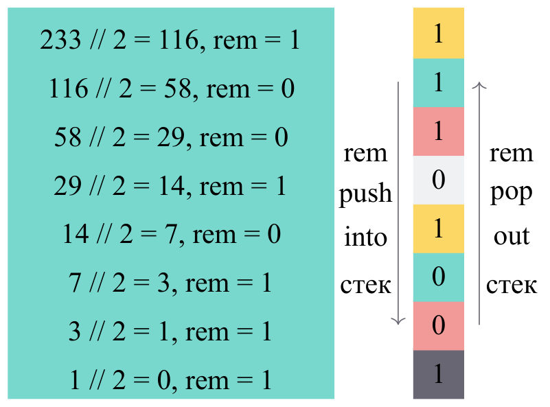

*Рисунок 4.4: Деление на 2*

Показанная ниже функция принимает десятичный параметр и использует оператор остатка от деления (%) в Rust, чтобы извлечь остаток, который затем помещается в стек. Параметр многократно делится на 2 до тех пор, пока не станет равен 0, после чего программа формирует двоичную запись исходного значения.

```rust
// divide_by_two.rs

fn divide_by_two(mut dec_num: u32) -> String {
    // save the remainder in a stack
    let mut rem_stack = Stack::new();

    // push rem into the stack
    while dec_num > 0 {
        let rem = dec_num % 2;
        rem_stack.push(rem);
        dec_num /= 2;
    }

    // pop out elems from the stack to form a string
    let mut bin_str = "".to_string();
    while !rem_stack.is_empty() {
        let rem = rem_stack.pop().unwrap().to_string();
        bin_str += &rem;
    }
    bin_str
}

fn main() {
    let num = 10;
    let bin_str: String = divided_by_two(num);
    println!("{num} = b{bin_str}");
    // 10 = b1010
}
```

Этот алгоритм перевода из десятичной в двоичную систему можно расширить, чтобы выполнять преобразования между любыми двумя системами счисления, обычно используемыми в информатике, например двоичной, восьмеричной и шестнадцатеричной. Например, десятичному числу 233(10) соответствует 351(8) в восьмеричной и e9(16) в шестнадцатеричной записи. Чтобы сделать функцию более общей, её можно изменить так, чтобы она принимала заранее заданное основание перевода,

заменяя понятие деления на 2 делением на основание перевода. Остатки по-прежнему помещаются в стек до тех пор, пока преобразуемое значение не станет равно 0. Однако для оснований, больших 10, неизбежно возникают остатки, превышающие 10, поэтому их лучше всего представлять одним символом. В функции `base_converter` мы выбираем обозначения A-F для значений 10-15, но можно использовать и строчные буквы вроде a-f, либо другие последовательности символов.

```rust
// base_converter.rs

fn base_converter(mut dec_num: u32, base: u32) -> String {
    // digits is the string form of integers(especially for 10
       -15) let digits = ['0', '1', '2', '3', '4', '5', '6', '7',
                 '8', '9', 'A', 'B', 'C', 'D', 'E', 'F'];
    let mut rem_stack = Stack::new();

    // push rem into the stack
    while dec_num > 0 {
        let rem = dec_num % base;
        rem_stack.push(rem);
        dec_num /= base;
    }

    // pop out elems from the stack to form a string
    let mut base_str = "".to_string();
    while !rem_stack.is_empty() {
        let rem = rem_stack.pop().unwrap() as usize;
        base_str += &digits[rem].to_string();
    }
    base_str
}

fn main() {
    let num1 = 10;
    let num2 = 43;
    let bin_str: String = base_converter(num1, 2);
    let hex_str: String = base_converter(num2, 16);
    println!("{num1} = b{bin_str}, {num2} = x{hex_str}");
    // 10 = b1010, 43 = x2B
}
```

<a id="ch04-4-3-5-префиксные-инфиксные-и-постфиксные-выражения"></a>

### 4.3.5 Префиксные, инфиксные и постфиксные выражения

В математике арифметическое выражение, например B * C, имеет определённый формат, который делает его легко воспринимаемым. Например, B, умноженное на C, с оператором умножения `*` между двумя операндами образует инфиксное выражение. Такой тип выражения естественно легко читать и понимать, поскольку он сохраняет порядок записи выражения. Однако для инфиксного выражения наподобие A + B * C, где операторы `+` и `*` помещены между операндами, требуется понимание приоритета операторов, чтобы определить порядок выполнения операций. При наличии операторов одинакового приоритета они вычисляются слева направо. Скобки могут изменять порядок выполнения операций, а приоритет арифметических операторов ставит умножение и деление перед сложением и вычитанием. Хотя человек легко решает такие выражения, мысленно расставляя скобки, компьютеру для выполнения той же задачи требуются

конкретные алгоритмы. Компьютер может избежать путаницы, используя полностью расставленные скобки, где у каждого оператора есть своя пара скобок, указывающая порядок выполнения операции. Однако обработка таких выражений может быть затруднена, поскольку компьютеры работают слева направо. Поэтому даже простые задачи, кажущиеся лёгкими для человека, могут оказаться сложными для компьютера, поскольку он лишён интеллекта и способности интуитивно понимать выражения. Чтобы гарантировать, что компьютер не перепутает порядок выполнения операций, можно использовать полностью заключённое в скобки выражение, где каждый оператор окружён парой скобок, обозначающей порядок выполнения операций. Однако поскольку компьютер обрабатывает данные слева направо, ему может быть трудно переключаться между внутренними и внешними скобками при вычислении выражений вида (A + (B * C)). Человек делает это интуитивно, но для компьютера это сложно, поскольку он строг и требует явных инструкций. Более удобный для компьютера метод — отделить оператор от операндов, вынеся оператор за скобки. Это порождает префиксные и постфиксные выражения, которые можно отличить от исходного инфиксного выражения. В префиксных выражениях операторы стоят перед операндами, а в постфиксных — после соответствующих операндов. Вычисление выполняется так: берутся оператор и операнды, вычисляется результат, который становится текущим значением, а затем выполняются последующие операции, пока выражение не будет вычислено целиком. Например, инфиксное выражение A + B можно записать как + A B в префиксной нотации или A B + в постфиксной нотации. Следуя правилам каждой из нотаций, читатель может вычислить более сложные выражения в префиксной или постфиксной нотации и подтвердить правильность результата.

**Таблица 4.2: Префиксные, инфиксные и постфиксные выражения**

| Префиксная | Инфиксная | Постфиксная |
| --- | --- | --- |
| A + B | + A B | A B + |
| A + B * C | + A * B C | A B C * + |
| (A + B) * C | * + A B C | A B + C * |
| A + B - C | - + A B C | A B + C - |
| A * B + C | + * A B C | A B * C + |
| A * B / C | / * A B C | A B * C / |

Для анализа сложных выражений читателю необходимо понимать важность скобок при выражении порядка выполнения операций. Даже небольшие изменения в расположении скобок могут привести к совершенно различным выражениям. В то время как инфиксные выражения требуют скобок для однозначного задания порядка выполнения операций, префиксные и постфиксные выражения в них не нуждаются. Это происходит потому, что порядок выполнения операций в этих нотациях целиком определяется положением операторов. В результате префиксные и постфиксные выражения могут чётко и без двусмысленно выражать логику вычисления, гарантируя, что основанные на них вычисления будут свободны от ошибок. В таблице ниже приведены некоторые примеры сложных выражений в разных нотациях.

**Таблица 4.3: Сложные пре-ин-постфиксные выражения**

| Инфиксная | Префиксная | Постфиксная |
| --- | --- | --- |
| A + B * C - D | - + A * B C D | A B C * + D - |
| A * B - C / D | - * A B / C D | A B * C D / - |
| A + B + C + D | + + + A B C D | A B + C + D + |
| (A + B) * (C - D) | * + A B - C D | A B + C D - * |

Префиксные и постфиксные выражения на первый взгляд могут показаться более сложными для вычисления. Например, для выражения A + B * C префиксная запись «+ A * B C» требует сначала вычислить «B * C», а затем прибавить результат к A. Однако знак умножения по-прежнему остаётся внутри оператора сложения, что делает вычисление невозможным. Чтобы разрешить эту проблему, можно использовать стеки для разворота порядка выполнения операций. Если помещать операнды и операторы в два отдельных стека слева направо, порядок выполнения операций разворачивается, как показано на рисунке (4.5). Такой подход позволяет эффективно и точно вычислять префиксные и постфиксные выражения.

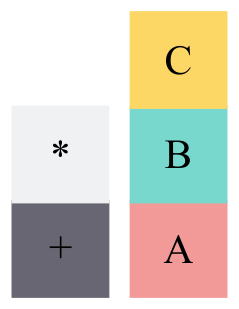

*Рисунок 4.5: Выражения в стеке*

Чтобы вычислить выражение в префиксной нотации, оператор и операнды помещаются в два отдельных стека слева направо. Для вычисления выражения верхний оператор извлекается из стека операторов, а два верхних операнда — из стека операндов. Оператор применяется к этим операндам, давая результат, который затем помещается обратно в стек операндов. Этот процесс повторяется, пока стек операторов не опустеет. Наконец, верхнее значение в стеке операндов и есть результат выражения. Этот метод столь же эффективен, как и выражения с полностью расставленными скобками, поскольку компьютеру требуется лишь помещать и извлекать элементы из стеков и вовсе не нужно иметь дело со скобками, как показано на рисунке (4.6).

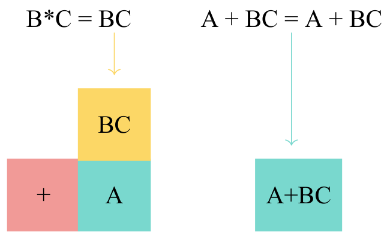

*Рисунок 4.6: Вычисление выражения с помощью стека*

Аналогично постфиксные выражения также могут вычисляться с помощью стеков. Для выполнения вычисления нужен лишь один стек. Например, постфиксная запись выражения A + B * C, то есть A B C * +, вычисляется так: A, B и C помещаются в стек. Когда встречается оператор *, два верхних операнда, B и C, извлекаются, перемножаются и помещаются обратно в стек. Затем, когда встречается оператор +, два верхних операнда, A и BC, извлекаются, складываются и помещаются обратно в стек, давая в итоге результат A + BC. Этот подход демонстрирует эффективность вычислений на основе стеков, позволяя обрабатывать выражения в любой нотации без использования скобок.

<a id="ch04-4-3-6-перевод-инфиксных-выражений-в-префиксные-и-постфиксные"></a>

### 4.3.6 Перевод инфиксных выражений в префиксные и постфиксные

Процесс вычисления показал, что для достижения эффективности необходимо преобразовывать инфиксные выражения в префиксные или постфиксные. Первым шагом на этом пути является получение префиксного или постфиксного выражения, а одним из способов такого получения служит использование полностью расставленных скобок.

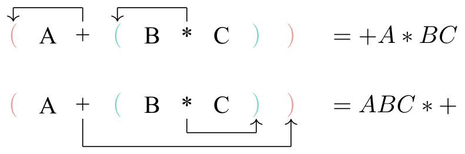

*Рисунок 4.7: Перевод из инфиксной в префиксную и постфиксную*

Например, A + B * C можно записать как (A + (B * C)), чтобы показать, что умножение имеет более высокий приоритет, чем сложение. Примечательно, что каждая пара скобок представляет начало и конец

пары операндов. Внутреннее выражение (A + (B * C)) — это (B * C), и, перенося знак умножения на позицию левой скобки и удаляя левую и соответствующую ей правую скобки, подвыражение можно преобразовать в префиксное выражение. Аналогично, перенося оператор сложения на позицию соответствующей левой скобки и удаляя парную правую скобку, получают полное префиксное выражение + A * B C. Повторяя эту операцию для всех операторов, получают полное постфиксное выражение. Чтобы преобразовать выражение — независимо от того, префиксное оно или постфиксное, — его сначала необходимо привести к полностью расставленным скобкам с учётом порядка выполнения операций. После того как выражение полностью расставлено скобками, оператор внутри скобок можно перенести на позицию левой или правой скобки, получив нужную нотацию. Например, более сложное выражение (A + B) * C - (D + E) / (F + G) можно преобразовать в префиксное или постфиксное выражение таким способом. Хотя результат может показаться сложным человеку, компьютер справляется с этим процессом без труда.

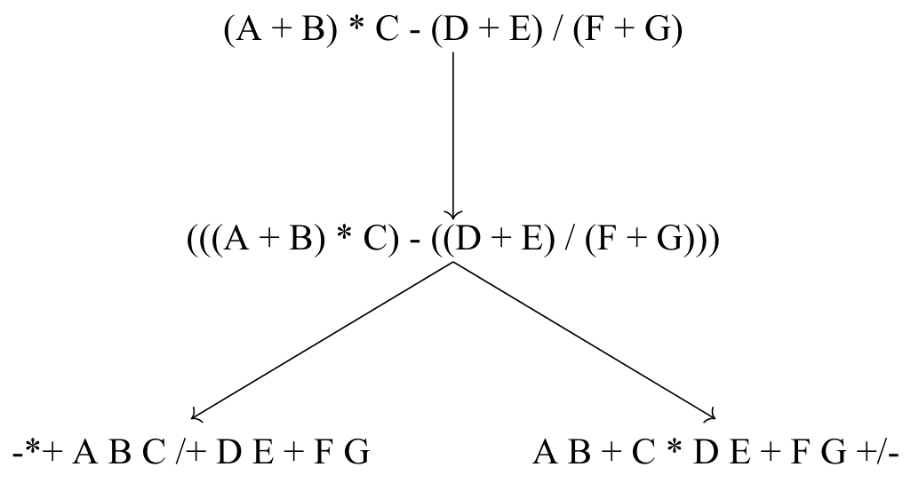

*Рисунок 4.8: Перевод из инфиксной в префиксную и постфиксную*

Получение полностью заключённого в скобки выражения — трудная задача, требующая изменения строки перемещением и удалением символов. Поэтому этот метод недостаточно универсален. Более удобный подход — обрабатывать операторы отдельно. При преобразовании инфиксного выражения, если не учитывать операнды, они сохраняют свои первоначальные взаимные позиции, и меняется лишь положение операторов. Поэтому при встрече операнда нет необходимости менять его позицию; вместо этого следует обрабатывать только операторы. Однако у операторов есть приоритеты, и они часто меняют порядок. Свойство разворота порядка присуще структуре данных «стек», которую можно использовать для хранения операторов. Чтобы преобразовать инфиксное выражение в постфиксное, можно использовать стек для хранения операторов, сканируя выражение слева направо. Когда встречается операнд, он добавляется к постфиксному выражению. Если встречается оператор, мы сравниваем его приоритет с приоритетом оператора на вершине стека. Если приоритет текущего оператора выше, он помещается в стек. Если приоритет текущего оператора ниже или равен, мы извлекаем операторы из стека и добавляем их к постфиксному выражению, пока не дойдём до оператора с меньшим приоритетом или открывающей скобки. Когда встречается закрывающая скобка, мы извлекаем операторы из стека и добавляем их к постфиксному выражению, пока не дойдём до соответствующей открывающей скобки, которую затем отбрасываем. В результате получается постфиксное выражение, которое можно эффективно вычислить. Например, чтобы преобразовать инфиксное выражение (A + B) * C, мы сканируем его слева направо. Сначала мы встречаем операнд A, который добавляется к постфиксному выражению. Затем встречаем оператор +, имеющий меньший приоритет, чем открывающая скобка, поэтому мы помещаем его в стек. Далее встречаем операнд B, который добавляется к постфиксному выражению. Наконец, мы встречаем закрывающую скобку, поэтому извлекаем оператор + из стека и добавляем его к постфиксному выражению, а затем оператор *. В результате получается постфиксное выражение A B + C *. Таким же способом можно преобразовать инфиксное выражение A * B + C * D в постфиксное выражение A B * C D * +, как показано на рисунке ниже.

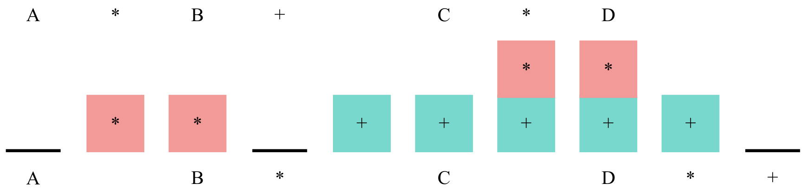

*Рисунок 4.9: Постфиксное выражение с помощью стека*

Чтобы преобразовать инфиксное выражение в постфиксную нотацию, следуйте этим шагам: 1. Создайте пустой стек op_stack для хранения операторов и пустой список postfix для хранения результата. 2. Разделите входную инфиксную строку на токены и сохраните их в списке с именем src_str. 3. Пройдите по токенам в src_str слева направо: если токен является операндом, добавьте его в конец списка postfix. Если токен — открывающая скобка, поместите его в op_stack. Если токен — закрывающая скобка, извлекайте операторы из op_stack и добавляйте их в postfix, пока соответствующая открывающая скобка не будет удалена. Если токен является оператором (+, -, * или /), поместите его в op_stack. Однако сначала извлеките из op_stack все операторы с более высоким или равным приоритетом и добавьте их в postfix. 4. После обработки входа проверьте op_stack. Извлеките из op_stack оставшиеся операторы и добавьте их в postfix. Итоговый список postfix и есть результат преобразования.

Алгоритм 4.1: преобразование выражения из инфиксной записи в постфиксную. Вход: инфиксное выражение

Выход: постфиксное выражение

1 Создать пустой стек op_stack и пустой список postfix
2 Преобразовать входное инфиксное выражение в список токенов (src_str)
3 для каждого c ∈ src_str do
4 если c ∈ ‘A − Z’ то
5 postfix.append(c)
6 иначе если c == ‘(’ то
7 op_stack.push(c)
8 иначе если c ∈ ‘ + − ∗ /’ то
9 пока op_stack.peek() имеет приоритет выше c
10 postfix.append(op_stack.pop())
11 конец
12 op_stack.push(c)
13 иначе если c == ‘)’ то
14 пока op_stack.peek() != ‘(’
15 postfix.append(op_stack.pop())
16 конец
17 конец
18 конец
19 пока !op_stack.is_empty() то
20 postfix.append(op_stack.pop())
21 конец
22 вернуть ‘ ’.join(postfix)

Чтобы преобразовать инфиксное выражение в постфиксное, можно использовать HashMap с именем `prec` для хранения приоритетов операторов. Этот HashMap сопоставляет каждому оператору целое число, используемое для сравнения приоритетов. Приоритет скобок назначается наименьшим, чтобы любой оператор по сравнению с ними имел более высокий приоритет. Операторы ограничены набором «+-*/», а операндами считаются прописные буквы A − Z или цифры 0 − 9.

```rust
// infix_to_postfix.rs
use std::collections::HashMap;

fn infix_to_postfix(infix: &str) -> Option<String> {
    // check parenthesis
    if !par_checker3(infix) {
        return None;
    }

    // set priority of all symbols
    let mut prec = HashMap::new();
    prec.insert("(", 1); prec.insert(")", 1);
    prec.insert("+", 2); prec.insert("-", 2);
    prec.insert("*", 3); prec.insert("/", 3);

    // ops: svae operators, postfix: svae postfix expression
    let mut ops = Stack::new();
    let mut postfix = Vec::new();
    for token in infix.split_whitespace() {
        // characters range from 0 - 9 and A-Z can
        // be pushed onto the stack
        if ("A" <= token && token <= "Z") ||
            ("0" <= token && token <= "9") {
            postfix.push(token);
        } else if "(" == token {
            // open mark, push onto the stack
            ops.push(token);
        } else if ")" == token {
            // close mark, pop out from stack
            let mut top = ops.pop().unwrap();
            while top != "(" {
                postfix.push(top);
                top = ops.pop().unwrap();
            }
        } else {
            // check the priority of operators
            while (!ops.is_empty()) &&
                (prec[ops.peek().unwrap()]
                                    >= prec[token]) {
                postfix.push(ops.pop().unwrap());
            }
            ops.push(token);
        }
    }

    // push the remaining operators onto the stack
```

```rust
    while !ops.is_empty() {
        postfix.push(ops.pop().unwrap())
    }
    // pop out operators and create the postfix expression
    let mut postfix_str = "".to_string();
    for c in postfix {
        postfix_str += &c.to_string();
        postfix_str += " ";
    }

    Some(postfix_str)
}

fn main() {
    let infix = "( A + B ) * ( C + D )";
    let postfix = infix_to_postfix(infix);
    match postfix {
        Some(val) => { println!("{infix} -> {val}"); },
        None => {
            println!("{infix} isn't a correct infix string");
        },
    }
    // ( A + B ) * ( C + D ) -> A B + C D + *
}
```

При вычислении постфиксных выражений особое внимание следует уделить операторам `-` и `/`. В отличие от операторов `+` и `*`, для `-` и `/` имеет значение порядок операндов. Например, A / B и B / A, A - B и B - A совершенно различны и не могут обрабатываться так же, как `+` и `*`. Предполагая, что постфиксное выражение представляет собой строку, разделённую пробелами, где операторы — «+-*/», а операнды — целые числа, получим на выходе тоже целое число. Приведём шаги алгоритма вычисления постфиксных выражений: 1. Создайте пустой стек с именем op_stack. 2. Разделите строку на список символов. 3. Просканируйте список символов слева направо. Если символ является операндом, преобразуйте его из символа в целое число и поместите значение в op_stack. Если символ является оператором, извлеките из op_stack два элемента. Второе извлечение даёт первый операнд, а первое извлечение — второй операнд. Выполните арифметическую операцию и поместите результат обратно в стек операндов. 4. Когда всё входное выражение обработано, результат находится в стеке. Извлеките op_stack, чтобы получить окончательный результат операции.

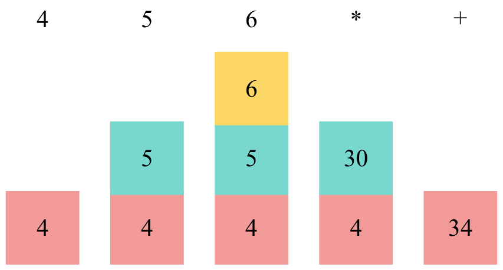

*Рисунок 4.10: Вычисление постфиксного выражения*

Конкретные шаги вычисления постфиксных выражений показаны на приведённом выше рисунке, а ниже приведён код реализации.

```rust
// postfix_eval.rs

fn postfix_eval(postfix: &str) -> Option<i32> {
    // the expression needs at least two operands and
    // one operator, and two spaces to separate them.
    if postfix.len() < 5 { return None; }

    let mut ops = Stack::new();
    for token in postfix.split_whitespace() {
        // Strings can be compared directly
        if "0" <= token && token <= "9" {
            ops.push(token.parse::<i32>().unwrap());
        } else {
            // For subtraction and division, the order matters
            let op2 = ops.pop().unwrap();
            let op1 = ops.pop().unwrap();
            let res = do_calc(token, op1, op2);
            ops.push(res);
        }
    }
    // The value remained in the stack is the result
    Some(ops.pop().unwrap())
}

// Perform arithmetic operations
fn do_calc(op: &str, op1: i32, op2: i32) -> i32 {
    if "+" == op {
        op1 + op2
    } else if "-" == op {
        op1 - op2
    } else if "*" == op {
        op1 * op2
    } else if "/" == op {
        if 0 == op2 {
            panic!("ZeroDivisionError: Invalid operation!");
        }
        op1 / op2
    } else {
        panic!("OperatorError: Invalid operator: {:?}", op);
    }
}

fn main() {
    let postfix = "1 2 + 1 2 + *";
    let res = postfix_eval(postfix);
    match res {
        Some(val) => println!("res = {val}"),
        None => println!("{postfix} isn't a valid postfix"),
    }
    // res = 9
}
```

<a id="ch04-4-4-очередь"></a>

## 4.4 Очередь

Очередь — это упорядоченная коллекция элементов, имеющая передний и задний концы. Новые элементы добавляются в конец, а удаляются из начала. Каждый элемент, добавленный в очередь, движется к началу, пока не станет очередным извлекаемым элементом. Такой порядок называется «первым пришёл — первым ушёл» (FIFO). Стек, напротив, использует порядок «последним пришёл — первым ушёл» (LIFO). Очереди широко применяются в повседневных ситуациях: например, в длинных очередях людей, ожидающих посадки на поезд или автобус, а также в ресторанах самообслуживания. Поведение очереди ограничено, поскольку у неё всего один вход и один выход. Невозможно вклиниться в очередь или выйти раньше времени: нужно дождаться своей очереди. Разумеется, реальные очереди и структуры данных «очередь» допускают вклинивание, однако в данном обсуждении эта возможность не рассматривается. Операционные системы используют очереди как структуру данных для управления процессами. В алгоритмах планирования применяется несколько различных очередей, чтобы задавать приоритет выполнения программ с максимально возможной скоростью и обслуживать как можно больше пользователей. При наборе текста на клавиатуре символы иногда появляются на экране с задержкой. Это происходит потому, что нажатия клавиш помещаются в буфер, подобный очереди.

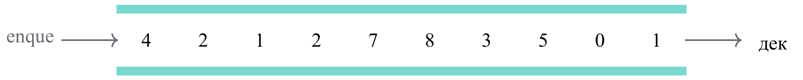

*Рисунок 4.11: Очередь*

<a id="ch04-4-4-1-абстрактный-тип-данных-очередь"></a>

### 4.4.1 Абстрактный тип данных «Очередь»

Очередь — это структура данных, поддерживающая свойство порядка FIFO. Она определяется следующей структурой и набором операций:

- new() создаёт новую очередь, не принимает параметров и возвращает пустую очередь.
- enqueue(item) добавляет новый элемент в конец очереди, принимает параметр item и ничего не возвращает.
- dequeue() удаляет элемент из начала очереди, не принимает параметров, возвращает удалённый элемент и изменяет очередь.
- is_empty() проверяет, пуста ли очередь, не принимает параметров и возвращает логическое значение.
- size() возвращает количество элементов в очереди, не принимает параметров и возвращает целое число типа usize.
- iter() возвращает неизменяемую итерацию по очереди, при этом очередь остаётся неизменной, параметров не принимает.
- iter_mut() возвращает изменяемую итерацию по очереди, при этом очередь изменяема, параметров не принимает.
- into_iter() превращает очередь в итерацию, поглощает очередь и не принимает параметров.

Предположим, что пустая очередь `q` уже создана. В таблице ниже приведены ожидаемые результаты выполнения различных операций над очередью, причём передний конец очереди расположен слева:

**Таблица 4.4: Операции с очередью**

| операция | значение | результат |
| --- | --- | --- |
| q.is_empty() | [] | true |
| q.enqueue(1) | [1] |  |
| q.enqueue(2) | [1,2] |  |
| q.enqueue(3) | [1,2,3] |  |
| q.dequeue() | [2,3] | 1 |
| q.enqueue(4) | [2,3,4] |  |
| q.enqueue(5) | [2,3,4,5] |  |
| q.deque() | [3,4,5] | 2 |
| q.size() | [3,4,5] | 3 |
| q.is_empty() | [3,4,5] | false |

<a id="ch04-4-4-2-реализация-очереди-на-rust"></a>

### 4.4.2 Реализация очереди на Rust

Чтобы реализовать очередь на Rust, можно использовать `Vec`, считая его левый конец задним концом очереди, а правый — передним. Добавление элемента в очередь имеет сложность O(n), тогда как удаление элемента — сложность O(1). Чтобы очередь не росла бесконечно, можно задать параметр `cap`, ограничивающий её длину.

```rust
// queue.rs

#[derive(Debug)]
struct Queue<T> {
    cap: usize, // capacity
    data: Vec<T>, // store elements
}

impl<T> Queue<T> {
    fn new(size: usize) -> Self {
        Self { cap: size, data: Vec::with_capacity(size) }
    }

    fn is_empty(&self) -> bool { 0 == Self::len(&self) }

    fn is_full(&self) -> bool { self.len() == self.cap }

    fn len(&self) -> usize { self.data.len() }

    fn clear(&mut self) {
        self.data = Vec::with_capacity(self.cap);
    }

    fn enqueue(&mut self, val: T) -> Result<(), String> {
        if self.len() == self.cap { // check left space
            return Err("No space available".to_string());
        }
        self.data.insert(0, val);
        Ok(())
    }

    // pop out values
    fn dequeue(&mut self) -> Option<T> {
        if self.len() > 0 {
            self.data.pop()
        } else {
            None
        }
    }

    // Implemntion of iterations for a queue
    // into_iter: queue modified and became a iterator
    // iter: queue unmodified and get a unmutable iterator
    // iter_mut: queue unmodified and get a mutable iterator
    fn into_iter(self) -> IntoIter<T> {
        IntoIter(self)
```

```rust
    }

    fn iter(&self) -> Iter<T> {
        let mut iterator = Iter { stack: Vec::new() };
        for item in self.data.iter() {
            iterator.stack.push(item);
        }
        iterator
    }

    fn iter_mut(&mut self) -> IterMut<T> {
        let mut iterator = IterMut { stack: Vec::new() };
        for item in self.data.iter_mut() {
            iterator.stack.push(item);
        }
        iterator
    }
}

// Implemention of 3 iterations
struct IntoIter<T>(Queue<T>);
impl<T: Clone> Iterator for IntoIter<T> {
    type Item = T;
    fn next(&mut self) -> Option<Self::Item> {
        if !self.0.is_empty() {
            Some(self.0.data.remove(0))
        } else {
            None
        }
    }
}

struct Iter<'a, T: 'a> { stack: Vec<&'a T>, }
impl<'a, T> Iterator for Iter<'a, T> {
    type Item = &'a T;
    fn next(&mut self) -> Option<Self::Item> {
        if 0 != self.stack.len() {
            Some(self.stack.remove(0))
        } else {
            None
        }
    }
}

struct IterMut<'a, T: 'a> { stack: Vec<&'a mut T> }
impl<'a, T> Iterator for IterMut<'a, T> {
    type Item = &'a mut T;
    fn next(&mut self) -> Option<Self::Item> {
        if 0 != self.stack.len() {
            Some(self.stack.remove(0))
        } else {
            None
```

```rust
        }
    }
}
fn main() {
    basic();
    iter();
    fn basic() {
        let mut q = Queue::new(4);
        let _r1 = q.enqueue(1); let _r2 = q.enqueue(2);
        let _r3 = q.enqueue(3); let _r4 = q.enqueue(4);
        if let Err(error) = q.enqueue(5) {
            println!("Enqueue error: {error}");
        }
        if let Some(data) = q.dequeue() {
            println!("dequeue data: {data}");
        } else {
            println!("empty queue");
        }
        println!("empty: {}, len: {}", q.is_empty(), q.len());
        println!("full: {}", q.is_full());
        println!("q: {:?}", q);
        q.clear();
        println!("{:?}", q);
    }

    fn iter() {
        let mut q = Queue::new(4);
        let _r1 = q.enqueue(1); let _r2 = q.enqueue(2);
        let _r3 = q.enqueue(3); let _r4 = q.enqueue(4);
        let sum1 = q.iter().sum::<i32>();
        let mut addend = 0;
        for item in q.iter_mut() {
            *item += 1;
            addend += 1;
        }
        let sum2 = q.iter().sum::<i32>();
        println!("{sum1} + {addend} = {sum2}");
        println!("sum = {}", q.into_iter().sum::<i32>());
    }
}
```

Вот результат выполнения.

```text
Enqueue error: No space available
dequeue data: 1
empty: false, len: 3
full: false
q: Queue { cap: 4, data: [4, 3, 2] }
Queue { cap: 4, data: [] }
10 + 4 = 14
sum = 14
```

<a id="ch04-4-4-3-горячая-картошка"></a>

### 4.4.3 Горячая картошка

Очередь часто используется для моделирования реальных ситуаций, в которых данные обрабатываются по принципу FIFO (первым пришёл — первым ушёл). Например, игра «горячая картошка» предполагает, что дети встают в круг и быстро передают картошку соседу, стремясь удержать её в движении, словно она горячая (см. рис. 4.12). Когда передача прекращается, ребёнок, держащий картошку, выбывает из круга. Игра продолжается до тех пор, пока в круге не останется один ребёнок. Игра напоминает «музыкальные стулья», где люди выполняют какое-либо действие — говорят, танцуют или встают со своих мест, — когда музыка замолкает.

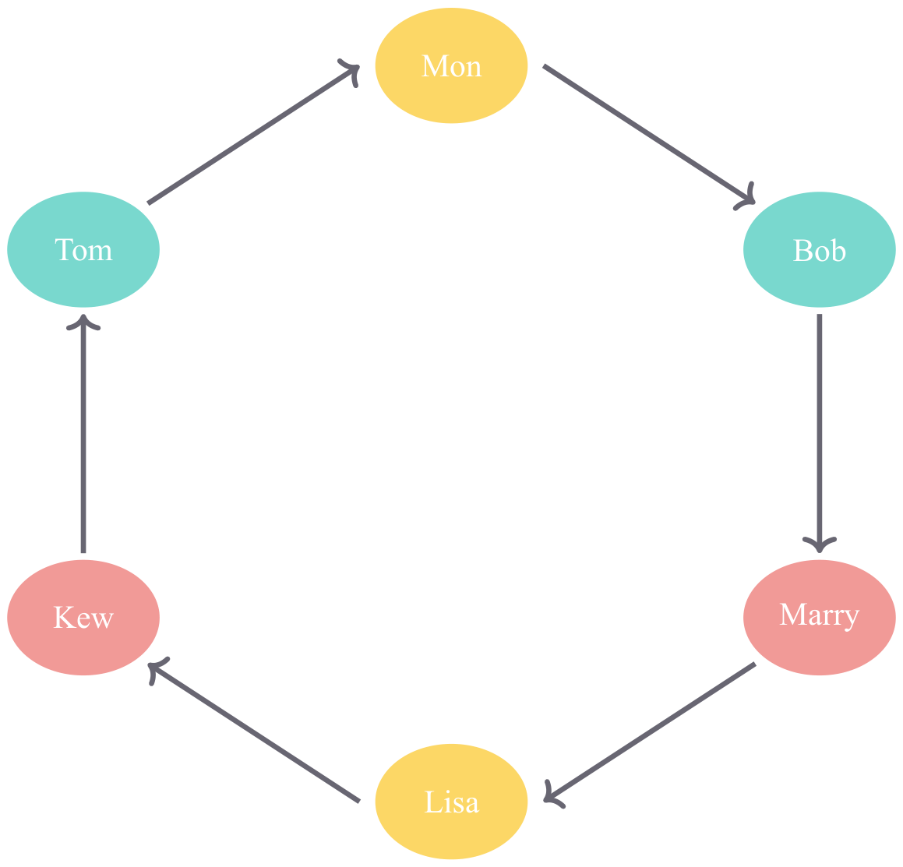

*Рисунок 4.12: горячая картошка*

Игра «горячая картошка» сопоставима с задачей Иосифа — легендарной историей, рассказанной историком Флавием Иосифом. Иосиф и его товарищи были заперты в пещере римской армией и предпочли умереть, нежели стать рабами Рима. Они образовали круг и стали считать по часовой стрелке до восьмого человека, которого затем убивали. Это продолжалось до тех пор, пока в живых не остался лишь один человек. Будучи математиком, Иосиф вычислил, где ему следует сесть, чтобы остаться последним живым, и в конечном счёте примкнул к римской стороне. Хотя у этой истории есть различные варианты, основные идеи как игры «горячая картошка», так и задачи Иосифа можно смоделировать с помощью очереди.

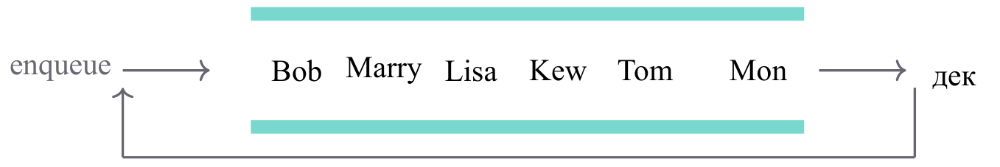

*Рисунок 4.13: моделирование игры «горячая картошка»*

Чтобы реализовать игру «горячая картошка», программа принимает несколько имён детей и константу `num`, задающую число детей, которых нужно пропустить, прежде чем исключить одного из круга. Предполагается, что ребёнок, держащий горячую картошку, всегда находится в начале очереди: он покидает очередь и встаёт в её конец, фактически передавая картошку следующему ребёнку, который оказывается в начале очереди. После `num` раундов извлечения из очереди и добавления в неё ребёнок, находящийся в начале очереди, окончательно удаляется.

Процесс повторяется до тех пор, пока в очереди не останется одно имя. Модель очереди для игры «горячая картошка» наглядно показана на двух приведённых выше рисунках. Ниже приведена реализация игры на основе этой модели.

```rust
// hot_potato.rs

fn hot_potato(names: Vec<&str>, num: usize) -> &str {
    // Initialize the queue and enqueue the names
    let mut q = Queue::new(names.len());
    for name in names {
        let _nm = q.enqueue(name);
    }

    while q.size() > 1 {
        // Dequeue and enqueue the names,
        // which simulates passing the potato
        for _i in 0..num {
            let name = q.dequeue().unwrap();
            let _rm = q.enqueue(name);
        }

        // After num dequeue/enqueue cycles
        // remove one person
        let _rm = q.dequeue();
    }

    q.dequeue().unwrap()
}
fn main() {
    let name = vec!["Mon","Tom","Kew","Lisa","Marry","Bob"];
    let survivor = hot_potato(name, 8);
    println!("The survival person is {survivor}");
    // The survival person is Marry
}
```

Стоит отметить, что используемое в реализации значение счётчика равно 8, то есть оно больше числа людей в очереди (равного 6). Однако это не проблема, поскольку очередь работает подобно кругу: достигнув конца, она возвращается к началу и продолжает отсчёт до тех пор, пока не будет достигнуто нужное значение. Поэтому в конце концов кто-то обязательно будет извлечён из очереди.

<a id="ch04-4-5-дек"></a>

## 4.5 Дек

Дек — это тоже линейная структура данных с двумя концами: передним и задним. В отличие от очереди, дек позволяет добавлять и удалять элементы с обоих концов. Такая гибкость делает его гибридной линейной структурой, способной работать и как стек, и как очередь. Хотя дек имеет сходство и со стеком, и с очередью, он не навязывает ни порядка LIFO, ни порядка FIFO. Порядок добавления и удаления данных определяет, будет ли дек вести себя как стек или как очередь. Важно отметить, что дек не следует использовать вместо стека или очереди, поскольку у каждой структуры данных есть свои уникальные свойства и она проектировалась для определённых вычислительных задач. Пример дека приведён на рисунке ниже.

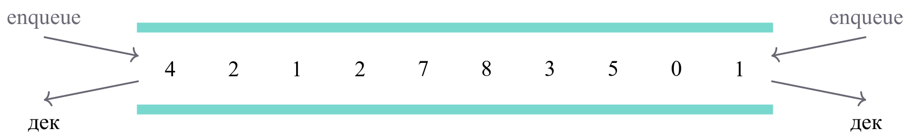

*Рисунок 4.14: Дек*

<a id="ch04-4-5-1-абстрактный-тип-данных-дек"></a>

### 4.5.1 Абстрактный тип данных «дек»

Структура данных «дек» представляет собой упорядоченную коллекцию элементов, допускающую добавление и удаление элементов с любого из концов. Она определяется следующими операциями:

- new() создаёт новый дек без аргументов и возвращает пустой дек.
- add_front(item) добавляет элемент item на передний конец дека, требуя item в качестве параметра и не возвращая никакого значения.
- add_rear(item) добавляет элемент item на задний конец дека, требуя item в качестве параметра и не возвращая никакого значения.
- remove_front() удаляет передний элемент из дека, не принимая аргументов, возвращает удалённый элемент и при этом изменяет дек.
- remove_rear() удаляет задний элемент из дека, не принимая аргументов, возвращает удалённый элемент и при этом изменяет дек.
- is_empty() проверяет, пуст ли дек, не принимая аргументов и возвращая логическое значение.
- size() возвращает число элементов в деке, не принимая аргументов и возвращая целое число типа `usize`.
- iter() возвращает неизменяемую форму итерации по деку; дек при этом остаётся неизменным, аргументы не требуются.
- iter_mut() возвращает изменяемую форму итерации по деку; дек при этом изменяем, аргументы не требуются.
- into_iter() превращает дек в итерируемую форму; дек при этом потребляется, аргументы не требуются.

Предположим, что `d` — это уже созданный пустой дек; в таблице ниже показаны результаты серии операций. Обратите внимание, что передний конец находится с правой стороны. При добавлении и извлечении элементов важно отслеживать содержимое переднего и заднего концов, поскольку изменение обоих концов может сделать результат несколько запутанным.

**Таблица 4.5: Операции над деком**

| операции | значение | возвращаемое значение |
| --- | --- | --- |
| d.is_empty() | [] | true |
| d.add_rear(1) | [1] | |
| d.add_rear(2) | [2,1] | |
| d.add_front(3) | [2,1,3] | |
| d.add_front(4) | [2,1,3,4] | |
| d.remove_rear() | [1,3,4] | 2 |
| d.remove_front() | [1,3] | 4 |
| d.size() | [1,3] | 2 |
| d.is_empty() | [1,3] | false |
| d.add_front(2) | [1,3,2] | |
| d.add_rear(4) | [4,1,3,2] | |
| d.size() | [4,1,3,2] | 4 |
| d.is_empty() | [4,1,3,2] | false |
| d.add_rear(5) | [5,4,1,3,2] | |
| d.add_front(10) | [5,4,1,3,2,10] | |

<a id="ch04-4-5-2-реализация-дека-на-rust"></a>

### 4.5.2 Реализация дека на Rust

Чтобы реализовать абстрактный тип данных «дек» на Rust, можно использовать `Vec` в качестве базовой структуры данных. Левый конец `Vec` служит задним концом дека, а правый — передним. Чтобы дек не рос бесконечно, добавлен параметр ёмкости, управляющий максимальной длиной дека.

```rust
// deque.rs

// deque definition
#[derive(Debug)]
struct Deque<T> {
    cap: usize, // capacity
    data: Vec<T>, // save elements in data
}

impl<T> Deque<T> {
    fn new(cap: usize) -> Self {
        Self {
            cap: cap,
            data: Vec::with_capacity(cap),
        }
    }

    fn is_empty(&self) -> bool {
        0 == self.len()
    }

    fn is_full(&self) -> bool {
        self.len() == self.cap
    }

    fn len(&self) -> usize {
        self.data.len()
    }

    fn clear(&mut self) {
        self.data = Vec::with_capacity(self.cap);
    }

    // use the tail of a Vec as the start of the deque
    fn add_front(&mut self, val: T) -> Result<(), String> {
        if self.len() == self.cap {
            return Err("No space avaliable".to_string());
        }
        self.data.push(val);

        Ok(())
    }

    // the head of the Vec is the tail of the deque
    fn add_rear(&mut self, val: T) -> Result<(), String> {
        if self.len() == self.cap {
```

```rust
            return Err("No space avaliabl".to_string());
        }
        self.data.insert(0, val);

        Ok(())
    }

    // remove data from queue head
    fn remove_front(&mut self) -> Option<T> {
        if self.len() > 0 {
            self.data.pop()
        } else {
            None
        }
    }

    // remove data from queue tail
    fn remove_rear(&mut self) -> Option<T> {
        if self.len() > 0 {
            Some(self.data.remove(0))
        } else {
            None
        }
    }

    // Implemention of iteration for the deque
    // into_iter: deque modified and became a iterator
    // iter: deque unmodified and get a unmutable iterator
    // iter_mut: deque unmodified and get a mutable iterator
    fn into_iter(self) -> IntoIter<T> {
        IntoIter(self)
    }

    fn iter(&self) -> Iter<T> {
        let mut iterator = Iter { stack: Vec::new() };
        for item in self.data.iter() {
            iterator.stack.push(item);
        }

        iterator
    }

    fn iter_mut(&mut self) -> IterMut<T> {
        let mut iterator = IterMut { stack: Vec::new() };
        for item in self.data.iter_mut() {
            iterator.stack.push(item);
        }

        iterator
    }
}
```

```rust
// Implementing 3 iterations
struct IntoIter<T>(Deque<T>);
impl<T: Clone> Iterator for IntoIter<T> {
    type Item = T;
    fn next(&mut self) -> Option<Self::Item> {
        // first element of a tuple is not empty
        if !self.0.is_empty() {
            Some(self.0.data.remove(0))
        } else {
            None
        }
    }
}

struct Iter<'a, T: 'a> { stack: Vec<&'a T>, }
impl<'a, T> Iterator for Iter<'a, T> {
    type Item = &'a T;
    fn next(&mut self) -> Option<Self::Item> {
        if 0 != self.stack.len() {
            Some(self.stack.remove(0))
        } else {
            None
        }
    }
}

struct IterMut<'a, T: 'a> { stack: Vec<&'a mut T> }
impl<'a, T> Iterator for IterMut<'a, T> {
    type Item = &'a mut T;
    fn next(&mut self) -> Option<Self::Item> {
        if 0 != self.stack.len() {
            Some(self.stack.remove(0))
        } else {
            None
        }
    }
}

fn main() {
    basic();
    iter();

    fn basic() {
        let mut d = Deque::new(4);
        let _r1 = d.add_front(1);
        let _r2 = d.add_front(2);
        let _r3 = d.add_rear(3);
        let _r4 = d.add_rear(4);

        if let Err(error) = d.add_front(5) {
            println!("add_front error: {error}");
        }
```

```rust
        println!("{:?}", d);

        match d.remove_rear() {
            Some(data) => println!("remove rear data {data}"),
            None => println!("empty deque"),
        }

        match d.remove_front() {
            Some(data) => println!("remove front data {data}"),
            None => println!("empty deque"),
        }
        println!("empty: {}, len: {}", d.is_empty(), d.len());
        println!("full: {}, {:?}", d.is_full(), d);

        d.clear();
        println!("{:?}", d);
    }

    fn iter() {
        let mut d = Deque::new(4);
        let _r1 = d.add_front(1);
        let _r2 = d.add_front(2);
        let _r3 = d.add_rear(3);
        let _r4 = d.add_rear(4);

        let sum1 = d.iter().sum::<i32>();
        let mut addend = 0;
        for item in d.iter_mut() {
            *item += 1;
            addend += 1;
        }

        let sum2 = d.iter().sum::<i32>();
        println!("{sum1} + {addend} = {sum2}");
        assert_eq!(14, d.into_iter().sum::<i32>());
    }
}
```

Ниже приведён пример вывода программы.

```text
add_front error: No space avaliable
Deque { cap: 4, data: [4, 3, 1, 2] }
remove rear data 4
remove front data 2
empty: false, len: 2
full: false, Deque { cap: 4, data: [3, 1] }
Deque { cap: 4, data: [] }
10 + 4 = 14
```

Как видно из приведённого вывода, дек имеет сходство и с очередью, и со стеком, и его можно рассматривать как их сочетание. Конкретная реализация дека может различаться в зависимости от ситуации, а то, какой конец считается передним и какой — задним, следует определять исходя из контекста.

<a id="ch04-4-5-3-проверка-палиндрома"></a>

### 4.5.3 Проверка палиндрома

Палиндромы — это строки, в которых символы на одинаковых позициях от обоих концов совпадают, например «radar», «sos» и «rustsur». В этом разделе мы рассмотрим алгоритм, позволяющий проверить, является ли заданная строка палиндромом. Один из подходов заключается в том, чтобы с помощью очереди поместить символы строки в очередь, а затем извлекать их оттуда и сравнивать с перевёрнутой исходной строкой. Этот метод прост, но требует много памяти. Более эффективный подход — использовать дек.

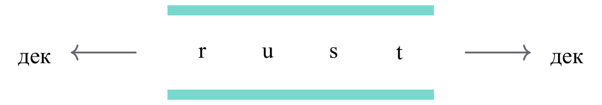

*Рисунок 4.15: Проверка палиндрома*

Чтобы проверять палиндромы с помощью дека, мы сначала обрабатываем входную строку слева направо, добавляя каждый её символ на задний конец дека. На этом этапе передний конец дека содержит первый символ строки, а задний — последний. Затем мы можем воспользоваться особенностью дека извлекать элементы с обоих концов, чтобы сравнивать символы, находящиеся на переднем и заднем концах. Если они совпадают, мы продолжаем извлекать символы с переднего и заднего концов, пока либо все символы не будут использованы и дек не опустеет, либо не останется дек размером 1. В обоих случаях строка является палиндромом. Любая другая ситуация означает, что строка не является палиндромом. Ниже приведён код реализации определения палиндрома с помощью дека.

```rust
// palindrome_checker.rs
fn palindrome_checker(pal: &str) -> bool {
    let mut d = Deque::new(pal.len());
    for c in pal.chars() {
        let _r = d.add_rear(c);
    }

    let mut is_pal = true;
    while d.size() > 1 && is_pal {
        let head = d.remove_front();
        let tail = d.remove_rear();
        if head != tail {
            is_pal = false;
        }
    }
    is_pal
}

fn main() {
    let pal = "rustsur";
    let is_pal = palindrome_checker(pal);
    println!("{pal} is palindrome string: {is_pal}");
    // rustsur is palindrome string: true

    let pal = "panda";
    let is_pal = palindrome_checker(pal);
    println!("{pal} is palindrome string: {is_pal}");
    // panda is palindrome string: false
}
```

<a id="ch04-4-6-связный-список"></a>

## 4.6 Связный список

Упорядоченная коллекция элементов данных важна для сохранения относительного положения данных и для обеспечения эффективного индексирования. И массивы, и связные списки позволяют собирать данные в упорядоченном виде и хранить их в относительных позициях, что делает их подходящими для реализации упорядоченных типов данных. Например, стандартная реализация Vec в Rust использует массив. В этом разделе рассматриваются связные списки, которые обладают рядом уникальных преимуществ. В отличие от массивов, связные списки не требуют размещения элементов в непрерывной памяти. Каждый элемент коллекции содержит ссылку на следующий элемент, поэтому элементы могут располагаться произвольно, без необходимости выделять целый блок памяти, что повышает эффективность работы. Для работы со связным списком необходимо явно указать положение первого элемента. Зная положение первого элемента, мы можем определить положение второго и так далее до самого конца связного списка.

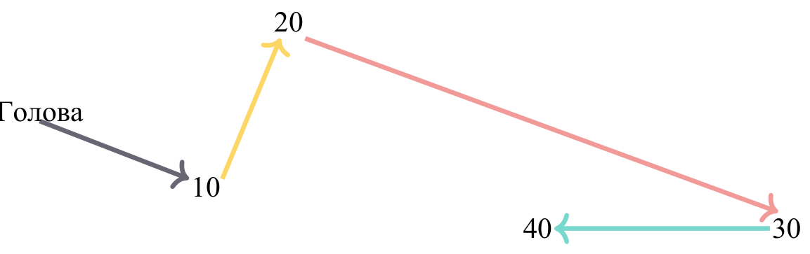

*Рисунок 4.16: Связный список*

Обычно связный список предоставляет ссылку на голову списка, а последний элемент должен быть установлен в null или в пустой следующий элемент, который также называется хвостом списка. При такой организации связный список можно легко обходить от головы к хвосту или в обратном направлении, переходя по ссылкам между элементами. Благодаря этому связные списки являются эффективной структурой данных для реализации других упорядоченных типов данных.

<a id="ch04-4-6-1-абстрактный-тип-данных-связный-список"></a>

### 4.6.1 Абстрактный тип данных «связный список»

Абстрактный тип данных связного списка состоит из его структуры и набора операций. Как отмечалось выше, связный список представляет собой упорядоченную коллекцию узлов, причём весь список можно обойти, начиная с головного узла. Структура связного списка довольно проста: каждый узел содержит один элемент и ссылку на следующий узел. Для связного списка определены следующие операции:

- new(): создаёт новый головной узел, указывающий на Node, не принимает аргументов и возвращает указатель.
- push(item): добавляет новый Node, принимает параметр item и возвращает None.
- pop(): удаляет головной узел связного списка, не принимает аргументов и возвращает этот узел типа Node.
- peek(): возвращает ссылку на головной узел связного списка, не принимает аргументов.
- peek_mut(): возвращает головной узел связного списка, не принимает аргументов и возвращает изменяемую ссылку на этот узел.
- is_empty(): возвращает логическое значение, указывающее, пуст ли текущий связный список, и не принимает аргументов.
- size(): возвращает длину связного списка в виде целого числа типа usize, не принимает аргументов.
- iter(): возвращает неизменяемую итерацию по связному списку, не изменяя при этом сам связный список, и не принимает аргументов.
- iter_mut(): возвращает изменяемую итерацию по связному списку, причём сам список должен быть изменяемым, и не принимает аргументов.
- into_iter(): потребляет связный список и возвращает его в итерируемой форме, не принимая аргументов.

Предположим, что l — пустой связный список; в таблице ниже показан результат последовательности операций над связным списком, где Link<num> обозначает адрес, указывающий на узел, содержащий num, а левый конец списка является головным узлом.

**Таблица 4.6: Операции над связным списком**

| Операция | Значение | Возвращаемое значение |
| --- | --- | --- |
| l.is_empty() | [None->None] | true |
| l.push(1) | [1->None] |  |
| l.push(2) | [2->1->None] |  |
| l.push(3) | [3->2->1->None] |  |
| l.peek() | [3->2->1->None] | Link<3> |
| l.pop() | [2->1->None] | 3 |
| l.size() | [2->1->None] | 2 |
| l.push(4) | [4->2->1->None] |  |
| l.peek_mut() | [4->2->1->None] | mut Link<4> |
| l.iter() | [4->2->1->None] | [4,2,1] |
| l.is_empty() | [4->2->1->None] | false |
| l.size() | [4->2->1->None] | 3 |
| l.into_iter() | [None->None] | [4,2,1] |

<a id="ch04-4-6-2-реализация-связного-списка-на-rust"></a>

### 4.6.2 Реализация связного списка на Rust

Для представления элемента связного списка мы используем абстракцию узла, которая включает сам элемент данных и адрес следующего элемента. Узел также предоставляет методы для доступа к элементу данных и его изменения. Как показано на рисунке ниже, Node состоит из данных и адреса следующего узла.

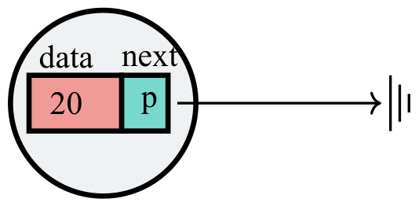

*Рисунок 4.17: Узел*

В Rust значение None используется для обозначения отсутствия следующего узла как в Node, так и в самом связном списке. Функция new инициализирует узел, устанавливая его поле next в None. Явное присваивание None полю next — хорошая практика, помогающая избежать висячих указателей, распространённой проблемы в таких языках, как C/C++.

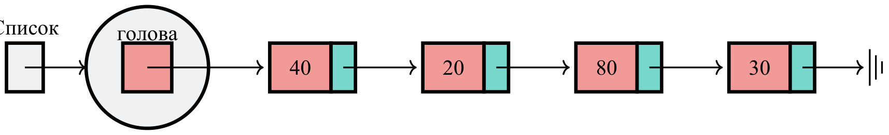

*Рисунок 4.18: Связный список*

Приведённый ниже код показывает реализацию связного списка; для читаемости кода ссылка на узел определена с помощью псевдонима Link.

```rust
// linked_list.rs

// The node link uses a Box pointer (size determined),
// because only with a determined size can memory be allocated.
type Link<T> = Option<Box<Node<T>>>;
```

```rust
// Linked list definition
struct List<T> {
    size: usize, // Number of nodes in the linked list
    head: Link<T>, // Head node
}

// Linked list node
struct Node<T> {
    elem: T, // data
    next: Link<T>, // Link to the next node
}

impl<T> List <T> {
    fn new() -> Self {
        Self {
            size: 0,
            head: None
        }
    }

    fn is_empty(&self) -> bool { 0 == self.size }

    fn len(&self) -> usize { self.size }

    fn clear(&mut self) {
        self.size = 0;
        self.head = None;
    }

    // add a new node ahead of the head node
    fn push(&mut self, elem: T) {
        let node = Box::new(Node {
            elem: elem,
            next: self.head.take(),
        });
        self.head = Some(node);
        self.size += 1;
    }

    // take will move data out from node and left a vaccum
    fn pop(&mut self) -> Option<T> {
        self.head.take().map(|node| {
            self.head = node.next;
            self.size -= 1;
            node.elem
        })
    }

    // peek get a unmutable reference
    fn peek(&self) -> Option<&T> {
        self.head.as_ref().map(|node| &node.elem )
    }
```

```rust
    // peek_mut get a mutable reference
    fn peek_mut(&mut self) -> Option<&mut T> {
        self.head.as_mut().map(|node| &mut node.elem )
    }

    // Implementation of iteration for the linked list.
    // into_iter: makes the linked list an iterator
    // by consuming it
    // iter: returns an immutable iterator without modifying
    // the linked list
    // iter_mut: returns a mutable iterator without modifying
    // the linked list
    fn into_iter(self) -> IntoIter<T> {
        IntoIter(self)
    }

    fn iter(&self) -> Iter<T> {
        Iter { next: self.head.as_deref() }
    }

    fn iter_mut(&mut self) -> IterMut<T> {
        IterMut { next: self.head.as_deref_mut() }
    }
}

// Implementation of three iterations
struct IntoIter<T>(List<T>);
impl<T> Iterator for IntoIter<T> {
    type Item = T;
    fn next(&mut self) -> Option<Self::Item> {
        // (List<T>) tuple's 0th item
        self.0.pop()
    }
}

struct Iter<'a, T: 'a> { next: Option<&'a Node<T>> }
impl<'a, T> Iterator for Iter<'a, T> {
    type Item = &'a T;
    fn next(&mut self) -> Option<Self::Item> {
        self.next.map(|node| {
            self.next = node.next.as_deref();
            &node.elem
        })
    }
}

struct IterMut<'a, T: 'a> { next: Option<&'a mut Node<T>> }
impl<'a, T> Iterator for IterMut<'a, T> {
    type Item = &'a mut T;
    fn next(&mut self) -> Option<Self::Item> {
        self.next.take().map(|node| {
```

```rust
            self.next = node.next.as_deref_mut();
            &mut node.elem
        })
    }
}

// Custom implementation of Drop for the linked list
impl<T> Drop for List<T> {
    fn drop(&mut self) {
        let mut link = self.head.take();
        while let Some(mut node) = link {
            link = node.next.take();
        }
    }
}

fn main() {
    basic_test();
    into_iter_test();
    iter_test();
    iter_mut_test();

    fn basic_test() {
        let mut list = List::new();
        list.push(1); list.push(2); list.push(3);

        assert_eq!(list.len(), 3);
        assert_eq!(list.is_empty(), false);
        assert_eq!(list.pop(), Some(3));
        assert_eq!(list.peek(), Some(&2));
        assert_eq!(list.peek_mut(), Some(&mut 2));

        list.peek_mut().map(|val| {
            *val = 4;
        });

        assert_eq!(list.peek(), Some(&4));
        list.clear();
        println!("basics test Ok!");
    }

    fn into_iter_test() {
        let mut list = List::new();
        list.push(1); list.push(2); list.push(3);

        let mut iter = list.into_iter();
        assert_eq!(iter.next(), Some(3));
        assert_eq!(iter.next(), Some(2));
        assert_eq!(iter.next(), Some(1));
        assert_eq!(iter.next(), None);

        println!("into_iter test Ok!");
```

```rust
    }

    fn iter_test() {
        let mut list = List::new();
        list.push(1); list.push(2); list.push(3);

        let mut iter = list.iter();
        assert_eq!(iter.next(), Some(&3));
        assert_eq!(iter.next(), Some(&2));
        assert_eq!(iter.next(), Some(&1));
        assert_eq!(iter.next(), None);
        println!("iter test Ok!");
    }

    fn iter_mut_test() {
        let mut list = List::new();
        list.push(1); list.push(2); list.push(3);

        let mut iter = list.iter_mut();
        assert_eq!(iter.next(), Some(&mut 3));
        assert_eq!(iter.next(), Some(&mut 2));
        assert_eq!(iter.next(), Some(&mut 1));
        assert_eq!(iter.next(), None);
        println!("iter_mut test Ok!");
    }
}
```

<a id="ch04-4-6-3-стек-на-основе-связного-списка"></a>

### 4.6.3 Стек на основе связного списка

Для реализации стека также можно использовать связный список — ещё одну разновидность линейных структур данных. В этом случае для хранения вершины стека можно использовать голову связного списка. По мере добавления новых элементов в стек они вставляются в начало связного списка. Реализация такого подхода приведена ниже. Обратите внимание, что, поскольку функции push и pop изменяют узлы связного списка, для извлечения значения узла используется функция take, которая забирает содержимое узла, оставляя на его месте пустое значение.

```rust
// list_stack.rs

// Linked List Node
#[derive(Debug, Clone)]
struct Node<T> {
    data: T,
    next: Link<T>,
}

// Node Self-contained Reference
type Link<T> = Option<Box<Node<T>>>;

impl<T> Node<T> {
    fn new(data: T) -> Self {
        Self {
            data: data,
            next: None // No next link when initialized
```

```rust
        }
    }
}

// Linked list stack
#[derive(Debug, Clone)]
struct LStack<T> {
    size: usize,
    top: Link<T>, // Top controls the entire stack
}

impl<T: Clone> LStack<T> {
    fn new() -> Self {
        Self {
            size: 0,
            top: None
        }
    }

    fn is_empty(&self) -> bool {
        0 == self.size
    }

    fn len(&self) -> usize {
        self.size
    }

    fn clear(&mut self) {
        self.size = 0;
        self.top = None;
    }

    // take out the node on the top, leaving an empty space
    // that could be filled later
    fn push(&mut self, val: T) {
        let mut node = Node::new(val);
        node.next = self.top.take();
        self.top = Some(Box::new(node));
        self.size += 1;
    }

    fn pop(&mut self) -> Option<T> {
        self.top.take().map(|node| {
            let node = *node;
            self.top = node.next;
            self.size -= 1;
            node.data
        })
    }

    // Return a reference to the data in the linked list stack
    fn peek(&self) -> Option<&T> {
```

```rust
        self.top.as_ref().map(|node| &node.data)
    }

    fn peek_mut(&mut self) -> Option<&mut T> {
        self.top.as_deref_mut().map(|node| &mut node.data)
    }

    // into_iter: the linked list stack changes
    // iter: the linked list stack remains unchanged
    // iter_mut: the linked list stack remains unchanged
    fn into_iter(self) -> IntoIter<T> {
        IntoIter(self)
    }

    fn iter(&self) -> Iter<T> {
        Iter { next: self.top.as_deref() }
    }

    fn iter_mut(&mut self) -> IterMut<T> {
        IterMut { next: self.top.as_deref_mut() }
    }
}

// Implement three iterations
struct IntoIter<T: Clone>(LStack<T>);
impl<T: Clone> Iterator for IntoIter<T> {
    type Item = T;
    fn next(&mut self) -> Option<Self::Item> {
        self.0.pop()
    }
}

struct Iter<'a, T: 'a> { next: Option<&'a Node<T>> }
impl<'a, T> Iterator for Iter<'a, T> {
    type Item = &'a T;
    fn next(&mut self) -> Option<Self::Item> {
        self.next.map(|node| {
            self.next = node.next.as_deref();
            &node.data
        })
    }
}

struct IterMut<'a, T: 'a> { next: Option<&'a mut Node<T>> }
impl<'a, T> Iterator for IterMut<'a, T> {
    type Item = &'a mut T;
    fn next(&mut self) -> Option<Self::Item> {
        self.next.take().map(|node| {
            self.next = node.next.as_deref_mut();
            &mut node.data
        })
    }
```

```rust
}

fn main() {
    basic();
    iter();

    fn basic() {
        let mut s = LStack::new();
        s.push(1); s.push(2); s.push(3);

        println!("empty: {:?}", s.is_empty());
        println!("top: {:?}, size: {}", s.peek(), s.len());
        println!("pop: {:?}, size: {}", s.pop(), s.len());

        let peek_mut = s.peek_mut();
        if let Some(data) = peek_mut {
            *data = 4
        }
        println!("top {:?}, size {}", s.peek(), s.len());

        println!("{:?}", s);
        s.clear();
        println!("{:?}", s);
    }

    fn iter() {
        let mut s = LStack::new();
        s.push(1); s.push(2); s.push(3);

        let sum1 = s.iter().sum::<i32>();
        let mut addend = 0;
        for item in s.iter_mut() {
            *item += 1;
            addend += 1;
        }
        let sum2 = s.iter().sum::<i32>();
        println!("{sum1} + {addend} = {sum2}");

        assert_eq!(9, s.into_iter().sum::<i32>());
    }
}
```

Вывод программы будет зависеть от того, как именно используется стек и какие функции вызываются.

```text
empty: false
top: Some(3), size: 3
pop: Some(3), size: 2
top Some(4), size 2
LStack { size: 2, top: Some(Node { data: 4,
         next: Some(Node { data: 1, next: None }) }) }
LStack { size: 0, top: None }
6 + 3 = 9
```

<a id="ch04-4-7-vec"></a>

## 4.7 Vec

В этой главе мы продемонстрировали, каким образом базовый тип данных Vec может использоваться для реализации различных абстрактных типов данных, включая стек, очередь, дек и связные списки. Vec — мощный, но вместе с тем простой контейнер данных, предоставляющий механизмы сбора данных и выполнения разнообразных операций, поэтому мы постоянно используем его как базовую структуру данных при реализации других типов данных. Он похож на List из Python и очень удобен в применении. Однако далеко не во всех языках программирования есть Vec, да и не всякий тип данных подходит для него. В некоторых случаях Vec или аналогичные контейнеры данных программистам приходится реализовывать самостоятельно.

<a id="ch04-4-7-1-абстрактный-тип-данных-vec"></a>

### 4.7.1 Абстрактный тип данных Vec

Vec представляет собой коллекцию элементов, сохраняющих взаимное относительное положение. Ниже перечислены различные операции абстрактного типа данных Vec:

- new(): создаёт новый пустой Vec, аргументов не принимает.
- push(item): добавляет элемент в конец Vec, принимает параметр item.
- pop(): удаляет последний элемент Vec и возвращает его, аргументов не принимает.
- insert(pos, item): вставляет элемент в позицию pos вектора Vec, принимает параметры pos и item.
- remove(idx): удаляет элемент с индексом idx из Vec и возвращает его, принимает один параметр.
- find(item): проверяет, присутствует ли элемент в Vec, и возвращает логическое значение, принимает параметр item.
- is_empty(): проверяет, пуст ли Vec, и возвращает логическое значение, аргументов не принимает.
- size(): вычисляет количество элементов в Vec и возвращает целое число типа usize, аргументов не принимает.
- iter(): возвращает неизменяемую итерацию по Vec.
- iter_mut(): возвращает изменяемую итерацию по Vec, аргументов не принимает.
- into_iter(): поглощает Vec и возвращает итерируемую форму Vec, аргументов не принимает.

Предположим, что v — это созданный пустой Vec. В таблице ниже показан вид Vec после выполнения различных операций, причём левая сторона соответствует голове списка.

**Таблица 4.7: Операции над Vec**

| операция | значение | результат |
| --- | --- | --- |
| v.is_empty() | [] | true |
| v.push(1) | [1] |  |
| v.push(2) | [1,2] |  |
| v.push(3) | [1,2,3] |  |
| v.size() | [1,2,3] | 3 |
| v.pop() | [1,2] | 3 |
| v.push(5) | [1,2,5] |  |
| v.find(4) | [1,2,5] | false |
| v.insert(0,8) | [8,1,2,5] |  |
| v.pop() | [8,1,2] | 5 |
| v.remove(0) | [1,2] | 8 |
| v.size() | [1,2] | 2 |

Наконец, стоит отметить, что, хотя Vec является мощной структурой данных, для конкретного варианта использования она не всегда окажется лучшим выбором. Программистам следует тщательно учитывать требования своего проекта и соответственно выбирать подходящую структуру данных.

<a id="ch04-4-7-2-реализация-vec-на-rust"></a>

### 4.7.2 Реализация Vec на Rust

Vec состоит из узлов связного списка, каждый из которых содержит элемент данных и явную ссылку на следующий узел. Зная местоположение первого узла, к последующим элементам можно получить доступ, переходя по ссылке next.

Поскольку ссылки играют ключевую роль в Vec, необходимо поддерживать ссылку на первый узел. Связный список создаётся со значением None, означающим, что список не ссылается ни на какое содержимое, как показано на рисунке (4.19). Голова связного списка ссылается на первый узел списка, в котором хранится адрес следующего узла. Важно отметить, что сам Vec не содержит объектов-узлов, а хранит лишь ссылку на первый узел структуры связного списка.

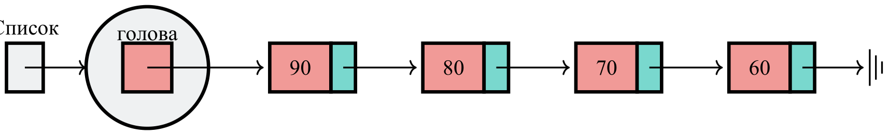

*Рисунок 4.19: Vec на основе связного списка*

Чтобы добавить новый элемент в связный список, единственная точка входа — это голова списка. Поскольку все остальные узлы доступны только переходом по ссылке next от первого узла, наиболее эффективный способ добавить новый узел — вставить его в голову связного списка. При таком подходе новый элемент становится первым элементом, а уже существовавшие элементы связываются с ним. Хотя приведённая здесь реализация Vec не является упорядоченной, упорядоченный Vec можно реализовать, используя функцию сравнения данных, задающую полный или частичный порядок. Приведённый ниже LVec обеспечивает лишь часть возможностей Vec из стандартной библиотеки, а функция print_lvec используется для вывода его элементов данных.

```rust
// lvec.rs

use std::fmt::Debug;

#[derive(Debug)]
struct Node<T> {
    elem: T,
    next: Link<T>,
}

type Link<T> = Option<Box<Node<T>>>;

impl<T> Node<T> {
    fn new(elem: T) -> Self {
        Self {
            elem: elem,
            next: None
        }
    }
}

// LinkedList Vec definition
#[derive(Debug)]
struct LVec<T> {
    size: usize,
    head: Link<T>,
}

impl<T: Copy + Debug> LVec<T> {
    fn new() -> Self {
        Self { size: 0, head: None }
```

```rust
    }

    fn is_empty(&self) -> bool {
        0 == self.size
    }

    fn len(&self) -> usize {
        self.size
    }

    fn clear(&mut self) {
        self.size = 0;
        self.head = None;
    }

    fn push(&mut self, elem: T) {
        let node = Node::new(elem);
        if self.is_empty() {
            self.head = Some(Box::new(node));
        } else {
            let mut curr = self.head.as_mut().unwrap();

            // find the last node in the list
            for _i in 0..self.size-1 {
                curr = curr.next.as_mut().unwrap();
            }

            // insert the new data after the last node
            curr.next = Some(Box::new(node));
        }
        self.size += 1;
    }

    // add a new LVec to the end of the stack
    fn append(&mut self, other: &mut Self) {
        while let Some(node) = other.head.as_mut().take() {
            self.push(node.elem);
            other.head = node.next.take();
        }
        other.clear();
    }

    fn insert(&mut self, mut index: usize, elem: T) {
        if index >= self.size { index = self.size; }

        // three cases for inserting a new node
        let mut node = Node::new(elem);
        if self.is_empty() { // LVec is empty
            self.head = Some(Box::new(node));
        } else if index == 0 { // insert at the beginning of
           the list node.next = self.head.take();
```

```rust
            self.head = Some(Box::new(node));
        } else { // insert int the middle of the list
            let mut curr = self.head.as_mut().unwrap();
            for _i in 0..index - 1 { // find the right insert
               position curr = curr.next.as_mut().unwrap();
            }
            node.next = curr.next.take();
            curr.next = Some(Box::new(node));
        }
        self.size += 1;
    }

    fn pop(&mut self) -> Option<T> {
        if self.size < 1 {
            return None;
        } else {
            self.remove(self.size - 1)
        }
    }

    fn remove(&mut self, index: usize) -> Option<T> {
        if index >= self.size { return None; }

        // two cases for deleting a node
        let mut node;
        if 0 == index {
            node = self.head.take().unwrap();
            self.head = node.next.take();
        } else { // find the position which will be deleteed
           and arrange the links properly let mut curr = self.head.as_mut().unwrap();
            for _i in 0..index - 1 {
                curr = curr.next.as_mut().unwrap();
            }
            node = curr.next.take().unwrap();
            curr.next = node.next.take();
        }
        self.size -= 1;

        Some(node.elem)
    }

   fn into_iter(self) -> IntoIter<T> {
        IntoIter(self)
    }

    fn iter(&self) -> Iter<T> {
        Iter { next: self.head.as_deref() }
    }

    fn iter_mut(&mut self) -> IterMut<T> {
```

```rust
        IterMut { next: self.head.as_deref_mut() }
    }

    // print LVec
    fn print_lvec(&self) {
        if 0 == self.size {
            println!("Empty lvec");
        }
        for item in self.iter() {
            println!("{:?}", item);
        }
    }
}

// Implemtion of three iterations
struct IntoIter<T: Copy + Debug >(LVec<T>);
impl<T: Copy + Debug> Iterator for IntoIter<T> {
    type Item = T;
    fn next(&mut self) -> Option<Self::Item> {
        self.0.pop()
    }
}

struct Iter<'a, T: 'a> { next: Option<&'a Node<T>> }
impl<'a, T> Iterator for Iter<'a, T> {
    type Item = &'a T;
    fn next(&mut self) -> Option<Self::Item> {
        self.next.map(|node| {
            self.next = node.next.as_deref();
            &node.elem
        })
    }
}

struct IterMut<'a, T: 'a> { next: Option<&'a mut Node<T>> }
impl<'a, T> Iterator for IterMut<'a, T> {
    type Item = &'a mut T;
    fn next(&mut self) -> Option<Self::Item> {
        self.next.take().map(|node| {
            self.next = node.next.as_deref_mut();
            &mut node.elem
        })
    }
}

fn main() {
    basic();
    iter();

    fn basic() {
        let mut lvec1: LVec<i32> = LVec::new();
        lvec1.push(10); lvec1.push(11);
```

```rust
        lvec1.push(12); lvec1.push(13);
        lvec1.insert(0,9);

        lvec1.print_lvec();

        let mut lvec2: LVec<i32> = LVec::new();
        lvec2.insert(0, 8);
        lvec2.append(&mut lvec1);

        println!("len: {}", lvec2.len());
        println!("pop {:?}", lvec2.pop().unwrap());
        println!("remove {:?}", lvec2.remove(0).unwrap());

        lvec2.print_lvec();
        lvec2.clear();
        lvec2.print_lvec();
    }

    fn iter() {
        let mut lvec: LVec<i32> = LVec::new();
        lvec.push(10); lvec.push(11);
        lvec.push(12); lvec.push(13);

        let sum1 = lvec.iter().sum::<i32>();
        let mut addend = 0;
        for item in lvec.iter_mut() {
            *item += 1;
            addend += 1;
        }
        let sum2 = lvec.iter().sum::<i32>();
        println!("{sum1} + {addend} = {sum2}");

        assert_eq!(50, lvec.into_iter().sum::<i32>());
    }
}
```

Вот результат выполнения.

```text
9
10
11
12
13
len: 6
pop 13
remove 8
9
10
11
12
Empty lvec
46 + 4 = 50
```

Важно отметить, что LVec представляет собой связный список из n узлов, и любой метод, требующий обхода узлов, например insert, push, pop, remove и тому подобные, имеет временную сложность O(n). Хотя в среднем случае может потребоваться обход лишь половины узлов, в худшем случае придётся обработать каждый узел списка.

<a id="ch04-4-8-итоги"></a>

## 4.8 Итоги

Эта глава посвящена нескольким линейным структурам данных, среди которых стек, очередь, двусторонняя очередь, связный список и `Vec`. Стек — это разновидность структуры данных, которая поддерживает порядок «последним пришёл — первым ушёл» (LIFO) и имеет такие базовые операции, как `push`, `pop` и `is_empty`. Стеки полезны при проектировании алгоритмов, вычисляющих разобранные выражения, и могут обеспечивать свойство разворота, которое пригодится при реализации вызовов функций операционной системы, функций сохранения веб-страниц и вообще многого другого. Префиксные, инфиксные и постфиксные выражения могут обрабатываться с помощью стека, однако компьютеры обычно не используют инфиксную запись. Очередь — это простая структура данных, которая поддерживает свойство упорядоченности «первым пришёл — первым ушёл» (FIFO) и имеет такие базовые операции, как `enqueue`, `dequeue` и `is_empty`. Очереди очень полезны при планировании системных задач и помогают строить эмуляции задач, ограниченных по времени. Двусторонняя очередь (`Deque`) — это структура данных, допускающая смешанное поведение стека и очереди. К её базовым операциям относятся `is_empty`, `add_front`, `add_rear`, `remove_front` и `remove_rear`. Хотя двустороннюю очередь можно использовать как стек или как очередь, рекомендуется применять её только в качестве двусторонней очереди. Связный список — это коллекция элементов, каждый из которых хранится на определённой относительной позиции списка. Сама реализация связного списка поддерживает логический порядок, и хранить элементы в физическом порядке не требуется. Изменение начала связного списка представляет собой особый случай. `Vec` — это контейнер данных, поставляемый вместе с Rust, причём его реализация по умолчанию использует динамические массивы. Однако в этой главе мы используем для этой цели связный список.

---


<a id="ch05"></a>

<!--
  Файл изменён по сравнению с оригиналом проекта QMHTMY/RustBook:
  текст переведён на русский язык. Лицензия: Apache License 2.0.
  Оригинал: https://github.com/QMHTMY/RustBook
-->
# Рекурсия

<a id="ch05-5-1-цели"></a>

## 5.1 Цели

- Понимание простых рекурсивных решений
- Обучение написанию программ с использованием рекурсии
- Понимание трёх законов рекурсии и их применение
- Понимание рекурсии как формы итерации
- Формулирование задач в виде рекурсивных решений
- Понимание того, как компьютеры реализуют рекурсию

<a id="ch05-5-2-что-такое-рекурсия"></a>

## 5.2 Что такое рекурсия?

Рекурсия — это метод решения задач, заключающийся в разбиении сложной задачи на меньшие подзадачи до тех пор, пока не будет достигнут простой базовый случай. Решив базовый случай и объединив результаты, можно получить решение исходной задачи. Рекурсия особенно полезна для элегантного решения трудных задач. Например, рассмотрим задачу вычисления суммы целочисленного массива вида [2, 1, 7, 4, 5]. Самый прямой способ сделать это — использовать аккумулятор, итеративно прибавляя каждое значение.

```rust
// iterative sum

fn nums_sum(nums: Vec<i32>) -> i32 {
    // use sum as accumulator
    let mut sum = 0;

    for num in nums {
        sum += num;
    }

    sum
}
```

Однако если в языке программирования отсутствуют циклы for или while, приведённый выше код суммирования не сработает. В таких случаях сумму всё же можно вычислить, используя рекурсию для решения меньших задач. Чтобы решить задачу суммирования рекурсивно, можно разбить массив на меньшие сложения, которые можно построить на основе базовой задачи сложения. Рекурсивно решая эти меньшие задачи, в конце концов можно решить исходную задачу суммирования без циклов.

Процесс построения малых сложений можно выполнить, используя знания уровня начальной школы о построении полностью заключённых в скобки выражений; таких форм, разумеется, две, как показано ниже. 2 + 1 + 7 + 4 + 5 = 2 + 1 + 7 + 4 + 5 sum = ((((2 + 1) + 7) + 4) + 5) sum = (((3 + 7) + 4) + 5) sum = (10 + 4) + 5) sum = (14 + 5)

sum = 19 (5.1)

= 2 + 1 + 7 + 4 + 5 sum = (2 + (1 + (7 + (4 + 5)))) sum = (2 + (1 + (7 + 9))) sum = (2 + (1 + 16)) sum = (2 + 17)

sum = 19

В целом рекурсия даёт элегантное и эффективное решение внешне трудных задач, позволяя вести вычисления результативно и справляться с программистскими задачами даже на языках с ограниченными возможностями. Данное выражение можно правильно заключить в скобки любой из двух форм скобок в правой части. Следуя правилу приоритета скобок и внутреннего приоритета, можно рассматривать выражение в скобках как последовательность малых сложений. Структура как частей, так и всего выражения целиком рекурсивна, и можно смоделировать её без использования циклов While или For. Если наблюдать за вычислением, начиная с «sum», и читать его снизу вверх, видно, что первое слагаемое равно 19, за ним следует (2 + 17), затем (2 + (1 + 16)). Общая сумма есть сумма первого слагаемого и остальных слагаемых в правой части. Далее её можно разложить на сумму её первого слагаемого и остальных слагаемых в правой части. Следовательно, математически это можно выразить так: Sum(nums) = First(nums) + Sum(restR(nums))

(5.2)

Это способ вычисления для второй формы выражений в скобках. Аналогично, есть способ вычисления и для первой формы выражений в скобках. Sum(nums) = Last(nums) + Sum(restL(nums))

(5.3)

Это уравнение определяет различные функции — First(nums), restR(nums), Last(nums) и restL(nums), — возвращающие из массива нужные элементы. Можно реализовать два рекурсивных метода вычисления выражений в Rust. Функция nums_sum1 суммирует оставшиеся слагаемые после nums[0], а функция nums_sum2 суммирует последнее слагаемое и все слагаемые перед ним. Обе реализации имеют одинаковые временную и пространственную сложности и не отличаются друг от друга.

```rust
// nums_sum12.rs

// Form : Sum(nums) = First(nums) + Sum(restR(nums))
fn nums_sum1(nums: &[i32]) -> i32 {
    if 1 == nums.len() {
        nums[0]
    } else {
        let first = nums[0];
        first + nums_sum1(&nums[1..])
    }
```

```rust
}

// Form : Sum(nums) = Last(nums) + Sum(restL(nums))
fn nums_sum2(nums: &[i32]) -> i32 {
    if 1 == nums.len() {
        nums[0]
    } else {
        let last = nums[nums.len() - 1];
        nums_sum2(&nums[..nums.len() - 1]) + last
    }
}

fn main() {
    let nums = [2,1,7,4,5];
    let sum1 = nums_sum1(&nums);
    let sum2 = nums_sum2(&nums);
    println!("sum1 = {sum1}, sum2 = {sum2}");
    // sum1 = 19, sum2 = 19

    let nums = [-1,7,1,2,5,4,10,100];
    let sum1 = nums_sum1(&nums);
    let sum2 = nums_sum2(&nums);
    println!("sum1 = {sum1}, sum2 = {sum2}");
    // sum1 = 128, sum2 = 128
}
```

Ключевая часть кода — операторы if и else и их соответствующие формы. Условие if 1 == nums.len() имеет решающее значение, поскольку отмечает точку перелома функции. В этой точке числовое значение возвращается напрямую, без дальнейших математических вычислений. В операторе else функция вызывает саму себя, достигая эффекта послойного раскрытия скобок и вычисления их значений. В этом и состоит суть рекурсии: функция вызывает сама себя, пока не достигнет базового случая.

<a id="ch05-5-2-1-три-закона-рекурсии"></a>

### 5.2.1 Три закона рекурсии

Анализируя приведённый выше код, можно увидеть, что все рекурсивные алгоритмы должны следовать этим трём основным законам:

```text
Recursive algorithms must have a base case
Recursive algorithms must move towards the base case
Recursive algorithms must call themselves in a recursive manner
```

Первый закон — это базовый случай, то есть условие, при котором алгоритм останавливается; в данном случае это 1 == nums.len(). Второй закон связан с декомпозицией задачи: в ветке else мы возвращаем число, а затем снова вычисляем его, используя набор элементов без возвращённого числа. Это уменьшает количество элементов в исходном массиве nums, которые нужно вычислить. Очевидно, что ветка else движется к базовому случаю (nums.len == 1), который наступает при nums.len() > 1. Третий закон — вызов самого себя — реализован в ветке else. Важно отметить, что вызов самого себя не является циклом: здесь нет операторов while или for. Итак, наш рекурсивный алгоритм суммирования удовлетворяет этим трём законам. Процесс вызовов рекурсивной функции можно наглядно представить в виде серии блоков, изображающих граф вызовов функции. Каждый рекурсивный вызов решает малую задачу, пока задача не достигнет базового случая, где её уже нельзя разложить дальше. Наконец, эти промежуточные вычисленные значения используются для решения большей задачи.

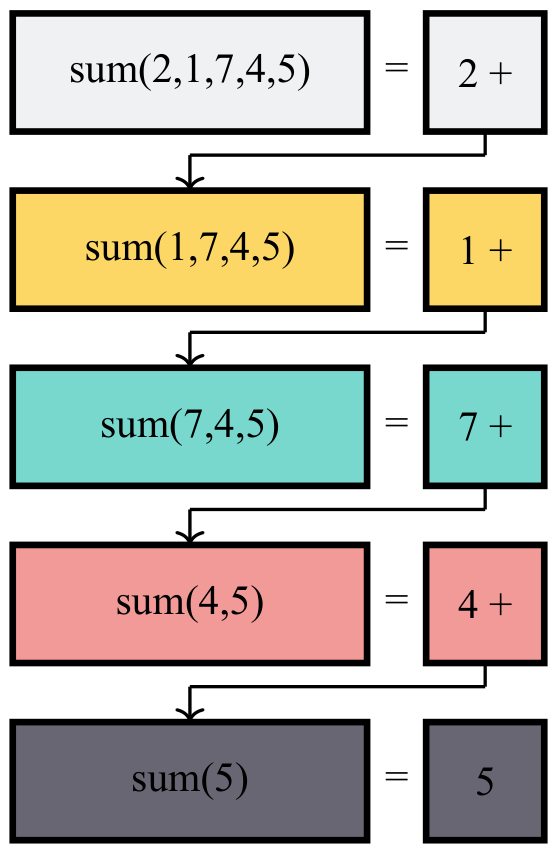

*Рисунок 5.1: вычисление с помощью итерации*

<a id="ch05-5-2-2-преобразование-целого-числа-в-строку-в-произвольной-системе-счисления"></a>

### 5.2.2 Преобразование целого числа в строку в произвольной системе счисления

В предыдущем разделе мы обсуждали реализацию алгоритмов преобразования целых чисел в двоичные и шестнадцатеричные строки с помощью стеков. Однако для преобразования систем счисления можно использовать и рекурсивные методы. Чтобы разработать рекурсивный алгоритм преобразования системы счисления, необходимо следовать трём законам рекурсии.

```text
The recursive algorithm must have a base case
The recursive algorithm must move towards the base case
The recursive algorithm must call itself
```

Алгоритм преобразования системы счисления можно вывести следующим образом:

```text
Simplify the original number into a series of individual digits
Use a lookup method to convert each digit into a character
Concatenate the individual characters to form the final result
```

Чтобы двигаться к базовому случаю, мы используем деление, изменяя состояние числа. Мы делим число на основание и получаем остаток и частное. Если частное меньше основания, мы прекращаем операцию и возвращаем результат. Например, рассмотрим десятичное число 996 и преобразование его в строку в системе с основанием 10. Мы делим 996 на 10, остаток равен 6, а частное равно 99. Поскольку остаток меньше 10, мы можем получить символ «6». Частное 99 меньше 996, что приближает нас к базовому случаю. Затем мы рекурсивно вызываем функцию, передав ей 99 в качестве входных данных. Мы делим 99 на 10, остаток равен 9, а частное равно 9. Поскольку остаток меньше 10, мы можем получить символ «9». Наконец, мы получаем десятичную строку «996». Когда мы умеем выполнять преобразование в систему с основанием 10, легко справиться с преобразованием в системы с основанием от 2 до 16. Вот алгоритм преобразования целых чисел в строку в произвольной системе счисления (от 2 до 16). Переменная BASESTR хранит символьное представление различных цифр; цифры больше 10 представляются символами A–F.

```text
// num2str_rec.rs

//Character table for various digits
const BASESTR: [&str; 16] = ["0","1","2","3","4","5","6","7",
                             "8","9","A","B","C","D","E","F"];
```

```rust
fn num2str_rec(num: i32, base: i32) -> String {
    if num < base {
        BASESTR[num as usize].to_string()
    } else {
        // Append remainder to the end of the string
        num2str_rec(num/base, base) +
            BASESTR[(num % base) as usize]
    }
}

fn main() {
    let num = 100;
    let sb = num2str_rec(num,2); // sb = str_binary
    let so = num2str_rec(num,8); // so = str_octal
    let sh = num2str_rec(num,16); // sh = str_hexdecimal
    println!("{num} = b{sb}, o{so}, x{sh}");
    // 100 = b1100100, o144, x64

    let num = 1000;
    let so = num2str_rec(num,8);
    let sh = num2str_rec(num,16);
    println!("{num} = o{so}, x{sh}");
    // 1000 = o1750, x3E8
}
```

В предыдущем разделе для преобразования чисел в произвольную систему счисления мы использовали стек. Теперь мы достигаем аналогичной функциональности с помощью рекурсии, что указывает на связь между стеками и рекурсией. Рекурсию можно рассматривать как стек, но стек неявно используется компилятором. Код использует только рекурсию, однако компилятор применяет стек для сохранения данных. Если бы мы реализовали следующий рекурсивный код с помощью стека, структура была бы очень похожей.

```rust
// num2str_stk.rs

fn num2str_stk(mut num: i32, base: i32) -> String {
    let digits: [&str; 16] = ["0","1","2","3","4","5","6","7",
                             "8","9","A","B","C","D","E","F"];

    let mut rem_stack = Stack::new();
    while num > 0 {
        if num < base {
            // Push directly to stack if not exceeding the base
            rem_stack.push(num);
        } else {
            // Push remainder to stack if exceeding the base
            rem_stack.push(num % base);
        }
        num /= base;
    }

    // Pop remainder from stack and form a string
    let mut numstr = "".to_string();
    while !rem_stack.is_empty() {
        numstr += digits[rem_stack.pop().unwrap() as usize];
```

```rust
    }

    numstr
}

fn main() {
    let num = 100;
    let sb = num2str_stk(100, 2);
    let so = num2str_stk(100, 8);
    let sh = num2str_stk(100, 16);
    println!("{num} = b{sb}, o{so}, x{sh}");
    // 100 = b1100100, o144, x64
}
```

<a id="ch05-5-2-3-ханойская-башня"></a>

### 5.2.3 Ханойская башня

Головоломку «Ханойская башня» изобрёл французский математик Эдуард Люка в 1883 году. Головоломка состоит в перемещении 64 золотых дисков уменьшающегося размера с одного из трёх шестов на другой, по одному диску за раз, с ограничением: больший диск нельзя класть на меньший. Вдохновением для этой головоломки послужила легенда о головоломке, которую настоятель индуистского храма в Индии дал молодым жрецам. В действительности перемещение всех 64 дисков заняло бы 5,85 триллиона лет — дольше, чем известный возраст Вселенной. Рисунок (5.2) иллюстрирует процесс перемещения дисков с первого шеста на третий, который напоминает стек. Если вы раньше не играли в это, попробуйте сейчас. Диски не нужны: подойдёт кучка кирпичиков, книг или листов бумаги, и не нужно 64 — достаточно 10. Проверьте, действительно ли это занимает столько времени.

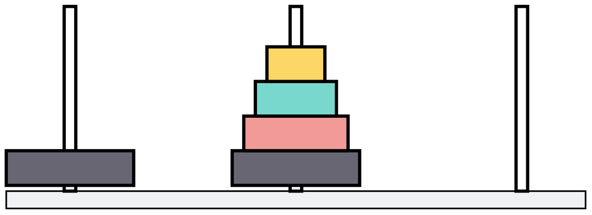

*Рисунок 5.2: Ханойская башня*

Чтобы решить эту задачу рекурсивно, нужно определить базовый случай. Предположим, есть ханойская башня с тремя шестами — левым, средним и правым — и пятью дисками на левом шесте. Можно считать, что мы умеем перемещать один диск направо. Это базовый случай. Если мы умеем перемещать n-1 диск на средний шест, то легко переместим нижний диск на правый шест, а затем переместим n-1 диск со среднего шеста на правый. Если мы не умеем перемещать n-1 диск на средний шест, можно считать, что мы умеем перемещать n-2 диска на средний шест, затем переместить (n-1)-й диск на правый шест, а затем переместить n-2 диска со среднего шеста на (n-1)-й диск, стоящий на правом шесте. Этот процесс представляет собой абстракцию процесса перемещения дисков. Итак, мы можем упорядочить описанный выше ход операций в следующий алгоритм рекурсивного решения головоломки «Ханойская башня».

```text
Move height-1 disks to the middle peg using the target peg as a
    helper. Move the last disk to the target peg.
Move height-1 disks from the middle peg to the target peg using
    the starting peg as a helper.
```

Чтобы решить задачу «Ханойской башни», необходимо следовать трём рекурсивным законам, чтобы гарантировать, что большие диски остаются внизу стопки. Базовый случай — когда диск всего один: его можно переместить в конечное назначение. Затем алгоритм уменьшает высоту Ханойской башни на шагах 1 и 3, двигаясь к базовому случаю. Решение можно реализовать в нескольких строках кода на Rust с помощью рекурсии, как показано ниже.

```rust
// hanoi.rs

// p: pole
fn hanoi(height:u32, src_p:&str, des_p:&str, mid_p:&str) {
    if height >= 1 {
        hanoi(height - 1, src_p, mid_p, des_p);
        println!("move disk[{height}] from
                    {src_p} to {des_p}");
        hanoi(height - 1, mid_p, des_p, src_p);
    }
}

fn main() {
    hanoi(1, "A", "B", "C");
    hanoi(2, "A", "B", "C");
    hanoi(3, "A", "B", "C");
    hanoi(4, "A", "B", "C");
    hanoi(5, "A", "B", "C");
    hanoi(6, "A", "B", "C");
}
```

Чтобы смоделировать задачу, можно взять три ручки и бумагу и перемещать диски в соответствии с выводом функции hanoi для высот 1, 2, 3 и 4.

<a id="ch05-5-3-хвостовая-рекурсия"></a>

## 5.3 Хвостовая рекурсия

Описанное выше рекурсивное вычисление называется обычной рекурсией; оно предполагает сохранение значений в процессе вычисления. Это может привести к переполнению стека, если рекурсивных вызовов слишком много, а память ограничена. Чтобы избежать этого, можно использовать хвостовую рекурсию. Хвостовая рекурсия обрабатывает текущий результат операции как параметр для следующего рекурсивного вызова функции, что снижает потребление памяти в стеке и делает код более лаконичным. Оптимизация хвостовой рекурсии особенно полезна при работе с подзадачами, которые нужно суммировать. Она уменьшает размер задачи, заранее вычисляя сумму параметров, что оптимизирует алгоритм. Однако код с хвостовой рекурсией может быть труднее для понимания, поскольку результаты подзадач напрямую используются как параметры следующего рекурсивного вызова. Обычную рекурсивную версию кода суммирования чисел можно преобразовать в более лаконичную хвостовую рекурсивную форму.

```rust
// nums_sum34.rs

fn nums_sum3(sum: i32, nums: &[i32]) -> i32 {
    if 1 == nums.len() {
        sum + nums[0]
    } else {
        nums_sum3(sum + nums[0], &nums[1..])
    }
```

```rust
}

fn nums_sum4(sum: i32, nums: &[i32]) -> i32 {
    if 1 == nums.len() {
        sum + nums[0]
    } else {
        nums_sum4(sum + nums[nums.len() - 1],
                  &nums[..nums.len() - 1])
    }
}

fn main() {
    let nums = [2,1,7,4,5];
    let sum1 = nums_sum3(0, &nums);
    let sum2 = nums_sum4(0, &nums);
    println!("sum1 is {sum1}, sum2 is {sum2}");
    // sum1 is 19, sum2 is 19
}
```

В конечном счёте реализация рекурсивных программ зависит от способности программиста писать ясный и эффективный код. Если хвостовая рекурсия не вызывает переполнения стека и легко понимается, она может быть полезным инструментом оптимизации алгоритмов.

<a id="ch05-5-3-1-рекурсия-и-итерация"></a>

### 5.3.1 Рекурсия и итерация

Для вычисления массива [2, 1, 7, 4, 5] мы применили три метода: итерацию циклом, рекурсию и хвостовую рекурсию. Эти методы показывают, что рекурсия и итерация могут достигать одной и той же цели. Так каково же соотношение между рекурсией и итерацией?

- Рекурсия — это процесс повторения некоего действия самоподобным образом. В математике и информатике она предполагает использование самой функции в её определении. При разворачивании рекурсии образуется древовидная структура. Это можно представить как процесс повторяющихся рекурсивных погружений и обратного поиска с откатами. Как только рекурсия достигает дна, начинается обратный поиск с откатами, что эквивалентно обходу дерева в глубину.
- Итерация же предполагает повторение процесса с обратной связью, где результат каждой итерации становится отправной точкой следующей. Итерация — это циклическая структура: начиная с начального состояния, каждая итерация проходит цикл и обновляет состояние. Множественные итерации продолжаются, пока не будет достигнуто конечное состояние.

Хотя всякая итерация может быть преобразована в рекурсию, преобразование рекурсии в итерацию возможно не всегда, поскольку превратить дерево в цикл удаётся не всегда. Поэтому важно выбирать подходящий метод для конкретной задачи, учитывая её сложность, читаемость и эффективность.

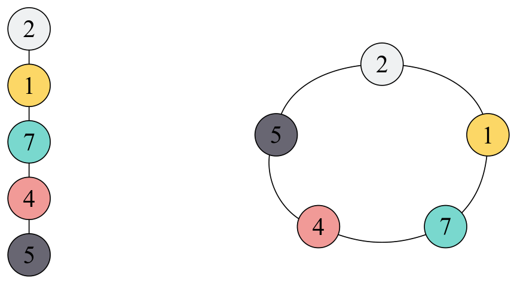

*Рисунок 5.3: рекурсия и итерация*

<a id="ch05-5-4-динамическое-программирование"></a>

## 5.4 Динамическое программирование

В информатике распространены задачи оптимизации, состоящие в поиске максимума или минимума некоторой функции. Эти задачи важны для достижения углеродной нейтральности, экономии энергии и улучшения пассажирского опыта. Цель этого раздела — показать различные решения задач оптимизации и представить динамическое программирование как эффективный подход к решению таких задач. Типичный пример задачи оптимизации — задача «минимальное количество купюр/монет для сдачи», часто встречающаяся в билетных кассах метро и торговых автоматах. Цель состоит в минимизации количества купюр/монет, возвращаемых за одну операцию. Например, вернуть две купюры (пятидолларовую и однодолларовую) при операции на шесть долларов вместо шести однодолларовых купюр. Задача состоит в том, как спланировать возврат купюр/монет разных достоинств для общей задачи, например сдачи с шести долларов. Самый интуитивный подход — жадный метод: он начинается с купюр/монет наибольшего достоинства и использует их как можно больше, затем переходит к следующему, меньшему достоинству и повторяет процесс, пока сдача не будет выдана полностью. Однако жадный метод не всегда даёт оптимальное решение. Например, если в стране сложная денежная система, включающая не только обычные купюры/монеты в 1, 5, 10 и 25 долларов, но и купюру/монету в 22 доллара, жадный метод не сможет найти наилучшее решение для сдачи с 66 долларов. Даже с добавлением купюры/монеты в 22 доллара жадный метод всё же находит решение, но оно требует пяти купюр (две по 25 долларов, одна по 10 долларов, одна по 5 долларов и одна по 1 доллару), тогда как оптимальный ответ — три купюры по 22 доллара. Для решения задачи о сдаче рекурсия — эффективный метод. Первый шаг — определить базовую задачу: выдать сдачу одной купюрой/монетой с неуказанным достоинством, но равной общей необходимой сумме. Это связано с тем, что сдача только одной купюрой/монетой представляет минимально необходимое количество купюр/монет, кроме случая, когда сумма равна нулю. Если используются долларовые купюры достоинством 1, 5, 10, 20 и 50 долларов, то количество купюр, необходимое для сдачи с исходной суммы, можно вычислить, прибавив единицу к количеству купюр, необходимому для оставшейся суммы после вычитания достоинства из общей суммы. Следовательно, формула для вычисления необходимого количества купюр проста.

numBills(amount) = { 1 + numBills(amount −1) 1 + numBills(amount −5) 1 + numBills(amount −10) 1 + numBills(amount −20) 1 + numBills(amount −50) (5.4)}

Для реализации этого подхода используется функция numBills, вычисляющая количество купюр, необходимое для заданной суммы сдачи. Функция рассматривает пять случаев, когда сдача может быть составлена из купюр разных достоинств. На строке 8 алгоритм проверяет, равна ли сумма сдачи достоинству какой-либо купюры; это служит базовым случаем. Если нет, функция рекурсивно вызывает саму себя с уменьшенной суммой сдачи и следующим, меньшим достоинством купюры. Счётчик использованных купюр увеличивается перед каждым рекурсивным вызовом, чтобы отслеживать общее количество купюр, использованных в итоговом решении.

```rust
// rec_mc1.rs

fn rec_mc1(cashes: &[u32], amount: u32) -> u32 {
    // Calculates the minimum number of coins required for
    // change when using only 1-yuan bills.
    let mut min_cashes = amount;

    if cashes.contains(&amount) {
        return 1;
    } else {
```

```rust
        // Extracts valid denominations (denominations must
        // be smaller than the change amount).
        for c in cashes.iter()
                       .filter(|&&c| c <= amount)
                       .collect::<Vec<&u32>>() {
            // Subtracts c from amount to indicate that a bill
            // of denomination c has been used,
            // and increments num_cashes by 1.
            let num_cashes = 1 + rec_mc1(&cashes, amount - c);

            // If num_cashes is smaller than min_cashes,
            // update min_cashes.
            if num_cashes < min_cashes {
                min_cashes = num_cashes;
            }
        }
    }

    min_cashes
}

fn main() {
    // cashes stores denominations of bills.
    let cashes = [1,5,10,20,50];
    let amount = 31u32;
    let cashes_num = rec_mc1(&cashes, amount);
    println!("need refund {cashes_num} cashes");
    // need refund 3 cashes
}
```

Чтобы избежать долгого ожидания, пока программа вернёт результат, важно оптимизировать код, сокращая избыточные вычисления. В приведённом коде при изменении суммы на 90 программа долго не отвечает, поскольку ей нужно выполнить большое количество рекурсивных вызовов, чтобы найти комбинацию из трёх купюр: [50, 20, 20].

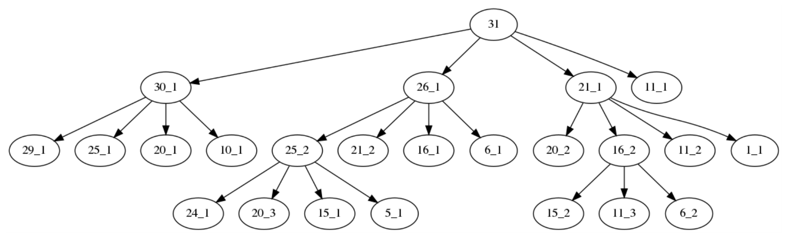

*Рисунок 5.4: решение задачи с помощью рекурсии*

Для решения этой проблемы одно из решений — сохранять ранее вычисленные результаты, чтобы избежать избыточных вычислений. Один из подходов — хранить текущее минимальное количество купюр в списке и проверять этот список перед вычислением нового минимального значения. Если результат уже существует, использовать сохранённое значение вместо повторного вычисления. Этот приём — пример обмена пространства на время в проектировании алгоритмов.

```rust
// rc_mc2.rs

fn rec_mc2(cashes: &[u32], amount: u32,
           min_cashes: &mut [u32]) -> u32
{
    // Calculates the minimum number of coins required for
    // change when using only 1-yuan bills.
    let mut min_cashe_num = amount;

    if cashes.contains(&amount) {
        // Collects denominations that match the
        // current change value.
        min_cashes[amount as usize] = 1;
        return 1;
    } else if min_cashes[amount as usize] > 0 {
        // If the change amount already has the minimum number
        // of coins required for change, return directly.
        return min_cashes[amount as usize];
    } else {
        for c in cashes.iter()
                       .filter(|&&c| c <= amount)
                       .collect::<Vec<&u32>>() {

            let cashe_num = 1 + rec_mc2(cashes,
                                        amount - c,
                                        min_cashes);

            // Updates the minimum number of coins
            // required for change.
            if cashe_num < min_cashe_num {
                min_cashe_num = cashe_num;
                min_cashes[amount as usize] = min_cashe_num;
            }
        }
    }

    min_cashe_num
}

fn main() {
    let amount = 90u32;
    let cashes: [u32; 5] = [1,5,10,20,50];
    let mut min_cashes: [u32; 91] = [0; 91];
    let cashe_num = rec_mc2(&cashes, amount, &mut min_cashes);
    println!("need refund {cashe_num} cashes");
    // need refund 3 cashes
}
```

Функция rec_mc2 требует меньше времени, поскольку использует переменную min_cashes для хранения промежуточных значений. Важно отметить: хотя этот раздел посвящён динамическому программированию, обе представленные программы являются рекурсивными, а не динамическим программированием. Вторая программа лишь сохраняет промежуточные значения во время рекурсии, используя приём запоминания (мемоизации) или кеширования, чтобы сократить время вычислений.

<a id="ch05-5-4-1-что-такое-динамическое-программирование"></a>

### 5.4.1 Что такое динамическое программирование?

Динамическое программирование (DP) — это математический метод решения задач оптимизации в процессах принятия решений. Описанная выше задача о сдаче — задача оптимизации, стремящаяся минимизировать количество использованных купюр/монет, и это цель оптимизации. Ключ к динамическому программированию — определить, можно ли решить задачу этим методом, и выразить задачу в виде состояния, между которыми возможны переходы. Состояние критично для вычисления и используется, чтобы вывести следующий шаг процесса решения задачи. В отличие от описанного выше жадного алгоритма, идущего от больших достоинств к малым, динамическое программирование предполагает, что текущий наилучший результат уже получен, и выводит следующий шаг на основе этого результата. Этот метод разбивает большую задачу на меньшие подзадачи и ведёт вывод от малых задач к большим. Промежуточные значения процесса вывода кешируются, и этот процесс называется переходом состояния. Для задачи о сдаче динамическому программированию требуются три параметра: список доступных купюр, сумма, для которой нужно выдать сдачу, и список, содержащий минимальное количество купюр, необходимое для каждой суммы. Алгоритм сохраняет вычисленные значения в список, начиная с наименьшей суммы и постепенно наращивая до желаемой суммы сдачи. Реализация алгоритма использует итерацию. Используя динамическое программирование, можно избежать избыточных вычислений и добиться значительного повышения эффективности. Программа кеширует ранее вычисленные результаты, что сокращает объём работы и время обработки.

```rust
// dp_rec_mc.rs

fn dp_rec_mc(cashes: &[u32], amount: u32,
             min_cashes: &mut [u32]) -> u32 {
    // Collect the minimum number of coins required to
    // make change from 1 to amount, and then reconstructs
    for denm in 1..=amount {
        let mut min_cashe_num = denm;
        for c in cashes.iter()
                       .filter(|&&c| c <= denm)
                       .collect::<Vec<&u32>>() {
            let index = (denm - c) as usize;
            let cashe_num = 1 + min_cashes[index];
            if cashe_num < min_cashe_num {
                min_cashe_num = cashe_num;
            }
        }
        min_cashes[denm as usize] = min_cashe_num;
    }
    // directly return the result
    min_cashes[amount as usize]
}

fn main() {
    let amount = 90u32;
    let cashes = [1,5,10,20,50];
    let mut min_cashes: [u32; 91] = [0; 91];
    let cash_num = dp_rec_mc(&cashes,amount,&mut min_cashes);
    println!("Refund for ${amount} need {cash_num} cashes");
    // Refund for $90 need 3 cashes
}
```

Итеративный код динамического программирования гораздо лаконичнее предыдущих рекурсивных версий и сокращает использование стека. Однако важно отметить: то, что задача может быть решена с помощью рекурсии, не означает, что это наилучшее решение. Хотя алгоритм динамического программирования находит минимальное количество необходимых купюр, он не указывает, какие достоинства купюр используются. Чтобы получить эту информацию, можно добавить таблицу cashes_used для записи достоинств и количеств использованных купюр. Алгоритм можно расширить, добавляя в таблицу cashes_used достоинство последней купюры, использованной для каждой суммы, а затем непрерывно находя последнюю купюру, использованную для предыдущей суммы, до самого конца.

```rust
// dp_rc_mc_show.rs

// The algorithm uses cashes_used to collect
// the denominations of coins used,
fn dp_rec_mc_show(cashes: &[u32], amount: u32,
                  min_cashes: &mut [u32],
                  cashes_used: &mut [u32]) -> u32 {
    for denm in 1..=amount {
        let mut min_cashe_num = denm ;
        // With a minimum denomination of 1 yuan
        let mut used_cashe = 1;
        for c in cashes.iter()
                       .filter(|&c| *c <= denm)
                       .collect::<Vec<&u32>>() {
            let index = (denm - c) as usize;
            let cashe_num = 1 + min_cashes[index];
            if cashe_num < min_cashe_num {
                min_cashe_num = cashe_num;
                used_cashe = *c;
            }
        }
        // update the minimum number of coins
        // required for each amount
        min_cashes[denm as usize] = min_cashe_num;
        cashes_used[denm as usize] = used_cashe;
    }

    min_cashes[amount as usize]
}

// prints the denominations of coins used
fn print_cashes(cashes_used: &[u32], mut amount: u32) {
    while amount > 0 {
        let curr = cashes_used[amount as usize];
        println!("${curr}");
        amount -= curr;
    }
}

fn main() {
    let amount = 81u32; let cashes = [1,5,10,20,50];
    let mut min_cashes: [u32; 82] = [0; 82];
    let mut cashes_used: [u32; 82] = [0; 82];
```

```rust
    let cs_num = dp_rec_mc_show(&cashes, amount,
                                &mut min_cashes,
                                &mut cashes_used);
    println!("Refund for ${amount} need {cs_num} cashes:");
    print_cashes(&cashes_used, amount);
}
```

Например, при выдаче сдачи с 90 долларов нужно всего три купюры ([50, 20, 20]).

```text
Refund for $90 requires 3 cashes:
$20
$20
$50
```

<a id="ch05-5-4-2-динамическое-программирование-и-рекурсия"></a>

### 5.4.2 Динамическое программирование и рекурсия

Рекурсия и динамическое программирование — две разные техники решения задач. Рекурсия разбивает большую задачу на меньшие и решает их, вызывая саму себя, а динамическое программирование решает большие задачи, используя решения меньших. Рекурсия может быть требовательной к памяти и приводить к переполнению стека, тогда как динамическое программирование требует определения правил переходов и начальных условий, но обладает простым кодом и крутой кривой обучения. При этом обе техники могут решать одни и те же задачи, например задачу о последовательности Фибоначчи.

```rust
// fibnacci_dp_rec.rs

fn fibnacci_dp(n: u32) -> u32 {
    // Using only two positions to store values can save memory
    let mut dp = [1, 1];
    for i in 2..=n {
        let idx1 = (i % 2) as usize;
        let idx2 = ((i - 1) % 2) as usize;
        let idx3 = ((i - 2) % 2) as usize;
        dp[idx1] = dp[idx2] + dp[idx3];
    }

    dp[((n-1) % 2) as usize]
}

fn fibnacci_rec(n: u32) -> u32 {
    if n == 1 || n == 2 {
        return 1;
    } else {
        fibnacci_rec(n-1) + fibnacci_rec(n-2)
    }
}

fn main() {
    println!("fib(10): {}", fibnacci_dp(10));
    println!("fib(10): {}", fibnacci_rec(10));
    // fib(10): 55
    // fib(10): 55
}
```

Важно отметить, что задача, решаемая с помощью динамического программирования, не обязательно решаема с помощью рекурсии, поскольку у них разные требования.

<a id="ch05-5-5-итоги"></a>

## 5.5 Итоги

В этой главе мы рассмотрели как рекурсивные, так и итеративные алгоритмы. Рекурсивные алгоритмы должны удовлетворять трём законам, и, хотя рекурсия иногда может заменить итерацию, она не всегда является оптимальным решением. Рекурсия может быть естественным способом выразить задачу, но хвостовая рекурсия — это техника оптимизации, способная сократить использование стека. Динамическое программирование — полезный подход к решению задач оптимизации путём разбиения больших задач на меньшие и постепенного построения больших решений. Если рекурсия решает задачи, разбивая их на части, то динамическое программирование работает, выстраивая решения от малых задач к большим.

---


<a id="ch06"></a>

<!--
  Файл изменён по сравнению с оригиналом проекта QMHTMY/RustBook:
  текст переведён на русский язык. Лицензия: Apache License 2.0.
  Оригинал: https://github.com/QMHTMY/RustBook
-->
# Поиск

<a id="ch06-6-1-цели"></a>

## 6.1 Цели

- Уметь реализовывать алгоритмы последовательного поиска и двоичного поиска.
- Понимать концепцию использования хеш-таблиц как техники поиска.
- Использовать Vec для реализации структуры данных хеш-карта.

<a id="ch06-6-2-что-такое-поиск"></a>

## 6.2 Что такое поиск?

В этой главе мы будем использовать структуры данных, реализованные ранее (стеки, очереди и связные списки), для решения практических задач поиска и сортировки. Поиск и сортировка — фундаментальные задачи информатики, и вокруг них построено множество программных приложений и алгоритмов. Вы наверняка знакомы с функцией поиска в различных программных приложениях, которыми пользовались, — например, с поиском определённых символов в документе Word или с использованием строки поиска в браузере Google для нахождения информации. Понятия «поиск» и «нахождение» (lookup) означают одно и то же, и эта книга не различает их. Поиск — это процесс нахождения конкретного элемента внутри набора элементов. Алгоритмы поиска обычно возвращают значение true или false, указывая тем самым, существует ли элемент в наборе, а иногда они также возвращают позицию элемента. В Rust для проверки того, содержится ли элемент в наборе, можно использовать функцию contains(). Эта функция проверяет, содержит ли набор определённое значение, и выполняет поиск за нас.

```rust
fn main() {
    let data = vec![1,2,3,4,5];
    if data.contains(&3) {
        println!("Yes");
    } else {
        println!("No");
    }
}
```

Хотя contains() и представляет собой простой алгоритм поиска, существует множество различных методов поиска, включая последовательный поиск, двоичный поиск и поиск по хешу. Мы рассмотрим, как работают эти различные алгоритмы и какова их сложность.

<a id="ch06-6-3-последовательный-поиск"></a>

## 6.3 Последовательный поиск

Когда элементы данных хранятся в таких коллекциях, как Vec, массивы или срезы, они имеют линейную связь, поскольку каждый элемент хранится в позиции относительно других элементов. Это означает, что значения индексов

элементов данных в срезах упорядочены и могут быть доступны по порядку, что делает эти структуры данных тоже линейными. Точно так же стеки, очереди и связные списки, которые мы изучили ранее, также являются линейными. Исходя из этой же линейной логики, присущей физическому миру, естественным методом поиска является линейный поиск, также известный как последовательный поиск. Линейный поиск работает следующим образом: он начинается с первого элемента в срезе и переходит от одного элемента к другому по порядку, пока не будет найден искомый элемент или пока не будет пройден весь срез. Если искомый элемент не найден после прохождения всего среза, это означает, что он не существует. На следующем рисунке показана работа этого поиска.

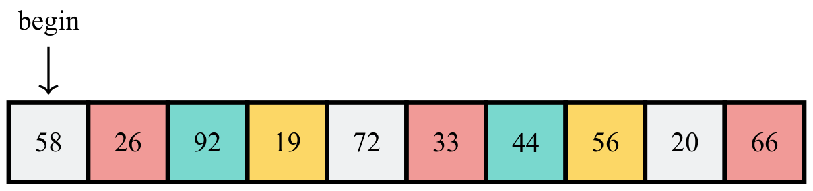

*Рисунок 6.1: Последовательный поиск*

<a id="ch06-6-3-1-реализация-последовательного-поиска-на-rust"></a>

### 6.3.1 Реализация последовательного поиска на Rust

Следующий код на Rust реализует последовательный поиск, и его легко понять. Программа принимает на вход срез целых чисел и искомое целое число. Она перебирает каждый элемент в срезе и сравнивает его с искомым значением. Если значение найдено, функция возвращает логическое значение true. В противном случае она возвращает false.

```rust
// sequential_search.rs

fn sequential_search(nums: &[i32], num: i32) -> bool {
    let mut pos = 0;
    let mut found = false;

    // Continue looping if pos is within the index range and
    // the item has not been found.
    while pos < nums.len() && !found {
        if num == nums[pos] {
            found = true;
        } else {
            pos += 1;
        }
    }

    found
}
```

Ниже приведён пример выполнения последовательного поиска.

```rust
fn main() {
    let num = 8;
    let nums = [9,3,7,4,1,6,2,8,5];
    let found = sequential_search(&nums, num);
    println!("nums contains {num}: {found}");
    // nums contains 8: true
}
```

Разумеется, последовательный поиск может также возвращать конкретную позицию искомого элемента или значение None, если он не найден.

```rust
// sequential_search_pos.rs

fn sequential_search_pos(nums:&[i32],num:i32) -> Option<usize>{
    let mut pos: usize = 0;
    let mut found = false;
    while pos < nums.len() && !found {
        if num == nums[pos] {
            found = true;
        } else {
            pos += 1;
        }
    }

    if found { Some(pos) } else { None }
}

fn main() {
    let num = 8;
    let nums = [9,3,7,4,1,6,2,8,5];
    match sequential_search_pos(&nums, num) {
        Some(pos) => println!("{num}'s index: {pos}"),
        None => println!("nums does not contain {num}"),
    }
    // 8's index: 7
}
```

<a id="ch06-6-3-2-анализ-последовательного-поиска"></a>

### 6.3.2 Анализ последовательного поиска

Чтобы проанализировать сложность алгоритма последовательного поиска, необходимо определить базовую вычислительную единицу. Поскольку операция сравнения является основной операцией поиска, подсчёт числа сравнений наиболее важен. Элементы данных в наборе расположены случайным образом и не упорядочены, и согласно теории вероятностей вероятность нахождения элемента данных в любой позиции набора одинакова. Если искомый элемент отсутствует в наборе, единственный способ узнать об этом — сравнить искомый элемент со всеми элементами данных в наборе. Если в наборе n элементов, то последовательному поиску требуется n сравнений, и сложность равна O(n). Что если искомый элемент находится в наборе? Останется ли сложность равной O(n)? При поиске искомого элемента в наборе анализ сложности алгоритма не всегда прост. Возможны три варианта: в лучшем случае искомый элемент находится в начале набора, и требуется всего одно сравнение, что даёт сложность O(1). В худшем случае искомый элемент находится в конце набора, и для его нахождения требуется n сравнений, что даёт сложность O(n). Наконец, искомый элемент может находиться в любом месте набора, и существует n-2 возможных значения сложности в диапазоне от O(2) до O(n − 1). В этом сценарии число возможных сравнений составляет от 1 до n, а средняя сложность равна сумме всех возможных сложностей, делённой на общее число сравнений.

n ∑

O(i)/n = O(n/2) = O(n)

(6.1) i=1

Когда набор становится большим, сложность последовательного поиска в случайной последовательности равна O(n), так как 1/2 можно пренебречь. Однако если элементы данных упорядочены по возрастанию и вероятность того, что

искомый элемент находится в любой из n позиций, по-прежнему одинакова, производительность поиска можно улучшить. Если искомый элемент не существует, поиск можно ускорить с помощью таких техник, как двоичный поиск. Например, при поиске искомого элемента 50 сравнение выполняется по порядку, пока не дойдёт до 56. В этот момент можно определить, что после него нет искомого значения 50, поскольку элементы после 56 больше 56, и алгоритм прекращает поиск.

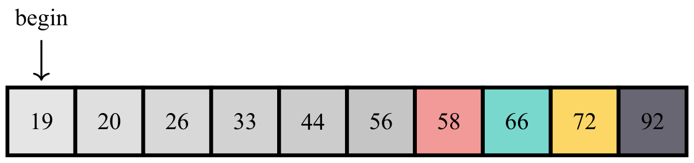

*Рисунок 6.2: Последовательный поиск по упорядоченным данным*

Ниже показан алгоритм последовательного поиска, используемый для отсортированных наборов данных. Он оптимизирует алгоритм за счёт переменной «stop», которая управляет поиском и немедленно останавливает его при выходе за пределы диапазона для экономии времени.

```rust
// ordered_sequential_search.rs

fn ordered_sequential_search(nums:&[i32], num:i32) -> bool {
    let mut pos = 0;
    let mut found = false;
    // return when reads on ordered data
    let mut stop = false;

    while pos < nums.len() && !found && !stop {
        if num == nums[pos] {
            found = true;
        } else if num < nums[pos] {
            // ordered data, return
            stop = true;
        } else {
            pos += 1;
        }
    }

    found
}

fn main() {
    let nums = [1,3,8,10,15,32,44,48,50,55,60,62,64];
    let num = 44;
    let found = ordered_sequential_search(&nums, num);
    println!("nums contains {num}: {found}");
    // nums contains 44: true

    let num = 49;
    let found = ordered_sequential_search(&nums, num);
    println!("nums contains {num}: {found}");
    // nums contains 49: false
}
```

В случае отсортированных данных, если искомый элемент отсутствует в наборе и меньше первого элемента, для определения того, что его нет в наборе, требуется всего одно сравнение. В худшем случае алгоритму потребуется сравнить искомый элемент со всеми n элементами набора, что даёт n сравнений. Среднее число сравнений по-прежнему равно n/2, и сложность остаётся равной O(n). Однако сложность O(n) лучше, чем при поиске по неупорядоченным данным, поскольку большинство поисков соответствует среднему случаю. Фактически, средняя сложность для отсортированных наборов данных может быть вдвое меньше, чем для неупорядоченных. Таким образом, сортировка всегда была важнейшей темой в информатике. Сложность последовательного поиска для неупорядоченных и упорядоченных наборов данных приведена в таблице ниже.

**Таблица 6.1: Сложность последовательного поиска**

| Случай | Мин. | Сред. | Макс. | Класс поиска |  |
| --- | --- | --- | --- | --- | --- |
| искомый элемент существует | O(1) | O( n | 2 ) | O(n) | неупорядоченный поиск |
| искомый элемент не существует | O(n) | O(n) | O(n) | неупорядоченный поиск |  |
| искомый элемент существует | O(1) | O( n | 2 ) | O(n) | упорядоченный поиск |
| искомый элемент не существует | O(1) | O( n | 2 ) | O(n) | упорядоченный поиск |

<a id="ch06-6-4-двоичный-поиск"></a>

## 6.4 Двоичный поиск

Упорядоченный набор данных выгоден для алгоритмов поиска, поскольку последовательный поиск по отсортированным наборам требует сравнения только с n-1 оставшимися элементами, если первый элемент не является искомым. Однако, хотя этот метод можно прервать при встрече со значением вне диапазона, он всё ещё относительно медленный. Существует ли более быстрый алгоритм поиска для отсортированных наборов данных? Конечно, он называется двоичным поиском. В дальнейшем мы проанализируем и реализуем двоичный поиск на Rust.

<a id="ch06-6-4-1-реализация-двоичного-поиска"></a>

### 6.4.1 Реализация двоичного поиска

Как следует из названия, двоичный поиск — это очень важный алгоритм поиска, который работает путём разделения набора данных на две части для поиска, используя low, mid и high для управления диапазоном поиска. Он начинается со среднего элемента, а не по порядку. Если средний элемент и есть искомый, поиск завершается. Если нет, можно использовать упорядоченность отсортированного набора, чтобы исключить половину оставшихся элементов. Если искомый элемент больше среднего, можно исключить средний элемент и половину элементов, меньших среднего, то есть не нужно сравнивать первый элемент со средним. Это связано с тем, что если целевой элемент больше среднего значения, он точно не находится в первой половине, независимо от того, есть ли он в наборе. И наоборот, если целевой элемент меньше среднего, можно пропустить вторую половину данных. После удаления половины данных обратимся к среднему элементу оставшейся половины, повторим процесс сравнения и исключения и в итоге получим результат. Этот поиск относительно быстрый и очень интуитивный, поэтому он называется двоичным поиском.

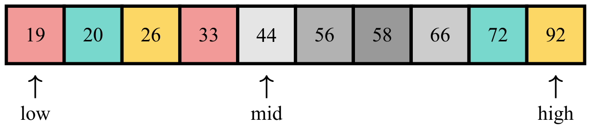

*Рисунок 6.3: Двоичный поиск*

Двоичный поиск — это алгоритм поиска, применяемый к отсортированным наборам данных. Он быстрее последовательного поиска, поскольку делит набор данных на две части, используя low, mid и high для управления диапазоном поиска. Если средний элемент и есть искомый, поиск завершается. Если нет, упорядоченность

отсортированного набора используется для исключения половины оставшихся элементов. Повторяя процесс сравнения и исключения, целевой элемент находится относительно быстро. Для реализации двоичного поиска мы устанавливаем low и high в крайнее левое и крайнее правое положения соответственно. Например, если мы хотим найти 60, мы сравниваем его со средним значением 44. Если оно больше 44, мы перемещаем low к 56, а mid к 66. Затем сравниваем его с 66 и обнаруживаем, что оно меньше 66, поэтому перемещаем high к 58, а mid к 56. Этот процесс продолжается, пока мы не достигнем целевого элемента.

```rust
// binary_search.rs

fn binary_search1(nums: &[i32], num: i32) -> bool {
    let mut low = 0;
    let mut high = nums.len() - 1;
    let mut found = false;

    // note: <= not <
    while low <= high && !found {
        let mid: usize = (low + high) >> 1;

        //low + high may cause overflow, use substraction
        //let mid: usize = low + ((high - low) >> 1);

        if num == nums[mid] {
            found = true;
        } else if num < nums[mid] {
            // num < mid, drop right half of data
            high = mid - 1;
        } else {
            // num >= mid, drop left half of data
            low = mid + 1;
        }
    }

    found
}

fn main() {
    let nums = [1,3,8,10,15,32,44,48,50,55,60,62,64];

    let target = 3;
    let found = binary_search1(&nums, target);
    println!("nums contains {target}: {found}");
    // nums contains 3: true

    let target = 63;
    let found = binary_search1(&nums, target);
    println!("nums contains {target}: {found}");
    // nums contains 63: false
}
```

Двоичный поиск удовлетворяет трём законам рекурсии и может быть реализован с помощью рекурсии. Однако рекурсивная реализация предполагает нарезку набора данных и отбрасывание среднего элемента, что может привести к риску переполнения стека. Поэтому для реализации двоичного поиска обычно рекомендуется использовать итеративный подход.

```rust
// binary_search.rs

fn binary_search2(nums: &[i32], num: i32) -> bool {
    // base case1: target does not exisit
    if 0 == nums.len() { return false; }

    let mid: usize = nums.len() >> 1;

    // base case2: target exisits
    if num == nums[mid] {
        return true;
    } else if num < nums[mid] {
        // minimize problem size
        return binary_search2(&nums[..mid], num);
    } else {
        return binary_search2(&nums[mid+1..], num);
    }
}

fn main() {
    let nums = [1,3,8,10,15,32,44,48,50,55,60,62,64];

    let target = 3;
    let found = binary_search2(&nums, target);
    println!("nums contains {target}: {found}");
    // nums contains 3: true

    let target = 63;
    let found = binary_search2(&nums, target);
    println!("nums contains {target}: {found}");
    // nums contains 63: false
}
```

В итоге, двоичный поиск — это быстрый и интуитивный алгоритм поиска, который лучше всего работает на отсортированных наборах данных. Его можно реализовать с помощью рекурсии, но для избежания риска переполнения стека обычно предпочитают итеративный подход.

<a id="ch06-6-4-2-анализ-двоичного-поиска"></a>

### 6.4.2 Анализ двоичного поиска

Алгоритм двоичного поиска имеет лучший случай, когда средний элемент и есть целевой, и его временная сложность составляет O(1). С каждым сравнением двоичный поиск исключает половину оставшихся элементов, что позволяет определить сложность в худшем случае, найдя максимальное число сравнений. После первого сравнения остаётся n/2 элементов, затем n/4 и так далее, пока количество оставшихся элементов не сократится до n/2i = 1, после чего двоичный поиск завершается.

n 2i = 1 (6.2) i = log2(n)

В результате алгоритм двоичного поиска выполняет не более log2(n) сравнений, что даёт ему временную сложность O(log2(n)), превосходящую алгоритмы со временной сложностью O(n). Однако важно отметить, что в рекурсивной реализации двоичного поиска использование стека по умолчанию потребляет память, что приводит к пространственной сложности, уступающей итеративной версии.

Хотя двоичный поиск может казаться эффективным, сортировать данные и использовать двоичный поиск не стоит, когда n очень мало. В таких случаях последовательный поиск может быть эффективнее. Кроме того, сортировка больших наборов данных для двоичного поиска может быть затратной по времени и памяти, что делает последовательный поиск более эффективным вариантом. Однако двоичный поиск хорошо подходит для наборов данных, которые не слишком велики и не слишком малы, что делает его идеальным выбором для многих практических сценариев.

<a id="ch06-6-4-3-интерполяционный-поиск"></a>

### 6.4.3 Интерполяционный поиск

Интерполяционный поиск — это разновидность двоичного поиска, специально предназначенная для отсортированных данных. Когда данные распределены равномерно, интерполяционный поиск может быстро приблизиться к области поиска и повысить эффективность. В отличие от двоичного поиска, интерполяционный поиск не использует медиану напрямую для ограничения диапазона поиска. Вместо этого он находит верхнюю и нижнюю границы с помощью алгоритма интерполяции. Этот алгоритм использует две точки (x0, y0) и (x1, y1) для выполнения линейной интерполяции и определения значения y, соответствующего любой точке x в диапазоне [x0, x1], или значения x, соответствующего любому y.

y −y0 = y1 −y0 x −x0 x1 −x0 (6.3)

x = (y −y0)(x1 −x0)

+ x0 y1 −y0

Для иллюстрации рассмотрим пример поиска элемента 27 в отсортированном наборе из 14 элементов [1, 9, 10, 15, 16, 17, 19, 23, 27, 28, 29, 30, 32, 35]. Мы используем индекс как ось x, а значение элемента — как ось y. Оказывается, что x0 = 0, x1 = 13, а y0 = 1, y1 = 35. Следовательно, можно вычислить значение x, соответствующее y = 27. x = (27 −1)(13 −0)

+ 0 35 −1 (6.4) x = 9

Начиная с nums[9], значение которого равно 28 и которое больше 27, мы используем его как верхнюю границу. Поскольку индекс 28 равен 9, мы продолжаем алгоритм интерполяции для поиска элементов в диапазоне [0,8]. x = (27 −1)(8 −0)

+ 0 27 −1 (6.5) x = 8

Наконец, мы приходим к nums[9], значение которого равно 27, и алгоритм завершается.

```rust
// interpolation_search.rs

fn interpolation_search(nums: &[i32], target: i32) -> bool {
    if nums.is_empty() {
        return false;
    }

    let mut low = 0usize;
    let mut high = nums.len() - 1;
    loop {
        let low_val = nums[low];
        let high_val = nums[high];

        // in this case, target isn't in the nums
        if high <= low || target < low_val
```

```rust
            || target > high_val {
            return false;
        }

        // calculate the position for insertion
        let offset = (target - low_val) * (high - low) as i32
                     / (high_val - low_val);
        let interpolant = low + offset as usize;

        // update high and low
        if nums[interpolant] > target {
            high = interpolant - 1;
        } else if nums[interpolant] < target {
            low = interpolant + 1;
        } else {
            // found: nums[interpolant] = target
            return true;
        }
    }
}
```

Вот пример использования этого поиска.

```rust
fn main() {
    let nums = [1,9,10,15,16,17,19,23,27,28,29,30,32,35];
    let target = 27;
    let found = interpolation_search(&nums, target);
    println!("nums contains {target}: {found}");
    // nums contains 27: true

    let nums = [0,1,2,10,16,19,31,35,36,38,40,42,43,55];
    let found = interpolation_search(&nums, target);
    println!("nums contains {target}: {found}");
    // nums contains 27: false
}
```

При внимательном анализе кода можно увидеть, что единственное отличие интерполяционного поиска от двоичного — способ вычисления интерполянта. Во всех остальных аспектах два алгоритма почти идентичны. Когда данные распределены равномерно, временная сложность интерполяционного поиска составляет O(loglog(n)). Доказательство этого результата сложно и может быть найдено в этой статье [11]. Однако сложность интерполяционного поиска в худшем и среднем случаях составляет O(n).

<a id="ch06-6-4-4-экспоненциальный-поиск"></a>

### 6.4.4 Экспоненциальный поиск

Экспоненциальный поиск — это разновидность двоичного поиска, использующая экспоненциальную функцию для оценки середины, что делает его подходящим для отсортированных данных без границ. Алгоритм непрерывно сравнивает значение в позициях 20, 21, 22, 2k с целевым значением, затем определяет диапазон поиска и, наконец, выполняет двоичный поиск в этом диапазоне. Временная сложность экспоненциального поиска составляет O(log(i)), где i — позиция целевого значения. Например, для поиска значения 22 в отсортированном наборе из 15 элементов [2,3,4,6,7,8,10,13,15,19,20,22,23,24,28] экспоненциальный поиск сначала проверяет, больше ли значение в позиции 20 = 1, чем 22. Затем он продолжает

проверять значения в позициях 21, 22 и 23, равные 4, 7 и 15, все из которых меньше 22. Проверка позиции 24 = 16 выходит за пределы диапазона, поэтому верхней границей становится последний индекс, 14.

```rust
// exponential_search.rs

fn exponential_search(nums: &[i32], target: i32) -> bool {
    let size = nums.len();
    if size == 0 { return false; }

    // find the upper bound
    let mut high = 1usize;
    while high < size && nums[high] < target {
        high <<= 1;
    }
    // use the half of the upper bound as the lower bound
    let low = high >> 1;

    // use binary_search method implemented previously
    binary_search(&nums[low..size.min(high+1)], target)
}

fn main() {
    let nums = [1,9,10,15,16,17,19,23,27,28,29,30,32,35];
    let target = 27;
    let found = exponential_search(&nums, target);
    println!("nums contains {target}: {found}");
    // nums contains 27: true
}
```

Следует отметить, что в реализации алгоритма экспоненциального поиска нижняя граница на строке 13 равна половине high, но может быть установлена и в 0. Однако установка в 0 может снизить эффективность. Сложность экспоненциального поиска делится на две части: поиск верхней границы для разделения диапазона поиска и выполнение двоичного поиска. Сложность поиска верхней границы связана с целевым значением i и составляет O(log(i)). Сложность двоичного поиска составляет O(log(n)), где n — длина диапазона поиска. Длина диапазона поиска равна high − low = 2log(i) − 2log(i) − 1 = 2log(i) − 1, и её сложность составляет O(log(2log(i) − 1)) = O(log(i)). Следовательно, общая сложность равна O(log(i) + log(i)) = O(log(i)).

<a id="ch06-6-5-поиск-по-хешу"></a>

## 6.5 Поиск по хешу

Алгоритмы поиска, рассмотренные до сих пор, используют позиционную информацию элементов в коллекции для выполнения поиска. Двоичный поиск может находить элементы данных за логарифмическое время, если коллекция отсортирована. Однако если алгоритм заранее знает сохранённые адреса различных элементов, он может получить их напрямую, не сравнивая по одному. Этот метод называется поиском по хешу — алгоритмом поиска со сложностью O(1), что делает его самым быстрым из доступных алгоритмов поиска. Чтобы реализовать поиск по хешу, адрес элемента должен существовать заранее. Необходима структура данных, которая обеспечивала бы эффективный способ хранения и получения адресов элементов. Такая структура данных известна как хеш-таблица: она хранит элементы данных так, что их легко обнаружить, причём позиция каждого элемента называется слотом или адресом. Эти слоты нумеруются, начиная с 0 или с любого другого значения. После выбора первого слота все последующие слоты увеличиваются соответственно. Изначально хеш-таблица не содержит элементов, и каждый слот пуст. Хеш-таблицу можно реализовать с помощью Vec, инициализируя каждый элемент значением None. На рисунке ниже показана хеш-таблица размера m = 11, то есть содержащая m слотов с именами от 0 до 10.

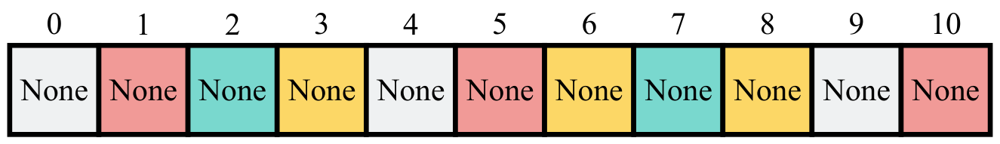

*Рисунок 6.4: Хеш-таблица*

Соответствие между элементами данных и их слотами в хеш-таблице осуществляется с помощью хеш-функции. Хеш-функция принимает любой элемент коллекции и возвращает конкретное имя слота; этот процесс называется хешированием. Например, если имеются целочисленные элементы [24, 61, 84, 41, 56, 31] и хеш-таблица на 11 слотов, расположение каждого элемента в хеш-таблице можно получить, передав его в хеш-функцию. Простая хеш-функция использует остаток от деления: остаток любого числа при делении на 11 лежит в пределах 11, что гарантирует наличие свободного слота для хранения данных. hash(item) = item%11

(6.6)

Вот результат вычисления хеша по остатку от деления.

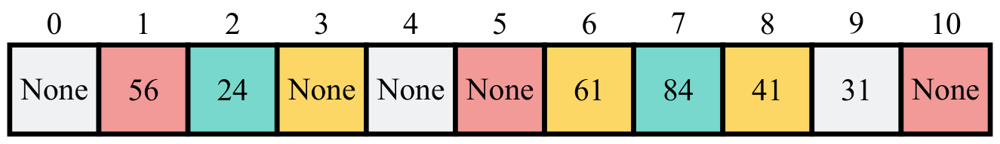

*Рисунок 6.5: Хеш по остатку от деления*

Вычислив хеш-значение, элемент можно вставить в соответствующий слот хеш-таблицы, как показано на рисунке выше. В настоящее время 6 из 11 слотов таблицы заняты, что даёт коэффициент заполнения λ = 6/11. Коэффициент заполнения — полезная мера для оценки хеш-таблицы, особенно когда ей приходится хранить большое число элементов. Высокий коэффициент заполнения означает, что свободного места для новых элементов мало, и таблицу необходимо расширять. В таких языках, как Rust и Go, расширение происходит автоматически, когда коэффициент заполнения превышает определённый порог, что готовит таблицу к последующей вставке данных. Хотя данные в хеш-таблице хранятся в несортированном виде, хеш-функция позволяет вычислить слот элемента данных независимо от порядка его следования. Например, чтобы проверить, есть ли в таблице число 56, можно вычислить его хеш-значение (hash(56) = 1) и просмотреть слот 1, чтобы найти 56 и убедиться в его наличии в таблице. Операция поиска имеет сложность O(1), что делает поиск по хешу очень эффективным. Однако могут возникнуть коллизии, и их необходимо разрешать, иначе хеш-таблицей нельзя будет пользоваться. Например, если добавить 97, а его хеш-значение (hash(97) = 9) совпадёт с занятым слотом (9), в котором лежит 31 вместо 97, возникнет коллизия, которую необходимо разрешить.

<a id="ch06-6-5-1-хеш-функции"></a>

### 6.5.1 Хеш-функции

В предыдущем разделе хеш-функция непосредственно вычисляла остаток от деления элемента, гарантируя, что остаток попадает в определённый диапазон. Любым алгоритмом, который по элементу может получить значение в заданном диапазоне, можно пользоваться как хеш-функцией. Улучшая хеш-функцию, можно минимизировать вероятность коллизий и создать эффективную хеш-таблицу. Один из способов улучшения хеш-функции — метод «суммы групп»: элементы разбиваются на блоки одинакового размера (последний блок может отличаться), суммируются, а затем вычисляется остаток. Например, если элемент данных — номер телефона «316-545-0134», его можно разбить на двузначные числа, при необходимости дополняя нулями, что даст [31, 65, 45, 01, 34]. Сумма равна 176, а остаток от деления на 11 даёт хеш-значение (слот) 0. Номер телефона также можно разбить на трёхзначные числа или развернуть перед вычислением остатка. Существует множество хеш-функций: любое значение, которое можно вычислить, а затем взять от него остаток, может использоваться самыми разными способами.

Другой алгоритм хеширования — метод «середины квадрата». Сначала элемент возводится в квадрат, затем из полученного квадрата извлекается средняя часть, для которой вычисляется остаток. Например, если число 36, его квадрат равен 1296, средняя часть — 29, а остаток от деления на 11 даёт hash(29) = 7, что означает: 36 следует хранить в слоте 7. При хранении строки остаток также можно вычислять на основе ASCII-значений её символов. Строка «rust» состоит из четырёх символов со значениями ASCII [114, 117, 115, 116], их сумма равна 462. Вычисление остатка даёт hash(462) = 0. Можно попробовать и другие строки, например «Java» со значениями ASCII [74, 97, 118, 97]. Её сумма равна 386, а остаток даёт hash(386) = 1, что означает: «Java» следует хранить в слоте 1, как показано на рисунке ниже.

7 9 0 3 5 6 8 10 1 2 4 go css rust Java None None None None C# C++ html

Ниже приведена реализация хеш-функции для ASCII-значений.

```rust
// hash.rs

fn hash1(astr: &str, size: usize) -> usize {
    let mut sum = 0;
    for c in astr.chars() {
        sum += c as usize;
    }

    sum % size
}

fn main() {
    let s1 = "rust"; let s2 = "Rust";
    let size = 11;

    let p1 = hash1(s1, size);
    let p2 = hash1(s2, size);
    println!("{s1} in slot {p1}, {s2} in slot {p2}");
    // rust in slot 0, Rust in slot 1
}
```

Чтобы уменьшить коллизии, которые могут возникнуть при использовании приведённой выше хеш-функции, её можно немного изменить. Например, можно использовать позиции различных символов в строке в качестве весов и умножать ASCII-значения на их позиционные веса. hash(rust) = (0 ∗114 + 1 ∗117 + 2 ∗115 + 3 ∗116)%11

= 695%11 (6.7) = 2

Предпочтительнее начинать индекс с 1, чтобы первый символ вносил вклад в сумму. Ниже приведены пример вычисления и фрагмент кода. hash(rust) = (1 ∗114 + 2 ∗117 + 3 ∗115 + 4 ∗116)%11

= 1157%11 (6.8) = 2

```rust
// hash.rs
fn hash2(astr: &str, size: usize) -> usize {
    let mut sum = 0;
    for (i, c) in astr.chars().enumerate() {
        sum += (i + 1) * (c as usize);
    }
    sum % size
}

fn main() {
    let (s1, s2, size) = ("rust", "Rust", 11);
    let p1 = hash2(s1, size);
    let p2 = hash2(s2, size);
    // rust in slot 2, Rust in slot 3
}
```

Эффективность имеет решающее значение при проектировании хеш-функции, чтобы она не стала узким местом системы. Если хеш-функция слишком сложна, она может нарушить сложность O(1).

<a id="ch06-6-5-2-разрешение-коллизий"></a>

### 6.5.2 Разрешение коллизий

Для решения проблемы коллизий хешей необходимы методы разрешения коллизий. Например, если используется хеш-функция с позицией в качестве веса и индекс начинается с 0, строки «rust» и «Rust» столкнутся. Когда два элемента дают хеш в один и тот же слот, необходимо применить метод, который позволит вставить конфликтующий элемент в другой слот хеш-таблицы. Этот процесс называется разрешением коллизий. Хотя идеальных хеш-таблиц не существует из-за ограниченной памяти и сложности реальных ситуаций, один из интуитивно понятных методов разрешения коллизий состоит в том, чтобы просканировать хеш-таблицу и попытаться найти следующий пустой слот для сохранения конфликтующего элемента. Самый простой метод называется открытой адресацией, а именно линейным пробированием. Линейное пробирование пытается линейно проверять следующий пустой слот в хеш-таблице, начиная с исходной точки коллизии, пока не будет найден первый пустой слот. Обратите внимание, что после достижения конца можно начать поиск заново. На следующем рисунке показана хеш-таблица с 11 слотами, в которую мы пытаемся вставить 35 и 47.

0 3 5 6 7 8 9 10 1 2 4 None 56 None None None 61 84 31 None 24 41

При вставке 35 его позицией должен быть слот 2, но мы обнаруживаем, что слот 2 уже содержит 24. Поэтому мы начинаем искать пустой слот с самого слота 2 и обнаруживаем, что слот 3 пуст, — и вставляем 35 туда.

0 3 5 6 7 8 9 10 1 2 4 None None None None 56 24 35 61 84 41 31

Когда мы вставляем 47, мы обнаруживаем, что слот 3 содержит значение 35, поэтому ищем следующий пустой слот и находим, что слот 4 пуст, — и вставляем 47 туда.

7 9 0 3 5 6 8 10 1 2 4 None None None 56 24 35 47 61 84 41 31

Чтобы искать элементы в хеш-таблице, построенной с использованием открытой адресации, необходимо применять тот же метод, что и при её построении. Например, если мы ищем элемент 56 с хешем 1, мы находим его в слоте 56 и возвращаем true. Однако если мы ищем элемент 35, имеющий хеш 2, вместо 35 мы можем обнаружить другой элемент, например 24, из-за коллизий. Чтобы не вернуть false, необходимо выполнять последовательный поиск, пока не будет найден 35, пустой слот или пока поиск не вернётся к 24, и лишь затем возвращать результат. Однако последовательный поиск может привести к сгущению данных, когда элементы скапливаются в таблице из-за множественных коллизий в одном и том же слоте хеша. Линейное пробирование заполняет последующие слоты конфликтующими элементами, вынуждая исходно предполагаемые значения вставляться в другое место. Последовательный поиск отнимает время, его сложность больше O(1). Для решения проблемы сгущения данных открытую адресацию можно расширить, пропуская несколько слотов вместо последовательного поиска следующего свободного слота. Например, проверяя каждый третий слот при возникновении конфликта, конфликтующие элементы распределяются более равномерно, что рассеивает конфликт. Этот метод даёт значительный эффект и может уменьшить сгущение данных, как показано на рисунке ниже.

0 3 5 6 7 8 9 10 1 2 4 None 47 None None 56 24 35 61 84 41 31

При добавлении элемента 35 может возникнуть конфликт, и поиск начинает пропускать каждый третий слот начиная с этой точки, рассеивая конфликт. В результате элемент 47 можно вставить без какого-либо конфликта. Этот метод оказался эффективным для уменьшения сгущения данных, как продемонстрировано на следующем рисунке. Перехеширование — это процесс поиска альтернативного слота в хеш-таблице после возникновения коллизии. Этот процесс предполагает вычисление нового хеш-значения с заданным размером шага, причём необходимо гарантировать, что все слоты таблицы в итоге будут доступны. Для этого рекомендуется использовать в качестве размера таблицы простое число, как в приведённом примере, где применяется 11. rehash(pos) = (pos + n)%size

(6.9)

Ещё один способ разрешения конфликтов — метод цепочек. Он предполагает создание связного списка для хранения элементов данных на каждой конфликтующей позиции, как показано на рисунке (6.6). При поиске конфликты разрешаются последовательным поиском по цепочке, что имеет сложность O(n). Если данные в конфликтующей цепочке отсортированы, можно использовать двоичный поиск и достичь сложности O(log2(n)). Если цепочка становится слишком длинной, её можно преобразовать в красно-чёрное дерево для повышения структурной устойчивости. Во многих языках программирования метод цепочек используется по умолчанию для разрешения коллизий в структурах данных хеш-таблиц.

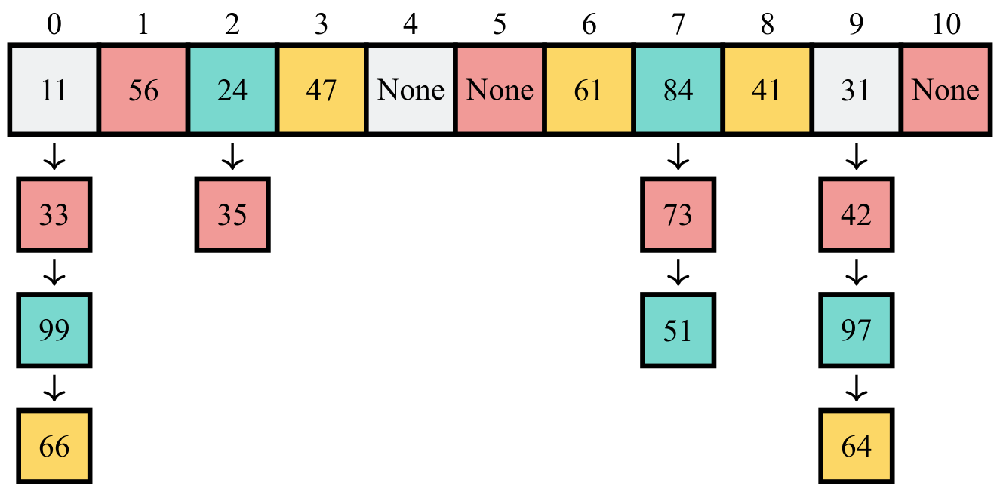

*Рисунок 6.6: Разрешение коллизий методом цепочек*

<a id="ch06-6-5-3-реализация-hashmap-в-rust"></a>

### 6.5.3 Реализация HashMap в Rust

Самый распространённый тип коллекции в Rust — HashMap. Это ассоциативный тип данных, который хранит пары «ключ — значение». Ключ используется для нахождения позиции значения, а из-за неопределённости позиции такой поиск напоминает поиск по карте. Поэтому эту структуру данных и называют HashMap. HashMap — неупорядоченная коллекция пар «ключ — значение», в которой ключи уникальны, а между ключами и значениями существует взаимно однозначное соответствие. Вот определение абстрактного типа данных для HashMap:

- new(): создаёт новый HashMap, не принимает аргументов и возвращает пустую коллекцию HashMap.
- insert(k,v): добавляет в HashMap новую пару «ключ — значение», принимая параметры k и v. Если ключ существует, старое значение заменяется новым. Возвращаемого значения нет.
- remove(k): удаляет из HashMap значение, соответствующее k, принимает параметр k и возвращает соответствующее значение v.
- get(k): возвращает значение v, хранящееся в HashMap для заданного ключа k (оно может быть пустым None), принимает параметр k.
- contains(k): возвращает true, если ключ k существует в HashMap, иначе false; принимает параметр k.
- len(): возвращает количество пар «ключ — значение», хранящихся в HashMap, не принимает аргументов.

В таблице ниже приведены результаты операций при условии, что «h» — уже созданный пустой HashMap (здесь он обозначен {}).

**Таблица 6.2: Операции HashMap**

| Операция | Значение | Возврат |
| --- | --- | --- |
| h.is_empty() | {} | true |
| h.insert(”a”, 1) | {a:1} |  |
| h.insert(”b”, 2) | {a:1, b:2} |  |
| h.insert(”c”, 3) | {a:1, b:2, c:3} |  |
| h.get(”b”) | {a:1, b:2, c:3} | Some(2) |
| h.get(”d”) | {a:1, b:2, c:3} | None |
| h.len() | {a:1, b:2, c:3} | 3 |
| h.contains(”c”) | {a:1, b:2, c:3} | true |
| h.contains(”e”) | {a:1, b:2, c:3} | false |
| h.remove(”a”) | {b:2, c:3} | Some(1) |
| h.remove(”a”) | {b:2, c:3} | None |
| h.insert(”a”, 1) | {b:2, c:3, a:1} |  |
| h.contains(”a”) | {b:2, c:3, a:1} | true |
| h.len() | {b:2, b:3, a:1} | 3 |
| h.get(”a”) | {b:2, c:3, a:1} | Some(1) |
| h.remove(”c”) | {b:2, a:1} | Some(3) |

В реальной реализации HashMap в Rust состоит из двух отдельных Vec — один хранит ключи (называется slot), а другой — значения (называется data). Vec slot сохраняет ключи с индексом, начинающимся с 1, а значение по умолчанию в Vec slot равно 0. HashMap инкапсулируется структурой, и добавлен параметр cap для управления ёмкостью.

```rust
// hashmap.rs

#[derive(Debug, Clone, PartialEq)]
struct HashMap <T> {
    cap: usize, // capacity
    slot: Vec<usize>, // store data address (index)
    data: Vec<T>, // store elements
}
```

Функцию rehash в Rust можно реализовать методом линейного поиска с прибавлением 1, что просто и легко реализуется. Начальный размер HashMap устанавливается в 11, но можно задать и другое простое число, например 13, 17, 19, 23, 29 и т. д. Ниже приведён полный код реализации HashMap на Rust.

```rust
// hashmap.rs

impl<T: Clone + PartialEq + Default> HashMap<T> {
    fn new(cap: usize) -> Self {
        // Initialize slot and data
        let mut slot = Vec::with_capacity(cap);
        let mut data = Vec::with_capacity(cap);
        for _i in 0..cap{
            slot.push(0);
            data.push(Default::default());
        }

        HashMap { cap, slot, data }
    }

    fn len(&self) -> usize {
        let mut len = 0;
        for &d in self.slot.iter() {
            // If slot is not empty, then increase len by 1
            if 0 != d {
                len += 1;
            }
        }
        len
    }

    fn is_empty(&self) -> bool {
        let mut empty = true;
        for &d in self.slot.iter() {
            if 0 != d {
                empty = false;
                break;
            }
        }
        empty
    }

    fn clear(&mut self) {
        let mut slot = Vec::with_capacity(self.cap);
        let mut data = Vec::with_capacity(self.cap);
        for _i in 0..self.cap{
            slot.push(0);
            data.push(Default::default());
        }

        self.slot = slot;
        self.data = data;
```

```rust
    }

    fn hash(&self, key: usize) -> usize {
        key % self.cap
    }

    fn rehash(&self, pos: usize) -> usize {
        (pos + 1) % self.cap
    }

    fn insert(&mut self, key: usize, value: T) {
        if 0 == key { panic!("Error: key must > 0"); }

        let pos = self.hash(key);
        if 0 == self.slot[pos] {
            // If the slot is empty, insert directly
            self.slot[pos] = key;
            self.data[pos] = value;
        } else {
            // If the slot is not empty, then
            // find next available position
            let mut next = self.rehash(pos);
            while 0 != self.slot[next]
                && key != self.slot[next] {
                next = self.rehash(next);

                // If the slot is full, exit
                if next == pos {
                    println!("Error: slot is full!");
                    return;
                }
            }

            // Insert the data in the found slot
            if 0 == self.slot[next] {
                self.slot[next] = key;
                self.data[next] = value;
            } else {
                self.data[next] = value;
            }
        }
    }

    fn remove(&mut self, key: usize) -> Option<T> {
        if 0 == key { panic!("Error: key must > 0"); }

        let pos = self.hash(key);
        if 0 == self.slot[pos] {
            // If the slot is empty, return None
            None
        } else if key == self.slot[pos] {
            // If found the same key,
```

```rust
            // update the slot and data
            self.slot[pos] = 0;
            let data = Some(self.data[pos].clone());
            self.data[pos] = Default::default();
            data
        } else {
            let mut data: Option<T> = None;
            let mut stop = false;
            let mut found = false;
            let mut curr = pos;

            while 0 != self.slot[curr] && !found && !stop {
                if key == self.slot[curr] {
                    // If the value is found, delete the data
                    found = true;
                    self.slot[curr] = 0;
                    data = Some(self.data[curr].clone());
                    self.data[curr] = Default::default();
                } else {
                    // If rehashing returns to the initial
                    // position, it means that it has searched
                    // a full circle and still not found
                    curr = self.rehash(curr);
                    if curr == pos {
                        stop = true;
                    }
                }
            }

            data
        }
    }

    fn get_pos(&self, key: usize) -> usize {
        if 0 == key { panic!("Error: key must > 0"); }

        // Calculate the data position
        let pos = self.hash(key);
        let mut stop = false;
        let mut found = false;
        let mut curr = pos;

        // Loop through to find the data
        while 0 != self.slot[curr] && !found && !stop {
            if key == self.slot[curr] {
                found = true;
            } else {
                // If rehashing returns to the initial position
                // it means that it has searched a full circle
                // and still not found
                curr = self.rehash(curr);
                if curr == pos {
```

```rust
                    stop = true;
                }
            }
        }

        curr
    }

    // Get a reference and a mutable reference to val
    fn get(&self, key: usize) -> Option<&T> {
        let curr = self.get_pos(key);
        self.data.get(curr)
    }

    fn get_mut(&mut self, key: usize) -> Option<&mut T> {
        let curr = self.get_pos(key);
        self.data.get_mut(curr)
    }

    fn contains(&self, key: usize) -> bool {
        if 0 == key {
            panic!("Error: key must > 0");
        }
        self.slot.contains(&key)
    }

    // Implement iteration and mutable iteration for hashmap
    fn iter(&self) -> Iter<T> {
        let mut iterator = Iter { stack: Vec::new() };
        for item in self.data.iter() {
            iterator.stack.push(item);
        }
        iterator
    }

    fn iter_mut(&mut self) -> IterMut<T> {
        let mut iterator = IterMut { stack: Vec::new() };
        for item in self.data.iter_mut() {
            iterator.stack.push(item);
        }
        iterator
    }
}

// Implementation of iteration
struct Iter<'a, T: 'a> { stack: Vec<&'a T>, }
impl<'a, T> Iterator for Iter<'a, T> {
    type Item = &'a T;
    fn next(&mut self) -> Option<Self::Item> {
        self.stack.pop()
    }
}
```

```rust
struct IterMut<'a, T: 'a> { stack: Vec<&'a mut T>, }
impl<'a, T> Iterator for IterMut<'a, T> {
    type Item = &'a mut T;
    fn next(&mut self) -> Option<Self::Item> {
        self.stack.pop()
    }
}

fn main() {
    basic();
    iter();

    fn basic() {
        let mut hmap = HashMap::new(11);
        hmap.insert(2,"dog");
        hmap.insert(3,"tiger");
        hmap.insert(10,"cat");

        println!("empty: {}, size: {:?}",
                    hmap.is_empty(), hmap.len());
        println!("contains key 2: {}", hmap.contains(2));

        println!("key 3: {:?}", hmap.get(3));
        let val_ptr = hmap.get_mut(3).unwrap();
        *val_ptr = "fish";
        println!("key 3: {:?}", hmap.get(3));
        println!("remove key 3: {:?}", hmap.remove(3));
        println!("remove key 3: {:?}", hmap.remove(3));

        hmap.clear();
        println!("empty: {}, size: {:?}",
                    hmap.is_empty(), hmap.len());
    }

    fn iter() {
        let mut hmap = HashMap::new(11);
        hmap.insert(2,"dog");
        hmap.insert(3,"tiger");
        hmap.insert(10,"cat");

        for item in hmap.iter() {
            println!("val: {item}");
        }

        for item in hmap.iter_mut() {
            *item = "fish";
        }

        for item in hmap.iter() {
            println!("val: {item}");
        }
```

```text
    }
}
```

Вот результат выполнения кода.

```text
empty: false, size: 3
contains key 2: true
key 3: Some("tiger")
key 3: Some("fish")
remove key 3: Some("fish")
remove key 3: None
empty: true, size: 0
val: cat
val:
val:
val:
val:
val:
val:
val: tiger
val: dog
val:
val:
val: fish
val: fish
val: fish
val: fish
val: fish
val: fish
val: fish
val: fish
val: fish
val: fish
val: fish
```

<a id="ch06-6-5-4-анализ-hashmap"></a>

### 6.5.4 Анализ HashMap

Хеш-таблица обеспечивает сложность поиска O(1) в лучшем случае. Однако из-за коллизий число сравнений в процессе поиска может различаться. Степень серьёзности коллизий влияет на производительность хеш-таблицы, а хорошей мерой оценки является коэффициент заполнения λ. Малый коэффициент заполнения означает, что вероятность коллизий невелика, и элементы скорее находятся в своих соответствующих слотах. Большой коэффициент заполнения означает, что таблица быстро заполняется, коллизий становится больше, а процесс разрешения конфликтов — сложнее. Результат каждого поиска — либо успех, либо неудача. Для поиска, выполняемого с помощью линейного пробирования

1 1+ 1−λ

открытой адресации, среднее число сравнений при успешном поиске примерно равно

, а при неудачном — 2 1−λ )2 1 1+( . Даже при использовании метода цепочек среднее число сравнений при успешном поиске равно 1 + λ/2,

примерно

2

а при неудачном — λ. В целом сложность поиска в хеш-таблице составляет около O(λ). При использовании метода цепочек в хеш-таблице рост числа коллизий приводит к тому, что в одну цепочку добавляется больше элементов. В результате поиск конкретного элемента в цепочке занимает больше времени и становится основной составляющей времени поиска.

<a id="ch06-6-6-итоги"></a>

## 6.6 Итоги

В этой главе рассмотрены несколько алгоритмов поиска, а именно последовательный поиск, двоичный поиск, интерполяционный поиск, экспоненциальный поиск и поиск по хешу. Последовательный поиск — простой алгоритм, имеющий сложность O(n). Двоичный поиск, в свою очередь, — быстрый алгоритм, который на каждом шаге делит набор данных пополам, но требует, чтобы данные были отсортированы, и имеет сложность O(log2(n)). Другие алгоритмы поиска, такие как интерполяционный и экспоненциальный, опираются на двоичный поиск и подходят для различных типов распределения данных. Поиск по хешу — высокоэффективный алгоритм поиска со сложностью O(1), который использует `HashMap`. Однако важно учитывать, что хеш-таблицы склонны к коллизиям и требуют соответствующих мер, таких как открытая адресация и метод цепочек, для их разрешения. Сортировка — полезный приём, ускоряющий алгоритмы поиска, а в следующей главе мы подробно рассмотрим алгоритмы сортировки.

---


<a id="ch07"></a>

<!--
  Файл изменён по сравнению с оригиналом проекта QMHTMY/RustBook:
  текст переведён на русский язык. Лицензия: Apache License 2.0.
  Оригинал: https://github.com/QMHTMY/RustBook
-->
# Сортировка

<a id="ch07-7-1-цели"></a>

## 7.1 Цели

- Изучить алгоритмы сортировки.
- Научиться реализовывать десять базовых алгоритмов сортировки на Rust.

<a id="ch07-7-2-что-такое-сортировка"></a>

## 7.2 Что такое сортировка?

Сортировка включает в себя упорядочивание элементов коллекции в определённом порядке. Например, игральные карты перемешиваются и раскладываются по мастям или номиналам, чтобы в них было удобно играть, а слова можно отсортировать по алфавиту или по длине. Аналогичным образом города Китая можно отсортировать по численности населения, этническому составу или региону. Упорядоченность — важный навык для человека, поскольку она позволяет обеспечивать слаженный ход работы в самых разных областях. Сортировка является важной областью информатики, и многие пионеры внесли вклад в развитие алгоритмов сортировки. Различные алгоритмы, включая последовательный поиск и двоичный поиск, выигрывают от сортировки наборов данных. Эффективность алгоритма сортировки зависит от количества обрабатываемых элементов: сложные методы сортировки слишком затратны для небольших коллекций, тогда как простые алгоритмы не подходят для больших наборов данных. В этой главе мы рассмотрим различные алгоритмы сортировки и сравним их производительность. Сравнение — это основная операция при сортировке, поскольку именно оно определяет последовательность, порядок и упорядоченность. Сравнение заключается в выяснении того, какой элемент больше или меньше на основании некоторого критерия, который может быть простым (числовое значение) или абстрактным (индекс здоровья). Если сравнение показывает, что порядок неверен, необходимо обменять элементы местами. Однако обмен элементами местами — дорогая операция в информатике, поэтому общее число обменов имеет решающее значение для оценки эффективности алгоритмов. В этой главе мы проанализируем различные алгоритмы сортировки с использованием анализа сложности в нотации O (big-O), который является наиболее наглядным показателем для оценки их эффективности. Помимо эффективности, сортировка связана также с проблемой устойчивости. Например, в списке [1,4,9,8,5,5,2,3,7,6] есть две пятёрки, и разные алгоритмы сортировки могут поменять порядок этих двух пятёрок. Хотя в итоге они окажутся рядом, исходное отношение порядка будет нарушено. Для числовых данных это может не иметь значения, но для структур данных, содержащих ключи, например личную информацию, необдуманная сортировка может изменить исходную последовательность записей.

```text
person {
                   person {
    amount: 5,
                       amount: 5,
    name: Shieber,
                       name: Kew,
    phone: 133xx,
                       phone: 133xx,
    age: 20,
                       age: 24,
}
                   }
```

Чтобы гарантировать, что порядок элементов в отсортированной коллекции остаётся устойчивым, при оценке алгоритмов сортировки важно учитывать устойчивость. Устойчивость означает, сохраняется ли в отсортированной коллекции относительный порядок равных элементов из исходной коллекции. Например, если значение `amount: 5` встречается в коллекции дважды и сортировка изменяет порядок этих двух вхождений, это может вызвать проблемы для алгоритмов, которые полагаются на устойчивость последовательности, например для операций списания. Для коллекций существует множество алгоритмов сортировки, однако есть десять основных типов алгоритмов сортировки, которые служат фундаментом для большинства из них. К ним относятся пузырьковая сортировка, быстрая сортировка, сортировка выбором, сортировка кучей, сортировка вставками, сортировка Шелла, сортировка слиянием, сортировка подсчётом, сортировка корзинами (bucket sort) и поразрядная сортировка. На основе этих десяти базовых алгоритмов было получено множество усовершенствованных вариантов. В этой статье мы рассмотрим несколько таких усовершенствованных алгоритмов, включая новую пузырьковую сортировку, шейкерную сортировку (cocktail sort), гребёнчатую сортировку (comb sort), двоичную сортировку вставками, сортировку Flash (flash sort) и сортировку Тимсорт (TimSort).

<a id="ch07-7-3-пузырьковая-сортировка"></a>

## 7.3 Пузырьковая сортировка

Пузырьковая сортировка — это простой алгоритм сортировки, который требует многократных проходов по коллекции: он сравнивает соседние элементы и меняет местами те из них, что расположены не по порядку. Каждый проход помещает наибольшее значение на его правильную позицию. Своё название алгоритм получил из-за сходства процесса сортировки с пузырьками, поднимающимися к поверхности кастрюли с кипящей водой. На первом проходе алгоритм сравнивает соседние элементы и меняет их местами, если они стоят в неправильном порядке. Если в списке n элементов, то на первом проходе выполняется n − 1 сравнение. На втором проходе наибольшее значение в наборе данных уже находится на правильной позиции, и сортировать нужно оставшиеся n − 1 элементов, то есть выполняется n − 2 сравнения. Алгоритму требуется n − 1 итерация, чтобы поместить очередное наибольшее значение на его надлежащую позицию. После завершения n − 1 раундов итераций и сравнений наименьший элемент гарантированно окажется на правильной позиции, и дальнейшая обработка не нужна.

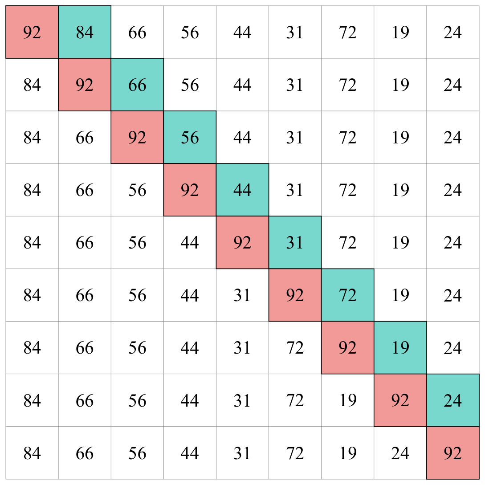

*Рисунок 7.1: Пузырьковая сортировка*

Диагональная линия на приведённом выше рисунке обозначает максимальное значение; она непрерывно смещается вправо, подобно пузырькам, поднимающимся к поверхности. Пузырьковая сортировка предполагает частые операции обмена, которые являются распро-

странёнными вспомогательными операциями при сравнениях. В Rust структура данных Vec по умолчанию предоставляет функцию swap(), однако операцию обмена можно реализовать и самостоятельно:

```rust
// swap
let temp = data[i];
data[i] = data[j];
data[j] = temp;
```

Некоторые языки программирования предоставляют удобный способ обмена значениями без использования временных переменных, например: data[i], data[j] = data[j], data[i]. Хотя такая возможность внутри всё равно использует переменные, она оперирует двумя переменными одновременно, как показано на рисунке ниже.

47 84

В этой главе для упрощения проектирования алгоритмов мы работаем только с наборами чисел. Поэтому для реализации пузырьковой сортировки можно использовать Vec.

```rust
// bubble_sort.rs

fn bubble_sort1(nums: &mut [i32]) {
    if nums.len() < 2 {
        return;
    }

    for i in 1..nums.len() {
        for j in 0..nums.len()-i {
            if nums[j] > nums[j+1] {
                nums.swap(j, j+1);
            }
        }
    }
}
```

Ниже приведён пример пузырьковой сортировки.

```rust
fn main() {
    let mut nums = [54,26,93,17,77,31,44,55,20];
    bubble_sort1(&mut nums);
    println!("sorted nums: {:?}", nums);
    // sorted nums: [17, 20, 26, 31, 44, 54, 55, 77, 93]
}
```

Стоит отметить, что чтобы избежать двойного цикла for, пузырьковую сортировку можно реализовать и с помощью цикла while.

```rust
// bubble_sort.rs

fn bubble_sort2(nums: &mut [i32]) {
    let mut len = nums.len() - 1;

    while len > 0 {
        for i in 0..len {
```

```rust
            if nums[i] > nums[i+1] {
                nums.swap(i, i+1);
            }
        }

        len -= 1;
    }
}

fn main() {
    let mut nums = [54,26,93,17,77,31,44,55,20];
    bubble_sort2(&mut nums);
    println!("sorted nums: {:?}", nums);
    // sorted nums: [17, 20, 26, 31, 44, 54, 55, 77, 93]
}
```

Пузырьковая сортировка сводится к сравнению соседних элементов и обмену тех из них, что расположены не по порядку; эти действия повторяются, пока наибольший элемент не окажется на своём месте. Для сортировки n чисел алгоритм выполняет n − 1 раундов обхода, независимо от исходного расположения данных. В первом раунде требуется n − 1 сравнение, во втором — n − 2 сравнения и так далее, пока не останется всего одно сравнение. Общее число сравнений можно вычислить по формуле: 1 + 2 + ..., +n −1 = n2

2 + n (7.1) 2

Это означает, что временная сложность пузырьковой сортировки составляет O( n2

2 + n 2 ) = O(n2).

Хотя обе представленные выше реализации пузырьковой сортировки и выполняют сортировку, даже для уже упорядоченного набора данных продолжают выполняться сравнения и обмены элементов. Чтобы оптимизировать алгоритм, можно добавить переменную, управляющую продолжением сравнений, и завершать работу сразу при обнаружении уже упорядоченного набора.

```rust
// bubble_sort.rs

fn bubble_sort3(nums: &mut [i32]) {
    // compare controls whether to continue comparing
    let mut compare = true;
    let mut len = nums.len() - 1;

    while len > 0 && compare {
        compare = false;
        for i in 0..len {
            if nums[i] > nums[i+1] {
                // Data is unordered and need to compare
                nums.swap(i, i+1);
                compare = true;
            }
        }

        len -= 1;
    }
}

fn main() {
    let mut nums = [54,26,93,17,77,31,44,55,20];
```

```rust
    bubble_sort3(&mut nums);
    println!("sorted nums: {:?}", nums);
    // sorted nums: [17, 20, 26, 31, 44, 54, 55, 77, 93]
}
```

Пузырьковая сортировка — это алгоритм, который сравнивает соседние элементы массива, начиная с первого числа, и обменивает их местами в зависимости от того, какое из них больше. Обмены выполняются только слева направо. Но можно ли выполнять пузырьковую сортировку справа налево? Да, можно, и такой двунаправленный метод сортировки называется шейкерной сортировкой (cocktail sort). Шейкерная сортировка — это вариант пузырьковой сортировки, который при движении справа налево сортирует по убыванию. Хотя она немного оптимизирует пузырьковую сортировку, её временная сложность по-прежнему составляет O(n2), однако для уже отсортированной последовательности она приближается к O(n).

```rust
// cocktail_sort.rs

fn cocktail_sort(nums: &mut [i32]) {
    if nums.len() <= 1 { return; }

    // bubble controls the sort process
    let mut bubble = true;
    let len = nums.len();
    for i in 0..(len >> 1) {
        if bubble {
            bubble = false;
            // bubble from left to right
            for j in i..(len - i - 1) {
                if nums[j] > nums[j+1] {
                    nums.swap(j, j+1);
                    bubble = true
                }
            }
            // bubble from right to left
            for j in (i+1..=(len - i - 1)).rev() {
                if nums[j] < nums[j-1] {
                    nums.swap(j-1, j);
                    bubble = true
                }
            }
        } else {
            break;
        }
    }
}

fn main() {
    let mut nums = [1,3,2,8,3,6,4,9,5,10,6,7];
    cocktail_sort(&mut nums);
    println!("sorted nums {:?}", nums);
    // sorted nums [1, 2, 3, 3, 4, 5, 6, 6, 7, 8, 9, 10]
}
```

В отличие от пузырьковой сортировки, гребёнчатая сортировка (comb sort) может сравнивать элементы, расстояние между которыми больше 1. Гребёнчатая сортировка начинает с расстояния (gap), равного длине массива, и уменьшает его на фиксированный коэффициент в каждой итерации цикла — как правило, умножая его на 0,8; это наиболее эффективный коэффициент, определённый автором

алгоритма экспериментальным путём. Когда расстояние становится равным 1, гребёнчатая сортировка вырождается в пузырьковую. Гребёнчатая сортировка стремится продвинуть «перевёрнутые» числа как можно дальше вперёд и обеспечить упорядоченность чисел на текущем расстоянии — это похоже на причёсывание волос гребёнкой, где расстояние играет роль промежутка между зубьями гребня. Гребёнчатая сортировка имеет временную сложность O(nlogn), пространственную сложность O(1) и является нестабильным алгоритмом сортировки.

```rust
// comb_sort.rs

fn comb_sort(nums: &mut [i32]) {
    if nums.len() <= 1 { return; }
    let mut i;
    let mut gap: usize = nums.len();

    // ordered basicly
    while gap > 0 {
        gap = (gap as f32 * 0.8) as usize;
        i = gap;
        while i < nums.len() {
            if nums[i-gap] > nums[i] {
                nums.swap(i-gap, i);
            }
            i += 1;
        }
    }

    // rearrange the element properly.
    // exchange controls the process
    let mut exchange = true;
    while exchange {
        exchange = false;
        i = 0;
        while i < nums.len() - 1 {
            if nums[i] > nums[i+1] {
                nums.swap(i, i+1);
                exchange = true;
            }
            i += 1;
        }
    }
}
fn main() {
    let mut nums = [1,2,8,3,4,9,5,6,7];
    comb_sort(&mut nums);
    println!("sorted nums {:?}", nums);
    // sorted nums [1, 2, 3, 4, 5, 6, 7, 8, 9]
}
```

У пузырьковой сортировки есть недостаток: граничные индексы, такие как i, j, i+1, j+1, должны быть расставлены правильно, и ошибаться в них нельзя. В 2021 году был опубликован новый алгоритм сортировки [12], не требующий работы с граничными значениями индексов. Он интуитивно понятен и на первый взгляд напоминает пузырьковую сортировку, но на самом деле похож на сортировку вставками. Хотя выглядит он как сортировка по убыванию, на деле это сортировка по возрастанию.

```rust
// CantBelieveItCanSort.rs

fn cbic_sort1(nums: &mut [i32]) {
    for i in 0..nums.len() {
        for j in 0..nums.len() {
            if nums[i] < nums[j] { nums.swap(i, j); }
        }
    }
}

fn main() {
    let mut nums = [54,32,99,18,75,31,43,56,21,22];
    cbic_sort1(&mut nums);
    println!("sorted nums {:?}", nums);
    // sorted nums [18, 21, 22, 31, 32, 43, 54, 56, 75, 99]
}
```

Разумеется, заменив знак «меньше» на знак «больше», этот алгоритм можно реализовать и как сортировку по убыванию.

```rust
// CantBelieveItCanSort.rs

fn cbic_sort2(nums: &mut [i32]) {
    for i in 0..nums.len() {
        for j in 0..nums.len() {
            if nums[i] > nums[j] {
                nums.swap(i, j);
            }
        }
    }
}
fn main() {
    let mut nums = [54,32,99,18,75,31,43,56,21,22];
    cbic_sort2(&mut nums);
    println!("sorted nums {:?}", nums);
    // sorted nums [99, 75, 56, 54, 43, 32, 31, 22, 21, 18]
}
```

Этот алгоритм использует только два цикла for, и значениями индексов не нужно управлять отдельно. Хотя он и напоминает определение пузырьковой сортировки, на самом деле это не алгоритм пузырьковой сортировки.

<a id="ch07-7-4-быстрая-сортировка"></a>

## 7.4 Быстрая сортировка

Быстрая сортировка (quicksort) и пузырьковая сортировка действительно имеют некоторое сходство, но утверждать, что быстрая сортировка является усовершенствованной версией пузырьковой, было бы неверно. Быстрая сортировка — совершенно другой алгоритм, в котором для ускорения процесса сортировки применяется стратегия «разделяй и властвуй». Алгоритм быстрой сортировки включает два основных шага: выбор опорного значения и разбиение множества. Опорным значением может быть любое значение в коллекции, но обычно выбирается значение, близкое к середине окончательно отсортированной коллекции, — так достигается наибольшая скорость сортировки. Существует множество различных методов выбора опорного значения, однако в этой главе объясняется только сам принцип, а оптимизация алгоритма не рассматривается.

На следующем рисунке опорное значение 84 не обязательно находится в середине отсортированной коллекции, и эффективнее было бы выбрать значение ближе к середине, например 56, в качестве опорного. Однако выбор правильного опорного значения не является предметом рассмотрения в этой главе.

84 92 66 56 31 72 19 44 24

Чтобы реализовать быструю сортировку, после выбора опорного значения (тёмно-серое значение) нужно установить два маркера для сравнения. Левый и правый маркеры должны располагаться на крайних левом и правом концах коллекции, не считая опорного значения.

84 92 66 56 31 72 19 44 24 левый маркер правый маркер 84 92 66 56 31 72 19 44 24 левый маркер правый маркер

Цель разбиения — переместить элементы, расположенные неверно относительно опорного значения. Сравнивая значения на левом и правом маркерах с опорным значением и меняя местами меньшее значение с левым маркером, а большее — с правым, за счёт повторяющихся обменов можно быстро получить в основном отсортированную коллекцию.

92 66 56 31 72 19 84 24 44 левый маркер правый маркер 92 66 56 31 72 19 84 24 44 левый маркер правый маркер 92 66 56 31 72 19 84 24 44 левый маркер правый маркер

Чтобы начать разбиение, следует сдвигать левый индекс вправо, пока не будет найдено значение, большее или равное опорному. Затем нужно сдвигать правый индекс влево, пока не будет найдено значение, меньшее или равное опорному. Если значение левого индекса больше правого индекса, значения меняются местами. В данном случае 84 и 24 удовлетворяют этому условию, поэтому значения меняются местами напрямую. Этот процесс повторяется, пока левый и правый индексы не пересекутся. После пересечения сравниваются значения левого и правого индексов. Если правое меньше левого, значение правого индекса меняется местами с опорным значением. В противном случае с опорным значением меняется местами значение левого индекса. Значение правого индекса служит точкой разделения, делящей множество на два интервала. К быстрой сортировке левого и правого интервалов рекурсивно применяется тот же алгоритм, пока сортировка не завершится. Важно отметить, что опорное значение не обязательно должно быть значением в середине коллекции, но

должно быть значением, находящимся в середине или близко к середине окончательно отсортированной коллекции, — так достигается наибольшая скорость сортировки.

24 19 31 44 56 66 72 92 84 левый маркер правый маркер <56 >56 19 31 56 66 72 92 84 24 44 левый маркер правый маркер левый маркер правый маркер

После выполнения быстрой сортировки для левой и правой частей процесс сортировки завершается. Если длина множества меньше или равна единице, оно уже отсортировано, и программа может сразу завершить работу. Для реализации быстрой сортировки имеется отдельная функция `partition`, которая выбирает в качестве опорного значения первый элемент (или случайное значение в наборе данных).

```rust
// quick_sort.rs

fn quick_sort1(nums: &mut [i32], low: usize, high: usize) {
    if low < high {
        let split = partition(nums, low, high);

        // avoid out of range (split <= 1) and syntax error
        if split > 1 {
            quick_sort1(nums, low, split - 1);
        }

        quick_sort1(nums, split + 1, high);
    }
}

fn partition(nums:&mut[i32], low:usize,high:usize) -> usize {
    // left marker and right marker
    let mut lm = low;
    let mut rm = high;

    loop {
        // left mark move to right gradually
        while lm <= rm && nums[lm] <= nums[low] {
            lm += 1;
        }

        // right mark move to left gradually
        while lm <= rm && nums[rm] >= nums[low] {
            rm -= 1;
        }
```

```rust
        // once lm > rm, return and exchange data between
        // postion lm and rm
        if lm > rm {
            break;
        } else {
            nums.swap(lm, rm);
        }
    }

    nums.swap(low, rm);

    rm
}

fn main() {
    let mut nums = [54,26,93,17,77,31,44,55,20];
    let high = nums.len() - 1;
    quick_sort1(&mut nums, 0, high);
    println!("sorted nums: {:?}", nums);
    // sorted nums: [17, 20, 26, 31, 44, 54, 55, 77, 93]
}
```

Однако быструю сортировку можно реализовать и напрямую рекурсивным методом, без использования функции `partition`.

```rust
// quick_sort.rs

fn quick_sort2(nums: &mut [i32], low: usize, high: usize) {
    if low >= high {
        return;
    }

    // left marker and right marker
    let mut lm = low;
    let mut rm = high;
    while lm < rm {
        // right marker move to left gradually
        while lm < rm && nums[low] <= nums[rm] {
            rm -= 1;
        }

        // left marker move to right gradually
        while lm < rm && nums[lm] <= nums[low] {
            lm += 1;
        }

        // exchange data between position lm and rm
        nums.swap(lm, rm);
    }

    // exchange data between position low and lm
    nums.swap(low, lm);
```

```rust
    if lm > 1 {
        quick_sort2(nums, low, lm - 1);
    }

    quick_sort2(nums, rm + 1, high);
}

fn main() {
    let mut nums = [54,26,93,17,77,31,44,55,20];
    let high = nums.len() - 1;
    quick_sort2(&mut nums, 0, high);
    println!("sorted nums: {:?}", nums);
    // sorted nums: [17, 20, 26, 31, 44, 54, 55, 77, 93]

    let mut nums = [1000,-1,2,-20,89,64,0,99,73];
    let high = nums.len() - 1;
    quick_sort2(&mut nums, 0, high);
    println!("sorted nums: {:?}", nums);
    // sorted nums: [-20, -1, 0, 2, 64, 73, 89, 99, 1000]
}
```

Чтобы разбить множество длиной n при быстрой сортировке, потребуется log(n) разбиений, если разбиение всегда приходится на середину. Однако нахождение точки разделения требует сравнения опорного значения с каждым из n элементов, что даёт сложность n·log(n). В худшем случае, когда точка разделения далека от середины, сортировка элементов от 1 до n − 1 будет повторяться n раз, что приводит к сложности O(n²). Быстрая сортировка опирается на рекурсию, но чрезмерная глубина может снизить её производительность. Чтобы преодолеть это ограничение, интросортировка (introsort) после превышения глубиной рекурсии значения log(n) переключается на сортировку кучей. Для небольших наборов (n < 20) интросортировка переключается на сортировку вставками. Этот смешанный алгоритм сортировки позволяет достичь высокой производительности быстрой сортировки на обычных наборах данных и сохранять производительность O(n·log(n)) в худшем случае. Интросортировка — встроенный алгоритм сортировки в C++. Быстрая сортировка делит сортируемый массив на две области для сортировки. Однако при большом количестве повторяющихся элементов быстрая сортировка будет многократно их сравнивать, что приводит к бесполезной трате производительности. Чтобы решить эту проблему, массив можно разделить на три области для сортировки (трёхобластная быстрая сортировка). Повторяющиеся элементы помещаются в третью область, а сортируются только две другие. В качестве опорного значения выбирается повторяющееся значение: меньшие опорного помещаются в левую область, большие — в правую, а равные — в среднюю. Затем трёхобластная быстрая сортировка рекурсивно вызывается для левой и правой областей.

<a id="ch07-7-5-сортировка-вставками"></a>

## 7.5 Сортировка вставками

Сортировка вставками (insertion sort) выполняет сортировку путём итеративной вставки элементов данных в отсортированную подпоследовательность. Хотя её производительность по-прежнему составляет O(n²), её подход отличается от других алгоритмов сортировки. Она всегда поддерживает отсортированную подпоследовательность в нижней части набора данных и вставляет новые элементы в эту подпоследовательность, расширяя её, пока вся коллекция не окажется отсортированной. Алгоритм начинает с предположения, что исходная подпоследовательность содержит только один элемент, расположенный в позиции 0. При следующем проходе элементы с 1 по n − 1 сравниваются с первым элементом. Если элемент меньше первого элемента, он вставляется перед первым элементом. Если он больше первого элемента, подпоследовательность расширяется на один элемент. Этот процесс повторяется для оставшихся неотсортированных элементов, пока вся коллекция не окажется отсортированной. На следующем рисунке отсортированная область показана красным цветом, а неотсортированная — синим. Каждая строка представляет операцию сортировки, а нижняя строка показывает отсортированный результат.

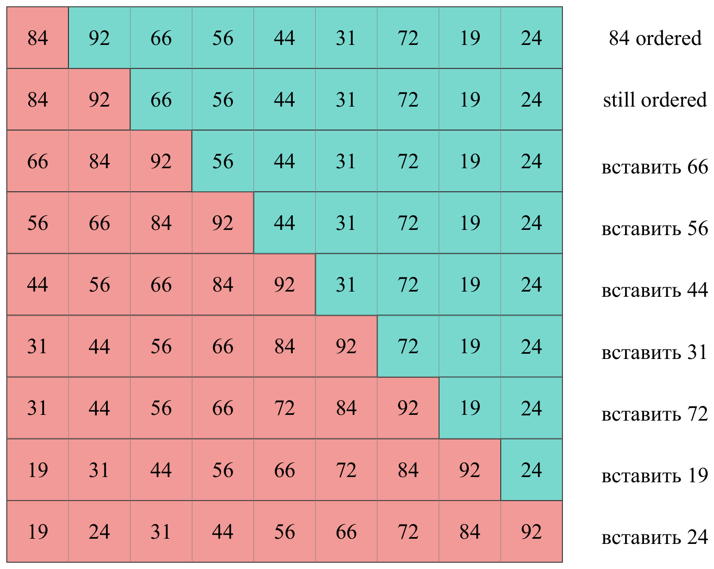

*Рисунок 7.2: Сортировка вставками*

```rust
// insertion_sort.rs
fn insertion_sort(nums: &mut [i32]) {
    if nums.len() < 2 { return; }
    for i in 1..nums.len() {
        let mut pos = i;
        let curr = nums[i];
        while pos > 0 && curr < nums[pos-1] {
            // move element to right
            nums[pos] = nums[pos-1];
            pos -= 1;
        }

        // insert element: curr
        nums[pos] = curr;
    }
}
fn main() {
    let mut nums = [54,32,99,18,75,31,43,56,21];
    insertion_sort(&mut nums);
    println!("sorted nums: {:?}", nums);
    // sorted nums: [18, 21, 31, 32, 43, 54, 56, 75, 99]
}
```

Сортировка вставками требует сравнения каждого нового элемента с уже отсортированными элементами один за другим. Однако алгоритм двоичного поиска, рассмотренный в главе 6, может эффективно находить позицию элемента в отсортированной подпоследовательности. Поэтому двоичный поиск можно использовать для ускорения.

```rust
// binary_insertion_sort.rs

fn binary_insertion_sort(nums: &mut [i32]) {
    let mut temp;
    let mut left;
    let mut mid;
    let mut right;

    for i in 1..nums.len() {
        left = 0;

        // Sorted array boundaries
        right = i - 1;

        // Data to be sorted
        temp = nums[i];

        // Binary search finds the position of temp
        while left <= right {
            mid = (left + right) >> 1;
            if temp < nums[mid] {
                // To prevent right = 0 - 1 case
                if 0 == mid {
                    break;
                }
                right = mid - 1;
            } else {
                left = mid + 1;
            }
        }

        // Move data back
        for j in (left..=i-1).rev() {
            nums.swap(j, j+1);
        }

        // Insert temp into the empty space
        if left != i {
            nums[left] = temp;
        }
    }
}

fn main() {
    let mut nums = [1,3,2,8,6,4,9,7,5,10];
    binary_insertion_sort(&mut nums);
    println!("sorted nums: {:?}", nums);
    // sorted nums: [1, 2, 3, 4, 5, 6, 7, 8, 9, 10]
}
```

<a id="ch07-7-6-сортировка-шелла"></a>

## 7.6 Сортировка Шелла

Сортировка Шелла, также известная как сортировка с уменьшающимся приращением (diminishing increment sort), — это алгоритм сортировки, который разбивает исходное множество на меньшие подмножества и применяет к каждому из них сортировку вставками. Способ выбора подмножеств является ключевым для сортировки Шелла. Вместо равномерного разбиения множества на непрерывные подсписки сортировка Шелла выбирает элементы через каждые несколько позиций и добавляет их в подмножество; расстояние между ними называется шагом (gap).

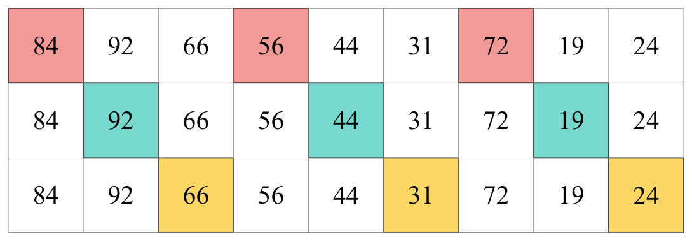

*Рисунок 7.3: Сортировка Шелла*

Чтобы понять сортировку Шелла, рассмотрим рисунок выше. Множество на рисунке содержит девять элементов. Если используется шаг, равный трём, получится всего три подмножества, каждое из которых содержит три элемента одного цвета. Эти разделённые элементы можно считать связанными между собой, поэтому для сортировки элементов одного цвета можно применить сортировку вставками. После сортировки подмножеств всё множество в целом остаётся неупорядоченным, как показано на рисунке ниже. Хотя всё множество в целом неупорядочено, оно не полностью неупорядочено: подмножества одного цвета упорядочены. Отсортировав всё множество с помощью сортировки вставками, можно полностью отсортировать его довольно быстро. Количество перемещений при сортировке вставками в этот момент невелико, поскольку соседние элементы находятся в упорядоченных позициях своих подмножеств, и эти соседние элементы почти упорядочены. Следовательно, для завершения сортировки требуется лишь несколько операций вставки.

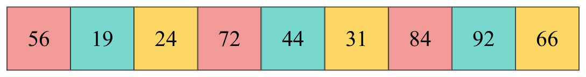

*Рисунок 7.4: Сортировка Шелла*

В сортировке Шелла ключевым элементом является приращение (increment): для определения числа подмножеств могут использоваться различные приращения. Значение шага в реализации сортировки Шелла непрерывно изменяется для достижения сортировки.

```rust
// shell_sort.rs

fn shell_sort(nums: &mut [i32]) {
    // Internal function for insertion sort
    // with elements exhcanged distance is gap
    fn ist_sort(nums: &mut [i32], start: usize, gap: usize) {
        let mut i = start + gap;

        while i < nums.len() {
            let mut pos = i;
            let curr = nums[pos];

            while pos >= gap && curr < nums[pos - gap] {
                nums[pos] = nums[pos - gap];
                pos -= gap;
```

```rust
            }

            nums[pos] = curr;
            i += gap;
        }
    }

    // minimize the gap in every loop untill 1
    let mut gap = nums.len() / 2;
    while gap > 0 {
        for start in 0..gap {
            ist_sort(nums, start, gap);
        }

        gap /= 2;
    }
}
```

Ниже приведены варианты использования.

```rust
fn main() {
    let mut nums = [54,32,99,18,75,31,43,56,21,22];
    shell_sort(&mut nums);
    println!("sorted nums: {:?}", nums);
    // sorted nums: [18, 21, 22, 31, 32, 43, 54, 56, 75, 99]

    let mut nums = [1000,-1,2,-20,89,64,0,99,73];
    shell_sort(&mut nums);
    println!("sorted nums: {:?}", nums);
    // sorted nums: [-20, -1, 0, 2, 64, 73, 89, 99, 1000]
}
```

Сортировка Шелла разбивает исходное множество на меньшие подмножества и применяет к каждому из них сортировку вставками. Подмножества выбираются путём отбора элемента через каждые несколько позиций, а расстояние между ними называется шагом. Затем множество считается связанным воедино, и для сортировки элементов одного цвета применяется сортировка вставками. Заключительная операция вставки в сортировке Шелла намного меньше, чем при обычной сортировке вставками, поскольку коллекция уже предварительно отсортирована более ранними приращениями. Это делает сортировку в целом очень эффективной. Хотя анализ сложности сортировки Шелла несколько сложнее, её сложность примерно находится между O(n) и O(n²). Изменяя значение шага в соответствии с формулой 2k − 1 (1, 3, 7, 15, 31),

3 2 ), что очень быстро. Кроме того, двоичный поиск может

сложность сортировки Шелла составляет приблизительно O(n, и его можно использовать для дальнейшего улучшения сортировки Шелла, как и сортировку вставками. Однако при индексной обработке в двоичном поиске нужно добавлять значение шага. Читателям предлагается подумать над реализацией этого улучшенного алгоритма.

<a id="ch07-7-7-сортировка-слиянием"></a>

## 7.7 Сортировка слиянием

Рассмотренная ранее стратегия «разделяй и властвуй» может применяться для повышения производительности алгоритмов сортировки, в частности сортировки слиянием. И сортировка слиянием, и быстрая сортировка используют рекурсию, последовательно деля список пополам для сортировки. Если в наборе только один элемент, он считается отсортированным. Если элементов несколько, набор разделяется, и рекурсивные вызовы сортировки слиянием выполняются для обоих интервалов. После сортировки операция слияния объединяет два интервала в единый отсортированный набор. Этот процесс проиллюстрирован на приведённых ниже рисунках.

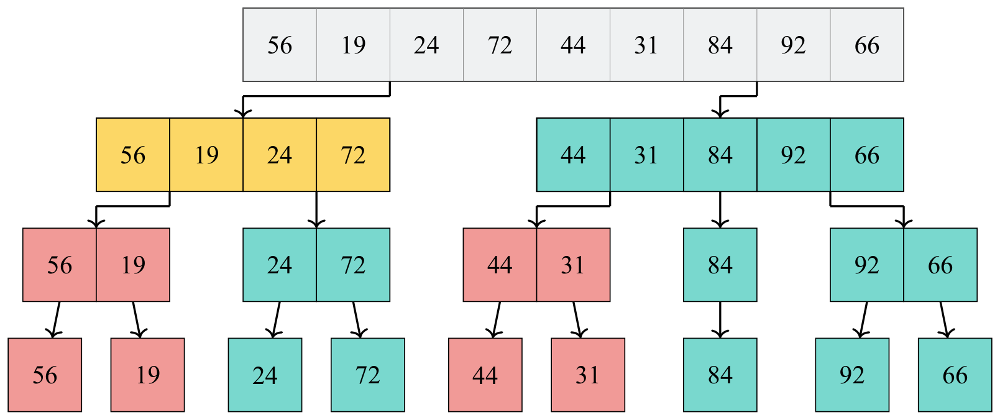

*Рисунок 7.5: Процедуры разделения в сортировке слиянием*

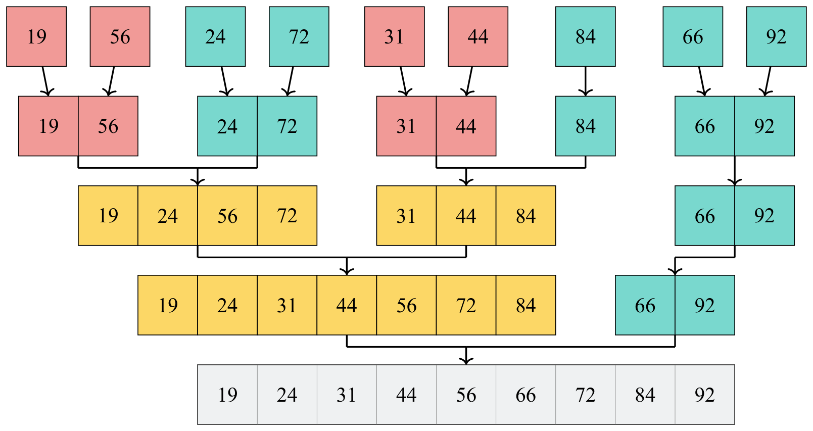

*Рисунок 7.6: Процедуры слияния в сортировке слиянием*

Сортировка слиянием сводит набор к базовым случаям из одного или двух элементов, что позволяет выполнить простое непосредственное сравнение. Затем начинается процесс слияния: сначала сортируется самая маленькая подпоследовательность базового случая. Слияние выполняется попарно, пока набор не будет полностью отсортирован. Даже если набор разделён неравномерно, на производительность это не влияет, так как разница составляет не более одного элемента. Операция слияния проста, поскольку каждая подпоследовательность уже отсортирована, и за один раз требуется лишь одно сравнение. Получаемая последовательность всегда упорядочена. Ниже приведена реализация сортировки слиянием на Rust, состоящая из двух сортировок и одной операции слияния, которая достаточно проста.

```rust
// merge_sort.rs

fn merge_sort(nums: &mut [i32]) {
    if nums.len() > 1 {
        let mid = nums.len() >> 1;
        merge_sort(&mut nums[..mid]); // sort the first half
        merge_sort(&mut nums[mid..]); // sort the last half
        merge(nums, mid); // merge all
```

```rust
    }
}

fn merge(nums: &mut [i32], mid: usize) {
    let mut i = 0; // mark element in first half of data
    let mut k = mid; // mark element in last half of data
    let mut temp = Vec::new();

    for _j in 0..nums.len() {
        if k == nums.len() || i == mid {
            break;
        }

        // put into a temp colletion
        if nums[i] < nums[k] {
            temp.push(nums[i]);
            i += 1;
        } else {
            temp.push(nums[k]);
            k += 1;
        }
    }

    // to make sure all data been solved
    if i < mid && k == nums.len() {
        for j in i..mid {
            temp.push(nums[j]);
        }
    } else if i == mid && k < nums.len() {
        for j in k..nums.len() {
            temp.push(nums[j]);
        }
    }

    // put temp data back to nums, finish sort
    for j in 0..nums.len() {
        nums[j] = temp[j];
    }
}

fn main() {
    let mut nums = [54,32,99,22,18,75,31,43,56,21];
    merge_sort(&mut nums);
    println!("sorted nums: {:?}", nums);
    // sorted nums: [18, 21, 22, 31, 32, 43, 54, 56, 75, 99]
}
```

Чтобы проанализировать временную сложность сортировки слиянием, можно разделить процесс сортировки на две части: сортировку и слияние. Сложность сортировки составляет O(log2(n)), как мы узнали из раздела о двоичном поиске. Шаг слияния заключается в размещении каждого элемента набора в отсортированном списке — не более n раз, что даёт сложность O(n). Поскольку рекурсивные операции и операции слияния комбинируются, производительность сортировки слиянием составляет O(nlog2(n)).

Пространственная сложность сортировки слиянием относительно высока — O(n). Чтобы сократить расход памяти, можно рассмотреть оптимизацию сортировки слиянием с помощью сортировки вставками. Один из подходов — применять сортировку вставками напрямую, когда длина меньше определённого порога (например, 64), и использовать сортировку слиянием, когда длина больше порога. Такой алгоритм называется сортировкой слиянием со вставками (insertion merge sort) и в определённой степени улучшает алгоритм сортировки слиянием. Однако детали реализации оставлены читателю.

<a id="ch07-7-8-сортировка-выбором"></a>

## 7.8 Сортировка выбором

Сортировка выбором — более эффективная версия пузырьковой сортировки: за каждый раунд она выполняет только один обмен данными, поскольку во время обхода разыскивает лишь индекс максимального значения. Завершив обход, она переставляет этот максимальный элемент в правильную позицию. Как и в пузырьковой сортировке, после первого обхода максимальный элемент оказывается в последней позиции, а после второго обхода второе по величине значение — в предпоследней. Для сортировки n элементов требуется n − 1 проходов. Хотя число сравнений у сортировки выбором и пузырьковой сортировки одинаково, сортировка выбором работает быстрее за счёт меньшего числа обменов данными. Временная сложность обоих алгоритмов — O(n²). На рисунке ниже показан весь процесс сортировки выбором, в котором при каждом обходе выбирается максимальный неотсортированный элемент и помещается в правильную позицию. В отличие от пузырьковой сортировки, сортировка выбором не обменивает пары элементов во время обхода.

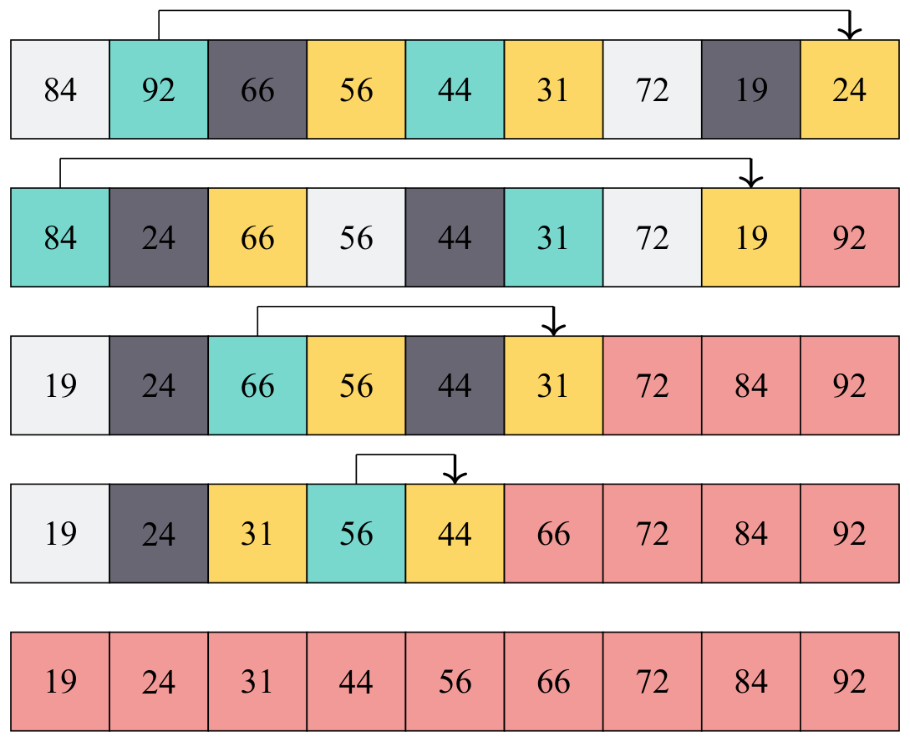

*Рисунок 7.7: Сортировка выбором*

```rust
// selection_sort.rs

fn selection_sort(nums: &mut Vec<i32>) {
    let mut left = nums.len() - 1; // left marker
    while left > 0 {
        let mut pos_max = 0;
        for i in 1..=left {
            if nums[i] > nums[pos_max] {
                pos_max = i; // current loop's max value
            }
        }
        nums.swap(left, pos_max);
```

```rust
        left -= 1; // unsorted elements reduced by 1
    }
}

fn main() {
    let mut nums = vec![54,32,99,18,75,31,43,56,21,22];
    selection_sort(&mut nums);
    println!("sorted nums: {:?}", nums);
    // sorted nums: [18, 21, 22, 31, 32, 43, 54, 56, 75, 99]
}
```

Хотя временная сложность пузырьковой сортировки и сортировки выбором одинакова, возможности для оптимизации всё же остаются. Одна из таких оптимизаций — двунаправленная сортировка, которую можно получить, применив подход шейкерной сортировки (cocktail sort). Аналогичным образом и сортировку выбором можно изменить так, чтобы она выполняла двунаправленную сортировку; это изменяет коэффициент сложности, но не саму временную сложность. Читателям предлагается самостоятельно рассмотреть реализацию этого подхода.

<a id="ch07-7-9-сортировка-кучей"></a>

## 7.9 Сортировка кучей

В компьютерах, помимо линейных структур данных, таких как стек и очередь, существуют и нелинейные структуры данных, одной из которых является куча. Куча представляет собой нелинейное полное двоичное дерево с левыми и правыми дочерними узлами. Высота дерева с n узлами равна log(n). Хотя деревья изучаются только в главе 8, понимание их здесь может помочь разобраться в свойствах куч. Существует два типа куч: кучи на минимум и кучи на максимум. В куче на минимум значение каждого узла меньше или равно значениям его левого и правого дочерних узлов, в то время как в куче на максимум значение каждого узла больше или равно значениям его левого и правого дочерних узлов. Рисунок (7.8) иллюстрирует пример кучи на минимум.

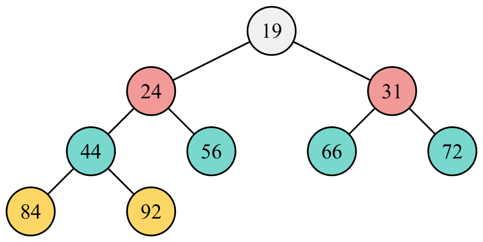

*Рисунок 7.8: Куча на минимум*

Сортировка кучей — это алгоритм сортировки, разработанный с использованием структуры данных «куча». Она многократно выбирает верхний элемент и перемещает его в конец, а затем перестраивает кучу для выполнения сортировки. Она представляет собой сортировку выбором со временной сложностью O(nlog2(n)) в худшем, лучшем и среднем случае и является нестабильной сортировкой. Как показано на рисунке выше, куча напоминает связный список с множественными связями. Узлы кучи нумеруются по уровням, и если эту логическую структуру отобразить на массив, она будет выглядеть как на рисунке ниже, где на первой позиции, индекс 0, занята нулём.

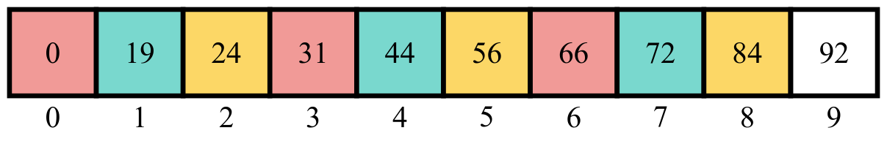

*Рисунок 7.9: Массив как куча на минимум*

Кучи можно представлять не только деревьями, но и массивами или Vec (как показано на рисунке выше). На самом деле, использование массивов или Vec для представления куч больше соответствует буквальному значению слова «куча», которое относится к собранной вместе коллекции вещей. Обратите внимание, что индексация начинается с 1, что позволяет представлять индексы левого и правого дочерних узлов как 2i и 2i+1, упрощая вычисления. Для соблюдения требований к связям между узлами двоичного дерева куча, представляемая массивом, должна отвечать следующим критериям:

- Куча на максимум: arr[i] >= arr[2i] and arr[i] >= arr[2i+1]
- Куча на минимум: arr[i] <= arr[2i] and arr[i] <= arr[2i+1]

Сортировка кучей заключается в построении из неотсортированной последовательности кучи на минимум. Минимальное значение всей последовательности является корневым узлом кучи. Поменяйте его местами с последним элементом последовательности, и последний элемент станет минимальным значением. Это минимальное значение больше не учитывается в куче, а оставшиеся n − 1 элементов перестраиваются в кучу, образуя новое минимальное значение. Поменяйте это минимальное значение местами с последним элементом новой кучи, и вы получите два отсортированных значения. Повторяйте этот процесс до тех пор, пока вся последовательность не будет отсортирована. Куча на минимум даёт сортировку по убыванию, а куча на максимум — по возрастанию. Для наглядности процесса сортировки кучей ниже приведён рисунок. Тёмно-серый цвет обозначает минимальный элемент, который был заменён на 92 и больше не входит в состав кучи. Когда 92 оказывается в корне кучи, она перестаёт быть кучей на минимум, поэтому новая куча на минимум строится так, чтобы в её корне оказалось минимальное значение 24. Затем 24 меняется местами с последним элементом в куче, а предпоследний элемент становится тёмно-серым. Обратите внимание, что пунктирная линия указывает, что этот элемент больше не принадлежит куче. Продолжая обмены, тёмно-серая подпоследовательность постепенно заполняет всю кучу в обратном порядке, начиная с последнего уровня, что приводит к сортировке от наибольшего к наименьшему. Для сортировки от наименьшего к наибольшему должна быть построена куча на максимум, а соответствующая логика кучи на минимум должна быть изменена.

92 31 24 56 66 72 44 84 19 24 44 31 84 56 66 72 92 19 31 44 66 84 56 92 72 24 19

Вот реализация сортировки кучей.

```rust
// heap_sort.rs

// calculate index of parent node
macro_rules! parent {
    ($child:ident) => {
        $child >> 1
    };
}

// calculate index of left child node
macro_rules! left_child {
    ($parent:ident) => {
        $parent << 1
    };
}

// calculate index of right child node
macro_rules! right_child {
    ($parent:ident) => {
        ($parent << 1) + 1
    };
}

fn heap_sort(nums: &mut [i32]) {
    if nums.len() < 2 { return; }

    let len = nums.len() - 1;
    let last_parent = parent!(len);
    for i in (1..=last_parent).rev() { // build a min-heap
        move_down(nums, i); // begins from 1
    }

    for end in (1..nums.len()).rev() { // rebuild min-heap
        nums.swap(1, end);
        move_down(&mut nums[..end], 1);
    }
}

// move down greater element
fn move_down(nums: &mut [i32], mut parent: usize) {
    let last = nums.len() - 1;
    loop {
        let left = left_child!(parent);
        let right = right_child!(parent);
        if left > last { break; }

        // right <= last: determin if right child node exists
        let child = if right <= last
                    && nums[left] < nums[right] {
            right
```

```rust
        } else {
            left
        };

        // swap data if child node is greater than parent node
        if nums[child] > nums[parent] {
            nums.swap(parent, child);
        }

        // update parent and child relationship
        parent = child;
    }
}

fn main() {
    let mut nums = [0,54,32,99,18,75,31,43,56,21,22];
    heap_sort(&mut nums);
    println!("sorted nums: {:?}", nums);
    // sorted nums: [0, 18, 21, 22, 31, 32, 43, 54, 56, 75, 99]
}
```

Куча — это двоичное дерево со временной сложностью O(nlog(n)). Время в основном затрачивается на две части: построение кучи и настройку кучи n раз. Построение кучи обрабатывает n элементов со сложностью O(n). Самый длинный путь при каждой настройке ведёт от корня до листа — это высота кучи, logn. Следовательно, временная сложность n настроек составляет O(nlog(n)), а итоговая суммарная временная сложность — O(nlog(n)). Здесь для получения индексов узлов используются макросы, но их можно реализовать и с помощью функций. Сортировка кучей и сортировка выбором похожи тем, что обе находят максимальное или минимальное значение в наборе.

<a id="ch07-7-10-сортировка-корзинами"></a>

## 7.10 Сортировка корзинами

Ранее были рассмотрены различные техники сортировки, включая алгоритмы, основанные на сравнениях. Однако существуют и алгоритмы сортировки, не использующие сравнения, такие как сортировка корзинами (bucket sort), сортировка подсчётом (counting sort) и поразрядная сортировка (radix sort). Сортировка без сравнений работает путём определения количества элементов, предшествующих каждому элементу в отсортированном множестве. Например, для набора чисел «nums» вычисление количества элементов, предшествующих «nums[i]», однозначно определяет его позицию в отсортированном множестве. Сортировка без сравнений может быть выполнена за один проход со временной сложностью O(n), поскольку требует лишь подсчёта количества элементов, предшествующих каждому элементу. Хотя сортировка без сравнений имеет низкую временную сложность, она требует дополнительной памяти для определения позиции, что делает её пригодной для определённых размеров и распределений данных (особенно чисел). Сортировка без сравнений требует наличия в данных индексируемой информации для определения позиции. В противоположность этому сортировка на основе сравнений подходит для данных различных размеров и распределений, что делает её применимой в самых разных ситуациях сортировки. Сортировка корзинами — один из видов сортировки без сравнений, где корзины похожи на слоты хеш-таблицы, но могут содержать несколько элементов. Основная идея сортировки корзинами состоит в следующем:

- Шаг 1: разделить элементы по разным корзинам, установив количество корзин равным k после нахождения maxV и minV и разделив интервал [minV, maxV] на k равных интервалов. Элементы последовательности хешируются в каждую корзину с помощью хеш-функции (например, взятия остатка).
- Шаг 2: отсортировать элементы в каждой корзине любым доступным алгоритмом сортировки.
- Шаг 3: слить упорядоченные элементы из каждой корзины в одно большое упорядоченное множество.

В Rust корзину можно определить как структуру, содержащую хеш-функцию с именем hasher и набор данных с именем values.

```rust
// bucket_sort.rs

struct Bucket<H, T> {
    hasher: H, // hasher: a function, recieved when called
    values: Vec<T>, // values: a container for data
}
```

Чтобы помочь читателям понять сортировку корзинами, рисунок ниже иллюстрирует процесс хеширования данных в корзины, сортировки внутри каждой корзины и слияния отсортированных данных для получения итогового упорядоченного множества.

92 70 80 66 56 44 31 20 24 5 7 0 1 2 3 4 6 8 80 70 20 66 56 31 92 44 24 20 70 80 31 56 66 92 24 44 20 24 31 44 56 66 70 80 92

Ниже приведена реализация сортировки корзинами.

```rust
// bucket_sort.rs

use std::fmt::Debug;

impl<H, T> Bucket<H, T> {
    fn new(hasher: H, value: T) -> Bucket<H, T> {
        Bucket {
            hasher: hasher,
            values: vec![value]
        }
    }
}

// Bucket sort, Debug feature is used for printing T
fn bucket_sort<H, T, F>(nums: &mut [T], hasher: F)
    where H: Ord,
          T: Ord + Clone + Debug,
          F: Fn(&T) -> H,
{
    let mut buckets: Vec<Bucket<H, T>> = Vec::new();
```

```rust
    for val in nums.iter() {
        let hasher = hasher(&val);

        // Binary search and sort bucket data
        match buckets.binary_search_by(|bct|
                bct.hasher.cmp(&hasher)) {
            Ok(idx) => buckets[idx].values.push(val.clone()),
            Err(idx) => buckets.insert(idx,
                        Bucket::new(hasher, val.clone())),
        }
    }

    // Split the buckets and merge them into a single Vec
    let ret = buckets.into_iter().flat_map(|mut bucket| {
        bucket.values.sort();
        bucket.values
    }).collect::<Vec<T>>();

    nums.clone_from_slice(&ret);
}

fn main() {
    let mut nums = [0,54,32,99,18,75,31,43,4,56,21,22,1,100];
    bucket_sort(&mut nums, |t| t / 5);
    println!("{:?}", nums);
    // [0, 1, 4, 18, 21, 22, 31, 32, 43, 54, 56, 75, 99, 100]
}
```

Реализация сортировки корзинами сложнее, чем реализация алгоритмов сортировки на основе сравнений, поскольку она предполагает создание структуры корзины и реализацию алгоритма сортировки, работающего с этой структурой. В данной реализации данные распределяются по корзинам с помощью деления на 5. Если используется другое значение, количество корзин нужно скорректировать соответствующим образом. Сортировка корзинами имеет временную сложность O(n + nlogn − nlogk), где n — количество сортируемых элементов, а k — количество используемых корзин. Если данные распределены равномерно, среднее количество элементов в каждой корзине составляет n/k. Если для сортировки каждой корзины используется быстрая сортировка, временная сложность каждой операции сортировки составляет O(n/k log(n/k)). Следовательно, общую временную сложность можно выразить как O(n) + k·O(n/k log(n/k)) = O(n + n log(n/k)). Когда k близко к n, сортировку корзинами можно рассматривать как имеющую временную сложность O(n). Одним из недостатков сортировки корзинами является то, что она может создавать слишком много ненужных корзин, что приводит к напрасной трате памяти. Для решения этой проблемы FlashSort — оптимизированный алгоритм сортировки корзинами, который оценивает необходимое количество корзин на основе количества сортируемых элементов. Если количество корзин больше количества элементов, количество корзин можно вычислить по формуле m = f ∗ n, где f — десятичная дробь, например 0.2. Правило размещения элементов по корзинам задаётся уравнением, приведённым ниже, где K(Ai) обозначает индекс корзины элемента Ai. K(Ai) = 1 + int((m −1) Ai −Amin

) (7.2) Amax −Amin

Если в каждой корзине в среднем находится n/m элементов, применение сортировки вставками для каждой корзины даёт общую временную сложность O(n²/m). Экспериментальные результаты показывают, что FlashSort работает оптимально — за O(n) — при m = 0.42n. Более того, при m = 0.1n FlashSort быстрее быстрой сортировки, пока n > 80, а при n = 10000 он работает в два раза быстрее. Кроме того, при m = 0.2n он на 15% быстрее, чем при m = 0.1n. Даже при m = 0.05n FlashSort всё ещё существенно быстрее быстрой сортировки, если n > 200.

<a id="ch07-7-11-сортировка-подсчетом"></a>

## 7.11 Сортировка подсчётом

Ещё один вид несравнительной сортировки — сортировка подсчётом, которая является частным случаем сортировки корзинами: она работает только с данными одного типа и поэтому требует больше места. Основная идея сортировки подсчётом такова:

- Сначала инициализируйте набор счётчиков длиной maxV - minV + 1, где maxV — максимальное значение в сортируемом множестве, а minV — минимальное. Установите все значения набора счётчиков в 0.
- Затем просканируйте сортируемое множество, используя в качестве индекса в наборе счётчиков разность текущего значения и minV, и увеличьте счётчик по этому индексу на единицу.
- Наконец, просканируйте набор счётчиков и записывайте значения обратно в исходное множество, чтобы завершить сортировку.

Например, пусть nums=[0,7,1,7,3,1,5,8,4,4,5]. Сначала обходим nums и находим минимальное и максимальное значения: maxV=8, minV=0, затем инициализируем набор счётчиков длиной 8 - 0 + 1: counter = [0, 0, 0, 0, 0, 0, 0, 0, 0]. Далее просматриваем nums и вычисляем индекс, вычитая minV из текущего значения. Например, при просмотре 0 индекс равен 0 - 0 = 0, поэтому значение счётчика с индексом 0 в counter увеличивается на единицу. На этом этапе counter равен [1,0,0,0,0,0,0,0,0]. Просмотр продолжается до получения конечного значения counter: [1, 2, 0, 1, 2, 2, 0, 2, 1]. При обходе набора счётчиков, если значение по некоторому индексу не равно 0, соответствующее значение индекса записывается в nums, а значение в counter уменьшается на единицу. Например, если значение на первой позиции 0 в counter равно 1, это означает, что в nums содержится один 0, и он записывается в nums. Далее значение с индексом 1 равно 2, что означает наличие в nums двух единиц, и они записываются в nums. В итоге nums отсортирован так: [0, 1, 1, 3, 4, 4, 5, 5, 7, 7, 8]. Процесс сортировки завершается обходом набора счётчиков, при этом не выполняется сравнение, обмен или какие-либо другие операции, поэтому сортировка очень быстрая. Ниже приведена реализация сортировки подсчётом:

```rust
// counting_sort.rs

fn counting_sort(nums: &mut [usize]) {
    if nums.len() <= 1 {
        return;
    }

    // bucket number is the maximum value in nums plus 1
    let max_bkt_num = 1 + nums.iter().max().unwrap();

    // save the number of each value in nums
    let mut counter = vec![0; max_bkt_num];
    for &v in nums.iter() {
        counter[v] += 1;
    }

    // write data back to original nums slice
    let mut j = 0;
    for i in 0..max_bkt_num {
        while counter[i] > 0 {
            nums[j] = i;
```

```rust
            counter[i] -= 1;
            j += 1;
        }
    }
}

fn main() {
    let mut nums = [54,32,99,18,75,31,43,56,21,22];
    counting_sort(&mut nums);
    println!("sorted nums: {:?}", nums);
    // sorted nums: [18, 21, 22, 31, 32, 43, 54, 56, 75, 99]
}
```

<a id="ch07-7-12-поразрядная-сортировка"></a>

## 7.12 Поразрядная сортировка

Третьим типом сортировки, не основанной на сравнении, является поразрядная сортировка, которая использует правило разрядов положительных чисел для сортировки. Процесс сортировки включает сбор и распределение данных, а конкретные шаги следующие:

- Шаг 1: Находим максимальное значение в заданном наборе целых чисел и определяем в нём количество цифр. Затем дополняем числа нулями слева, чтобы количество цифр стало одинаковым.
- Шаг 2: Начиная с наименьшего разряда, выполняем устойчивую сортировку, собираем числа в соответствии с их разрядами, а затем сортируем числа по следующему более значительному разряду до тех пор, пока сортировка не будет завершена.

Например, рассмотрим последовательность целых чисел [1, 134, 532, 45, 36, 346, 999, 102]. Максимальное значение в наборе равно 999 и имеет три цифры. Поэтому для единиц, десятков и сотен требуется три раунда сортировки. Сначала дополним числа нулями слева, чтобы все числа имели три цифры, как показано во втором столбце рисунка. Затем в порядке сортируем числа по их единичному, десятному и сотенному цифрам. После трёх раундов сортировки данные будут отсортированы. Красная цифра на рисунке обозначает цифру, которая сортируется в текущем раунде, и, как можно видеть, числа сортируются по соответствующей им цифре на каждом шаге.

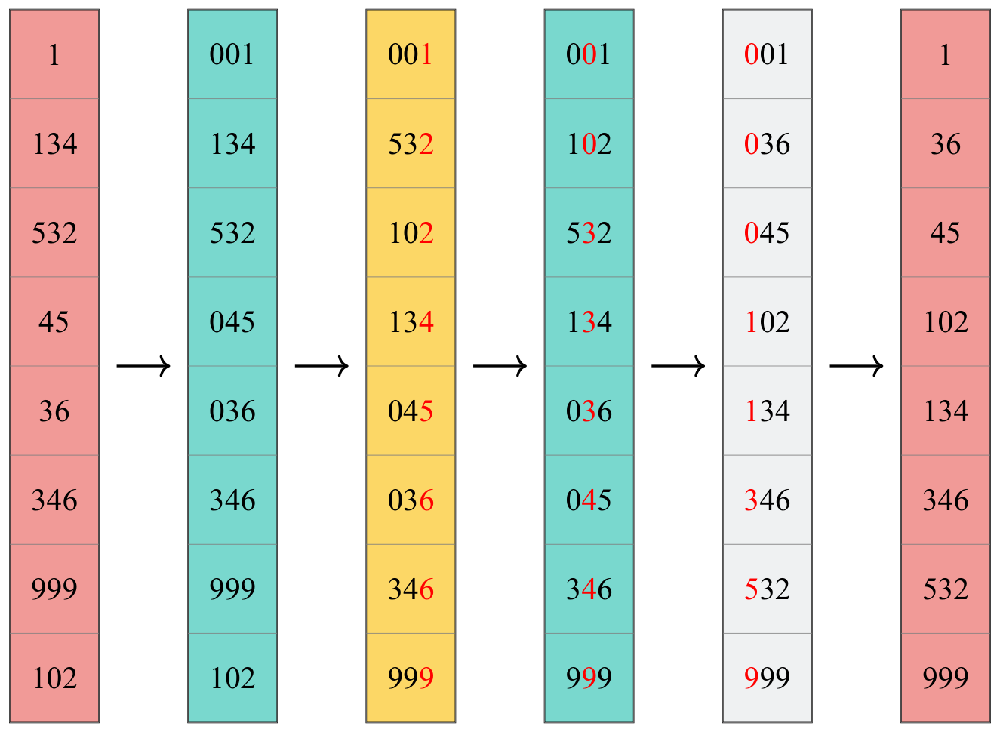

*Рисунок 7.10: Поразрядная сортировка*

```rust
// radix_sort.rs

fn radix_sort(nums: &mut [usize]) {
    if nums.len() <= 1 { return; }

    // Find the largest number, which has the most digits.
    let max_num = match nums.iter().max() {
        Some(&x) => x,
        None => return,
    };

    // Find the power of 2 that is greater than or equals to
    // the length of nums as the bucket size. For example,
    // the closest and greater power of 2 to 10 is 2^4 = 16,
    // the closest and greater power of 2 to 17 is 2^5 = 32.
    let radix = nums.len().next_power_of_two();

    // The variable 'digit' represents the count of numbers
    // in a bucket that are less than a certain digit.
    // The ones, tens, hundreds, and thousands digits
    // correspond to positions 1, 2, 3, and 4, respectively.
    // The counting starts from the ones digit, so it is 1.
    let mut digit = 1;
    while digit <= max_num {
        // Calculate the position of the data in the bucket.
        let index_of = |x| x / digit % radix;
        let mut counter = vec![0; radix];
        for &x in nums.iter() {
            counter[index_of(x)] += 1;
        }
        for i in 1..radix {
            counter[i] += counter[i-1];
        }

        // sorting
        for &x in nums.to_owned().iter().rev() {
            counter[index_of(x)] -= 1;
            nums[counter[index_of(x)]] = x;
        }

        // process next bucket
        digit *= radix;
    }
}

fn main() {
    let mut nums = [0,54,32,99,18,75,31,43,56,21,22,100];
    radix_sort(&mut nums);
    println!("sorted nums: {:?}", nums);
    // sorted nums: [18, 21, 22, 31, 32, 43, 54, 56, 75, 99]
}
```

Чтобы сортировать по тому же разряду, устойчивая сортировка используется, поскольку она сохраняет предыдущий результат сортировки. Например, сортировка по десяткам сохраняет результат сортировки по единицам, а сортировка по сотням сохраняет результат сортировки по десяткам. Бинарный поиск также можно использовать для решения любой неотрицательной последовательности целых чисел с помощью алгоритма поразрядной сортировки. Временная сложность составляет O(64n), если предположить, что максимальное целое число в последовательности составляет 64 бита. Хотя алгоритмы сортировки, основанные на сравнении, имеют временную сложность O(nlog(n)), они всё ещё быстрее, чем поразрядная сортировка, поскольку коэффициент 64 слишком велик, чтобы быть практичным. Чтобы использовать бинарный поиск, k=2 является наименьшим, а количество цифр — наибольшим, поэтому временная сложность становится равной O(nd), а пространственная сложность равна O(n + k), и она меньше. И наоборот, когда в качестве основания используется максимальное значение, k=maxV является наибольшим, а количество цифр — наименьшим, что приводит к меньшей временной сложности O(nd) и увеличенной пространственной сложности O(n + k), из-за чего поразрядная сортировка вырождается в сортировку подсчётом. Итог: эти три метода сортировки, не основанные на сравнении (сортировка подсчётом, сортировка корзинами и поразрядная сортировка), взаимосвязаны. Сортировка подсчётом — частный случай сортировки корзинами, а поразрядная сортировка вырождается в сортировку подсчётом, если для сортировки используется минимальное количество цифр. Сортировка корзинами подходит для элементов с равномерным распределением, сортировка подсчётом требует небольшого различия между maxV и minV, а поразрядная сортировка может обрабатывать только положительные числа, при этом значения maxV и minV должны быть как можно ближе. Поэтому эти три метода сортировки применимы только для сортировки небольших объёмов данных, желательно менее 10000.

<a id="ch07-7-13-сортировка-тимсорт-timsort"></a>

## 7.13 Сортировка Тимсорт (TimSort)

Гибридный алгоритм сортировки Тимсорт (TimSort), предложенный Тимом Питерсом в 2002 году, объединяет несколько методов сортировки, чтобы преодолеть ограничения отдельных алгоритмов. Тимсорт эффективен, стабилен и адаптируется к распределению данных, что делает его превосходящим большинство алгоритмов сортировки. В настоящее время он является алгоритмом сортировки по умолчанию во многих языках программирования и платформах, включая Java, Python, Rust и другие. Тимсорт — это гибридный стабильный алгоритм сортировки, использующий сортировку слиянием и сортировку вставками. Когда количество сортируемых элементов меньше 64, Тимсорт напрямую вызывает сортировку вставками. Однако когда количество элементов больше 64, Тимсорт комбинирует сортировку вставками и сортировку слиянием. На практике сортируемые данные часто содержат частично упорядоченные блоки, в которых некоторые части данных уже отсортированы по возрастанию или убыванию, как показано на рисунке ниже. Тимсорт использует эту особенность данных при их сортировке, и наличие частично упорядоченных блоков является ключевой идеей алгоритма.

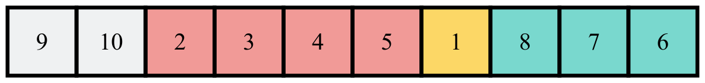

*Рисунок 7.11: Частично упорядоченные данные*

Для сортировки набора элементов Тимсорт делит их на серии (runs), или разделы. Эти серии можно рассматривать как отдельные вычислительные единицы. Тимсорт проходит по элементам и размещает их в разных сериях, одновременно сливая серии в соответствии с определёнными правилами. Это слияние продолжается до тех пор, пока не останется только одна серия, которая и является отсортированным результатом. Чтобы задать подходящий размер раздела, Тимсорт использует параметр minrun. Каждый раздел не может содержать меньше элементов, чем minrun. Если в разделе меньше элементов, чем minrun, количество серий расширяется до minrun с помощью сортировки вставками, после чего выполняется слияние.

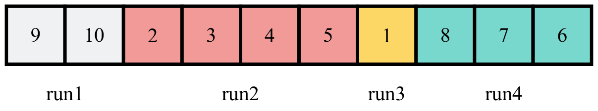

*Рисунок 7.12: Серии данных*

Приблизительный процесс работы Тимсорт выглядит следующим образом:

- Просканировать набор, который требуется отсортировать, чтобы определить, больше ли 64 количество элементов.
- Если оно меньше или равно 64, использовать алгоритм сортировки вставками для сортировки данных и вернуть результат.
- Если оно больше 64, просканировать набор, вычислить minrun и найти различные упорядоченные блоки.
- Сливать блоки попарно. Если в отдельном блоке меньше элементов, чем minrun, использовать сортировку вставками для его расширения.
- Повторять этот процесс, пока не останется только один блок, который и будет отсортированным набором.

Тимсорт — это алгоритм сортировки, который можно реализовать, решив три важные задачи: определение значения minrun, поиск упорядоченных блоков, а также расширение и слияние маленьких блоков. Первая задача — определить значение minrun. Тимсорт выбирает первые шесть двоичных разрядов длины n сортируемой коллекции в качестве minrun. Если оставшиеся разряды не равны 0, то minrun увеличивается на 1. Диапазон значений minrun — от 32 до 64.

- Для коллекции длины n = 189 её двоичное представление: 10111101. Первые шесть разрядов, 101111, равны 47, а оставшиеся разряды, 01, приводят к значению minrun, равному 48.
- Для коллекции длины n = 976 её двоичное представление: 1111010000. Первые шесть разрядов, 111101, равны 61, а оставшиеся разряды, 0000, приводят к значению minrun, равному 61.

Фактически максимальное значение первых шести двоичных разрядов равно 111111 = 63, а минимальное — 100000 = 32. Поэтому значение minrun находится в диапазоне от 32 до 64. Вторая задача — найти упорядоченные блоки. Тимсорт находит упорядоченные блоки, выявляя возрастающие или убывающие последовательности в коллекции. Это достигается алгоритмом, которому достаточно сравнивать соседние элементы, чтобы определить, образуют ли они блок. Третья задача — расширение и слияние маленьких блоков. После вычисления значения minrun Тимсорт на месте преобразует любые блоки, расположенные в обратном порядке, в правильный порядок. Если в блоке меньше элементов, чем minrun, используется сортировка вставками для расширения блока до достижения значения minrun. Затем алгоритм проверяет соотношение между текущим блоком и двумя предыдущими блоками. Если длины трёх блоков не удовлетворяют условиям A > B + C, B > C, то в зависимости от ситуации выполняется слияние A и B или B и C с использованием сортировки вставками. В противном случае алгоритм продолжает поиск следующего блока и повторяет расширение и слияние блоков. В итоге коллекция превращается в несколько упорядоченных блоков, причём длины этих слитых блоков располагаются от наибольшей к наименьшей. После завершения разбиения на блоки маленькие блоки попарно сливаются с конца коллекции к началу, и коллекция превращается в один большой блок, что означает завершение сортировки. Первые две задачи понятны, но третья может требовать дополнительных пояснений. Обращение порядка блока — простая операция. Для расширения блока в текущий блок вставляются новые элементы. Однако слияние блоков может быть сложным, поскольку возможны шесть различных сценариев. Когда есть только два блока, алгоритму достаточно учитывать условие A > B. Когда есть три блока, алгоритм проверяет, выполняются ли условия A > B + C и B > C. Ниже приведены иллюстрации шести случаев, где A находится внизу стека, а B или C — наверху:

- A > B: слияние не выполняется.
- A < B: слить серию A с B.
- A > B + C и B > C: слияние не выполняется.
- A > B + C и B < C: слить серию B с C.
- A < B + C и A > C: слить серию B с C. • A < B + C и A < C: слить серию A с B.

```rust
1: A > B, no merge
                              2: A < B,B merges A
     |
                       |
                                   |
                                                     |
B -> |
         [xxxxxxxxx]
                       |
                              B -> | [xxxxxxxxxxxxx] |
     |
                       |
                                   |
                                                     |
A -> | [xxxxxxxxxxxxx] |
                              A -> |
                                       [xxxxxxxxx]
                                                     |
     |
                       |
                                   |
                                                     |
3: A > B + C; B > C, no merge 4: A > B + C; B < C, B merges C
     |
                       |
                                   |
                                                     |
C -> |
           [xxx]
                       |
                              C -> |
                                       [xxxxxxx]
                                                     |
     |
                       |
                                   |
                                                     |
B -> |
         [xxxxxxxx]
                       |
                              B -> |
                                         [xxx]
                                                     |
```

```rust
     |
                       |
                                   |
                                                     |
A -> | [xxxxxxxxxxxxx] |
                              A -> | [xxxxxxxxxxxxx] |
     |
                       |
                                   |
                                                     |
5: A < B + C; A > C, B merges C 6: A < B + C; C > A, B merges A
     |
                       |
                                   |
                                                     |
C -> |
          [xxxxxx]
                       |
                              C -> |
                                      [xxxxxxxxxxx]
                                                     |
     |
                       |
                                   |
                                                     |
B -> |
         [xxxxxxxx]
                       |
                              B -> | [xxxxxxxxxxxxx] |
     |
                       |
                                   |
                                                     |
A -> | [xxxxxxxxxxxxx] |
                              A -> |
                                       [xxxxxxxxx]
                                                     |
     |
                       |
                                   |
                                                     |
```

На рисунке показано слияние трёх упорядоченных блоков с минимальной длиной серии, равной 3. Символы A, B и C обозначают серии [xx], а вертикальные линии — временный стек, используемый для слияния этих блоков. Чтобы определить, нужно ли выполнять слияние и как именно, сравниваются длины трёх блоков. Идеальное состояние после слияния показано в случаях 1 и 3, тогда как остальные четыре сценария слияния используются для приближения к этим двум случаям. Условие A > B + C, B > C необходимо для обеспечения эффективного слияния. Например, прямое слияние блока [6,7,8] с [0,1,2,3,4,9,5] привело бы к двум оставшимся блокам с большой разницей в длине, из-за чего сортировка вставками стала бы неэффективной. Напротив, когда блоки имеют схожие длины, их слияние выполняется очень быстро. Поэтому в этом случае блоки не сливаются, а обрабатываются отдельно, после чего сливаются в обратном порядке в конце: [6,7,8] и [5], затем [0,1,2,3,4,9] и [5,6,7,8].

7 5 0 3 9 6 8 1 2 4

Чтобы упростить процесс сортировки, задаётся минимальная длина серии, ниже которой используется двоичная сортировка вставками. Если длина серии равна 64, minrun также устанавливается равным 64. В противном случае для minrun выбирается значение в диапазоне от 32 до 64

n

for minrun such that k =

minrun не превосходит степени двойки. k представляет собой количество

оставшихся блоков после сканирования и обработки, и их длины должны быть упорядочены от наибольшей к наименьшей. Это позволяет выполнять слияние с конца, в результате чего получаются более длинные блоки и более быстрое слияние, подобно двоичному поиску. Следовательно, требуется, чтобы k было меньше или равно степени двойки.

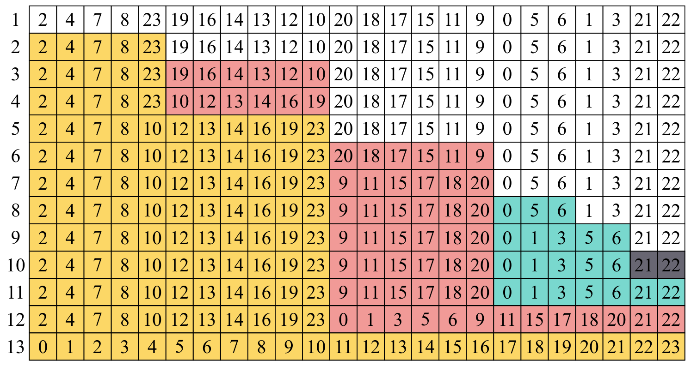

*Рисунок 7.13: Тимсорт*

Для иллюстрации механизма расширения и слияния блоков выше приведены схемы. В этом примере minrun = 5, и каждая строка представляет собой один цикл операций. В крайнем левом столбце указан номер цикла, а в квадратных рамках показаны элементы, которые нужно отсортировать. Алгоритм Тимсорт состоит из нескольких раундов обработки для сортировки заданного набора данных. В первом раунде алгоритм получает данные для сортировки из своих параметров. Во втором раунде он ищет разделы и находит раздел длиной, равной значению минимальной серии, который представляет собой заранее определённый набор значений [2,4,7,8,23]. В третьем раунде он ищет следующий раздел и обнаруживает инверсию [19,16,14,13,12,10], которая затем в четвёртом раунде приводится к упорядоченному виду [10,12,13,14,16,19]. В пятом раунде алгоритм сравнивает длину текущего раздела с длиной предыдущего раздела и, если текущий раздел длиннее, сливает их с помощью сортировки вставками. Результатом является [2,4,7,8,10,12,13,14,16,19,23] — новый раздел, представляющий собой объединение двух предыдущих разделов. В шестом раунде он находит следующий раздел [20,18,17,15,11,9], обнаруживает инверсию и в седьмом раунде приводит его к упорядоченному виду. Затем он сравнивает его длину с длиной предыдущего раздела и, поскольку он короче, продолжает поиск следующего раздела. В восьмом раунде алгоритм находит новый раздел [0,5,6], который короче минимальной длины серии, и расширяет его с помощью сортировки вставками. Затем он сравнивает его длину с длинами двух предыдущих разделов и определяет, что они удовлетворяют определённым условиям, а значит, слияние не требуется. Этот процесс продолжается до тех пор, пока все разделы не будут сформированы, что происходит после десяти раундов. В одиннадцатом раунде алгоритм начинает сливать меньшие разделы с конца к началу ([0,1,3,5,6] и [21,22]). В двенадцатом раунде он сливает два оставшихся раздела [9,11,15,17,18,20] и [0,1,3,5,6,21,22], в результате чего получается один упорядоченный набор.

```rust
// tim_sort_without_gallop.rs

// The minimum length of a sequence involved in merging,
// shorter than which insertion sort is used.
const MIN_MERGE: usize = 64;

// Sorting state structure
struct SortState<'a> {
    list: &'a mut [i32],
    runs: Vec<Run>, // store all run(s)
    pos: usize,
}

// Define the Run entity to save the starting index and
// interval length of the run in the list.
#[derive(Debug, Copy, Clone)]
struct Run {
    pos: usize,
    len: usize,
}
```

```rust
// merge_lo: a sorting state structure, used for merging
// sorting A and B.
struct MergeLo<'a> {
    list_len: usize, // The length of the data
    first_pos: usize, // first position of run1
    first_len: usize, // length of run1
    second_pos: usize, // first position of run2
    dest_pos: usize, // index of the sorted result.
    list: &'a mut [i32], // partial interval of the data
                         // to be sorted
    temp: Vec<i32>, // with a length set as the minimum
                         // value between the lengths of
                         // run1 and run2.
}

// merge_hi: a sorting state structure, used for merging
// sorting B and C.
struct MergeHi<'a> {
    first_pos: isize,
    second_pos: isize,
    dest_pos: isize,
    list: &'a mut [i32],
    temp: Vec<i32>, // used for memory alignment
}
```

Для блоков, содержащих менее MIN_MERGE элементов, можно использовать двоичную сортировку вставками, чтобы ускорить процесс сортировки. Этот метод уже был реализован в предыдущем разделе, поэтому дополнительный код здесь не приводится. При использовании Тимсорт первым шагом является вычисление значения minrun и выявление отсортированных серий (включая обратные серии). При необходимости обратные серии следует преобразовать в обычные.

```rust
// tim_sort_without_gallop.rs

// Calculate minrun, actual range is [32, 64]
fn calc_minrun(len: usize) -> usize {
    // If any bit in the low bits of len is 1, r is set to 1
    let mut r = 0;
    let mut new_len = len;
    while new_len >= MIN_MERGE {
        r |= new_len & 1;
        new_len >>= 1;
    }

    new_len + r
}

// Calculate the starting index of the run and convert
// the reverse run to a forward run
fn count_run(list: &mut [i32]) -> usize {
    let (ord, pos) = find_run(list);
    if ord { // convert reverse run to a forward run
        list.split_at_mut(pos).0.reverse();
    }
```

```rust
    pos
}

// Determine whether the relationship between list[i]
// and list[i+1] is ascending or descending and
// return the inflection point index
fn find_run(list: &[i32]) -> (bool, usize) {
    let len = list.len();
    if len < 2 {
        return (false, len);
    }

    let mut pos = 1;
    if list[1] < list[0] {
        // descending: list[i+1] < list[i]
        while pos < len - 1 && list[pos + 1] < list[pos] {
            pos += 1;
        }
        (true, pos + 1)
    } else {
        // ascending: list[i+1] >= list[i]
        while pos < len - 1 && list[pos + 1] >= list[pos] {
            pos += 1;
        }
        (false, pos + 1)
    }
}
```

Далее для сортировки SortState необходимо реализовать конструктор и функцию sort. Наконец, когда длины разделов не удовлетворяют требованиям, необходимо выполнить слияние разделов с использованием сортировки слиянием.

```rust
// tim_sort_without_gallop.rs

impl<'a> SortState<'a> {
    fn new(list: &'a mut [i32]) -> Self {
        SortState {
            list: list,
            runs: Vec::new(),
            pos: 0,
        }
    }

    fn sort(&mut self) {
        let len = self.list.len();
        // calculate the minrun
        let minrun = calc_minrun(len);

        while self.pos < len {
            let pos = self.pos;
            let mut run_len = count_run(self.list
                                            .split_at_mut(pos)
```

```rust
                                            .1);

            // check if the remaining number of elements is
            // less than minrun, if so,
            // let run_minlen = len - pos
            let run_minlen = if minrun > len - pos {
                len - pos
            } else {
                minrun
            };

            // If the run is very short, extend its length
            // to run_minlen, and the extended run needs to
            // be sorted, so use binary insertion sort
            if run_len < run_minlen {
                run_len = run_minlen;
                let left = self.list
                               .split_at_mut(pos).1
                               .split_at_mut(run_len).0;
                binary_insertion_sort(left);
            }

            // Stack the runs, with each run having a
            // different length
            self.runs.push(Run {
                pos: pos,
                len: run_len,
            });

            // Find the next run position
            self.pos += run_len;

            // Merge runs that do not conform to the
            // A > B + C and B > C rules
            self.merge_collapse();
        }

        // Forcefully merge all remaining runs from the top
        // of the stack until only one run remains,
        // completing the tim_sort sort
        self.merge_force_collapse();
    }

    // Merge runs to satisfy A > B + C and B > C
    // If A <= B + C, merge B with the shorter of A and C
    // If only A and B, and A <= B, merge A and B
    fn merge_collapse(&mut self) {
        let runs = &mut self.runs;
        while runs.len() > 1 {
            let n = runs.len() - 2;
```

```rust
            // check the relationships between A, B, C, and D
            // with D to prevent special cases of bugs
            // A <= B + C || D <= A + B
            if (n >= 1 && runs[n - 1].len
                <= runs[n].len + runs[n + 1].len)
                || (n >= 2 && runs[n - 2].len
                    <= runs[n].len + runs[n - 1].len)
            {
                // Determine the length relationship between
                // three consecutive runs A, B, and C,
                // and merge n-1 corresponding to A,
                // n corresponding to B, and n+1
                // corresponding to C
                let (pos1, pos2) = if runs[n-1].len
                                        < runs[n+1].len {
                    (n - 1, n) // merge A and B
                } else {
                    (n, n + 1) // merge B and C
                };

                // Take out run1 and run2 to be merged
                let (run1, run2) = (runs[pos1], runs[pos2]);
                debug_assert_eq!(run1.pos+run1.len, run2.pos);

                // Merge run to run1, i.e., update run1
                // and delete run2,
                // run1 index remains unchanged, and length
                // becomes the len(run1) + len(run2)
                runs.remove(pos2);
                runs[pos1] = Run {
                    pos: run1.pos,
                    len: run1.len + run2.len,
                };

                // Take the merged run1 for merge sort
                let new_list = self.list
                    .split_at_mut(run1.pos).1
                    .split_at_mut(run1.len + run2.len).0;
                merge_sort(new_list, run1.len, run2.len);
            } else {
                break;
            }
        }
    }

    // Forcefully merge any remaining runs until
    // only one run remains
    fn merge_force_collapse(&mut self) {
        let runs = &mut self.runs;
        while runs.len() > 1 {
            let n = runs.len() - 2;
```

```rust
            // Check the length relationship between three
            // consecutive runs A, B, and C,
            // and merge n-1 corresponding to A,
            // n corresponding to B, n+1 corresponding to C
            let (pos1, pos2) = if n > 0
                   && runs[n - 1].len < runs[n + 1].len {
                (n - 1, n)
            } else {
                (n, n + 1)
            };

            // Take out run1 and run2 to be merged
            let (run1, run2) = (runs[pos1], runs[pos2]);
            debug_assert_eq!(run1.len, run2.pos);

            // Merge run to run1, i.e., update run1
            // and delete run2,
            // run1 index remains unchanged, and length
            // becomes the sum of the lengths of run1 and run2
            runs.remove(pos2);
            runs[pos1] = Run {
                pos: run1.pos,
                len: run1.len + run2.len,
            };

            // Take the merged run1 for merge sort
            let new_list = self.list
                .split_at_mut(run1.pos).1
                .split_at_mut(run1.len + run2.len).0;
            merge_sort(new_list, run1.len, run2.len);
        }
    }
}
```

Существует шесть случаев разбиения, при которых может потребоваться слияние A и B или слияние B и C. Поскольку A, B и C расположены в памяти непрерывно, слияние A и B можно реализовать отдельно от слияния B и C, используя их относительное расположение.

```rust
// tim_sort_without_gallop.rs

// merge sort for A, B and C
fn merge_sort(
    list: &mut [i32],
    first_len: usize,
    second_len: usize)
{
    if 0 == first_len || 0 == second_len { return; }

    if first_len > second_len {
        // Merge B and C, and merge from the end
        // of the list using temp
        merge_hi(list, first_len, second_len);
    } else {
```

```rust
        // Merge B and A, and merge from the beginning
        // of the list using temp
        merge_lo(list, first_len);
    }
}

// merge A and B to a single run
fn merge_lo(list: &mut [i32], first_len: usize) {
    unsafe {
        let mut state = MergeLo::new(list, first_len);
        state.merge();
    }
}

impl<'a> MergeLo<'a> {
    unsafe fn new(list: &'a mut [i32], first_len: usize) ->
       Self { let mut ret_val = MergeLo {
            list_len: list.len(),
            first_pos: 0,
            first_len: first_len,
            second_pos: first_len, // run1 close to run2,
                                   // the start index of run2
                                   // is exactly equals the
                                   // length of run1
            dest_pos: 0, // write the sorted data
                                   // back to run1
            list: list,
            temp: Vec::with_capacity(first_len),
        };

        // copy run1 to temp
        ret_val.temp.set_len(first_len);
        for i in 0..first_len {
            ret_val.temp[i] = ret_val.list[i];
        }

        ret_val
    }

    // merge sort
    fn merge(&mut self) {
        while self.second_pos > self.dest_pos
             && self.second_pos < self.list_len {
            debug_assert!((self.second_pos - self.first_len) +
                self.first_pos == self.dest_pos);

            if self.temp[self.first_pos]
                    > self.list[self.second_pos] {
                self.list[self.dest_pos]
                    = self.list[self.second_pos];
                self.second_pos += 1;
```

```rust
            } else {
                self.list[self.dest_pos]
                    = self.temp[self.first_pos];
                self.first_pos += 1;
            }
            self.dest_pos += 1;
        }
    }
}

// clear temp stack
impl<'a> Drop for MergeLo<'a> {
    fn drop(&mut self) {
        unsafe {
            // put left date of temp into list(high digit)
            if self.first_pos < self.first_len {
                for i in 0..(self.first_len - self.first_pos) {
                    self.list[self.dest_pos + i]
                        = self.temp[self.first_pos + i];
                }
            }

            // set the lenght of temp to 0
            self.temp.set_len(0);
        }
    }
}

// merge B and C as a new run block
fn merge_hi(
    list: &mut [i32],
    first_len: usize,
    second_len: usize)
{
    unsafe {
        let mut state = MergeHi::new(list,
                                     first_len,
                                     second_len);
        state.merge();
    }
}

impl<'a> MergeHi<'a> {
    unsafe fn new(
        list: &'a mut [i32],
        first_len: usize,
        second_len: usize) -> Self
    {
        let mut ret_val = MergeHi {
            first_pos: first_len as isize - 1,
            second_pos: second_len as isize - 1,
            dest_pos: list.len() as isize - 1,// from the tail
```

```rust
            list: list,
            temp: Vec::with_capacity(second_len),
        };

        // copy run2 to temp
        ret_val.temp.set_len(second_len);
        for i in 0..second_len {
            ret_val.temp[i] = ret_val.list[i + first_len];

        }

        ret_val
    }

    // merge sort
    fn merge(&mut self) {
        while self.first_pos < self.dest_pos
             && self.first_pos >= 0 {
            debug_assert!(self.first_pos + self.second_pos + 1
                == self.dest_pos);
            if self.temp[self.second_pos as usize]
                >= self.list[self.first_pos as usize] {
                self.list[self.dest_pos as usize]
                    = self.temp[self.second_pos as usize];
                self.second_pos -= 1;
            } else {
                self.list[self.dest_pos as usize]
                    = self.list[self.first_pos as usize];
                self.first_pos -= 1;
            }
            self.dest_pos -= 1;
        }
    }
}

// clear temp stack
impl<'a> Drop for MergeHi<'a> {
    fn drop(&mut self) {
        unsafe {
            // put left date of temp into list(low digit)
            if self.second_pos >= 0 {
                let size = self.second_pos + 1;
                let src = 0;
                let dest = self.dest_pos - size;
                for i in 0..size {
                    self.list[(dest + i) as usize]
                        = self.temp[(src + i) as usize];
                }
            }

            // set the length of temp stack to 0
            self.temp.set_len(0);
```

```text
        }
    }
}
```

Ниже приведена основная функция Тимсорт.

```rust
// timSort entry point

fn tim_sort(list: &mut [i32]) {
    if list.len() < MIN_MERGE {
       binary_insertion_sort(list);
    } else {
       let mut sort_state = SortState::new(list);
       sort_state.sort();
    }
}
```

Ниже приведён пример использования Тимсорт.

```rust
fn main() {
    let mut nums: Vec<i32> = vec![
         2, 4, 7, 8, 23, 19, 16, 14, 13, 12, 10, 20,
        18, 17, 15, 11, 9, -1, 5, 6, 1, 3, 21, 40,
        22, 39, 38, 37, 36, 35, 34, 33, 24, 30, 31, 32,
        25, 26, 27, 28, 29, 41, 42, 43, 44, 45, 46, 47,
        48, 49, 50, 51, 52, 53, 54, 55, 56, 57, 58, 59,
        60, 80, 79, 78, 77, 76, 75, 74, 73, 72, 71, 70,
        61, 62, 63, 64, 65, 66, 67, 68, 69, 95, 94, 93,
        92, 91, 90, 85, 82, 83, 84, 81, 86, 87, 88, 89,
    ];
    tim_sort(&mut nums);
    println!("sorted nums: {:?}", nums);
}
sorted nums: [-1, 1, 2, 3, 4, 5, 6, 7, 8, 9, 10, 11, 12, 13, 14, 15, 16, 17, 18, 19, 20, 21, 22, 23, 24, 25, 26, 27, 28, 29, 30, 31, 32, 33, 34, 35, 36, 37, 38, 39, 40, 41, 42, 43, 44, 45, 46, 47, 48, 49, 50, 51, 52, 53, 54, 55, 56, 57, 58, 59, 60, 61, 62, 63, 64, 65, 66, 67, 68, 69, 70, 71, 72, 73, 74, 75, 76, 77, 78, 79, 80, 81, 82, 83, 84, 85, 86, 87, 88, 89, 90, 91, 92, 93, 94, 95]
```

Реализованный алгоритм Тимсорт работает только для чисел типа i32, но его можно расширить для поддержки сортировки значений различных типов с помощью обобщённых типов. Кроме того, при слиянии некоторые данные могут быть уже отсортированы, однако реализованный алгоритм Тимсорт всё равно выполняет сравнения по одному. Тем не менее слияние можно ускорить с помощью стратегии, называемой галопированием (galloping). Реализация Тимсорт в исходном коде этой книги в файле tim_sort_without_gallop.rs является неускоренной версией, но в файле tim_sort.rs также реализована ускоренная версия Тимсорт. Заинтересованные читатели могут обратиться к этим реализациям и сравнить различия между двумя алгоритмами. Некоторые читатели могут задаться вопросом, как Тимсорт определяет, являются ли сортируемые данные изначально блочно упорядоченными. На самом деле алгоритм не может этого определить — это свойство частично упорядоченных данных, которое обнаружил автор. В физике существует понятие энтропии [13], обозначающее степень беспорядка в физической

системе. Чем более неупорядочена система, тем больше энтропия, и наоборот, чем более упорядочена система, тем меньше энтропия. В большинстве случаев вещи обладают определённой степенью упорядоченности. Например, люди — это упорядоченные существа, существующие вопреки энтропии, и становятся неупорядоченными только со смертью. Другой пример — принцип локальности обращений [14]: при доступе к данным на жёстком диске процессор считывает в память также данные, расположенные рядом, поскольку к ним, вероятно, будет обращение в ближайшее время. Эти два явления являются законами природы, согласующимися со статистическими принципами, и Тим разработал Тимсорт на основе этих законов. Это показывает важность структур данных и то, как различное понимание может привести к совершенно разным алгоритмам.

<a id="ch07-7-14-итоги"></a>

## 7.14 Итоги

В этой главе мы изучили десять различных типов алгоритмов сортировки. Пузырьковая сортировка, сортировка выбором и сортировка вставками — это алгоритмы со сложностью O(n2), тогда как большинство остальных алгоритмов сортировки имеют сложность O(nlog2(n)). Сортировка выбором является улучшением пузырьковой сортировки, сортировка Шелла улучшает сортировку вставками, сортировка кучей улучшает сортировку выбором, а быстрая сортировка и сортировка слиянием используют подход «разделяй и властвуй». Все эти сортировки основаны на сравнении, однако существуют и сортировки без сравнения, которые опираются исключительно на числовые закономерности, — например сортировка корзинами, сортировка подсчётом и поразрядная сортировка. Эти сортировки имеют сложность порядка O(n) и подходят для сортировки небольших объёмов данных. Сортировка подсчётом является частным случаем сортировки корзинами, а поразрядная сортировка — это многоэтапная сортировка корзинами, которая может выродиться в сортировку подсчётом. Помимо базовых алгоритмов сортировки, мы также изучили улучшенные варианты некоторых алгоритмов, в частности алгоритм TimSort — эффективный и устойчивый гибридный алгоритм сортировки. Его улучшенная версия уже является алгоритмом сортировки по умолчанию во многих языках и на многих платформах. В приведённой ниже таблице обобщены сведения о различных алгоритмах сортировки; читатели могут самостоятельно сравнить их и разобраться в них, чтобы углубить своё понимание.

**Таблица 7.1: Временная и пространственная сложность различных алгоритмов сортировки**

| № | Алгоритм | Худшее время | Лучшее время | Среднее время | Пространственная сложность | Устойчивость |
| --- | --- | --- | --- | --- | --- | --- |
| 1 | Пузырьковая сортировка | O(n2) | O(n) | O(n2) | O(1) | устойчивая |
| 2 | Быстрая сортировка | O(n2) | O(nlog(n)) | O(nlog(n)) | O(nlog(n)) | неустойчивая |
| 3 | Сортировка выбором | O(n2) | O(n2) | O(n2) | O(1) | неустойчивая |
| 4 | Сортировка кучей | O(nlog(n)) | O(nlog(n)) | O(nlog(n)) | O(1) | неустойчивая |
| 5 | Сортировка вставками | O(n2) | O(n) | O(n2) | O(1) | устойчивая |
| 6 | Сортировка Шелла | O(n2) | O(n) | O(n1.3) | O(1) | неустойчивая |
| 7 | Сортировка слиянием | O(nlog(n)) | O(nlog(n)) | O(nlog(n)) | O(n) | устойчивая |
| 8 | Сортировка подсчётом | O(n + k) | O(n + k) | O(n + k) | O(n + k) | устойчивая |
| 9 | Сортировка корзинами (bucket sort) | O(n2) | O(n) | O(n + k) | O(n + k) | устойчивая |
| 10 | Поразрядная сортировка | O(nk) | O(nk) | O(nk) | O(n + k) | устойчивая |
| 11 | Тимсорт (TimSort) | O(nlog(n)) | O(n) | O(nlong(n)) | O(n) | устойчивая |

---


<a id="ch08"></a>

<!--
  Файл изменён по сравнению с оригиналом проекта QMHTMY/RustBook:
  текст переведён на русский язык. Лицензия: Apache License 2.0.
  Оригинал: https://github.com/QMHTMY/RustBook
-->
# Деревья

<a id="ch08-8-1-цели"></a>

## 8.1 Цели

- Понимание деревьев и их применения.
- Реализация очереди с приоритетом с помощью двоичной кучи.
- Понимание двоичных деревьев поиска и сбалансированных двоичных деревьев.
- Реализация двоичных деревьев поиска и сбалансированных двоичных деревьев.

<a id="ch08-8-2-что-такое-дерево"></a>

## 8.2 Что такое дерево?

В предыдущих главах мы рассматривали линейные структуры данных — стеки, очереди и связные списки, — в которых каждый элемент данных связан со следующим.

a c e b d

Дерево — это новая структура данных, которая расширяет линейную структуру, соединяя несколько элементов данных.

a c b e d g f

Подобно обычному дереву, эта структура данных имеет корень, ветви и листья, которые связаны между собой. Деревья применяются в различных областях информатики, например в операционных системах, графике, базах данных и компьютерных сетях. Далее по тексту эта структура данных будет называться «деревом».

Прежде чем углубляться в деревья, важно рассмотреть несколько распространённых примеров деревьев, например биологическое классификационное дерево. По этому графу видно конкретное местоположение записи «People» (внизу слева), что очень помогает при изучении взаимосвязей и свойств. Дерево такого типа является иерархическим и имеет чётко определённую структуру из семи уровней: царство, тип, класс, отряд, семейство, род и вид. Высший уровень представляет наиболее абстрактное понятие, а низший — наиболее конкретное. Если начать от корня дерева и следовать по стрелкам вниз, можно получить полный путь, указывающий полное название вида. Организмы могут найти своё место на этом дереве жизни, где отображаются их родственные связи. Например, полное название вида «человек» — «царство животных — тип хордовых — класс млекопитающих — отряд приматов — семейство гоминид — род Homo — вид Homo sapiens». Множество дочерних узлов каждого узла независимо от множества дочерних узлов другого узла, что делает взаимосвязи между узлами ясными. Это свойство также означает, что изменение дочерних узлов одного узла не повлияет на другие узлы. Оно особенно полезно, когда деревья используются в качестве контейнеров для хранения данных: инструменты могут изменять данные в конкретных узлах, оставляя остальные данные неизменными. Наконец, каждый листовой узел уникален, и от корня к каждому листовому узлу ведёт единственный уникальный путь. Это свойство делает хранение данных эффективным, поскольку уникальный путь можно использовать в качестве пути хранения. Файловая система на наших компьютерах основана на усовершенствованной древовидной структуре. Дерево файловой системы и биологическое классификационное дерево имеют много общего, и путь от корневого каталога к любому подкаталогу однозначно идентифицирует

этот подкаталог и все файлы в нём. Если вы знакомы с операционными системами типа Unix, то наверняка узнаете пути вроде /root, /home/user и /etc как узлы дерева, где / — корневой узел. Деревья также можно использовать для представления файлов веб-страниц — коллекций ресурсов, имеющих иерархическую структуру. Например, данные веб-страницы поискового интерфейса Google.cn показывают, что элементы тегов <> также расположены иерархически.

```text
<html lang="zh"><head><meta charset="utf-8">
  <head>
      <meta charset="utf-8">
      <title>Google</title>
      <style>
        html { background: #fff; margin: 0 1em; }
        body { font: .8125em/1.5 arial, sans-serif; }
      </style>
  </head>
  <body>
  <div>
    <h1><a href="http://www.google.com.hk/webhp?hl=zh-CN">
        <strong id="target">google.com.hk</strong></a></h1>
    <p>Please save our website</p>
  </div>
  <ul>
    <li><a href="http://translate.google.cn/">translate</a></li
       > </ul>
  </body>
</html>
```

В файлах веб-страниц корень HTML охватывает все остальные элементы, как показано на схеме ниже. Такая иерархическая структура позволяет отображать веб-страницы единообразно на разных устройствах и в разных браузерах. Используя деревья для представления файлов веб-страниц, можно эффективно сохранять и извлекать данные и изменять отдельные элементы, не затрагивая компоновку всей страницы.

<a id="ch08-8-2-1-терминология-и-определения-дерева"></a>

### 8.2.1 Терминология и определения дерева

Рассмотрев примеры деревьев, определим теперь различные свойства дерева.

- Узел: узел — это базовая единица дерева, состоящая из имени-«ключа» и необязательной информации-«полезной нагрузки». Информация полезной нагрузки не всегда необходима для алгоритмов дерева, но обычно важна в приложениях, требующих дополнительных сведений об узлах, например имён файлов, содержимого файлов или меток времени.
- Корень: корень — это узел верхнего уровня дерева, не имеющий входящих рёбер. Все узлы дерева достижимы, если следовать по рёбрам от корня. Это аналог понятий / или диска C в операционной системе.
- Ребро: ребро соединяет два узла и представляет связь между ними. Каждый узел дерева, кроме корня, имеет ровно одно входящее ребро и потенциально несколько исходящих. Ребро определяет путь, который можно использовать для нахождения конкретного узла.
- Путь: путь — это последовательность рёбер, соединяющих узлы. Сам по себе путь не является структурой, а представляет собой ассоциативное отношение, возникающее из логического расположения рёбер. Например, /home/user/files/sort.rs — путь, определяющий расположение файла sort.rs.
- Дочерний узел: дочерний узел — это узел, находящийся на один уровень ниже другого узла и происходящий от того же родительского узла. Например, sort.rs — дочерний узел files/. Дочерние узлы не уникальны: их может быть ноль, один или несколько, подобно отношениям «родитель — ребёнок» в человеческом обществе, поэтому дочерние узлы часто называют терминами родства.
- Родительский узел: родительский узел — это узел, от которого происходят все узлы более низких уровней. Например, files/ — родительский узел sort.rs. Родительский узел уникален, поскольку у ребёнка может быть только один родитель.
- Поддерево: поддерево — это набор узлов и рёбер, состоящий из родительского узла и всех его потомков. Поскольку дерево — рекурсивная структура, любой узел, взятый из дерева, образует новое поддерево.
- Листовой узел: листовой узел — это узел без дочерних узлов, находящийся на самом нижнем уровне дерева.
- Внутренний узел: внутренний узел имеет дочерние узлы и родительский узел.
- Глубина: глубина узла — это число рёбер, пройденных от корня до этого узла. Глубина корневого узла равна нулю. В /home/user/files глубина files равна 2. Глубина, равная нулю, не означает отсутствия глубины, а означает, что глубина равна нулю, то есть это первый уровень.
- Высота: высота дерева — это максимальная глубина любого узла дерева.

Чтобы определить дерево, начнём с приведённых выше базовых сведений:

- Дерево имеет корневой узел — самый верхний узел в иерархии.
- Каждый узел, кроме корневого, соединён с родительским узлом и может иметь ноль или более дочерних узлов, образуя ветвящуюся структуру.
- Путь от корневого узла к любому другому узлу дерева уникален, то есть к этому узлу ведёт только один путь.

На следующем изображении показан пример структуры дерева с левым и правым дочерними узлами, обозначенными как «lc» и «rc» соответственно. Поскольку деревья — рекурсивные структуры, структура поддерева совпадает со структурой его родительского узла.

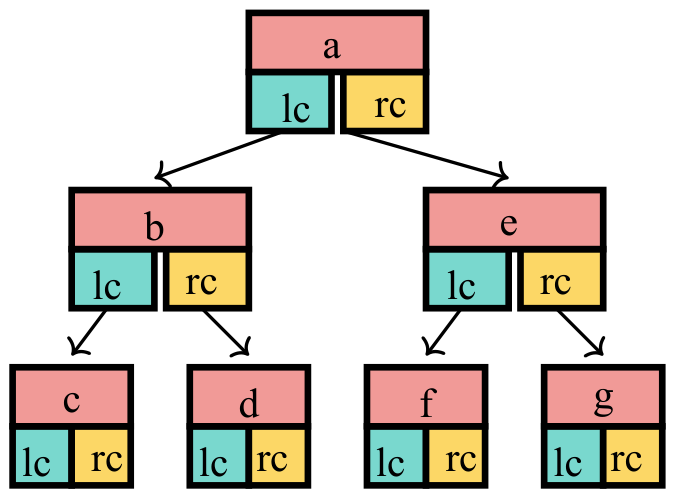

*Рисунок 8.1: дерево*

<a id="ch08-8-2-2-представление-дерева"></a>

### 8.2.2 Представление дерева

Деревья — мощная нелинейная структура данных, но для их представления в компьютере требуются линейные структуры данных. Один из распространённых способов представления дерева — использование массива. При таком подходе элементы дерева хранятся в массиве: корень находится по первому индексу, а дочерние узлы следуют в логическом порядке.

```text
tree = [ 'a',
          ['b',
            ['c',[],[]],
            ['d',[],[]],
          ],
          ['e',
            ['f',[],[]],
            []
          ],
       ]
```

Для доступа к элементам дерева можно использовать методы доступа к массиву, что упрощает получение поддеревьев и элементов. Однако для больших деревьев со многими уровнями такой подход становится громоздким и непрактичным, поскольку доступ к узлам на большей глубине требует сложных вложенных методов доступа.

```rust
println!("root {:?}", tree[0]);
println!("left subtree {:?}", tree[1]);
println!("right subtree {:?}", tree[2]);
```

Альтернативный подход к представлению деревьев — использование узлов. При таком подходе каждый узел дерева представлен объектом или структурой, которая хранит ключ узла и информацию полезной нагрузки, а также ссылки на его дочерние узлы. Связи между узлами образуют рёбра дерева. Этот подход похож на структуру данных «связный список», где каждый узел имеет ссылку на следующий узел. Представление дерева на основе узлов гибче подхода на основе массива и легко справляется с большими деревьями. На рисунке ниже показан пример двоичного дерева, представленного с помощью узлов.

a c b e d f

Такая структура проста и позволяет избежать сложности вложенных массивов при доступе к элементам. Теперь главное — как определить узлы дерева. Один из возможных способов — определить узел с помощью структуры.

```rust
use std::cmp::{max, Ordering::*};
use std::fmt::{Debug, Display};

// Binary tree child node link
type Link<T> = Option<Box<BinaryTree<T>>>;

// Binary tree definition
```

```rust
#[derive(Debug, Clone, PartialEq)]
struct BinaryTree<T> {
    key: T, // data storage
    left: Link<T>, // left child node address storage
    right: Link<T>, // right child node address storage
}
```

У структуры есть ключ, хранящий данные, а также левый и правый указатели, хранящие адреса левого и правого дочерних узлов.

```rust
// binary_tree.rs

impl<T: Clone + Ord + ToString + Debug> BinaryTree<T> {
    fn new(key: T) -> Self {
        Self { key: key, left: None, right: None }
    }

    // New child node is added as the
    // left child node of the root node
    fn insert_left_tree(&mut self, key: T) {
        if self.left.is_none() {
            let node = BinaryTree::new(key);
            self.left = Some(Box::new(node));
        } else {
            let mut node = BinaryTree::new(key);
            node.left = self.left.take();
            self.left = Some(Box::new(node));
        }
    }

    // New child node is added as the
    // right child node of the root node
    fn insert_right_tree(&mut self, key: T) {
        if self.right.is_none() {
            let node = BinaryTree::new(key);
            self.right = Some(Box::new(node));
        } else {
            let mut node = BinaryTree::new(key);
            node.right = self.right.take();
            self.right = Some(Box::new(node));
        }
    }
}
```

При вставке нового дочернего узла в дерево возможны два случая. Первый случай — когда узел не имеет дочерних узлов: тогда новый узел можно вставить непосредственно как его потомка. Второй случай — когда узел уже имеет дочерние узлы: тогда дочерние узлы нового узла сначала должны быть присоединены к подходящим местам в дереве, и лишь после этого сам новый узел можно добавить как потомка исходного узла. Код, определяющий узлы дерева, может вызвать путаницу, поскольку в нём используется термин «BinaryTree», а не «Node». Однако когда несколько узлов связаны вместе и образуют дерево, всё поддерево можно рассматривать как один узел, что упрощает процесс вставки. Важно, тем не менее, отметить, что внутренняя структура узла остаётся значимой, поэтому он назван «BinaryTree», а не «Node».

Тем не менее для реализации дерева подойдёт любое из этих названий. Ниже приведён код вычисления количества узлов разных типов и глубины дерева.

```rust
// binary_tree.rs

impl<T: Clone + Ord + ToString + Debug> BinaryTree<T> {
    // calculate total node number
    fn size(&self) -> usize {
        self.calc_size(0)
    }

    fn calc_size(&self, mut size: usize) -> usize {
        size += 1;

        if !self.left.is_none() {
            size =self.left.as_ref().unwrap().calc_size(size);
        }
        if !self.right.is_none() {
            size =self.right.as_ref().unwrap().calc_size(size);
        }

        size
    }

    // calculate the total leaf nodes number
    fn leaf_size(&self) -> usize {
        // both left and right nodes are none
        // which means current node is a leaf node
        if self.left.is_none() && self.right.is_none() {
            return 1;
        }

        // calculate the total leaf nodes of
        // both left and right substrees
        let left_leaf = match &self.left {
            Some(left) => left.leaf_size(),
            None => 0,
        };
        let right_leaf = match &self.right {
            Some(right) => right.leaf_size(),
            None => 0,
        };

        // leaf nodes = leaf nodes(left) + leaf nodes(right)
        left_leaf + right_leaf
    }

    // calculate non-leaf nodes,
    // it is actually very easy to calculate
    fn none_leaf_size(&self) -> usize {
        self.size() - self.leaf_size()
    }
```

```rust
    // calculate the depth of a tree
    fn depth(&self) -> usize {
        let mut left_depth = 1;
        if let Some(left) = &self.left {
            left_depth += left.depth();
        }

        let mut right_depth = 1;
        if let Some(right) = &self.right {
            right_depth += right.depth();
        }

        // return the max depth
        max(left_depth, right_depth)
    }
}
```

Для манипулирования данными узла двоичного дерева необходимо реализовать методы доступа к левому и правому дочерним узлам, установки и получения значения корневого узла и изменения значений узлов. Кроме того, полезными могут оказаться методы определения наличия значения узла и поиска максимального и минимального значений узлов.

```rust
// binary_tree.rs

impl<T: Clone + Ord + ToString + Debug> BinaryTree<T> {
    // get left subtree
    fn get_left(&self) -> Link<T> {
        self.left.clone()
    }

    fn get_right(&self) -> Link<T> {
        self.right.clone()
    }

    // get and set key
    fn get_key(&self) -> T {
        self.key.clone()
    }

    fn set_key(&mut self, key: T) {
        self.key = key;
    }

    // find min/max key in the tree
    fn min(&self) -> Option<&T> {
        match self.left {
            None => Some(&self.key),
            Some(ref node) => node.min(),
        }
    }

    fn max(&self) -> Option<&T> {
```

```rust
        match self.right {
            None => Some(&self.key),
            Some(ref node) => node.max(),
        }
    }

    // determine whether a key is in the tree
    fn contains(&self, key: &T) -> bool {
        match &self.key.cmp(key) {
            Equal => true,
            Greater => {
                match &self.left {
                    Some(left) => left.contains(key),
                    None => false,
                }
            },
            Less => {
                match &self.right {
                    Some(right) => right.contains(key),
                    None => false,
                }
            },
        }
    }
}
```

<a id="ch08-8-2-3-дерево-разбора"></a>

### 8.2.3 Дерево разбора

Далее объясняется, как двоичное дерево можно использовать для хранения данных, на примере хранения выражения (1 + (2 * 3)). Это выражение полностью заключено в скобки, что задаёт порядок операций. Структура дерева, соответствующая этому выражению, показана на приведённой ниже схеме.

+ 1 * 3 2

Чтобы сохранить данные в дереве, мы следуем определённым правилам, основанным на структуре дерева. Эти правила таковы:

- Если текущий символ — (, добавляется новый узел как левый дочерний узел, и мы спускаемся в этот узел.
- Если текущий символ — один из «+», «-», «*» или «/», мы устанавливаем значение корня равным этому символу, добавляем новый правый дочерний узел и спускаемся в этот дочерний узел.
- Если текущий символ — число, мы устанавливаем значение корня равным этому числу и возвращаемся в родительский узел.
- Если текущий символ — ), мы возвращаемся в родительский узел текущего узла.

Чтобы преобразовать математическое выражение (1 + (2 * 3)) в показанное на рисунке дерево, можно использовать определённые для дерева правила хранения данных. Конкретные шаги таковы: (1) создаём корневой узел. (2) Читаем символ ( — создаём новый левый дочерний узел и спускаемся в этот узел. (3) Читаем символ 1 — устанавливаем значение узла равным 1 и возвращаемся в родительский узел. (4) Читаем символ + — устанавливаем значение узла равным +, создаём новый правый дочерний узел и спускаемся в этот узел. (5) Читаем символ ( — создаём новый левый дочерний узел и спускаемся в этот узел. (6) Читаем символ 2 — устанавливаем значение узла равным 2 и возвращаемся в родительский узел. (7) Читаем символ * — устанавливаем значение узла равным *, создаём новый правый дочерний узел и спускаемся в этот узел. (8) Читаем символ 3 — устанавливаем значение узла равным 3 и возвращаемся в родительский узел. (9) Читаем символ ) — возвращаемся в родительский узел. Использование дерева позволяет сохранить арифметическое выражение, сохранив при этом структурную информацию данных. На самом деле языки программирования при компиляции хранят весь код в деревьях и строят абстрактные синтаксические деревья. Анализируя функции каждой части синтаксического дерева, компилятор генерирует промежуточный код, оптимизирует его и затем генерирует итоговый код. Если вы разбираетесь в принципах компиляции, всё это должно быть вам знакомо.

<a id="ch08-8-2-4-обходы-дерева"></a>

### 8.2.4 Обходы дерева

Цель хранения данных — эффективно выполнять такие операции, как добавление, удаление, поиск и изменение данных. В древовидной структуре для выполнения этих операций необходимо находить конкретный узел. Однако, в отличие от линейных структур данных, которые можно обходить с помощью индексов, деревья — нелинейные структуры, поэтому способ поиска другой. Для доступа к узлам дерева есть три широко используемых метода, различающихся порядком посещения узлов. Это обход в прямом порядке (pre-order), обход в симметричном порядке (in-order) и обход в обратном порядке (post-order), и они аналогичны методам обхода линейных структур данных. Чтобы проиллюстрировать эти методы, представьте эту книгу в виде дерева, где оглавление — корень, каждая глава — его дочерние узлы, а каждый подраздел — дочерние узлы соответствующих глав. Первый метод — обход в прямом порядке: он начинается с корневого узла, затем переходит к левому поддереву и, наконец, к правому поддереву. Чтобы обойти дерево по алгоритму обхода в прямом порядке, нужно рекурсивно вызвать метод обхода в прямом порядке для левого поддерева, начиная от корневого узла. Например, в описанном выше дереве книги алгоритм обхода в прямом порядке сначала посещает оглавление, затем главу 1, раздел 1, раздел 2 и так далее. Закончив главу 1, алгоритм возвращается к оглавлению и рекурсивно вызывает обход в прямом порядке для главы 2, посещая главу 2, раздел 1, раздел 2 и так далее.

Алгоритм обхода в прямом порядке прост и может быть реализован как внутренний метод или как внешняя функция.

```rust
// binary_tree.rs

impl<T: Clone + Ord + ToString + Debug> BinaryTree<T> {
    fn preorder(&self) {
        println!("key: {:?}", &self.key);
        match &self.left {
            Some(node) => node.preorder(),
            None => (),
        }
        match &self.right {
            Some(node) => node.preorder(),
            None => (),
        }
    }
}

// pre-order: implemented externally [by recursion]
fn preorder<T: Clone + Ord + ToString + Debug>(bt: Link<T>) {
    if !bt.is_none() {
        println!("key: {:?}", bt.as_ref().unwrap().get_key());
        preorder(bt.as_ref().unwrap().get_left());
        preorder(bt.as_ref().unwrap().get_right());
    }
}
```

Обход в обратном порядке начинается с левого поддерева, затем следует правое поддерево и, наконец, корневой узел.

```rust
// binary_tree.rs

impl<T: Clone + Ord + ToString + Debug> BinaryTree<T> {
    fn postorder(&self) {
        match &self.left {
            Some(node) => node.postorder(),
            None => (),
        }
        match &self.right {
            Some(node) => node.postorder(),
            None => (),
        }
        println!("key: {:?}", &self.key);
    }
}

// post-order: implemented externally [by recursion]
fn postorder<T: Clone + Ord + ToString + Debug>(bt: Link<T>) {
    if !bt.is_none() {
        postorder(bt.as_ref().unwrap().get_left());
        postorder(bt.as_ref().unwrap().get_right());
        println!("key: {:?}", bt.as_ref().unwrap().get_key());
```

```text
    }
}
```

Обход в симметричном порядке начинается с левого поддерева, затем следует корневой узел и, наконец, правое поддерево.

```rust
// binary_tree.rs

impl<T: Clone + Ord + ToString + Debug> BinaryTree<T> {
    fn inorder(&self) {
        if self.left.is_some() {
            self.left.as_ref().unwrap().inorder();
        }
        println!("key: {:?}", &self.key);
        if self.right.is_some() {
            self.right.as_ref().unwrap().inorder();
        }
    }
}

// in-order: implemented externally [by recursion]
fn inorder<T: Clone + Ord + ToString + Debug>(bt: Link<T>) {
    if !bt.is_none() {
        inorder(bt.as_ref().unwrap().get_left());
        println!("key: {:?}", bt.as_ref().unwrap().get_key());
        inorder(bt.as_ref().unwrap().get_right());
    }
}
```

Чтобы вычислить арифметическое выражение вроде (1 + (2 * 3)), сохранённое в дереве, нужно извлечь операторы и операнды в правильном порядке. Хотя обход в прямом порядке по возможности начинается с корневого узла, для вычисления выражений он не подходит, поскольку нам нужно начинать с листовых узлов. Обход в обратном порядке, напротив, является правильным методом извлечения данных: он начинается с левого поддерева, затем следует правое поддерево и, наконец, корневой узел. Сначала получив значения левого и правого дочерних узлов, а затем оператор корневого узла, мы можем выполнить одну операцию, сохранить результат на месте оператора и продолжить обход в обратном порядке, посещая правый дочерний узел, пока не будет вычислено итоговое значение. Кроме того, обход в симметричном порядке можно применить к дереву, хранящему арифметическое выражение (1 + (2 * 3)), чтобы получить исходное выражение 1 + 2 * 3. Однако, поскольку дерево не сохраняет скобки, восстановленное выражение будет иметь правильный порядок, но приоритет операций может оказаться неверным. Чтобы включить скобки в вывод, можно изменить обход в симметричном порядке.

```rust
// binary_tree.rs

impl<T: Clone + Ord + ToString + Debug> BinaryTree<T> {
    // form a expression: [internal implementation]
    fn iexp(&self) -> String {
        let mut exp = "".to_string();

        exp += "(";
        let exp_left = match &self.left {
            Some(left) => left.iexp(),
            None => "".to_string(),
```

```rust
        };
        exp += &exp_left;

        exp += &self.get_key().to_string();

        let exp_right = match &self.right {
            Some(right) => right.iexp(),
            None => "".to_string(),
        };
        exp += &exp_right;
        exp += ")";

        exp
    }
}

// form a expression: [external implementation]
fn oexp<T>(bt: Link<T>) -> String
  where: T: Clone + Ord + ToString + Debug + Display
{
    let mut exp = "".to_string();
    if !bt.is_none() {
        exp = "(".to_string() +
              &oexp(bt.as_ref().unwrap().get_left());
        exp += &bt.as_ref().unwrap().get_key().to_string();
        exp += &(oexp(bt.as_ref().unwrap().get_right()) + ")");
    }

    exp
}
```

Помимо трёх рассмотренных ранее методов обхода есть ещё один метод — обход по уровням, который посещает узлы слой за слоем. Поскольку необходимая для обхода по уровням структура данных «очередь» была реализована ранее, можно непосредственно использовать её для реализации этого метода обхода.

```rust
// binary_tree.rs

impl<T: Clone + Ord + ToString + Debug> BinaryTree<T> {
    fn levelorder(&self) {
        let size = self.size();
        let mut q = Queue::new(size);

        // enqueue the root node
        let _r = q.enqueue(Box::new(self.clone()));
        while !q.is_empty() {
            // dequeue the first node, and output its value
            let front = q.dequeue().unwrap();
            println!("key: {:?}", front.get_key());

            // enqueue the left/right child node
            match front.get_left() {
                Some(left) => {
                  let _r = q.enqueue(left);
```

```rust
                },
                None => {},
            }

            match front.get_right() {
                Some(right) => {
                  let _r = q.enqueue(right);
                },
                None => {},
            }
        }
    }
}

// level-order: implemented externally [by recursion]
fn levelorder<T: Clone + Ord + ToString + Debug>(bt: Link<T>) {
    if bt.is_none() { return; }

    let size = bt.as_ref().unwrap().size();
    let mut q = Queue::new(size);

    let _r = q.enqueue(bt.as_ref().unwrap().clone());
    while !q.is_empty() {
        // dequeue the first node, and print its value
        let front = q.dequeue().unwrap();
        println!("key: {:?}", front.get_key());

        match front.get_left() {
            Some(left) => {
              let _r = q.enqueue(left);
            },
            None => {},
        }

        match front.get_right() {
            Some(right) => {
              let _r = q.enqueue(right);
            },
            None => {},
        }
    }
}
```

Ниже приведены примеры использования двоичного дерева.

```rust
// binary_tree.rs

fn main() {
    basic();
    order();

    fn basic() {
        let mut bt = BinaryTree::new(10usize);
```

```rust
        let root = bt.get_key();
        println!("root key: {:?}", root);

        bt.set_key(11usize);
        let root = bt.get_key();
        println!("root key: {:?}", root);

        bt.insert_left_tree(2usize);
        bt.insert_right_tree(18usize);

        println!("left child: {:#?}", bt.get_left());
        println!("right child: {:#?}", bt.get_right());

        println!("min key: {:?}", bt.min().unwrap());
        println!("max key: {:?}", bt.max().unwrap());

        println!("tree nodes: {}", bt.size());
        println!("tree leaves: {}", bt.leaf_size());
        println!("tree internals: {}", bt.none_leaf_size());
        println!("tree depth: {}", bt.depth());
        println!("tree contains '2': {}", bt.contains(&2));
    }

    fn order() {
        let mut bt = BinaryTree::new(10usize);
        bt.insert_left_tree(2usize);
        bt.insert_right_tree(18usize);

        println!("internal pre-in-post-level order");
        bt.preorder();
        bt.inorder();
        bt.postorder();
        bt.levelorder();

        let nk = Some(Box::new(bt.clone()));
        println!("outside pre-in-post-level order");
        preorder(nk.clone());
        inorder(nk.clone());
        postorder(nk.clone());
        levelorder(nk.clone());

        println!("internal exp: {}", bt.iexp);
        println!("outside exp: {}", oexp(nk));
    }
}
root key: 10 root key: 11 left child: Some( BinaryTree { key: 2,
```

```text
        left: None,
        right: None,
    },
)
right child: Some(
    BinaryTree {
        key: 18,
        left: None,
        right: None,
    },
)
min key: 2
max key: 18
tree nodes: 3
tree leaves: 2
tree internals: 1
tree depth: 2
tree contains '2': true
internal pre-in-post-level order:
key: 10
key: 2
key: 18
key: 2
key: 10
key: 18
key: 2
key: 18
key: 10
key: 10
key: 2
key: 18
outside pre-in-post-level order:
key: 10
key: 2
key: 18
key: 2
key: 10
key: 18
key: 2
key: 18
key: 10
key: 10
key: 2
key: 18
internal exp: ((2)10(18))
outside exp: ((2)10(18))
```

Для упрощения описания трёх порядков обхода можно использовать сокращения. Обход в прямом порядке можно обозначить сокращением «rt-l-r», которое показывает, что сначала посещается корень, затем левое поддерево и, наконец, правое поддерево. Объединяя три порядка обхода, получаем «rt-l-r» для обхода в прямом порядке, «l-rt-r» для обхода в симметричном порядке и «l-r-rt» для обхода в обратном порядке. Стоит отметить, что возможен и порядок обхода «rt-r-l», но это просто зеркальное отражение обхода в прямом порядке. Поскольку «левое» и «правое» относительны,

«l-rt-r» и «r-rt-l» можно считать зеркальными отражениями друг друга. Аналогично «r-l-rt» — зеркальное отражение обхода в обратном порядке, а «r-rt-l» — зеркальное отражение обхода в симметричном порядке. Таблица ниже суммирует методы обхода для удобства обращения к ним:

**Таблица 8.1: Прямой, симметричный и обратный порядок и их зеркальные методы**

| № | метод обхода | порядок | зеркальный порядок | зеркальный метод обхода |
| --- | --- | --- | --- | --- |
| 1 | прямой обход | rt-l-r | rt-r-l | зеркальный прямой обход |
| 2 | симметричный обход | l-rt-r | r-rt-l | зеркальный симметричный обход |
| 3 | обратный обход | l-r-rt | r-l-rt | зеркальный обратный обход |
| 4 | зеркальный прямой обход | rt-r-l | rt-l-r | прямой обход |
| 5 | зеркальный симметричный обход | r-rt-l | l-rt-r | симметричный обход |
| 6 | зеркальный обратный обход | r-l-rt | l-r-rt | обратный обход |

<a id="ch08-8-3-двоичная-куча"></a>

## 8.3 Двоичная куча

В предыдущих разделах мы изучили очередь — линейную структуру данных, работающую по принципу «первым пришёл — первым ушёл» (FIFO). Ещё одной разновидностью очереди является очередь с приоритетом, которая извлекает элементы на основе приоритета, а не в порядке их добавления. В такой очереди элемент с наивысшим приоритетом извлекается первым, независимо от того, когда он был добавлен. При добавлении нового элемента в очередь с приоритетом он перемещается в начало, если его приоритет достаточно высок. Это перемещение представляет собой сортировку по определённому критерию, обеспечивающую нахождение элементов с высоким приоритетом в начале. Очередь с приоритетом полезна для задач, связанных с приоритетами, таких как планирование процессов в операционной системе. В этом сценарии очередь с приоритетом используется для получения приоритета каждого процесса и его сортировки соответствующим образом. Например, если вы слушаете музыку и читаете новости на телефоне, а затем получаете входящий звонок, система присваивает звонку наивысший приоритет и прерывает как новости, так и музыку, чтобы показать интерфейс входящего звонка. Это пример управления процессами с помощью очереди с приоритетом и присвоения входящему звонку очень высокого приоритета. Для реализации очереди с приоритетом её нужно сортировать по некоторому правилу, чтобы элементы с высоким приоритетом оказывались в начале. Однако вставка элементов в очередь имеет сложность O(n), а сортировка очереди — не менее O(n log n). Чтобы добиться более быстрых результатов, для сортировки очереди с приоритетом можно использовать двоичную кучу. Двоичная куча по сути является полным двоичным деревом и позволяет добавлять и извлекать элементы за время O(log n), что делает её идеальной для эффективных систем планирования. Несмотря на то что она определяется как двоичное дерево, для реализации двоичной кучи можно использовать линейную структуру данных, такую как массив, срез или Vec. Пока операции следуют определению двоичной кучи, линейная структура данных может реализовывать её функциональность и использоваться как нелинейная структура данных. Кроме того, существует две распространённые формы двоичных куч: куча на минимум и куча на максимум — в зависимости от того, находится ли наверху наименьший или наибольший элемент данных. Это означает, что существуют и две формы очередей с приоритетом.

<a id="ch08-8-3-1-абстрактный-тип-данных-двоичной-кучи"></a>

### 8.3.1 Абстрактный тип данных двоичной кучи

Куча на минимум может использоваться как очередь с приоритетом, и её абстрактный тип данных включает следующие методы:

- new() создаёт новую двоичную кучу без параметров и возвращает пустую кучу.
- push(k) добавляет в кучу новый элемент со значением параметра k и ничего не возвращает.
- pop() возвращает и удаляет минимальный элемент из кучи, изменяя кучу.
- min() возвращает минимальный элемент кучи, не изменяя кучу.
- size() возвращает количество элементов в куче в виде числового значения.
- is_empty() возвращает логическое значение, показывающее, пуста куча или нет.
- build(arr) строит новую кучу из массива или вектора данных, принимая arr в качестве параметра.

Если двоичная куча «h» уже создана как очередь с приоритетом, таблица ниже показывает результаты выполненных операций с кучей, причём верхний элемент кучи находится справа. Значение приоритета элемента — это его значение, причём меньшие значения имеют более высокий приоритет и поэтому оказываются справа.

**Таблица 8.2: Операции над двоичной кучей**

| операции | значение кучи | возвращаемое значение | операции | значение кучи | возвращаемое значение |
| --- | --- | --- | --- | --- | --- |
| h.is_empty() | [] | true | h.is_empty() | [8,6,3,2,1] | false |
| h.push(3) | [3] | h.pop() | [8,6,3,2] | 1 |  |
| h.push(8) | [8,3] | h.min() | [8,6,3,2] | 2 |  |
| h.min() | [8,3] | 3 | h.pop() | [8,6,3] | 2 |
| h.push(6) | [8,6,3] | h.pop() | [8,6] | 3 |  |
| h.size() | [8,6,3] | 3 | h.build([5,4]) | [8,6,5,4] |  |
| h.push(2) | [8,6,3,2] | h.build([1]) | [8,6,5,4,1] |  |  |
| h.push(1) | [8,6,3,2,1] | h.min() | [8,6,5,4,1] | 1 |  |

<a id="ch08-8-3-2-реализация-двоичной-кучи-на-rust"></a>

### 8.3.2 Реализация двоичной кучи на Rust

Чтобы обеспечить эффективную работу двоичной кучи, важно использовать её логарифмическое свойство. Для двоичной кучи, хранящейся в линейной структуре данных, поддержание сбалансированности является ключом к достижению логарифмической производительности. Сбалансированная двоичная куча имеет примерно равное количество узлов в левом и правом поддеревьях и стремится заполнить левый и правый дочерние узлы каждого узла, причём в худшем случае не более одного узла может иметь неполный набор дочерних узлов.


*Рисунок 8.2: Двоичная куча*

Для иллюстрации рассмотрим кучу [0,5,9,11,14,18,19,21,33,17,27], хранящуюся с помощью Vec, и соответствующую структуру дерева, показанную выше. Поскольку родительские и дочерние узлы хранятся в линейной структуре данных, их взаимосвязь легко вычислить. Если узел находится по индексу p, то его левый дочерний узел находится по индексу 2p, а правый дочерний узел — по индексу 2p + 1. Здесь p начинается с индекса 1, а индекс 0 не используется для данных, поэтому он устанавливается в 0 в качестве заполнителя.


*Рисунок 8.3: Куча в Vec*

Например, индекс числа 5 равен p = 1, а его левый дочерний узел находится по индексу 2 ∗ p = 2, где значение равно 9. Следовательно, 9 является левым дочерним узлом числа 5 в структуре дерева. Аналогично, родительский узел любого дочернего узла находится по индексу p/2. Например, если p = 2 для числа 9, то его родительский узел находится по индексу 2/2 = 1, а если p = 3

для правого дочернего узла 11, то его родительский узел находится по индексу 3/2 = 1 (результат деления округляется вниз). Таким образом, для вычисления родительского узла любого дочернего узла достаточно выражения p/2, тогда как дочерние узлы вычисляются с помощью 2p и 2p + 1. Ранее мы определили макросы для вычисления индексов родительского и дочерних узлов и продолжим использовать их для расчётов.

```text
// binary_heap.rs

// calculate parent node index
macro_rules! parent {
    ($child:ident) => {
        $child >> 1
    };
}

// calculate left child node index
macro_rules! left_child {
    ($parent:ident) => {
        $parent << 1
    };
}

// calculate right child node index
macro_rules! right_child {
    ($parent:ident) => {
        ($parent << 1) + 1
    };
}
```

Для начала двоичная куча определяется как структура данных, содержащая поле, представляющее размер кучи. Поле размера не включает первый элемент данных 0, который считается заполнителем. Предполагается, что данные, сохраняемые в куче, имеют тип i32. При инициализации кучи данные присутствуют по индексу 0, но размер устанавливается равным 0.

```rust
// binary_heap.rs

// Binary heap definision
// Implement Debug and Clone Trait
#[derive(Debug, Clone)]
struct BinaryHeap {
    size: usize, // data count
    data: Vec<i32>, // data container
}

impl BinaryHeap {
    fn new() -> Self {
        BinaryHeap {
            size: 0,
            data: vec![0] // first 0 not count in total
        }
    }

    fn size(&self) -> usize {
        self.size
```

```rust
    }

    fn is_empty(&self) -> bool {
        0 == self.size
    }

    // Get the minimum data in the heap
    fn min(&self) -> Option<i32> {
        if 0 == self.size {
            None
        } else {
            // Some(self.data[1].clone());
            // clone used for genric type
            Some(self.data[1])
        }
    }
}
```

При добавлении данных в кучу добавление их в конец кучи нарушит баланс, поэтому данные нужно переместить вверх для его поддержания.

5 9 11 18 19 14 21 7 33 17 27 5 9 11 7 19 14 21 33 17 27 18 5 7 11 14 9 19 21 33 17 27 18

По мере добавления каждого элемента данных размер кучи увеличивается, и данные при необходимости перемещаются вверх для поддержания баланса.

```rust
// binary_heap.rs

impl BinaryHeap {
    // Add a data to the end and adjust the heap
    fn push(&mut self, val: i32) {
        self.data.push(val);
        self.size += 1;
        self.move_up(self.size);
    }

    // little data move up.
    // c(child, current), p(parent)
    fn move_up(&mut self, mut c: usize) {
        loop {
            // calculate the parent index of current node
            let p = parent!(c);
            if p <= 0 {
                break;
            }

            // If the current node's data is smaller than
            // the parent node's data, swap them
            if self.data[c] < self.data[p] {
                self.data.swap(c, p);
            }

            // The parent node becomes the current node
            c = p;
        }
    }
}
```

Для извлечения минимального значения из кучи нужно рассмотреть три случая: когда данных в куче нет, возвращать None; когда есть только один элемент данных, извлекать его напрямую; когда элементов данных несколько, поменять местами верхний и конечный элементы кучи, скорректировать кучу и затем вернуть минимальное значение в конце. Функция move_down используется для перемещения элементов вниз с целью поддержания баланса, а функция min_child — для поиска минимального дочернего узла.

```rust
// binary_heap.rs

impl BinaryHeap {
    // pop out the top value
    fn pop(&mut self) -> Option<i32> {
        if 0 == self.size {
            // no data, return None
            None
        } else if 1 == self.size {
            self.size -= 1;

            self.data.pop()
```

```rust
        } else {
            // swap data and then adjust the heap
            self.data.swap(1, self.size);
            let val = self.data.pop();
            self.size -= 1;
            self.move_down(1);

            val
        }
    }

    // bigger data move down
    fn move_down(&mut self, mut c: usize) {
        loop {
            let lc = left_child!(c);
            if lc > self.size { break; }

            // the index of mininum child node of current node
            let mc = self.min_child(c);
            if self.data[c] > self.data[mc] {
                self.data.swap(c, mc);
            }

            // the mininum child node becomes current node
            c = mc;
        }
    }

    // Calculate the index of the minimum child node
    fn min_child(&self, c: usize) -> usize {
        let (lc, rc) = (left_child!(c), right_child!(c));

        if rc > self.size {
            // right child node is out of range,
            // left child node is the minimum child node
            lc
        } else if self.data[lc] < self.data[rc] {
            // left child node is smaller than right child node
            lc
        } else {
            // right child node is smaller than left child node
            rc
        }
    }
}
```

Процесс удаления минимального элемента из кучи заключается в извлечении элемента из вершины кучи и перемещении последнего элемента наверх. В этот момент верхний элемент не является минимальным значением и не удовлетворяет определению кучи, поэтому кучу нужно перестроить. Для перестроения кучи верхний элемент нужно переместить вниз с помощью функции move_down. Эта функция с помощью макроса вычисляет, с каким дочерним узлом — левым или правым — нужно выполнить обмен на основе индекса узла, и в итоге меняет местами верхний элемент с его минимальным дочерним узлом до тех пор, пока куча не будет восстановлена.

5 18 7 11 9 19 14 21 33 17 27 5 7 9 11 14 18 19 21 33 17 27


*Рисунок 8.4: удаление данных и перестроение кучи*

Наконец, данные можно добавлять в кучу пакетами. Например, срез данных [0,5,4,3,1,2] можно добавить в кучу за один раз, чтобы избежать частых вызовов функции push. Исходные данные в куче можно либо оставить без изменений, добавляя данные среза по одному, либо удалить перед добавлением данных среза. Второй подход приводит к новой куче, содержащей только данные среза.

Для реализации двоичной кучи на минимум определим функции build_new и build_add, как показано ниже.

```rust
// binary_heap.rs

impl BinaryHeap {
    // build a new heap
    fn build_new(&mut self, arr: &[i32]) {
        // delete all data
        for _i in 0..self.size {
            let _rm = self.data.pop();
        }

        // add new data
        for &val in arr {
```

```rust
            self.data.push(val);
        }

        // change the size
        self.size = arr.len();

        // adjust the heap to make it a min-heap
        let size = self.size;
        let mut p = parent!(size);
        while p > 0 {
            self.move_down(p);
            p -= 1;
        }
    }

    // add slice data one by one
    fn build_add(&mut self, arr: &[i32]) {
        for &val in arr {
            self.push(val);
        }
    }
}
```

С помощью этих функций мы завершили построение двоичной кучи на минимум. Весь процесс должен быть легко понятен, и на его основе можно написать код и для двоичной кучи на максимум. Ниже приведён пример использования двоичной кучи.

```rust
// binary_heap.rs

fn main() {
    let mut bh = BinaryHeap::new();
    let nums = [-1,0,2,3,4];
    bh.push(10); bh.push(9);
    bh.push(8); bh.push(7); bh.push(6);

    bh.build_add(&nums);
    println!("empty: {:?}", bh.is_empty());
    println!("min: {:?}", bh.min());
    println!("pop min: {:?}", bh.pop());

    bh.build_new(&nums);
    println!("size: {:?}", bh.len());
    println!("pop min: {:?}", bh.pop());
}
```

Ниже приведены результаты выполнения.

```text
empty: false
min: Some(-1)
size: 10
pop min: Some(-1)
size: 5
pop min: Some(-1)
```

<a id="ch08-8-3-3-анализ-двоичной-кучи"></a>

### 8.3.3 Анализ двоичной кучи

Двоичная куча хранит данные линейно в Vec, но её сортировка основана на структуре дерева. Как обсуждалось ранее, высота дерева составляет O(n log₂ n), а сортировка кучей перемещает элементы с нижнего уровня дерева на верхний, причём количество перемещений равно количеству уровней. Следовательно, временная сложность сортировки кучей составляет O(n log₂ n). Поскольку для построения кучи требуется обработать все n элементов, сложность составляет O(n). В целом временная сложность двоичной кучи равна O(n log₂ n) + O(n) = O(n log₂ n).

<a id="ch08-8-4-binary-search-tree"></a>

## 8.4 Binary Search Tree

Однако линейные структуры данных не подходят для представления деревьев большого объёма, так как копирование и перемещение данных становятся очень затратными по времени. Для решения этой проблемы в данном разделе рассматривается реализация деревьев с помощью узлов. В частности, этот раздел посвящён двоичным деревьям, у которых есть только два дочерних узла. Чтобы лучше понять двоичные деревья, мы изучаем двоичные деревья поиска для поиска, которые хранят данные в виде пар «ключ — значение», подобно HashMap.

<a id="ch08-8-4-1-абстрактный-тип-данных-двоичное-дерево-поиска"></a>

### 8.4.1 Абстрактный тип данных «двоичное дерево поиска»

Двоичное дерево поиска предоставляет следующие абстрактные типы данных:

- new() создаёт новое дерево, не принимает параметров и возвращает пустое дерево.
- insert(k, v) сохраняет данные (k, v) в дереве, принимает ключ k и значение v и ничего не возвращает.
- contains(&k) ищет в дереве ключ k, принимает параметр &k и возвращает логическое значение.
- get(&k) возвращает значение v ключа k из дерева, не удаляя его, и принимает параметр &k.
- max() возвращает максимальный ключ k и его значение v в дереве и не принимает параметров.
- min() возвращает минимальный ключ k и его значение v в дереве и не принимает параметров.
- len() возвращает количество элементов данных в дереве, не принимает параметров и возвращает целое число типа usize.
- is_empty() проверяет, пусто ли дерево, не принимает параметров и возвращает логическое значение.
- iter() возвращает дерево в виде итератора, не принимает параметров и не изменяет дерево.
- preorder() выполняет обход в прямом порядке (pre-order), не принимает параметров и выводит каждую пару k-v.
- inorder() выполняет обход в симметричном порядке (in-order), не принимает параметров и выводит каждую пару k-v.
- postorder() выполняет обход в обратном порядке (post-order), не принимает параметров и выводит каждую пару k-v.

В таблице ниже показано двоичное дерево поиска после различных операций; узлы дерева представлены кортежами и заключены в квадратные скобки, при этом предполагается, что t — только что созданное пустое дерево.

**Table 8.3: Operations on binary search tree**

| operation | tree value | return value |
| --- | --- | --- |
| t.is_empty() | [] | true |
| t.insert(1,‘a’) | [(1,‘a’)] |  |
| t.insert(2,‘b’) | [(1,‘a’),(2,‘b’)] |  |
| t.len() | [(1,‘a’),(2,‘b’)] | 2 |
| t.get(&4) | [(1,‘a’),(2,‘b’)] | None |
| t.get(&2) | [(1,‘a’),(2,‘b’)] | Some(‘b’) |
| t.min() | [(1,‘a’),(2,‘b’)] | (Some(1), Some(‘a’)) |
| t.max() | [(1,‘a’),(2,‘b’)] | (Some(2), Some(‘b’)) |
| t.contains(2) | [(1,‘a’),(2,‘b’)] | true |
| t.insert(2,‘c’) | [(1,‘a’),(2,‘c’)] |  |
| t.insert(3,‘d’) | [(1,‘a’),(2,‘c’),(3,‘d’)] |  |
| t.contains(4) | [(1,‘a’),(2,‘c’),(3,‘d’)] | false |
| t.get(&3) | [(1,‘a’),(2,‘c’),(3,‘d’)] | Some(‘d’) |

<a id="ch08-8-4-2-реализация-двоичного-дерева-поиска-в-rust"></a>

### 8.4.2 Реализация двоичного дерева поиска в Rust

В отличие от куч, где левый и правый дочерние узлы не сравниваются по значению, в двоичном дереве поиска ключ левого дочернего узла меньше ключа родительского узла, а ключ правого дочернего узла больше ключа родительского узла. Это правило left < parent < right рекурсивно применяется ко всем поддеревьям.


*Figure 8.5: Binary search tree*

В приведённом выше примере 70 — корневой узел; 31 меньше и становится левым узлом, а 93 больше и становится правым узлом. Затем вставляется 14, которое меньше 70 и спускается к 31, а поскольку оно меньше 31, оно становится левым узлом 31. Аналогичные шаги выполняются при вставке других данных, и в итоге формируется двоичное дерево поиска. Симметричный обход (in-order) этого дерева даёт последовательность [14, 23, 31, 70, 73, 93, 94], отсортированную от меньшего к большему, поэтому двоичное дерево поиска также можно использовать для сортировки данных. С помощью симметричного обхода мы получаем результат сортировки по возрастанию, а с помощью зеркального симметричного обхода, то есть обхода в порядке «право-корень-лево», — результат сортировки по убыванию. Для реализации двоичного дерева поиска мы определяем его как структуру BST (BinarySearchTree), которая включает ключи, значения и ссылки на левый и правый дочерние узлы. В соответствии с определением абстрактного типа данных реализация двоичного дерева поиска показана ниже.

```rust
// bst.rs
use std::cmp::{max, Ordering::*};
use std::fmt::Debug;

// Binary search tree node link
type Link<T,U> = Option<Box<BST<T,U>>>;

// Definition of binary search tree
#[derive(Debug,Clone)]
struct BST<T,U> {
    key: Option<T>,
    val: Option<U>,
    left: Link<T,U>,
    right: Link<T,U>,
}

impl<T,U> BST<T,U>
    where T: Copy + Ord + Debug,
          U: Copy + Debug
{
    fn new() -> Self {
        Self {
            key: None,
```

```rust
            val: None,
            left: None,
            right: None,
        }
    }

    fn is_empty(&self) -> bool {
        self.key.is_none()
    }

    fn size(&self) -> usize {
        self.calc_size(0)
    }

    // Recursively count the number of nodes
    fn calc_size(&self, mut size: usize) -> usize {
        if self.key.is_none() { return size; }

        // Add current node count to total node count 'size'
        size += 1;
        // Count left and right child nodes
        if !self.left.is_none() {
            size = self.left.as_ref().unwrap().calc_size(size);
        }
        if !self.right.is_none() {
            size = self.right
                    .as_ref().unwrap().calc_size(size);
        }

        size
    }

    // Count leaf nodes
    fn leaf_size(&self) -> usize {
        // If both left and right are empty,
        // current node is a leaf node, return 1
        if self.left.is_none() && self.right.is_none() {
            return 1;
        }

        // Count leaf nodes in left and right subtree
        let left_leaf = match &self.left {
            Some(left) => left.leaf_size(),
            None => 0,
        };
        let right_leaf = match &self.right {
            Some(right) => right.leaf_size(),
            None => 0,
        };

        // total sum of leaf nodes
        left_leaf + right_leaf
```

```rust
    }

    // Count non-leaf nodes
    fn none_leaf_size(&self) -> usize {
        self.size() - self.leaf_size()
    }

    // Calculate tree depth
    fn depth(&self) -> usize {
        let mut left_depth = 1;
        if let Some(left) = &self.left {
            left_depth += left.depth();
        }

        let mut right_depth = 1;
        if let Some(right) = &self.right {
            right_depth += right.depth();
        }

        max(left_depth, right_depth)
    }

    fn insert(&mut self, key: T, val: U) {
        // If no data, insert directly
        if self.key.is_none() {
            self.key = Some(key);
            self.val = Some(val);
        } else {
            match &self.key {
                Some(k) => {
                    // If key exists, update val
                    if key == *k {
                        self.val = Some(val);
                        return;
                    }

                    // If no same key found,
                    // Find the subtree to insert new node
                    let child = if key < *k {
                        &mut self.left
                    } else {
                        &mut self.right
                    };

                    // Recursively go down the tree
                    // until insertion
                    match child {
                        Some(ref mut node) => {
                            node.insert(key, val);
                        },
                        None => {
                            let mut node = BST::new();
```

```rust
                            node.insert(key, val);
                            *child = Some(Box::new(node));
                        },
                    }
                },
                None => (),
            }
        }
    }

    // find the key in tree
    fn contains(&self, key: &T) -> bool {
        match &self.key {
            None => false,
            Some(k) => {
                // Compare key value and determine
                // whether to continue searching recursively
                match k.cmp(key) {
                    Equal => true, // find it
                    Greater => { // search in left subtree
                        match &self.left {
                            Some(node) => node.contains(key),
                            None => false,
                        }
                    },
                    Less => { // search in right subtree
                        match &self.right {
                            Some(node) => node.contains(key),
                            None => false,
                        }
                    },
                }
            },
        }
    }

    // get the min/max node value
    fn min(&self) -> (Option<&T>, Option<&U>) {
        // miniumun value is on the left subtree
        match &self.left {
            Some(node) => node.min(),
            None => match &self.key {
                Some(key) => (Some(&key), self.val.as_ref()),
                None => (None, None),
            },
        }
    }

    fn max(&self) -> (Option<&T>, Option<&U>) {
        // maxiumun value is on the right subtree
        match &self.right {
            Some(node) => node.max(),
```

```rust
            None => match &self.key {
                Some(key) => (Some(&key), self.val.as_ref()),
                None => (None, None),
            },
        }
    }

    // get subtree
    fn get_left(&self) -> Link<T,U> {
        self.left.clone()
    }

    fn get_right(&self) -> Link<T,U> {
        self.right.clone()
    }

    // get a value reference with parameter key
    fn get(&self, key: &T) -> Option<&U> {
        match &self.key {
            None => None,
            Some(k) => {
                match k.cmp(key) {
                    Equal => self.val.as_ref(),
                    Greater => {
                        match &self.left {
                            None => None,
                            Some(node) => node.get(key),
                        }
                    },
                    Less => {
                        match &self.right {
                            None => None,
                            Some(node) => node.get(key),
                        }
                    },
                }
            },
        }
    }
}
```

Ниже приведена реализация обходов в прямом, симметричном, обратном порядке и обхода по уровням.

```rust
// bst.rs

impl<T,U> BST<T,U>
    where T: Copy + Ord + Debug,
          U: Copy + Debug
{
    // Internal implementation
    fn preorder(&self) {
        println!("key: {:?}, val: {:?}",self.key, self.val);
        match &self.left {
```

```rust
            Some(node) => node.preorder(),
            None => (),
        }
        match &self.right {
            Some(node) => node.preorder(),
            None => (),
        }
    }

    fn inorder(&self) {
        match &self.left {
            Some(node) => node.inorder(),
            None => (),
        }
        println!("key: {:?}, val: {:?}",self.key, self.val);
        match &self.right {
            Some(node) => node.inorder(),
            None => (),
        }
    }

    fn postorder(&self) {
        match &self.left {
            Some(node) => node.postorder(),
            None => (),
        }
        match &self.right {
            Some(node) => node.postorder(),
            None => (),
        }
        println!("key: {:?}, val: {:?}",self.key, self.val);
    }

    fn levelorder(&self) {
        let size = self.size();
        let mut q = Queue::new(size);

        let _r = q.enqueue(Box::new(self.clone()));
        while !q.is_empty() {
            let front = q.dequeue().unwrap();
            println!("key: {:?}, val: {:?}",
                    front.key, front.val);

            match front.get_left() {
                Some(left) => { let _r = q.enqueue(left); },
                None => (),
            }
            match front.get_right() {
                Some(right) => { let _r = q.enqueue(right); },
                None => (),
            }
        }
```

```rust
    }
}

// External implementation
fn preorder<T, U>(bst: Link<T,U>)
where T: Copy + Ord + Debug,
      U: Copy + Debug
{
    if !bst.is_none() {
        println!("key: {:?}, val: {:?}",
                  bst.as_ref().unwrap().key.unwrap(),
                  bst.as_ref().unwrap().val.unwrap());
        preorder(bst.as_ref().unwrap().get_left());
        preorder(bst.as_ref().unwrap().get_right());
    }
}

fn inorder<T, U>(bst: Link<T,U>)
where T: Copy + Ord + Debug,
      U: Copy + Debug
{
    if !bst.is_none() {
        inorder(bst.as_ref().unwrap().get_left());
        println!("key: {:?}, val: {:?}",
                  bst.as_ref().unwrap().key.unwrap(),
                  bst.as_ref().unwrap().val.unwrap());
        inorder(bst.as_ref().unwrap().get_right());
    }
}

fn postorder<T, U>(bst: Link<T,U>)
where T: Copy + Ord + Debug,
      U: Copy + Debug
{
    if !bst.is_none() {
        postorder(bst.as_ref().unwrap().get_left());
        postorder(bst.as_ref().unwrap().get_right());
        println!("key: {:?}, val: {:?}",
                  bst.as_ref().unwrap().key.unwrap(),
                  bst.as_ref().unwrap().val.unwrap());
    }
}

fn levelorder<T, U>(bst: Link<T,U>)
where T: Copy + Ord + Debug,
      U: Copy + Debug
{
    if bst.is_none() { return; }

    let size = bst.as_ref().unwrap().size();
    let mut q = Queue::new(size);
    let _r = q.enqueue(bst.as_ref().unwrap().clone());
```

```rust
    while !q.is_empty() {
        let front = q.dequeue().unwrap();
        println!("key: {:?}, val: {:?}", front.key, front.val);

        match front.get_left() {
            Some(left) => { let _r = q.enqueue(left); },
            None => {},
        }

        match front.get_right() {
            Some(right) => { let _r = q.enqueue(right); },
            None => {},
        }
    }
}
```

Ниже приведены выходные данные после выполнения программы двоичного дерева поиска.

```rust
// bst.rs

fn main() {
    basic();
    order();

    fn basic() {
        let mut bst = BST::<i32, char>::new();
        bst.insert(8, 'e'); bst.insert(6,'c');
        bst.insert(7, 'd'); bst.insert(5,'b');
        bst.insert(10,'g'); bst.insert(9,'f');
        bst.insert(11,'h'); bst.insert(4,'a');

        println!("bst is empty: {}", bst.is_empty());
        println!("bst size: {}", bst.size());
        println!("bst leaves: {}", bst.leaf_size());
        println!("bst internals: {}", bst.none_leaf_size());
        println!("bst depth: {}", bst.depth());

        let min_kv = bst.min();
        let max_kv = bst.max();
        println!("min key-val: {:?}-{:?}", min_kv.0, min_kv.1);
        println!("max key-val: {:?}-{:?}", max_kv.0, max_kv.1);
        println!("bst contains 5: {}", bst.contains(&5));
        println!("key: 5, val: {:?}", bst.get(&5).unwrap());
    }

    fn order() {
        let mut bst = BST::<i32, char>::new();
        bst.insert(8, 'e'); bst.insert(6,'c');
        bst.insert(7, 'd'); bst.insert(5,'b');
        bst.insert(10,'g'); bst.insert(9,'f');
        bst.insert(11,'h'); bst.insert(4,'a');

        println!("internal inorder, preorder, postorder: ");
```

```rust
        bst.inorder();
        bst.preorder();
        bst.postorder();
        bst.levelorder();
        println!("outside inorder, preorder, postorder: ");
        let nk = Some(Box::new(bst.clone()));
        inorder(nk.clone());
        preorder(nk.clone());
        postorder(nk.clone());
        levelorder(nk.clone());
    }
}
```

The following are outputs after execution.

```text
bst is empty: false
bst size: 8
bst leaves: 4
bst internals: 4
bst depth: 4
min key: Some(4), min val: Some('a')
max key: Some(11), max val: Some('h')
bst contains 5: true
key: 5, val: 'b'
internal inorder, preorder, postorder:
key: 4, val: 'a'
key: 5, val: 'b'
key: 6, val: 'c'
key: 7, val: 'd'
key: 8, val: 'e'
key: 9, val: 'f'
key: 10, val: 'g'
key: 11, val: 'h'
key: 8, val: 'e'
key: 6, val: 'c'
key: 5, val: 'b'
key: 4, val: 'a'
key: 7, val: 'd'
key: 10, val: 'g'
key: 9, val: 'f'
key: 11, val: 'h'
key: 4, val: 'a'
key: 5, val: 'b'
key: 7, val: 'd'
key: 6, val: 'c'
key: 9, val: 'f'
key: 11, val: 'h'
key: 10, val: 'g'
key: 8, val: 'e'
key: 8, val: 'e'
key: 6, val: 'c'
key: 10, val: 'g'
key: 5, val: 'b'
```

```text
key: 7, val: 'd'
key: 9, val: 'f'
key: 11, val: 'h'
key: 4, val: 'a'
outside inorder, preorder, postorder:
key: 4, val: 'a'
key: 5, val: 'b'
key: 6, val: 'c'
key: 7, val: 'd'
key: 8, val: 'e'
key: 9, val: 'f'
key: 10, val: 'g'
key: 11, val: 'h'
key: 8, val: 'e'
key: 6, val: 'c'
key: 5, val: 'b'
key: 4, val: 'a'
key: 7, val: 'd'
key: 10, val: 'g'
key: 9, val: 'f'
key: 11, val: 'h'
key: 4, val: 'a'
key: 5, val: 'b'
key: 7, val: 'd'
key: 6, val: 'c'
key: 9, val: 'f'
key: 11, val: 'h'
key: 10, val: 'g'
key: 8, val: 'e'
key: 8, val: 'e'
key: 6, val: 'c'
key: 10, val: 'g'
key: 5, val: 'b'
key: 7, val: 'd'
key: 9, val: 'f'
key: 11, val: 'h'
key: 4, val: 'a'
```

При вставке 76 в дерево путь поиска показан чёрными узлами.


*Figure 8.6: Insertion into a BST*

Удаление узла в двоичном дереве поиска — сложная операция. Первый шаг — найти узел, который нужно удалить, причём его может не оказаться в дереве. После того как узел найден, необходимо определить, есть ли у него дочерние узлы; возможны три случая: дочерних узлов нет, есть один дочерний узел или есть два дочерних узла.

**Table 8.4: Key deletion cases**

| No | Node | node k | delete mothod |
| --- | --- | --- | --- |
| 1 | No node | None | Directly return |
| 2 | One root node | None | Directly delete |
| 3 | Multiple nodes | None | Directly delete |
| 4 | Multiple nodes | One child | Replace k with child node |
| 5 | Multiple nodes | Two children | Replace k with the successor node |

Если узел является листовым узлом без дочерних узлов, достаточно удалить ссылку на него из родительского узла. Если у него один дочерний узел, мы изменяем ссылку родительского узла так, чтобы она указывала непосредственно на этот дочерний узел. Самый сложный случай — когда у узла два дочерних узла. В этом случае мы находим минимальный узел в правом поддереве, называемый узлом-преемником, и заменяем удаляемый узел узлом-преемником. У узла-преемника также могут быть дочерние узлы, и их взаимосвязи необходимо соответствующим образом скорректировать. Конкретные ситуации показаны на следующем рисунке, где пунктирной рамкой обозначен удаляемый узел k, а справа показано двоичное дерево, полученное после удаления узла.

70 70 leaf node 31 93 31 93 14 73 94 14 73 94 23 76 23 70 70 one child node 31 93 93 14 14 73 94 23 73 94 23 76 70 70 two child nodes 31 93 31 76 73 94 73 94 14 14 23 76 23

Удаление листового узла — самый простой случай, а удаление внутреннего узла с одним дочерним узлом выполняется несложно. Самый трудный случай — когда у узла два дочерних узла, поскольку при этом требуется скорректировать взаимосвязи нескольких узлов.

<a id="ch08-8-4-3-analysis-of-binary-search-tree"></a>

### 8.4.3 Analysis of Binary Search Tree

Теперь, когда двоичное дерево поиска полностью реализовано, проанализируем временную сложность каждого метода. Обходы и len() имеют временную сложность O(n), так как им нужно обработать все n элементов. Метод contains() сравнивает данные с левым и правым дочерними узлами и в зависимости от результата выбирает ветвь. Он проходит не более чем по самому длинному пути от корня до листового узла. Высота двоичного дерева связана с общим числом узлов: 20 + 21 + 2i... + 2h = n

(8.1) h = log2(n)

Используя свойства двоичного дерева, можно приблизительно считать максимальную длину пути равной h = log2(n). Таким образом, временная сложность contains() составляет O(log2(n)). Вставка, удаление и изменение основаны на поиске, поскольку перед продолжением обработки элемент необходимо найти. Их временная сложность зависит только от поиска и может быть выполнена за постоянное время. Следовательно, производительность методов contains(), insert() и get() — всё это O(log2(n)). Высота h двоичного дерева является ограничивающим фактором их производительности. Если вставляемые данные всегда находятся в отсортированном состоянии, двоичное дерево может выродиться в линейный связный список, и производительность методов contains(), insert() и remove() будет O(n). На рисунке ниже показан этот сценарий.


*Рисунок 8.7: bst в виде линейного связного списка*

В этом разделе мы не реализовали функцию remove(), поскольку она не входит в определение абстрактного типа данных, а двоичные деревья поиска используются главным образом для вставки и поиска данных, а не для удаления. Однако заинтересованные читатели могут в качестве упражнения попытаться реализовать функцию remove(). Чтобы повысить производительность за счёт уменьшения высоты дерева, можно преобразовать двоичное дерево в многопутевое дерево, например в B-деревья и B+-деревья. У таких деревьев много дочерних узлов, поэтому высота дерева невелика и запросы выполняются быстро. Они широко применяются при реализации баз данных и файловых систем. Например, база данных MySQL использует B+-деревья для хранения данных с узлами, представляющими страницы памяти размером 16 КБ. Если каждая запись данных имеет размер 1 КБ, один узел может хранить 16 записей. При использовании для хранения индекса с ключом bigint расходуется 8 байтов, а индекс занимает 6 байтов, всего 14 байтов. Таким образом, один узел может хранить примерно 16∗1024/14 = 1170 индексов. При высоте 3 B+-дерево может хранить около 1170∗1170∗16 = 21902400 индексов, что позволяет хранить около 20 миллионов записей данных. Для получения данных требуется не более двух запросов, что объясняет, почему запросы к базе данных выполняются так быстро. Заинтересованные читатели могут прочитать книги, посвящённые MySQL, чтобы узнать больше.

<a id="ch08-8-5-сбалансированное-двоичное-дерево-поиска"></a>

## 8.5 Сбалансированное двоичное дерево поиска

В предыдущем разделе мы построили двоичное дерево поиска и выяснили, что его производительность в некоторых случаях может деградировать до O(n) — например, когда дерево несбалансированно и одна его сторона содержит значительно больше узлов, чем другая. Такая неэффективность приводит к замедлению последующих операций. Для эффективной обработки данных необходимо строить сбалансированное двоичное дерево. В этом разделе рассматривается дерево AVL,

сбалансированное двоичное дерево поиска, способное автоматически поддерживать баланс. Оно названо в честь своих изобретателей: Г. М. Адельсон-Вельского и Е. М. Ландиса. Дерево AVL — это тоже обычное двоичное дерево поиска, но отличается способом выполнения операций над деревом. В деревьях AVL для определения сбалансированности дерева в ходе операций используется фактор баланса (balance factor). Фактор баланса — это разность высот левого и правого поддеревьев узла, определяемая как: balanceFactor = height(leftSubTree) −height(rightSubTree)

(8.2)

Согласно такому определению фактора баланса, если фактор больше нуля, то левое поддерево перевешивает. Если он меньше нуля, перевешивает правое поддерево, а если он равен нулю, дерево сбалансировано. Для эффективной реализации дерева AVL значения фактора баланса −1, 0 и 1 считаются допустимыми, поскольку в этих случаях разность высот левого и правого поддеревьев равна всего 1, что по существу и есть баланс. Как только фактор баланса узла выходит за этот диапазон, например становится равным 2 или −2, дерево необходимо повернуть для восстановления баланса. На следующем рисунке показаны случаи несбалансированности левого и правого поддеревьев, причём фактор баланса каждого узла указан его значением.

-2 0 -1 0 -1 0

<a id="ch08-8-5-1-дерево-avl"></a>

### 8.5.1 Дерево AVL

Чтобы двоичное дерево оставалось сбалансированным, необходимо выполнять условие на фактор баланса, которое допускает только три возможности: перевес слева, равновесие или перевес справа. Следует отметить, что дерево с перевесом слева или справа, для которого фактор баланса по-прежнему равен −1, 0 или 1, также считается сбалансированным. На рисунке ниже изображено наиболее несбалансированное дерево с перевесом слева, удовлетворяющее условию на фактор баланса, для деревьев высоты 0, 1, 2 и 3.

0 1 1 1 0 0 1 1 1 0 1 0 0 0

Анализируя общее число узлов в дереве, можно вывести формулу для числа узлов в дереве высоты h: для дерева высоты 0 имеется только один узел; для дерева высоты 1 — 2 узла; для дерева высоты 2 — 4 узла; для дерева высоты 3 — 7 узлов и так далее. Nh = 1 + Nh−1 + Nh−2

(8.3)

Примечательно, что эта формула напоминает последовательность Фибоначчи. Зная число узлов в дереве, можно получить формулу высоты для дерева AVL с помощью уравнения Фибоначчи, где i-е число Фибоначчи

задаётся следующим уравнением:

F0 = 0 F1 = 1 (8.4)

Fi = Fi−1 + Fi−2 Для вычисления числа узлов в дереве AVL можно использовать следующую формулу, в которой F0 = 1. Nh = Fh+2 −1

(8.5) √

С ростом i отношение Fi/Fi−1 приближается к золотому сечению Φ = (1 +

5)/2, поэтому Φ можно использовать для

представления Fi, которое вычисляется как Fi = Φi

5 . Nh = Φh √ 5 + 1 (8.6)

На основе этих формул можно вывести формулу высоты для деревьев AVL. log(Nh −1) = log( Φh

√ 5)

log(Nh −1) = hlogΦ −1

2log5 (8.7)

h = log(Nh −1) + 1

2log5 logΦ

h = 1.44log(Nh) В этой формуле h — высота дерева AVL, а Nh — число узлов. Отсюда следует, что высота дерева AVL не более чем в 1,44 раза превышает логарифм числа узлов, а сложность поиска составляет O(logN), что весьма эффективно.

<a id="ch08-8-5-2-реализация-дерева-avl-на-rust"></a>

### 8.5.2 Реализация дерева AVL на Rust

Чтобы вставить новый узел в дерево AVL, сначала он добавляется как листовой узел, что автоматически даёт ему фактор баланса 0. Однако фактор баланса родительского узла необходимо обновить в зависимости от того, является ли новый узел левым или правым дочерним узлом. Если это правый дочерний узел, фактор баланса родителя уменьшается на 1, а если левый, фактор баланса увеличивается на 1. Это обновление рекурсивно распространяется вверх по дереву, пока не будет достигнут корень или узел, фактор баланса которого станет равным 0. В нашей реализации дерево AVL представлено перечислением с двумя вариантами: Null, обозначающим пустое дерево, и Tree, обозначающим узел дерева. Тип AvlNode используется для хранения данных, левого и правого поддеревьев и фактора баланса каждого узла.

```rust
// avl.rs

// Use a enum to define the Avl tree
#[derive(Clone, Debug, PartialEq)]
enum AvlTree<T> {
    Null,
    Tree(Box<AvlNode<T>>),
}

// Definish of Avl tree node
#[derive(Debug)]
struct AvlNode<T> {
```

```text
    key: T,
    left: AvlTree<T>, // left subtree
    right: AvlTree<T>, // right subtree
    bfactor: i8, // balance factor
}
```

Для реализации дерева AVL нужно добавить две функции: insert и rebalance. Для сравнения данных узлов также вводится свойство сравнения, называемое Ording. Кроме того, необходимы функции replace и max для обновления значений и вычисления высоты дерева.

```rust
// avl.rs

use std::cmp::{max, Ordering::*};
use std::fmt::Debug;
use std::mem::replace;
use AvlTree::*;

impl<T> AvlTree<T> where T : Clone + Ord + Debug {
    // new tree is Empty
    fn new() -> AvlTree<T> {
        Null
    }

    fn insert(&mut self, key: T) -> (bool, bool) {
        let ret = match self {
            Null => {
                // If there is no node, insert directly
                let node = AvlNode {
                    key: key,
                    left: Null,
                    right: Null,
                    bfactor: 0,
                };
                *self = Tree(Box::new(node));

                (true, true)
            },
            Tree(ref mut node) => match node.key.cmp(&key) {
                // Compare the value of the node and determine
                // which side to insert from
                // inserted: whether insertion is performed
                // deepened: whether the depth is increased

                // If they are equal, no insertion is needed
                Equal => (false, false),
                // node value is smaller, insert to the right
                Less => {
                    let (inserted, deepened)
                        = node.right.insert(key);
                    if deepened {
                        let ret = match node.bfactor {
                            -1 => (inserted, false),
                             0 => (inserted, true),
```

```rust
                             1 => (inserted, false),
                             _ => unreachable!(),
                        };
                        node.bfactor += 1;

                        ret
                    } else {
                        (inserted, deepened)
                    }
                },
                // node value is greater, insert to the left
                Greater => {
                    let (inserted, deepened)
                        = node.left.insert(key);
                    if deepened {
                        let ret = match node.bfactor {
                            -1 => (inserted, false),
                             0 => (inserted, true),
                             1 => (inserted, false),
                             _ => unreachable!(),
                        };
                        node.bfactor -= 1;

                        ret
                    } else {
                        (inserted, deepened)
                    }
                },
            },
        };
        self.rebalance();

        ret
    }

    // Adjust the balance factors of each node
    fn rebalance(&mut self) {
        match self {
            // If there is no data, no adjustment is needed
            Null => (),
            Tree(_) => match self.node().bfactor {
                // If the right subtree is heavy
                -2 => {
                    let lbf = self.node()
                                  .left
                                  .node()
                                  .bfactor;

                    if lbf == -1 || lbf == 0 {
                        let (a, b) = if lbf == -1 {
                            (0, 0)
                        } else {
```

```rust
                            (-1,1)
                        };

                        // Rotate and update the balance factor
                        self.rotate_right();
                        self.node().right.node().bfactor = a;
                        self.node().bfactor = b;
                    } else if lbf == 1 {
                        let (a, b) = match self.node()
                                               .left.node()
                                               .right.node()
                                               .bfactor
                        {
                            -1 => (1, 0),
                             0 => (0, 0),
                             1 => (0,-1),
                             _ => unreachable!(),
                        };

                        // First rotate left, then rotate right
                        // finally update the balance factor
                        self.node().left.rotate_left();
                        self.rotate_right();
                        self.node().right.node().bfactor = a;
                        self.node().left.node().bfactor = b;
                        self.node().bfactor = 0;
                    } else {
                        unreachable!()
                    }
                },
                // If the left subtree is heavy
                2 => {
                     let rbf=self.node().right.node().bfactor;
                     if rbf == 1 || rbf == 0 {
                         let (a, b) = if rbf == 1 {
                            (0, 0)
                         } else {
                            (1,-1)
                         };

                         self.rotate_left();
                         self.node().left.node().bfactor = a;
                         self.node().bfactor = b;
                     } else if rbf == -1 {
                        let (a, b) = match self.node()
                                               .right.node()
                                               .left.node()
                                               .bfactor
                        {
                             1 => (-1,0),
                             0 => (0, 0),
                            -1 => (0, 1),
```

```text
                             _ => unreachable!(),
                        };

                        // First rotate right, then rotate left
                        // finally update the balance factor
                        self.node().right.rotate_right();
                        self.rotate_left();
                        self.node().left.node().bfactor = a;
                        self.node().right.node().bfactor = b;
                        self.node().bfactor = 0;
                     } else {
                         unreachable!()
                     }
                },
                _ => (),
            },
        }
    }
}
```

Функция insert рекурсивно обновляет фактор баланса, а функция rebalance восстанавливает баланс дерева AVL. Эффективная ребалансировка важна для поддержания правильной работы дерева AVL без ущерба для производительности. Ребалансировка включает один или несколько поворотов дерева, которые выполняются посредством левого или правого поворота. Чтобы выполнить левый поворот, можно действовать согласно шагам, показанным на рисунке (8.8): (1) правый дочерний узел (B) назначается новым корнем поддерева; (2) старый корень (A) становится левым дочерним узлом нового корня; (3) если у нового корня (B) уже есть левый дочерний узел, он становится правым дочерним узлом нового левого дочернего узла (A). Аналогично, чтобы выполнить правый поворот, можно действовать так: (1) левый дочерний узел (B) назначается новым корнем поддерева; (2) старый корень (A) становится правым дочерним узлом нового корня; (3) если у нового корня (B) уже есть правый дочерний узел, он становится левым дочерним узлом нового правого дочернего узла (A). Два дерева на рисунке несбалансированы, и их можно сбалансировать в дерево справа, выполнив левый и правый повороты с корнем A.


*Рисунок 8.8: Несбалансированное дерево и его повороты*

Для выполнения поворотов в поддереве можно использовать правила левого и правого поворота. Однако иногда после выполнения одного поворота баланс всё ещё может быть нарушен в противоположную сторону.

C A -2 2 левый поворот C A 1 -1 B B 0 0

В таких случаях нужно использовать новые правила поворота, описанные ниже:

- Чтобы сбалансировать поддерево левым поворотом, сначала проверяется фактор баланса правого дочернего узла. Если правое поддерево перевешивает, выполняется правый поворот в нём, а затем левый поворот.
- Аналогично, чтобы сбалансировать поддерево правым поворотом, сначала проверяется фактор баланса левого дочернего узла. Если левое поддерево перевешивает, выполняется левый поворот в нём, а затем правый поворот.

Хотя процесс поворота поддерева легко понять концептуально, его реализация в коде может быть сложной, поскольку требуется перемещать узлы в правильном порядке, сохраняя все свойства двоичного дерева поиска. Кроме того, механизмы владения в Rust делают перемещение узлов и обновление связей между указателями подверженными ошибкам. Для реализации функций поворота используются функции получения узла и поддерева, такие как left_subtree и right_subtree.

```rust
// avl.rs

impl<T> AvlTree<T> where T : Ord {
    // get a avlNode
    fn node(&mut self) -> &mut AvlNode<T> {
        match self {
            Null => panic!("Empty tree"),
            Tree(node) => node,
        }
    }

    // get the left/right subtrees
    fn left_subtree(&mut self) -> &mut Self {
        match self {
            Null => panic!("Error: Empty tree!"),
            Tree(node) => &mut node.left,
        }
    }

    fn right_subtree(&mut self) -> &mut Self {
        match self {
            Null => panic!("Error: Empty tree!"),
            Tree(node) => &mut node.right,
        }
    }

    fn rotate_left(&mut self) {
        let mut n = replace(self, Null);
        let mut right = replace(n.right_subtree(), Null);
        let right_left = replace(right.left_subtree(), Null);
        *n.right_subtree() = right_left;
```

```rust
        *right.left_subtree() = n;
        *self = right;
    }

    fn rotate_right(&mut self) {
        let mut n = replace(self, Null);
        let mut left = replace(n.left_subtree(), Null);
        let left_right = replace(left.right_subtree(), Null);
        *n.left() = left_right;
        *left.right_subtree() = n;
        *self = left;
    }
}
```

Для поддержания баланса дерева можно выполнять операции поворота. Однако также необходимо реализовать методы получения важной информации о дереве, такие как число узлов, значения узлов, высота дерева, минимальное и максимальное значения и поиск узлов. Для этого в сбалансированном двоичном дереве реализуются методы size, leaf_size, depth, node, min, max и contains.

```rust
// avl.rs

impl<T> AvlTree<T> where T : Ord {
    // Calculate the nodes number: number of left and right
    // child nodes + root node, calculated recursively
    fn size(&self) -> usize {
        match self {
            Null => 0,
            Tree(n) => 1 + n.left.size() + n.right.size(),
        }
    }

    // Calculate the leaf nodes number: calculated recursively
    fn leaf_size(&self) -> usize {
        match self {
            Null => 0,
            Tree(node) => {
                if node.left == Null && node.right == null {
                    return 1;
                }
                let left_leaf = match node.left {
                    Null => 0,
                    _ => node.left.leaf_size(),
                };
                let right_leaf = match node.right {
                    Null => 0,
                    _ => node.right.leaf_size(),
                };
                left_leaf + right_leaf
            },
        }
    }

    // Calculate the number of non-leaf nodes
```

```rust
    fn none_leaf_size(&self) -> usize {
      self.size() - self.leaf_size()
    }

    // The depth of the tree is the maximum depth of the left
    // and right subtrees plus one, calculated recursively
    fn depth(&self) -> usize {
        match self {
          Null => 0,
          Tree(n) => max(n.left.depth(),n.right.depth()) + 1,
        }
    }

    fn is_empty(&self) -> bool {
        match self {
            Null => true,
            _ => false,
        }
    }

    // Get the maximum and minimum node values of the tree
    fn min(&self) -> Option<&T> {
        match self {
            Null => None,
            Tree(node) => {
                match node.left {
                    Null => Some(&node.key),
                    _ => node.left.min(),
                }
            },
        }
    }

    fn max(&self) -> Option<&T> {
        match self {
            Null => None,
            Tree(node) => {
                match node.right {
                    Null => Some(&node.key),
                    _ => node.right.min(),
                }
            },
        }
    }

    // determine if key is in the tree
    fn contains(&self, key: &T) -> bool {
        match self {
            Null => false,
            Tree(n) => {
                match n.key.cmp(&key) {
                    Equal => { true },
```

```rust
                    Greater => {
                        match &n.left {
                            Null => false,
                            _ => n.left.contains(key),
                        }
                    },
                    Less => {
                        match &n.right {
                            Null => false,
                            _ => n.right.contains(key),
                        }
                    },
                }
            },
        }
    }
}
```

Помимо этих методов, можно реализовать четыре метода обхода, обычно используемых для двоичных деревьев: inorder, preorder, postorder и levelorder. Эти методы обхода позволяют посещать каждый узел дерева и манипулировать им в определённом порядке, что бывает полезно в различных сценариях, например при выводе дерева, поиске конкретного узла или вычислении некоторых статистических характеристик дерева.

```rust
// avl.rs

impl<T> AvlTree<T> where T : Ord {
    // Internal implementation of preorder, inorder, postorder,
    // and level-order traversal
    fn preorder(&self) {
        match self {
            Null => (),
            Tree(node) => {
                println!("key: {:?}", node.key);
                node.left.preorder();
                node.right.preorder();
            },
        }
    }

    fn inorder(&self) {
        match self {
            Null => (),
            Tree(node) => {
                node.left.inorder();
                println!("key: {:?}", node.key);
                node.right.inorder();
            },
        }
    }

    fn postorder(&self) {
        match self {
            Null => (),
```

```rust
            Tree(node) => {
                node.left.postorder();
                node.right.postorder();
                println!("key: {:?}", node.key);
            },
        }
    }

    fn levelorder(&self) {
        let size = self.size();
        let mut q = Queue::new(size);

        let _r = q.enqueue(self);
        while !q.is_empty() {
            let front = q.dequeue().unwrap();
            match front {
                Null => (),
                Tree(node) => {
                    println!("key: {:?}", node.key);
                    let _r = q.enqueue(&node.left);
                    let _r = q.enqueue(&node.right);
                },
            }
        }
    }
}

// External implementation of preorder, inorder, postorder,
// and level-order traversal
fn preorder<T: Clone + Ord + Debug>(avl: &AvlTree<T>) {
    match avl {
        Null => (),
        Tree(node) => {
            println!("key: {:?}", node.key);
            preorder(&node.left);
            preorder(&node.right);
        },
    }
}

fn inorder<T: Clone + Ord + Debug>(avl: &AvlTree<T>) {
    match avl {
        Null => (),
        Tree(node) => {
            inorder(&node.left);
            println!("key: {:?}", node.key);
            inorder(&node.right);
        },
    }
}

fn postorder<T: Clone + Ord + Debug>(avl: &AvlTree<T>) {
```

```rust
    match avl {
        Null => (),
        Tree(node) => {
            postorder(&node.left);
            postorder(&node.right);
            println!("key: {:?}", node.key);
        },
    }
}

fn levelorder<T: Clone + Ord + Debug>(avl: &AvlTree<T>) {
    let size = avl.size();
    let mut q = Queue::new(size);
    let _r = q.enqueue(avl);
    while !q.is_empty() {
        let front = q.dequeue().unwrap();
        match front {
            Null => (),
            Tree(node) => {
                println!("key: {:?}", node.key);
                let _r = q.enqueue(&node.left);
                let _r = q.enqueue(&node.right);
            },
        }
    }
}

fn main() {
    basic();
    order();

    fn basic() {
        let mut t = AvlTree::new();
        for i in 0..5 { let (_r1, _r2) = t.insert(i); }

        println!("empty:{},size:{}",t.is_empty(),t.size());
        println!("leaves:{},depth:{}",t.leaf_size(),t.depth());
        println!("internals:{}",t.none_leaf_size());
        println!("min-max key:{:?}-{:?}",t.min(), t.max());
        println!("contains 9:{}",t.contains(&9));
    }

    fn order() {
        let mut avl = AvlTree::new();
        for i in 0..5 { let (_r1, _r2) = avl.insert(i); }

        println!("internal pre-in-post-level order");
        avl.preorder(); avl.inorder();
        avl.postorder(); avl.levelorder();
        println!("outside pre-in-post-level order");
        preorder(&avl); inorder(&avl);
        postorder(&avl); levelorder(&avl);
```

```text
    }
}
```

Ниже приведены результаты выполнения.

```text
empty:false,size:5
leaves:3,depth:3
internals:2
min-max key:Some(0)-Some(4)
contains 9:false
internal pre-in-pos-level order
key: 1
key: 0
key: 3
key: 2
key: 4
key: 0
key: 1
key: 2
key: 3
key: 4
key: 0
key: 2
key: 4
key: 3
key: 1
key: 1
key: 0
key: 3
key: 2
key: 4
outside pre-in-pos-level order
key: 1
key: 0
key: 3
key: 2
key: 4
key: 0
key: 1
key: 2
key: 3
key: 4
key: 0
key: 2
key: 4
key: 3
key: 1
key: 1
key: 0
key: 3
key: 2
key: 4
```

<a id="ch08-8-5-3-анализ-дерева-avl"></a>

### 8.5.3 Анализ дерева AVL

Сбалансированное двоичное дерево AVL включает функцию ребалансировки, а также операции левого и правого поворота для поддержания своего баланса, что позволяет его операциям сохранять относительно хорошую производительность при сложности в худшем случае O(log2(n)). Однако важно отметить, что деревья AVL выполняют значительное число операций поворота для поддержания баланса. Красно-чёрное дерево — это оптимизированное двоичное дерево, которое требует меньшего числа поворотов по сравнению с деревом AVL. Оно представляет собой ослабленный вариант дерева AVL и может использоваться в сценариях с частыми вставками, удалениями и изменениями для достижения лучшей производительности.

<a id="ch08-8-6-итоги"></a>

## 8.6 Итоги

В этой главе мы познакомились с деревьями — эффективной структурой данных, которая позволяет реализовывать широкий спектр полезных алгоритмов. Деревья находят широкое применение в системах хранения данных, сетях и других областях. В ходе этой главы с помощью деревьев мы выполнили следующие задачи:

- Разобрали и вычислили выражения.
- Реализовали двоичные кучи в качестве приоритетных очередей.
- Реализовали двоичные деревья, двоичные деревья поиска и сбалансированные двоичные деревья поиска.

В предыдущих главах мы ознакомились с несколькими абстрактными типами данных, используемыми для реализации отображений (Maps), включая упорядоченные таблицы, хеш-таблицы, двоичные деревья поиска и сбалансированные двоичные деревья поиска. Таблица ниже сравнивает производительность в худшем случае различных операций, поддерживаемых этими типами данных. Хотя красно-чёрные деревья представляют собой улучшение по сравнению с деревьями AVL, их сложность и производительность остаются аналогичными деревьям AVL, различаясь только коэффициентами. Для получения дополнительной информации читателям рекомендуется ознакомиться с соответствующими источниками.

**Таблица 8.5: Производительность различных абстрактных типов данных**

| Операция | Упорядоченная таблица | Хеш-таблица | Двоичное дерево поиска (BST) | Дерево AVL | Красно-чёрное дерево |
| --- | --- | --- | --- | --- | --- |
| Вставка | O(n) | O(1) | O(n) | O(log(n)) | O(log(n)) |
| Проверка наличия | O(log(n)) | O(1) | O(n) | O(log(n)) | O(log(n)) |
| Удаление | O(n) | O(1) | O(n) | O(log(n)) | O(log(n)) |

---


<a id="ch09"></a>

<!--
  Файл изменён по сравнению с оригиналом проекта QMHTMY/RustBook:
  текст переведён на русский язык. Лицензия: Apache License 2.0.
  Оригинал: https://github.com/QMHTMY/RustBook
-->
# Графы

<a id="ch09-9-1-цели"></a>

## 9.1 Цели

- Понять понятие и формат хранения графов.
- Реализовать несколько структур данных графов на Rust.
- Изучить два важных алгоритма поиска по графам.
- Использовать графы для решения различных прикладных задач.

<a id="ch09-9-2-что-такое-граф"></a>

## 9.2 Что такое граф?

В предыдущей главе мы рассматривали двоичные деревья как структуру данных, в то время как эта глава посвящена графам — более обобщённой форме деревьев. Хотя деревья можно рассматривать как упрощённые графы или тщательно подобранные графы с определёнными ограничениями на отношения между их узлами, у графов таких ограничений нет. В то время как у деревьев есть корневой узел и направление сверху вниз, у графов нет ни того ни другого. В отличие от деревьев, графы могут содержать циклы. Они состоят из точек, рёбер и отношений точка—ребро, тогда как деревья состоят из узлов и связей. Рисунок выше иллюстрирует граф с множеством узлов и связей, демонстрируя вертикальные и горизонтальные отношения между различными элементами. Например, математический анализ и линейная алгебра не имеют прямой связи, но могут совместно порождать нейросети, образуя горизонтальные отношения. Производные, с другой стороны, способствуют построению математического анализа, который является частью математического анализа, и это образует вертикальные отношения.

Графы — универсальные структуры данных, которые можно использовать для представления различных явлений реального мира, таких как карты полётов, графы социальных сетей и графы планирования учебных курсов. В этой главе мы узнаем о концепции и формате хранения графов, а также о том, как реализовать их на Rust. Мы также изучим два важных алгоритма поиска по графам, которые можно применять для решения различных задач. Исследование графов, их различных применений и алгоритмов относится к специализированной дисциплине, называемой теорией графов.

<a id="ch09-9-2-1-словарь-и-определения-графа"></a>

### 9.2.1 Словарь и определения графа

Граф является более общей формой дерева и определяется следующими понятиями:

- Вершина (или узел): элемент графа, имеющий имя, или ключ, и, возможно, дополнительную информацию, или полезную нагрузку.
- Ребро: элемент, соединяющий две вершины и указывающий на связь между ними. Ребро может быть однонаправленным или двунаправленным и может иметь вес, представляющий собой величину, такую как расстояние, стоимость, время или близость.
- Вес: мера ребра.

Граф может быть представлен как G = (V, E), где V — множество вершин, а E — множество рёбер. На рисунке ниже приведён пример взвешенного ориентированного графа с множеством вершин V = (V 0, V 1, V 2, V 2, V 4, V 5) и множеством рёбер E, состоящим из различных связей и их весов, всего 9 рёбер.


*Рисунок 9.1: Граф*

Помимо вершин, рёбер и весов, для обозначения порядка точек используются пути. Путь — это последовательность вершин, представляющая порядок соединения точек, например (v, w, x, y, z). Могут также существовать циклические графы, имеющие циклы, например V 5−> V 2−> V 3−> V 5. Если в графе нет циклов, он называется ациклическим графом или графом DAG. Множество важных задач можно представить с помощью графов DAG.

<a id="ch09-9-3-формат-хранения-графа"></a>

## 9.3 Формат хранения графа

Для хранения нелинейного графа в линейном устройстве хранения, таком как память компьютера, используются два распространённых способа: матрица смежности и список смежности. Матрица смежности хранит узлы, ребра и веса графа в двумерной матрице, что требует N 2 места для графа с N узлами. Однако этот метод может привести к значительной растрате памяти, если граф разреженный. Напротив, список смежности аналогичен хеш-таблице и сохраняет все рёбра, относящиеся к каждой вершине, организуя для каждой вершины цепочку. Объём занимаемой памяти зависит от числа рёбер и обычно намного меньше N 2. Поэтому компьютеры используют списки смежности для хранения структур данных графов.

<a id="ch09-9-3-1-матрица-смежности"></a>

### 9.3.1 Матрица смежности

Матрица смежности — простой способ хранения графа. В этом методе вершины графа представляются строками и столбцами двумерной матрицы. Значение на пересечении строки v и столбца w указывает на наличие ребра между вершинами v и w, причём значение задаёт вес этого ребра. Если между двумя вершинами есть ребро, они называются смежными. Граф, изображённый на (9.1), можно сохранить с помощью матрицы смежности.


*Рисунок 9.2: Матрица смежности*

Хотя матрица смежности легко понять и анализировать для небольших графов, у неё есть существенный недостаток: она часто бывает очень разреженной. Большинство ячеек матрицы пусты, что приводит к заметной растрате памяти. Для графа с N вершинами матрица смежности требует N 2 ячеек памяти. Поэтому матрица смежности — неэффективный способ хранения больших графов.

<a id="ch09-9-3-2-список-смежности"></a>

### 9.3.2 Список смежности


*Рисунок 9.3: Список смежности*

Эффективный способ хранения графов — использование списка смежности, как показано на рисунке выше. В этом подходе массив хранит все вершины графа, а каждая вершина поддерживает связный список, соединяющий её с другими вершинами. Обращаясь к связным спискам различных вершин, можно узнать, с сколькими вершинами она соединена; это напоминает метод цепочек, который HashMap использует для разрешения коллизий. Список смежности хранит соединённые вершины в структуре, аналогичной HashMap, поскольку рёбра имеют вес, в то время как массивы могут хранить только вершины. Графы, реализованные через списки смежности, компактны и не тратят память зря. Эта структура также очень удобна для хранения. Здесь отчётливо видно значение базовых структур данных, а HashMap, реализованный в предыдущих главах, полезен для реализации списков смежности.

<a id="ch09-9-4-абстрактный-тип-данных-граф"></a>

## 9.4 Абстрактный тип данных «Граф»

Абстрактный тип данных «Граф» (ADT) может быть определён на основе базового определения графа. В основе графа лежат вершины и рёбра, а операции определяются вокруг них. Для графа определены следующие операции:

- new(): создаёт новый пустой граф без параметров и возвращает пустой граф.
- add_vertex(v): добавляет в граф вершину с параметром v, возвращаемого значения нет.
- add_edge(fv,tv,w): добавляет в граф взвешенное ориентированное ребро с параметрами fv, tv и w, возвращаемого значения нет.
- get_vertex(vk): находит вершину с ключом vk в графе, требует параметр vk и возвращает вершину.
- get_vertices(): возвращает список всех вершин графа без параметров.
- vert_nums(): возвращает количество вершин в графе без параметров.
- edge_nums(): возвращает количество рёбер в графе без параметров.
- contains(vk): проверяет, содержится ли вершина в графе с параметром vk, и возвращает логическое значение.
- is_empty(): проверяет, пуст ли граф, без параметров, и возвращает логическое значение.

Пусть g — только что созданный пустой граф, таблица ниже показывает результаты различных операций над графом. [] хранит вершины, () хранит рёбра, где первые два значения — точки, а третье — вес ребра, например (1, 5, 2) означает, что вес ребра между точкой 1 и точкой 5 равен 2.

**Таблица 9.1: Операции над графом**

| Операция | Значение графа | Возвращаемое значение |
| --- | --- | --- |
| g.is_empty() | [] | true |
| g.add_vertex(1) | [1] |  |
| g.add_vertex(5) | [1,5] |  |
| g.add_edge(1,5,2) | [1,5,(1,5,2)] |  |
| g.get_vertex(5) | [1,5,(1,5,2)] | 5 |
| g.get_vertex(4) | [1,5,(1,5,2)] | None |
| g.edge_nums() | [1,5,(1,5,2)] | 1 |
| g.vert_nums() | [1,5,(1,5,2)] | 2 |
| g.contains(1) | [1,5,(1,5,2)] | true |
| g.get_verteces() | [1,5,(1,5,2)] | [1,5] |
| g.add_vertex(7) | [1,5,7,(1,5,2)] |  |
| g.add_vertex(9) | [1,5,7,9,(1,5,2)] |  |
| g.add_edge(7,9,8) | [1,5,7,9,(1,5,2),(7,9,8)] |  |
| g.contains(3) | [1,5,7,9,(1,5,2),(7,9,8)] | false |
| g.vert_nums() | [1,5,7,9,(1,5,2),(7,9,8)] | 4 |
| g.edge_nums() | [1,5,7,9,(1,5,2),(7,9,8)] | 2 |

<a id="ch09-9-5-реализация-графа-в-rust"></a>

## 9.5 Реализация графа в Rust

Чтобы реализовать в Rust граф на основе матрицы смежности, сначала нужно создать вершины и рёбра, а затем использовать двумерный Vec для хранения отношений рёбер.

```rust
// graph_matrix.rs

// Definition of graph vertex
#[derive(Debug)]
struct Vertex<'a> {
    id: usize,
    name: &'a str,
}

impl Vertex<'_> {
    fn new(id: usize, name: &'static str) -> Self {
        Self {
            id,
            name
        }
    }
}
```

Рёбра можно представить с помощью логического значения, указывающего на их существование, поскольку это просто отношения и их не требуется создавать как отдельные сущности.

```rust
// graph_matrix.rs

// Definition of graph edge
#[derive(Debug, Clone)]
struct Edge {
    edge: bool, // boolean value to show whethe edge exists
}

impl Edge {
    fn new() -> Self {
        Self { edge: false }
    }

    fn set_edge() -> Self {
        Edge { edge: true }
    }
}
```

Следовательно, отношения рёбер можно реализовать и сохранить в двумерном Vec.

```rust
// graph_matrix.rs

// Definition for Graph
#[derive(Debug)]
struct Graph {
    nodes: usize,
    graph: Vec<Vec<Edge>>, // store edges of a vertex
}
```

```rust
impl Graph {
    fn new(nodes: usize) -> Self {
        Self {
            nodes,
            graph: vec![vec![Edge::new(); nodes]; nodes],
        }
    }

    fn is_empty(&self) -> bool {
        0 == self.nodes
    }

    fn len(&self) -> usize { self.nodes }

    // add a edge and set the edge property to true
    fn add_edge(&mut self, n1: &Vertex, n2: &Vertex) {
        if n1.id < self.nodes && n2.id < self.nodes {
           self.graph[n1.id][n2.id] = Edge::set_edge();
        } else {
            println!("Error, vertex beyond the graph");
        }
    }
}

fn main() {
    let mut g = Graph::new(4);
    let n1 = Vertex::new(0,"n1");let n2 = Vertex::new(1,"n2");
    let n3 = Vertex::new(2,"n3");let n4 = Vertex::new(3,"n4");
    g.add_edge(&n1,&n2); g.add_edge(&n1,&n3);
    g.add_edge(&n2,&n3); g.add_edge(&n2,&n4);
    g.add_edge(&n3,&n4); g.add_edge(&n3,&n1);
    println!("{:#?}", g);
    println!("graph empty: {}", g.is_empty());
    println!("graph nodes: {}", g.len());
}
```

Ниже приведён вывод после выполнения.

```text
Graph {
    nodes: 4,
    graph: [
        [
            Edge { edge: false, },
            Edge { edge: true, },
            Edge { edge: true, },
            Edge { edge: false, },
        ],
        [
            Edge { edge: false, },
            Edge { edge: false, },
            Edge { edge: true, },
            Edge { edge: true, },
```

```text
        ],
        [
            Edge { edge: true, },
            Edge { edge: false, },
            Edge { edge: false, },
            Edge { edge: true, },
        ],
        [
            Edge { edge: false, },
            Edge { edge: false, },
            Edge { edge: false, },
            Edge { edge: false, },
        ],
    ],
}
graph empty: false
graph nodes: 4
```

Далее мы реализуем граф на основе списка смежности с использованием HashMap. Поскольку вершины являются основными элементами, а рёбра — отношениями между вершинами, необходимо создать структуру данных Vertex для представления элемента-вершины. Для Vertex нужно определить такие операции, как создание новой вершины, получение значения самой вершины, добавление смежных вершин, получение всех смежных вершин и получение весов смежных вершин. Переменная neighbors используется для хранения всех смежных вершин текущей вершины.

```rust
// graph_adjlist.rs

use std::hash::Hash;
use std::collections::HashMap;

// Definision of Vertex
#[derive(Debug, Clone)]
struct Vertex<T> {
    key: T,
    neighbors: Vec<(T, i32)>, // store adjacent vertices
}

impl<T: Clone + PartialEq> Vertex<T> {
    fn new(key: T) -> Self {
        Self {
          key: key,
          neighbors: Vec::new()
        }
    }

    // Check if a point is adjacent to the current point
    fn adjacent_key(&self, key: &T) -> bool {
        for (nbr, _wt) in self.neighbors.iter() {
            if nbr == key {
                return true;
            }
        }
```

```rust
        false
    }

    fn add_neighbor(&mut self, nbr: T, wt: i32) {
        self.neighbors.push((nbr, wt));
    }

    // Get the set of adjacent points
    fn get_neighbors(&self) -> Vec<&T> {
        let mut neighbors = Vec::new();
        for (nbr, _wt) in self.neighbors.iter() {
            neighbors.push(nbr);
        }

        neighbors
    }

    // Return the edge weight to the adjacent point
    fn get_nbr_weight(&self, key: &T) -> &i32 {
        for (nbr, wt) in self.neighbors.iter() {
            if nbr == key {
                return wt;
            }
        }

        &0
    }
}
```

Graph — это структура данных, используемая для реализации графов; она содержит HashMap, отображающий имена вершин в объекты вершин.

```rust
// graph_adjlist.rs

// Definish of Graph
#[derive(Debug, Clone)]
struct Graph <T> {
    vertnums: u32, // count of vertices
    edgenums: u32, // count of edges
    vertices: HashMap<T, Vertex<T>>,
}

impl<T: Hash + Eq + PartialEq + Clone> Graph<T> {
    fn new() -> Self {
        Self {
            vertnums: 0,
            edgenums: 0,
            vertices: HashMap::<T, Vertex<T>>::new(),
        }
    }

    fn is_empty(&self) -> bool { 0 == self.vertnums }
```

```rust
    fn vertex_num(&self) -> u32 { self.vertnums }

    fn edge_num(&self) -> u32 { self.edgenums }

    fn contains(&self, key: &T) -> bool {
        for (nbr, _vertex) in self.vertices.iter() {
            if nbr == key { return true; }
        }

        false
    }

    fn add_vertex(&mut self, key: &T) -> Option<Vertex<T>> {
        let vertex = Vertex::new(key.clone());
        self.vertnums += 1;
        self.vertices.insert(key.clone(), vertex)
    }

    fn get_vertex(&self, key: &T) -> Option<&Vertex<T>> {
        if let Some(vertex) = self.vertices.get(key) {
            Some(&vertex)
        } else {
            None
        }
    }

    // Get the keys of all nodes
    fn vertex_keys(&self) -> Vec<T> {
        let mut keys = Vec::new();
        for key in self.vertices.keys() {
            keys.push(key.clone());
        }

        keys
    }

    // Delete a point (and its edges)
    fn remove_vertex(&mut self, key: &T) -> Option<Vertex<T>> {
        let old_vertex = self.vertices.remove(key);
        self.vertnums -= 1;

        // Delete edges from the current point
        self.edgenums -= old_vertex.clone()
                                   .unwrap()
                                   .get_neighbors()
                                   .len() as u32;

        // Delete edges to the current point
        for vertex in self.vertex_keys() {
            if let Some(vt) = self.vertices.get_mut(&vertex) {
                if vt.adjacent_key(key) {
                    vt.neighbors.retain(|(k, _)| k != key);
```

```rust
                    self.edgenums -= 1;
                }
            }
        }

        old_vertex
    }

    fn add_edge(&mut self, from: &T, to: &T, wt: i32) {
        // If the point doesn't exist, add it first
        if !self.contains(from) {
            let _fv = self.add_vertex(from);
        }
        if !self.contains(to) {
            let _tv = self.add_vertex(to);
        }

        // Add an edge
        self.edgenums += 1;
        self.vertices.get_mut(from)
                     .unwrap()
                     .add_neighbor(to.clone(), wt);
    }

    // Determine if two vertices are adjacent
    fn adjacent(&self, from: &T, to: &T) -> bool {
        self.vertices.get(from).unwrap().adjacent_key(to)
    }
}
```

С помощью Graph можно создать вершины V0–V5 и их рёбра, как показано на графе (9.1).

```rust
// graph_adjlist.rs

fn main() {
    let mut g = Graph::new();

    for i in 0..6 { g.add_vertex(&i); }
    println!("graph empty: {}", g.is_empty());

    let vertices = g.vertex_keys();
    for vtx in vertices { println!("Vertex: {:#?}", vtx); }

    g.add_edge(&0,&1,5); g.add_edge(&0,&5,2);
    g.add_edge(&1,&2,4); g.add_edge(&2,&3,9);
    g.add_edge(&3,&4,7); g.add_edge(&3,&5,3);
    g.add_edge(&4,&0,1); g.add_edge(&4,&4,8);
    println!("vert nums: {}", g.vertex_num());
    println!("edge nums: {}", g.edge_num());
    println!("contains 0: {}", g.contains(&0));

    let vertex = g.get_vertex(&0).unwrap();
    println!("key: {}, to nbr 1 weight: {}",
```

```rust
              vertex.key, vertex.get_nbr_weight(&1));

    let keys = vertex.get_neighbors();
    for nbr in keys { println!("nighbor: {nbr}"); }

    for (nbr, wt) in vertex.neighbors.iter() {
        println!("0 nighbor: {nbr}, weight: {wt}");
    }

    let res = g.adjacent(&0, &1);
    println!("0 adjacent to 1: {res}");
    let res = g.adjacent(&3, &2);
    println!("3 adjacent to 2: {res}");

    let rm = g.remove_vertex(&0).unwrap();
    println!("remove vertex: {}", rm.key);
    println!("left vert nums: {}", g.vertex_num());
    println!("left edge nums: {}", g.edge_num());
    println!("contains 0: {}", g.contains(&0));
}
```

Ниже приведён вывод после выполнения.

```text
graph empty: false
Vertex: 3
Vertex: 4
Vertex: 1
Vertex: 2
Vertex: 5
Vertex: 0
vert nums: 6
edge nums: 8
contains 0: true
key: 0, to nbr 1 weight: 5
nighbor: 1
nighbor: 5
0 nighbor: 1, weight: 5
0 nighbor: 5, weight: 2
0 is adjacent to 1: true
3 is adjacent to 2: false
remove vertex: 0
left vert nums: 5
left edge nums: 5
contains 0: false
```

<a id="ch09-9-5-1-задача-о-цепочке-слов"></a>

### 9.5.1 Задача о цепочке слов

Структура данных «граф» позволяет решать практические задачи, например головоломку «цепочка слов» (word ladder). В этой головоломке нужно преобразовать одно слово в другое, меняя за один раз по одной букве (FOOL -> SAGE), при этом получившееся слово должно существовать в словаре. Эта игра была придумана в 1878 году Льюисом Кэрроллом, автором «Alice’s Adventures in Wonderland». У этой задачи существует несколько решений, как показано в последовательности слов ниже.

```text
 a
       b
            c
                  d
                        e
                              f
                                    g
---------------------------------------
FOOL
      FOOL FOOL
                 FOOL
                       FOOL
                             FOOL
                                   FOOL
POOL
      FOIL FOIL
                 COOL
                       COOL
                             FOUL
                                   FOUL
POLL
      FAIL FAIL
                 POOL
                       POOL
                             FOIL
                                   FOIL
POLE
      FALL FALL
                 POLL
                       POLL
                             FALL
                                   FALL
PALE
      PALL PALL
                 POLE
                       PALL
                             FALL
                                   FALL
SALE
      PALE PALE
                 PALE
                       PALE
                             PALL
                                   PALL
SAGE
      PAGE SALE
                 SALE
                       SALE
                             POLL
                                   POLL
      SAGE SAGE
                 SAGE
                       SAGE
                             PALE
                                   PALE
                             PAGE
                                   SALE
                             SAGE
                                   SAGE
```

Наша цель — использовать графовые алгоритмы для поиска кратчайшего пути между начальным и конечным словами, как показано в столбце a приведённого выше рисунка. Для этого сначала преобразуем слова в вершины и соединим между собой слова, которые могут быть преобразованы друг в друга. Если два слова различаются только одной буквой, между ними создаётся двунаправленное ребро, как показано на рисунке ниже. Наконец, используем алгоритм поиска по графу, чтобы найти кратчайший путь между начальной и конечной вершинами.


*Рисунок 9.4: Цепочка слов*

Для создания графовой модели задачи о цепочке слов существует несколько способов. При работе со списком слов одинаковой длины можно создать вершину для каждого слова из списка. Чтобы соединить слова, каждое слово из списка нужно сравнить с остальными. Если два сравниваемых слова различаются только одной буквой, между ними в графе можно создать ребро. Этот метод пригоден для небольших списков слов, но для больших списков, таких как словарь CET-4 с 3000 слов или словарь CET-6 с 5000 слов, такое сравнение неэффективно и требует миллионов сравнений. Альтернативный подход состоит в том, чтобы рассматривать позиции букв в словах и группировать слова по схожим шаблонам. Таким образом, для каждой позиции можно искать похожие слова и объединять их в группы. Например, если убрать первую букву слова SOPE и оставить остальное «_OPE», все четырёхбуквенные слова, оканчивающиеся на «OPE», должны быть связаны со словом SOPE и собраны в множество. Тот же процесс применяется к «S_PE», и все слова, соответствующие этому шаблону, собираются вместе. Наконец, собираются все слова, соответствующие этому шаблону, как показано на рисунке ниже.

```text
_OPE P_PE
           PO_E
                 POP_
POPE POPE
           POPE
                 POPE
ROPE PIPE
           POLE
                 POPS
NOPE PAPE
           PORE
HOPE
           POSE
LOPE
           POKE
COPE
```

Это решение можно реализовать с помощью HashMap. Упомянутое ранее множество хранит слова с одинаковым шаблоном в виде ключей в HashMap, который хранит наборы похожих слов. После того как множества слов сформированы, можно создать граф. Для начала создаётся вершина для каждого слова в HashMap, а затем создаются рёбра между всеми вершинами, найденными под одним и тем же ключом в словаре. Когда граф реализован, задача поиска цепочки может быть выполнена.

<a id="ch09-9-6-breadth-first-search-bfs"></a>

## 9.6 Breadth First Search(BFS)

Изучение графов и теории графов — сложная предметная область, для которой разработано множество превосходных алгоритмов. Однако наиболее часто используются алгоритмы поиска в ширину (BFS) и поиска в глубину (DFS). В задаче о цепочке слов BFS применяется для нахождения кратчайшего пути, поскольку графы нелинейны, и традиционные алгоритмы двоичного и линейного поиска для этой задачи непригодны.

fool pool foil foul cool searching queue pool foil foul cool

Алгоритм BFS исследует рёбра графа, чтобы найти все вершины в G (предполагая, что расстояние между точками равно 1), до которых существует путь из заданной вершины s. Он делает это, сначала находя все вершины, удалённые от s на одну единицу, затем все вершины, удалённые на две единицы, и так далее, пока не будут найдены все вершины. Поиск выполняется слой за слоем, поэтому он и называется поиском в ширину. Точки, соединённые с исходной вершиной, рассматриваются как один слой, сначала помещаются в очередь, а затем алгоритм находит следующий слой соединяющих точек для находящихся в очереди и повторяет процесс до завершения поиска. Во время поиска вершины можно раскрашивать, чтобы указать их состояние. Изначально все вершины белые. По мере выполнения поиска вершины, соединённые с текущей рассматриваемой вершиной, помечаются серым. Алгоритм проверяет каждую серую вершину, и если она не является целевым значением, она помечается чёрным, а поиск продолжается среди белых вершин, соединённых с серой вершиной. Этот процесс продолжается до выполнения задачи поиска или до полного обхода графа. Такой метод поиска похож на механизм сборки мусора в некоторых языках, например на трёхцветную сборку мусора в языке Go.

<a id="ch09-9-6-1-implementing-a-bfs"></a>

### 9.6.1 Implementing a BFS

Чтобы реализовать простой алгоритм BFS, сначала нужно создать граф. Конкретная форма графа зависит от назначения алгоритма. Здесь мы продемонстрируем алгоритм BFS на простом графе, в котором узлы содержат данные и ссылку на следующий узел. В графе мы будем хранить только первый узел и ссылку на следующий узел.

```rust
// bfs.rs

use std::rc::Rc;
use std::cell::RefCell;

// Node has multiple shared links,
// Box cannot be shared, only Rc can be shared.
// Rc is immutable, RefCell with internal mutability
// is used to wrap it.
type Link = Option<Rc<RefCell<Node>>>;

// Definition for a Node
struct Node {
    data: usize,
    next: Link,
}

impl Node {
    fn new(data: usize) -> Self {
        Self {
            data: data,
            next: None
        }
    }
}

// Definition for a Graph
struct Graph {
    first: Link,
    last: Link,
}

impl Graph {
    fn new() -> Self {
        Self { first: None, last: None }
    }

    fn is_empty(&self) -> bool {
        self.first.is_none()
    }

    fn get_first(&self) -> Link {
        self.first.clone()
    }

    // Print node
    fn print_node(&self) {
        let mut curr = self.first.clone();
        while let Some(val) = curr {
            print!("[{}]", &val.borrow().data);
            curr = val.borrow().next.clone();
```

```rust
        }

        print!("\n");
    }

    // Insert node, RefCell is used to borrow_mut to modify
    fn insert(&mut self, data: usize) {
        let node = Rc::new(RefCell::new(Node::new(data)));

        if self.is_empty() {
            self.first = Some(node.clone());
            self.last = Some(node);
        } else {
            self.last.as_mut()
                     .unwrap()
                     .borrow_mut()
                     .next = Some(node.clone());
            self.last = Some(node);
        }
    }
}
```

Приведённый выше код показывает реализацию графа. Следующий код использует этот граф для реализации базового алгоритма поиска в ширину. Функция build_graph строит граф и инкапсулирует его в кортеж, который затем сохраняется в вектор. Второе значение кортежа указывает, был ли узел посещён: 0 означает, что не посещён, а 1 — что посещён.

```rust
// bfs.rs

// Build the graph based on data
fn build_graph(data: [[usize;2];20]) -> Vec<(Graph, usize)> {
    let mut graphs: Vec<(Graph, usize)> = Vec::new();
    for _ in 0..9 { graphs.push((Graph::new(), 0)); }
    for i in 1..9 {
        for j in 0..data.len() {
            if data[j][0] == i {
                graphs[i].0.insert(data[j][1]);
            }
        }
        print!("[{i}]->");
        graphs[i].0.print_node();
    }
    graphs
}

fn bfs(graph: Vec<(Graph, usize)>) {
    let mut gp = graph;
    let mut nodes = Vec::new();
    gp[1].1 = 1;
    let mut curr = gp[1].0.get_first().clone();

    // Print the graph
    print!("{1}->");
```

```rust
    while let Some(val) = curr {
        nodes.push(val.borrow().data);
        curr = val.borrow().next.clone();
    }

    // Print the breadth-first graph
    loop {
        if 0 == nodes.len() {
            break;
        } else {
            // Pop the first node from nodes, mimicking a queue
            let data = nodes.remove(0);
            // If the node has not been visited,
            // add it to nodes and change its visit status to 1
            if 0 == gp[data].1 {
                gp[data].1 = 1;
                // Print the value of the current node
                print!("{data}->");
                // Add nodes connected to current node to nodes
                let mut curr = gp[data].0.get_first().clone();
                while let Some(val) = curr {
                    nodes.push(val.borrow().data);
                    curr = val.borrow().next.clone();
                }
            }
        }
    }
    println!();
}

fn main() {
    let data = [
      [1,2],[2,1],[1,3],[3,1],[2,4],[4,2],[2,5],
      [5,2],[3,6],[6,3],[3,7],[7,3],[4,5],[5,4],
      [6,7],[7,6],[5,8],[8,5],[6,8],[8,6]
    ];
    let gp = build_graph(data);
    bfs(gp);
}
```

Вывод кода, который печатает соседние узлы каждой вершины и все вершины, показан ниже.

```rust
[1]->[2][3]
[2]->[1][4][5]
[3]->[1][6][7]
[4]->[2][5]
[5]->[2][4][8]
[6]->[3][7][8]
[7]->[3][6]
[8]->[5][6]
1->2->3->4->5->6->7->8->
```

Этот алгоритм использует Vec в качестве очереди для поиска кратчайшего пути преобразования в цепочке слов. Помимо печати значений связей каждого узла, он также печатает все узлы в порядке их поиска. Чтобы лучше представлять цвета узлов, нужно определить перечисление, представляющее цвета, и соответствующим образом обновлять цвета узлов. В узел нужно добавить значение расстояния, представляющее расстояние от начальной точки, чтобы можно было вычислить кратчайшее расстояние.

```rust
// word_ladder.rs

// Enum for colors used to determine
// if a node has been searched
#[derive(Clone, Debug, PartialEq)]
enum Color {
    White, // White: not yet explored
    Gray, // Gray: currently being explored
    Black, // Black: exploration complete
}

// Definition for a Vertex
#[derive(Debug, Clone)]
struct Vertex<T> {
    color: Color,
    distance: u32, // Minimum distance from the starting node
                   // i.e. minimum number of transformations
    key: T,
    neighbors: Vec<(T, u32)>, // store all adjacent vertices
}

impl<T: Clone + PartialEq> Vertex<T> {
    fn new(key: T) -> Self {
        Self {
            color: Color::White,
            distance: 0,
            key: key,
            neighbors: Vec::new(),
        }
    }

    fn add_neighbor(&mut self, nbr: T, wt: u32) {
        self.neighbors.push((nbr, wt));
    }

    // Get adjacent nodes
    fn get_neighbors(&self) -> Vec<&T> {
        let mut neighbors = Vec::new();

        for (nbr, _wt) in self.neighbors.iter() {
            neighbors.push(nbr);
        }

        neighbors
    }
}
```

Приведённый выше код, в котором задаются цвет и узел, сложнее базового алгоритма BFS. Для добавления узлов в очередь вводится реализация Queue из главы 4. Определение графа для решения задачи о цепочке слов включает количество узлов, рёбер и hashMap для хранения значений узлов и их структур.

```rust
// word_ladder.rs

use std::collections::HashMap;
use std::hash::Hash;

// Definition of Graph
#[derive(Debug, Clone)]
struct Graph<T> {
    vertnums: u32,
    edgenums: u32,
    vertices: HashMap<T, Vertex<T>>,
}

impl<T: Hash + Eq + PartialEq + Clone> Graph<T> {
    fn new() -> Self {
        Self {
            vertnums: 0,
            edgenums: 0,
            vertices: HashMap::<T, Vertex<T>>::new(),
        }
    }

    fn contains(&self, key: &T) -> bool {
        for (nbr, _vertex) in self.vertices.iter() {
            if nbr == key { return true; }
        }

        false
    }

    // add a vertice
    fn add_vertex(&mut self, key: &T) -> Option<Vertex<T>> {
        let vertex = Vertex::new(key.clone());
        self.vertnums += 1;
        self.vertices.insert(key.clone(), vertex)
    }

    // add an edge
    fn add_edge(&mut self, from: &T, to: &T, wt: u32) {
        // Add node if it doesn't exist
        if !self.contains(from) {
            let _fvert = self.add_vertex(from);
        }
        if !self.contains(to) {
            let _tvert = self.add_vertex(to);
        }
```

```text
        self.edgenums += 1;
        self.vertices
            .get_mut(from)
            .unwrap()
            .add_neighbor(to.clone(), wt);
    }
}
```

С помощью этого графа можно построить граф цепочки слов, упорядочив слова в соответствии с их шаблонами.

```rust
// word_ladder.rs

// Construct the graph based on words and patterns
fn build_word_graph(words: Vec<&str>) -> Graph<String> {
    let mut hmap: HashMap<String,Vec<String>> = HashMap::new();

    // Build a word-pattern hashMap
    for word in words {
        for i in 0..word.len() {
            let pattn = word[..i].to_string()
                        + "_"
                        + &word[i + 1..];
            if hmap.contains_key(&pattn) {
                hmap.get_mut(&pattn)
                    .unwrap()
                    .push(word.to_string());
            } else {
                hmap.insert(pattn, vec![word.to_string()]);
            }
        }
    }

    // Double-ended graph with a distance of 1
    let mut word_graph = Graph::new();
    for word in hmap.keys() {
        for w1 in &hmap[word] {
            for w2 in &hmap[word] {
                if w1 != w2 {
                    word_graph.add_edge(w1, w2, 1);
                }
            }
        }
    }

    word_graph
}
```

Затем алгоритм BFS используется для поиска кратчайшего пути. Обратите внимание: хотя определены три цвета, в очередь будут добавляться только белые узлы, поэтому серые узлы можно помечать чёрным или оставлять без пометки. Эта функция BFS строит дерево поиска в ширину, а очередь поиска очищается, когда алгоритм находит результат «sage».

```rust
// word_ladder.rs

// Word ladder graph - breadth-first search
fn word_ladder(g: &mut Graph<String>,
               start: Vertex<String>,
               end: Vertex<String>,
               len: usize) -> u32
{
    // Check if the starting point exists
    if !g.vertices.contains_key(&start.key) {
        return 0;
    }

    if !g.vertices.contains_key(&end.key) {
        return 0;
    }

    // Prepare the queue and add the starting point
    let mut vertex_queue = Queue::new(len);
    let _r = vertex_queue.enqueue(start);

    while vertex_queue.len() > 0 {
        // Dequeue the node
        let curr = vertex_queue.dequeue().unwrap();

        for nbr in curr.get_neighbors() {
            // Clone to avoid conflicts with data in the graph
            // Vertices in the Graph are wrapped with RefCell
            // and do not need to be cloned
            let mut nbv = g.vertices.get(nbr).unwrap().clone();

            if end.key != nbv.key {
                // Only white nodes can be added to the queue;
                // other colors have already been processed
                if Color::White == nbv.color {
                    // Update the node's color and distance and
                    // add it to the queue
                    nbv.color = Color::Gray;
                    nbv.distance = curr.distance + 1;

                    // The color and distance of the node
                    // in the graph also need to be updated
                    g.vertices.get_mut(nbr)
                              .unwrap()
                              .color = Color::Gray;
                    g.vertices.get_mut(nbr)
                              .unwrap()
                              .distance = curr.distance + 1;

                    // Add white nodes to the queue
                    let _r = vertex_queue.enqueue(nbv);
```

```rust
                }
            } else {
                // Since the neighbor of curr contains end,
                // one more transformation is enough
                return curr.distance + 1;
            }
        }
    }

    0
}

fn main() {
    let words = [
      "FOOL", "COOL", "POOL", "FOUL", "FOIL", "FAIL", "FALL",
      "POLL", "PALL", "POLE", "PALE", "SALE", "PAGE", "SAGE",
    ];

    let len = words.len();
    let mut g = build_word_graph(words);

    // The starting node is added to the queue and is
    // being explored, so its color changes to gray
    g.vertices.get_mut("FOOL").unwrap().color = Color::Gray;

    // Retrieve the first and last points
    let start = g.vertices.get("FOOL").unwrap().clone();
    let end = g.vertices.get("SAGE").unwrap().clone();

    // Calculate the minimum number of transformations,
    // which is the distance.
    let distance = word_ladder(&mut g, start, end, len);
    println!("the shortest distance: {distance}");
    // the shortest distance: 6
}
```

В процессе поиска строится дерево поиска в ширину, а раскраска узлов в процессе поиска показана на рисунке. В начале берутся все узлы, соседние с «fool», включая «pool», «foil», «foul» и «cool», и эти узлы добавляются в очередь для поиска.

fool pool foil foul cool poll searching queue poll foil foul cool

Когда bfs проверяет узел «cool», он обнаруживает, что тот серый, а это указывает на наличие более короткого пути к «cool». При проверке «pool» добавляется новый узел «poll».

fool pool foil foul cool poll fail searching queue poll fail

Следующая вершина в очереди — «foil», и единственный новый узел, который можно добавить в дерево, — «fail». Когда bfs продолжает обрабатывать очередь, следующие два узла не добавляют в очередь никаких новых точек.

fool pool foil foul cool poll fail pole pall pope pale page sale sage searching queue

Наконец, кратчайший путь — это количество уровней от «fool» до «sage», равное 6 уровням (кратчайший путь равен 6). Читатели могут проверить этот код на других словах.

<a id="ch09-9-6-2-analysis-of-bfs"></a>

### 9.6.2 Analysis of BFS

Временная сложность поиска в ширину (BFS) зависит от количества вершин и рёбер в графе. Чтобы построить граф в BFS, нужно обработать как минимум V вершин, что даёт временную сложность O(V). Во время поиска BFS обрабатывает одно ребро за раз, что даёт временную сложность O(E). Таким образом, общая временная сложность BFS составляет O(V + E). Если все вершины соединены с начальным узлом, очередь должна хранить как минимум количество узлов графа, что даёт пространственную сложность O(V). Интересно, что граф можно также рассматривать как развёрнутый многогранник, и количество его вершин, рёбер и граней должно удовлетворять формуле Эйлера V − E + F = 2. Переставив эту формулу, получаем V + E = 2E − F + 2, что означает, что сложность BFS равна O(V + E) = O(2E − F + 2). В случае графа цепочки слов (рис. 9.5.1) количество вершин, рёбер и граней равно соответственно 18, 14 и 6, и формула проверяется подстановкой этих значений. Здесь я хочу сказать, что алгоритм BFS для графов, по-видимому, распространяется на геометрическую область, что является для меня большим вдохновением.

<a id="ch09-9-6-3-the-knight-s-tour-problem"></a>

### 9.6.3 The Knight’s Tour Problem

Маршрут коня — классическая головоломка, в которой шахматная фигура конь перемещается по шахматной доске так, чтобы посетить каждую клетку ровно один раз, образуя маршрут. Эта задача многие годы увлекала многих людей, включая игроков, математиков и специалистов по информатике, и существует множество алгоритмов её решения. Поиск по графу — самое прямое решение, требующее двух шагов: представления ходов коня и нахождения пути длиной rows × columns − 1, где начальная клетка не учитывается. На шахматной доске 8 × 8 возможно максимум 1.305 × 1035 маршрутов. Чтобы представить задачу о маршруте коня в виде графа, каждая клетка шахматной доски представляется как узел, а каждый допустимый ход коня представляется как ребро графа. Конь показан на рисунке ниже жёлтым квадратом.

20 23 21 22 24 21 23 15 16 17 18 19 15 19 12 10 13 11 12 14 5 9 3 1 5 7 9 6 8 movable vertices 0 3 1 2 4

Чтобы построить полный граф размера n × n, нужно рассмотреть восемь возможных ходов коня. Обойдя весь граф, можно составить список ходов для каждой позиции, и все они могут быть преобразованы в рёбра графа.

```rust
// knight_tour.rs

use std::collections::HashMap;
use std::hash::Hash;
```

```rust
use std::fmt::Display;

// bread-width
const BDSIZE: u32 = 8;

// Color enum used to determine if a node has been searched
#[derive(Debug, Clone, PartialEq)]
enum Color {
    White, // White: not yet explored
    Gray, // Gray: currently being explored
}

// Definition of vertice
#[derive(Debug, Clone)]
struct Vertex<T> {
    key: T,
    color: Color,
    neighbors: Vec<T>,
}

impl<T: PartialEq + Clone> Vertex<T> {
    fn new(key: T) -> Self {
        Self {
            key: key,
            color: Color::White,
            neighbors: Vec::new(),
        }
    }

    fn add_neighbor(&mut self, nbr: T) {
        self.neighbors.push(nbr);
    }

    fn get_neighbors(&self) -> Vec<&T> {
        let mut neighbors = Vec::new();
        for nbr in self.neighbors.iter() {
            neighbors.push(nbr);
        }
        neighbors
    }
}
```

После того как все возможные ходы каждого узла найдены, можно построить граф маршрута коня.

```rust
// knight_tour.rs

// Knight's tour graph definition
#[derive(Debug, Clone)]
struct Graph<T> {
    vertnums: u32,
    edgenums: u32,
    vertices: HashMap<T, Vertex<T>>,
}
```

```rust
impl<T: Eq + PartialEq + Clone + Hash> Graph<T> {
    fn new() -> Self {
        Self {
            vertnums: 0,
            edgenums: 0,
            vertices: HashMap::<T, Vertex<T>>::new(),
        }
    }

    fn add_vertex(&mut self, key: &T) -> Option<Vertex<T>> {
        let vertex = Vertex::new(key.clone());
        self.vertnums += 1;
        self.vertices.insert(key.clone(), vertex)
    }

    fn add_edge(&mut self, src: &T, des: &T) {
        if !self.vertices.contains_key(src) {
          let _fv = self.add_vertex(src);
        }
        if !self.vertices.contains_key(des) {
          let _tv = self.add_vertex(des);
        }

        self.edgenums += 1;
        self.vertices.get_mut(src)
                     .unwrap()
                     .add_neighbor(des.clone());
    }
}

// Destination coordinates that can be moved to
fn legal_moves(x: u32, y: u32, bdsize: u32) -> Vec<(u32, u32)>
   { // Knight moves like a horse, which is a "L" shape move
    // Horizontal and vertical coordinates of the horse will
    // increase or decrease accordingly in eight directions
    let move_offsets = [
                (-1, 2), ( 1, 2),
        (-2, 1), ( 2, 1),
        (-2, -1), ( 2, -1),
                (-1, -2), ( 1, -2),
    ];

    // A closure function to check if the new coordinate
    // is valid (within the chessboard range)
    let legal_pos = |a: i32, b: i32| { a >= 0 && a < b };

    let mut legal_positions = Vec::new();
    for (x_offset, y_offset) in move_offsets.iter() {
        let new_x = x as i32 + x_offset;
        let new_y = y as i32 + y_offset;
```

```rust
        // Check the coordinate and add it to
        // the set of movable points
        if legal_pos(new_x, bdsize as i32)
          && legal_pos(new_y, bdsize as i32) {
            legal_positions.push((new_x as u32, new_y as u32));
        }
    }

    // Return the set of movable points
    legal_positions
}

// Build the graph of movable paths
fn build_knight_graph(bdsize: u32) -> Graph<u32> {
    // A closure function to calculate the point value
    // Point range is [0, 63]
    let calc_point = |row: u32, col: u32, size: u32| {
      (row % size) * size + col
    };

    // Set edges between points
    let mut knight_graph = Graph::new();
    for row in 0..bdsize {
        for col in 0..bdsize {
            let dests = legal_moves(row, col, bdsize);
            for des in dests {
                let src_p = calc_point(row, col, bdsize);
                let des_p = calc_point(des.0, des.1, bdsize);
                knight_graph.add_edge(&src_p, &des_p);
            }
        }
    }

    knight_graph
}
```

Алгоритм поиска, используемый для решения задачи о маршруте коня, называется поиском в глубину. Тогда как поиск в ширину исследует вершины одного уровня как можно шире, поиск в глубину исследует несколько уровней дерева как можно глубже. Для решения задачи с помощью поиска в глубину можно применять различные стратегии. Первая стратегия запрещает посещать узлы несколько раз, а вторая позволяет посещать узлы несколько раз при построении дерева. Когда алгоритм поиска в глубину встречает тупик (то есть точку, из которой нет ходов), он возвращается к предыдущей самой глубокой точке и продолжает исследование.

```rust
// depth: length of the path traveled,
// curr: current node, path: saves visited points
fn knight_tour<T>(
    kg: &mut Graph<T>,
    curr: Vertex<T>,
    path: &mut Vec<String>,
    depth: u32) -> bool
    where T: Eq + PartialEq + Clone + Hash + Display
```

```rust
{
    // Add the string value of the current node to path
    path.push(curr.key.to_string());

    let mut done = false;
    if depth < BDSIZE * BDSIZE - 1 {
        let mut i = 0;
        let nbrs = curr.get_neighbors();

        // Knight travels between neighboring points
        while i < nbrs.len() && !done {
            // Avoid multiple mutable references
            let nbr =kg.vertices.get(nbrs[i]).unwrap().clone();

            if Color::White == nbr.color {
                // Update the corresponding point color to gray
                kg.vertices.get_mut(nbrs[i])
                           .unwrap()
                           .color = Color::Gray;
                // Search for the next suitable point
                done = knight_tour(kg, nbr, path, depth + 1);
                if !done {
                    // If not found, remove the current point
                    // from path and restore the color of the
                    // corresponding point to white
                    let _rm = path.pop();
                    kg.vertices.get_mut(nbrs[i])
                               .unwrap()
                               .color = Color::White;
                }
            }

            // Explore the next neighboring point
            i += 1;
        }
    } else {
        done = true;
    }

    done
}

fn main() {
    // Build the knight's tour graph
    let mut kg: Graph<u32> = build_knight_graph(BDSIZE);

    // Choose a starting point and update the color
    // of the corresponding point in the graph
    let point = 0;
    kg.vertices.get_mut(&point).unwrap().color = Color::Gray;
    let start = kg.vertices.get(&point).unwrap().clone();
```

```rust
    // Start the knight's tour path saves all visited points
    let mut path = Vec::new();
    let successed = knight_tour(&mut kg, start, &mut path, 0);

    // Format and output the result.
    if successed {
        for row in 0..BDSIZE {
            let row_s = ((row % BDSIZE) * BDSIZE) as usize;
            let row_e = row_s + BDSIZE as usize;
            let row_str = path[row_s..row_e].join("\t");
            println!("{row_str}");
        }
    }
}
```

Пути маршрута коня можно получить с помощью алгоритма knight_tour.

```text
0
        10
                4
                        14
                                31
                                        46
                                                63
                                                        53
47
        30
                15
                        5
                                22
                                        7
                                                13
                                                        23
6
        21
                38
                        55
                                45
                                        39
                                                54
                                                        37
20
        3
                18
                        12
                                29
                                        44
                                                61
                                                        51
36
        19
                2
                        8
                                25
                                        35
                                                41
                                                        56
50
        60
                43
                        28
                                11
                                        1
                                                16
                                                        26
9
        24
                34
                        40
                                57
                                        42
                                                59
                                                        49
32
        17
                27
                        33
                                48
                                        58
                                                52
                                                        62
```

Задачу о маршруте коня можно решить с помощью рекурсивной версии алгоритма поиска в глубину, называемой алгоритмом knight_tour. Этот алгоритм ищет путь длиной 64, что равно количеству клеток на шахматной доске. Алгоритм исследует граф, переходя к следующей вершине, пока не достигнет тупика или не исчерпает весь граф, а затем выполняет возврат. Для отслеживания посещённых вершин поиск в глубину использует цвета: непосещённые вершины белые, а посещённые — серые. Возврат происходит, когда функция knight_tour возвращает false, что указывает на достижение тупика. В отличие от поиска в ширину, который использует очередь для отслеживания следующей вершины, поиск в глубину является рекурсивным и имеет неявный стек, который помогает алгоритму выполнять возврат.

<a id="ch09-9-7-depth-first-search-dfs"></a>

## 9.7 Depth First Search(DFS)

Задача о маршруте коня — это частный случай алгоритма поиска в глубину, который направлен на создание максимально глубокого дерева. Поиск в глубину обычно используется для обхода графов с множеством ветвей: его цель — проникать как можно глубже, связывать как можно больше узлов и ветвиться при необходимости. В некоторых случаях поиск в глубину может создавать несколько деревьев, которые называются лесом поиска в глубину. Как и поиск в ширину, поиск в глубину использует ссылки на предшественников для построения деревьев. Чтобы лучше понять поиск в глубину, класс вершины можно расширить двумя переменными, указывающими время начала и окончания поиска узла: время начала также указывает количество шагов до встречи с вершиной, а время окончания — количество шагов до того, как вершина окрашивается в чёрный цвет. На следующем рисунке показан небольшой граф и применённый к нему алгоритм поиска в глубину. Толстые линии обозначают проверенные рёбра, причём узел на другом конце ребра уже добавлен в дерево поиска в глубину. Поиск начинается с вершины A, и поскольку в начале поиска все вершины окрашены, алгоритм случайным образом начинает обход с вершины A. При посещении вершины первым шагом её цвет устанавливается в серый, что указывает на то, что вершина исследуется, а время обнаружения — в 1. Поскольку у вершины A две смежные вершины (B и D), каждую вершину необходимо посетить, причём смежные вершины посещаются в алфавитном порядке.

A1/ B C D E F

Далее мы посещаем вершину B, которая смежна с вершинами C и D. Вершина C приводит нас к концу ветви, поэтому её можно окрасить в чёрный цвет и установить время окончания равным 4. Теперь возвращаемся к вершине B и продолжаем исследовать D, которая приводит нас к вершине E. У вершины E две смежные вершины — B и F. Поскольку B уже окрашена в чёрный цвет, её можно пропустить и посетить вершину F.

C3/ A1/ B2/ A1/ B2/ C D E F D E F C C A1/ B2/ A1/ B2/ 3/4 3/4 D5/ D5/ E6/ F7/ E F

У вершины F есть только одна смежная вершина — C, уже окрашенная в чёрный цвет, поэтому алгоритм достиг конца ветви. Следовательно, алгоритм должен выполнять обратный поиск с откатами (бэктрекинг) и продолжать поиск до тех пор, пока не встретит серую вершину или не завершится.

C C3/ A1/ B2/ A1/ B2/ 3/4 D5/ E6/ F D5/ E F D E F 7/8 6/9 7/8 C C A1/ B2/ A1/ B 3/4 2/11 3/4 D E F D E F 5/10 6/9 7/8 5/10 6/9 7/8

В итоге алгоритм возвращается к исходной вершине и завершает поиск, получая пройденный путь: A → B → D → E → F.

C A B 1/12 2/11 3/4 D E F 5/10 6/9 7/8

<a id="ch09-9-7-1-implementing-a-dfs"></a>

### 9.7.1 Implementing a DFS

Основываясь на предыдущем обсуждении и иллюстрации, можно представить базовую реализацию алгоритма поиска в глубину, которая не включает цветовые пометки, но реализует основной функционал исследования.

```rust
// dfs.rs
use std::rc::Rc;
use std::cell::RefCell;

// Node link
type Link = Option<Rc<RefCell<Node>>>;

struct Node {
    data: usize,
    next: Link,
}

impl Node {
    fn new(data: usize) -> Self {
        Self {
            data: data,
            next: None
        }
    }
}

// Definition of Graph
struct Graph {
    first: Link,
    last: Link,
}

impl Graph {
    fn new() -> Self {
        Self { first: None, last: None }
    }

    fn is_empty(&self) -> bool {
        self.first.is_none()
    }

    fn get_first(&self) -> Link {
        self.first.clone()
    }

    fn print_node(&self) {
        let mut curr = self.first.clone();
        while let Some(val) = curr {
            print!("[{}]", &val.borrow().data);
            curr = val.borrow().next.clone();
        }
        print!("\n");
```

```rust
    }

    // insert data
    fn insert(&mut self, data: usize) {
        let node = Rc::new(RefCell::new(Node::new(data)));
        if self.is_empty() {
            self.first = Some(node.clone());
            self.last = Some(node);
        } else {
            self.last.as_mut()
                     .unwrap()
                     .borrow_mut()
                     .next = Some(node.clone());
            self.last = Some(node);
        }
    }
}

// build a graph
fn build_graph(data: [[usize;2];20]) -> Vec<(Graph, usize)> {
    let mut graphsVec<(Graph, usize)> = Vec::new();
    for _ in 0..9 {
      graphs.push((Graph::new(), 0));
    }

    for i in 1..9 {
        for j in 0..data.len() {
            if data[j][0] == i {
              graphs[i].0.insert(data[j][1]);
            }
        }

        print!("[{i}]->");
        graphs[i].0.print_node();
    }

    graphs
}

fn dfs(graph: Vec<(Graph, usize)>) {
    let mut gp = graph;
    let mut nodes: Vec<usize> = Vec::new();
    let mut temp: Vec<usize> = Vec::new();

    gp[1].1 = 1;
    let mut curr = gp[1].0.get_first().clone();

    // print graph
    print!("{1}->");
    while let Some(val) = curr {
        nodes.insert(0,val.borrow().data);
        curr = val.borrow().next.clone();
```

```rust
    }

    // print dfs graph
    loop{
        if 0 == nodes.len() {
            break;
        }else{
            let data = nodes.pop().unwrap();
            if 0 == gp[data].1 { // Unvisited
                // Change state to visited
                gp[data].1 = 1;
                print!("{data}->");

                // Add node to temp and perform depth-first
                // search on it
                let mut curr = gp[data].0.get_first().clone();
                while let Some(val) = curr {
                    temp.push(val.borrow().data);
                    curr = val.borrow().next.clone();
                }

                while !temp.is_empty(){
                    nodes.push(temp.pop().unwrap());
                }
            }
        }
    }

    println!("");
}

fn main() {
    let data = [
      [1,2],[2,1],[1,3],[3,1],[2,4],[4,2],[2,5],
      [5,2],[3,6],[6,3],[3,7],[7,3],[4,5],[5,4],
      [6,7],[7,6],[5,8],[8,5],[6,8],[8,6]
    ];
    let gp = build_graph(data);
    dfs(gp);
}
```

Ниже приведён вывод, отображающий смежные узлы каждой вершины и самый глубокий путь.

```rust
[1]->[2][3]
[2]->[1][4][5]
[3]->[1][6][7]
[4]->[2][5]
[5]->[2][4][8]
[6]->[3][7][8]
[7]->[3][6]
[8]->[5][6]
1->2->4->5->8->6->3->7->
```

<a id="ch09-9-7-2-analysis-of-dfs"></a>

### 9.7.2 Analysis of DFS

Временная сложность поиска в глубину (DFS) может быть вычислена как с точки зрения вершин, так и с точки зрения рёбер. В `build_graph` каждая вершина должна быть обработана один раз для построения графа, что даёт сложность O(V). Во время поиска DFS начинается с некоторой вершины и исследует все смежные вершины как можно глубже, обрабатывая каждое ребро с временной сложностью O(E). Следовательно, общая временная сложность DFS равна O(V + E). Если во время DFS все вершины образуют цепочку, то самый глубокий поиск будет включать все узлы, что даёт пространственную сложность O(V). Важно отметить, что деревья являются частным случаем графов. Поэтому алгоритмы поиска в глубину и поиска в ширину для графов могут также использоваться для поиска в деревьях. Поиск в ширину, который был рассмотрен в главе о деревьях, на самом деле представляет собой обход по уровням. DFS и BFS являются основой для многих других важных алгоритмов обработки графов, что делает их необходимыми для поиска в графах. В следующих разделах будут использоваться BFS и DFS графа для решения практических задач, чтобы углубить понимание.

<a id="ch09-9-7-3-topological-sorting"></a>

### 9.7.3 Topological Sorting

Задачи реального мира часто могут быть смоделированы в виде графов и решены с помощью алгоритмов обработки графов. Например, рассмотрим задачу составления четырёхлетнего учебного плана для специальности, которая включает обеспечение правильных зависимостей между курсами и допустимой последовательности курсов. Эта задача может быть сложной, но с использованием структуры данных «граф» её можно решить с помощью алгоритмов обработки графов. Предположим, у нас есть четыре курса с зависимостями, показанными на графе; допустимый порядок изучения курсов — [functions, derivatives, systems of equations, calculus, linear algebra, probability theory, convolutional neural networks]. Чтобы определить порядок курсов, можно использовать алгоритм сортировки зависимостей между курсами, который известен как топологическая сортировка.


*Figure 9.5: Courses Topological Relationship*

Топологическая сортировка — это вариант поиска в глубину, который создаёт линейное упорядочение всех вершин ориентированного ациклического графа (DAG). Полученный порядок может использоваться для указания приоритетов событий, составления расписаний проектов, генерации графов приоритетов для запросов к базе данных и так далее. Основные идеи топологической сортировки заключаются в следующем:

- Вызвать `dfs()` для графа g с использованием поиска в глубину, чтобы найти подходящие вершины.
- Сохранить вершины в стеке так, чтобы последняя из них оказалась на дне.
- Вернуть данные из стека как результат топологической сортировки.

Следуя этим шагам, можно преобразовать граф в линейное отношение, например упомянутый выше учебный план, который может быть преобразован в топологическую последовательность.


*Figure 9.6: Course sheduling*

Итоговый результат топологической сортировки представлен ниже. Курсы одного цвета можно проходить в любом порядке, а курсы разных цветов — только в порядке, заданном топологической сортировкой.


*Figure 9.7: Topological sequence of course sheduling*

Для реализации алгоритма обработки графа для составления расписания курсов сначала определим перечисление цветов, представляющее состояние исследования узла.

```rust
// course_topological_sort.rs
use std::collections::HashMap;
use std::hash::Hash;
use std::fmt::Display;

// Color enum used to determine if a node has been searched
#[derive(Debug, Clone, PartialEq)]
enum Color {
    White, // White: not yet explored
    Gray, // Gray: currently being explored
    Black, // Black: exploration complete
}
```

Затем определяются узел и граф, как это уже не раз делалось ранее.

```rust
// course_topological_sort.rs

// course vertex definition
#[derive(Debug, Clone)]
struct Vertex<T> {
    key: T,
    color: Color,
    neighbors: Vec<T>,
}
```

```rust
impl<T: PartialEq + Clone> Vertex<T> {
    fn new(key: T) -> Self {
        Self {
            key: key,
            color: Color::White,
            neighbors: Vec::new(),
        }
    }

    fn add_neighbor(&mut self, nbr: T) {
        self.neighbors.push(nbr);
    }
}

// couses relation graph definition
#[derive(Debug, Clone)]
struct Graph<T> {
    vertnums: u32,
    edgenums: u32,
    vertices: HashMap<T, Vertex<T>>, // all vertex
    edges: HashMap<T, Vec<T>>, // all edges
}

impl<T: Eq + PartialEq + Clone + Hash> Graph<T> {
    fn new() -> Self {
        Self {
            vertnums: 0,
            edgenums: 0,
            vertices: HashMap::<T, Vertex<T>>::new(),
            edges: HashMap::<T, Vec<T>>::new(),
        }
    }

    fn add_vertex(&mut self, key: &T) -> Option<Vertex<T>> {
        let vertex = Vertex::new(key.clone());
        self.vertnums += 1;
        self.vertices.insert(key.clone(), vertex)
    }

    fn add_edge(&mut self, src: &T, des: &T) {
        if !self.vertices.contains_key(src) {
          let _sv = self.add_vertex(src);
        }

        if !self.vertices.contains_key(des) {
          let _dv = self.add_vertex(des);
        }

        // add vertex
        self.edgenums += 1;
        self.vertices.get_mut(src)
                     .unwrap()
```

```rust
                     .add_neighbor(des.clone());

        // add edge
        if !self.edges.contains_key(src) {
            let _eg = self.edges
                          .insert(src.clone(), Vec::new());
        }

        self.edges.get_mut(src).unwrap().push(des.clone());
    }
}
```

Когда граф построен, можно приступать к созданию графа зависимостей курсов. При исследовании всех узлов-курсов в графе используется атрибут цвета, чтобы указать, был ли узел посещён. Переменная schedule хранит результат топологической сортировки курсов. Чтобы предотвратить ошибки планирования, такие как циклические зависимости, здесь добавлена переменная "has_circle" для управления процессом поиска. При обнаружении цикла программа завершается, указывая на то, что входные данные некорректны.

```rust
// course_topological_sort.rs

// Build the course dependency graph.
fn build_course_graph<T>(pre_requisites:Vec<Vec<T>>)->Graph<T>
    where T: Eq + PartialEq + Clone + Hash
{
    // Create edge relationships for dependent courses.
    let mut course_graph = Graph::new();
    for v in pre_requisites.iter() {
        let prev = v.first().unwrap();
        let last = v.last().unwrap();
        course_graph.add_edge(prev, last);
    }

    course_graph
}

// Course scheduling.
fn course_scheduling<T>(
    cg: &mut Graph<T>,
    course: Vertex<T>,
    schedule: &mut Vec<String>,
    mut has_circle: bool)
where T: Eq + PartialEq + Clone + Hash + Display
{
    // Clone to prevent conflicts with mutable references.
    let edges = cg.edges.clone();

    // Explore dependent courses.
    let dependencies = edges.get(&course.key);

    if !dependencies.is_none() {
        for dep in dependencies.unwrap().iter() {
            let course = cg.vertices.get(dep)
                                    .unwrap().clone();
```

```rust
            if Color::White == course.color {
                cg.vertices.get_mut(dep)
                           .unwrap()
                           .color = Color::Gray;

                course_scheduling(cg, course,
                                  schedule, has_circle);

                // Exit when encountering a cycle.
                if has_circle {
                    return;
                }
            } else if Color::Gray == course.color {
                has_circle = true;
                return;
            }
        }
    }

    // Change node color and add to schedule.
    cg.vertices.get_mut(&course.key)
               .unwrap()
               .color = Color::Black;
    schedule.push(course.key.to_string());
}

fn find_topological_order<T>(
    course_num: usize,
    pre_requisites: Vec<Vec<T>>)
where T: Eq + PartialEq + Clone + Hash + Display
{
    // Build the course dependency graph.
    let mut cg = build_course_graph(pre_requisites);

    // Get all course nodes into "courses".
    let vertices = cg.vertices.clone();
    let mut courses = Vec::new();
    for key in vertices.keys() {
        courses.push(key);
    }

    // Save feasible course schedules.
    let mut schedule = Vec::new();

    // Determine if there is a cycle.
    let has_circle = false;

    // Perform topological sorting of courses.
    for i in 0..course_num {
        let course = cg.vertices.get(&courses[i])
                                .unwrap()
                                .clone();
```

```rust
        // Only explore courses that are not explored
        // and do not have cycles.
        if !has_circle && Color::White == course.color {
            // Change the color of the course node to indicate
            // that it is currently being explored.
            cg.vertices.get_mut(&courses[i])
                       .unwrap()
                       .color = Color::Gray;

            course_scheduling(&mut cg, course,
                              &mut schedule, has_circle);
        }
    }

    if !has_circle {
        println!("{:#?}", schedule);
    }
}

fn main() {
    let course_num = 7;

    // Build course dependency relationships.
    let mut pre_requisites = Vec::<Vec<&str>>::new();
    pre_requisites.push(vec!["calculus", "function"]);
    pre_requisites.push(vec!["calculus", "derivation"]);
    pre_requisites.push(vec!["linear algebra", "equation"]);
    pre_requisites.push(vec!["CNN", "calculus"]);
    pre_requisites.push(vec!["CNN", "probalility thery"]);
    pre_requisites.push(vec!["CNN", "linear algebra"]);

    // Find the topological sorting result, which is a
    // reasonable course learning order.
    find_topological_order(course_num, pre_requisites);
}
```

Here is a feasible course learning order.

```text
[
    "function",
    "derivation",
    "calculus",
    "equation",
    "linear algebra",
    "probability theory",
    "CNN",
]
```

Помимо выбора курсов, приготовление пищи также можно абстрагировать как топологическую сортировку. Например, рассмотрим приготовление блинов, как показано на рисунке ниже. Рецепт прост: 1 яйцо, 1 чашка блинной смеси, 1 столовая ложка масла и 3/4 чашки молока. Чтобы приготовить блины, сначала необходимо включить плиту и разогреть сковороду. Затем ложкой смешать все ингредиенты и вылить смесь на сковороду. Когда

начинают образовываться пузырьки, перевернуть блин и обжарить его с обеих сторон до золотистой корочки. Перед едой можно добавить соус.


*Figure 9.8: Pancake Cooking*

С помощью алгоритма топологической сортировки приведённый выше рисунок можно упростить до стандартной схемы этапов приготовления. На этой схеме этапы одного цвета можно выполнять в любом порядке. Такая схема этапов может помочь начинающим кулинарам успешно приготовить блины. Однако сделать их вкусными — это уже совсем другое дело.


*Figure 9.9: Pancake cooking process topological relationship*

И приготовление пищи, и выбор курсов могут быть абстрагированы как организация процессов, и поэтому теоретически один и тот же код может использоваться для работы с ними. Реализация алгоритма топологической сортировки процесса приготовления пищи совпадает с алгоритмом топологической сортировки для планирования курсов. Поэтому большая часть кода здесь приводиться не будет, но её можно найти в файлах исходного кода этой книги.

```rust
// cooking_topological_sort.rs

// Implementation omitted as it is identical to
// course_topological_sort
fn main() {
    let operation_num = 9;
```

```rust
    // constructe a cooking process dependency relationship
    let mut pre_requisites = Vec::<Vec<&str>>::new();
    pre_requisites.push(vec!["Mix", "3/4 cup of milk"]);
    pre_requisites.push(vec!["Mix", "1 egg"]);
    pre_requisites.push(vec!["Mix", "1 tablespoon olive oil"]);
    pre_requisites.push(vec!["Pour in 1/4 cup", "Mix"]);
    pre_requisites.push(vec!["Pour in 1/4 cup",
                             "Heat the pan"]);
    pre_requisites.push(vec!["Flip the bottom until golden",
                             "Pour in 1/4 cup"]);
    pre_requisites.push(vec!["Enjoy",
                             "Flip the bottom until golden"]);
    pre_requisites.push(vec!["Enjoy", "Heat the sauce"]);

    // Find a feasible topological result
    // which is a reasonable cooking order
    find_topological_order(operation_num, pre_requisites);
}
```

Here are two feasible cooking sequences.

```text
[
    "3/4 cup of milk",
    "1 egg",
    "1 tablespoon olive oil",
    "Mix",
    "Heat the pan",
    "Pour in 1/4 cup",
    "Flip the bottom until golden",
    "Heat the sauce",
    "Enjoy",
]
[
    "Heat the pan",
    "3/4 cup of milk",
    "1 egg",
    "1 tablespoon olive oil",
    "Mix",
    "Pour in 1/4 cup",
    "Flip the bottom until golden",
    "Heat the sauce",
    "Enjoy",
]
```

<a id="ch09-9-8-компоненты-сильной-связности"></a>

## 9.8 Компоненты сильной связности

Крупные графы, такие как связи между веб-страницами, обычно представляют в виде графов, а поисковые системы, например Google, используют огромные ориентированные графы для хранения ссылок во Всемирной паутине. В графе такого типа страницы являются вершинами, а гиперссылки — рёбрами, соединяющими их. На рисунке 9.10 изображены веб-страницы, связанные с главным сайтом Google, что показывает: весь интернет можно рассматривать как граф.


*Рисунок 9.10: Связи в интернете*

Одна из заметных особенностей таких графов состоит в том, что у некоторых вершин исключительно много рёбер. Например, Google связан почти с каждым сайтом в мире, а у таких сайтов, как Baidu и Tencent, множество ссылок внутри Китая. Однако у многих вершин очень мало рёбер или всего одно, и они образуют кластеры связанных между собой узлов. Такие кластеры называют компонентами связности, а если компоненту связности можно достичь из любой её вершины за конечное число шагов, её называют компонентой сильной связности. Ориентированный граф сильно связен тогда и только тогда, когда любые две его вершины взаимно достижимы. Сильно связные графы похожи на вложенные циклы и должны содержать циклы. Ориентированный граф может содержать несколько компонент сильной связности, и каждая из этих компонент называется компонентой сильной связности. На рисунке 9.11 показан пример компонент сильной связности в ориентированном графе.


*Рисунок 9.11: Компоненты сильной связности и их упрощение*

Компоненты сильной связности C ∈ G, в которых вершины v и w связаны, можно представить точкой в упрощённом графе (показаны в трёхцветных областях слева). Для выявления компонент сильной связности обычно применяется алгоритм Тарьяна, основанный на поиске в глубину. Применение алгоритма поиска компонент сильной связности к связному графу даёт три дерева, которые соответствуют трём компонентам связности, как показано на рисунке ниже. Независимая область C

состоит только из самой себя как узла, тогда как F, L и H образуют одну компоненту связности, а A, E, G, D и B — другую компоненту связности. Три дерева, полученных алгоритмом поиска компонент сильной связности, представляют три компоненты связности. Перенося задачу с уровня узлов на уровень компонент связности, алгоритм упрощает её и облегчает последующий анализ и обработку.

C A E F G B L D H

<a id="ch09-9-8-1-алгоритм-компонент-сильной-связности-на-основе-bfs"></a>

### 9.8.1 Алгоритм компонент сильной связности на основе BFS

Задача о разделении на провинции — пример задачи о компонентах сильной связности. В Китае города распределены по провинциальным административным регионам. Для решения этой задачи предоставляется большой объём информации о городах и связях между ними, а алгоритм применяется, чтобы разбить города на группы и определить число провинций, к которым эти города относятся. Предположим, имеется n городов, часть которых связана друг с другом, а часть — нет: Chengdu и Yibin относятся к провинции Сычуань, поэтому связь между ними можно представить как [«Chengdu», «Yibin»] и [«Yibin», «Chengdu»]. Другой пример — [«Guangzhou», «Shenzhen»], [«Guangzhou», «Dongguan»]... Здесь города абстрагируются как точки графа, а связи рассматриваются как рёбра. Число провинций можно определить, найдя количество компонент сильной связности, что можно сделать с помощью алгоритма поиска в ширину. Изначально цвет каждого узла-города в графе белый, а при посещении он окрашивается в серый. Поиск в ширину начинается с этого города и продолжается, пока не будут посещены (окрашены в серый) все города одной компоненты связности, что означает одну провинцию. Обойдя все компоненты связности городов, можно найти все провинции. В случае задачи о разделении на провинции ответ должен быть равен 2 — числу провинций. Ниже приведена реализация алгоритма поиска компонент сильной связности с использованием поиска в ширину. Она содержит только самые базовые функции для реализации точки и графа, а неиспользуемые функции удалены. Переменная edges в определении графа хранит все связи между рёбрами для исследования отношений между рёбрами.

```rust
// find_province_num_bfs.rs

use std::collections::HashMap;
use std::hash::Hash;

// Enum for colors
#[derive(Debug, Clone, PartialEq)]
```

```rust
enum Color {
    White, // White: not yet explored
    Gray, // Gray: currently being explored
}

// Definition of cities
#[derive(Debug, Clone)]
struct Vertex<T> {
    key: T,
    color: Color,
    neighbors: Vec<T>,
}
impl<T: PartialEq + Clone> Vertex<T> {
    fn new(key: T) -> Self {
        Self {
            key: key,
            color: Color::White,
            neighbors: Vec::new(),
        }
    }

    fn add_neighbor(&mut self, nbr: T) {
        self.neighbors.push(nbr);
    }

    fn get_neighbors(&self) -> Vec<&T> {
        let mut neighbors = Vec::new();
        for nbr in self.neighbors.iter() {
            neighbors.push(nbr);
        }
        neighbors
    }
}

// Definition of province
#[derive(Debug, Clone)]
struct Graph<T> {
    vertnums: u32,
    edgenums: u32,
    vertices: HashMap<T, Vertex<T>>,
    edges: HashMap<T, Vec<T>>,
}

impl<T: Eq + PartialEq + Clone + Hash> Graph<T> {
    fn new() -> Self {
        Self {
            vertnums: 0,
            edgenums: 0,
            vertices: HashMap::<T, Vertex<T>>::new(),
            edges: HashMap::<T, Vec<T>>::new(),
        }
    }
```

```rust
    fn add_vertex(&mut self, key: &T) -> Option<Vertex<T>> {
        let vertex = Vertex::new(key.clone());
        self.vertnums += 1;
        self.vertices.insert(key.clone(), vertex)
    }

    fn add_edge(&mut self, src: &T, des: &T) {
        if !self.vertices.contains_key(src) {
          let _fv = self.add_vertex(src);
        }
        if !self.vertices.contains_key(des) {
          let _tv = self.add_vertex(des);
        }

        // add a vertex (city)
        self.edgenums += 1;
        self.vertices.get_mut(src)
                     .unwrap()
                     .add_neighbor(des.clone());
        // add an edge
        if !self.edges.contains_key(src) {
            let _ = self.edges.insert(src.clone(), Vec::new());
        }
        self.edges.get_mut(src).unwrap().push(des.clone());
    }
}
```

Имея определения графа и узла, можно построить граф связей между городами. Мы последовательно меняем цвет каждого города на серый, пока группа городов не будет полностью исследована; в этот момент мы находим компоненту сильной связности, то есть провинцию.

```rust
// find_province_num_bfs.rs

/ Build the city connection graph
fn build_city_graph<T>(connected: Vec<Vec<T>>) -> Graph<T>
    where T: Eq + PartialEq + Clone + Hash {
    // Set edges between nodes with relationships
    let mut city_graph = Graph::new();
    for v in connected.iter() {
        let src = v.first().unwrap();
        let des = v.last().unwrap();
        city_graph.add_edge(src, des);
    }

    city_graph
}

fn find_province_num_bfs<T>(connected: Vec<Vec<T>>) -> u32
    where T: Eq + PartialEq + Clone + Hash {
    let mut cg = build_city_graph(connected);

    // Get keys of all main city nodes
```

```rust
    let mut cities = Vec::new();
    for key in cg.edges.keys() { cities.push(key.clone()); }

    // Process each strongly connected component
    let mut province_num = 0;
    let mut q = Queue::new(cities.len());
    for ct in &cities {
        let city = cg.vertices.get(ct).unwrap().clone();
        if Color::White == city.color {
            // Change the current nodet's color and enqueue it
            cg.vertices.get_mut(ct)
                       .unwrap()
                       .color = Color::Gray;
            q.enqueue(city);
            // Process a strongly connected component
            // of a province
            while !q.is_empty() {
                // Get a node and its neighbors
                let q_city = q.dequeue().unwrap();
                let nbrs = q_city.get_neighbors();
                // Process each neighbor
                for nbr in nbrs {
                    let nbrc = cg.vertices.get(nbr)
                                          .unwrap()
                                          .clone();
                    if Color::White == nbrc.color {
                        // Enqueue the unexplored nodes
                        cg.vertices.get_mut(nbr)
                                   .unwrap()
                                   .color = Color::Gray;
                        q.enqueue(nbrc);
                    }
                }
            }
            // Finish processing a strongly connected component
            // of a province
            province_num += 1;
        }
    }

    province_num
}
fn main() {
    // Build the city dependency relationship
    let mut connected = Vec::<Vec<&str>>::new();
    connected.push(vec!["Chengdu", "Zigong"]);
    connected.push(vec!["Chengdu", "Mianyang"]);
    connected.push(vec!["Chengdu", "Deyang"]);
    connected.push(vec!["Chengdu", "Luzhou"]);
    connected.push(vec!["Chengdu", "Neijiang"]);
    connected.push(vec!["Chengdu", "Leshan"]);
```

```rust
    connected.push(vec!["Chengdu", "Yibin"]);
    connected.push(vec!["Zigong", "Chengdu"]);

    connected.push(vec!["Guangzhou", "Shenzhen"]);
    connected.push(vec!["Guangzhou", "Dongguan"]);
    connected.push(vec!["Guangzhou", "Zhuhai"]);
    connected.push(vec!["Guangzhou", "Zhongshan"]);
    connected.push(vec!["Guangzhou", "Shantou"]);
    connected.push(vec!["Guangzhou", "Foshan"]);
    connected.push(vec!["Guangzhou", "Zhanjiang"]);
    connected.push(vec!["Shenzhen", "Guangzhou"]);

    connected.push(vec!["Wuhan", "Jingzhou"]);
    connected.push(vec!["Wuhan", "Yichang"]);
    connected.push(vec!["Wuhan", "Xiangyang"]);
    connected.push(vec!["Wuhan", "Jingmen"]);
    connected.push(vec!["Wuhan", "Xiaogan"]);
    connected.push(vec!["Wuhan", "Huanggang"]);
    connected.push(vec!["Jingzhou", "Wuhan"]);

    // Find all strongly connected components, there are three
    // provinces: Sichuan, Guangdong, and Hubei
    let province_num = find_province_num_bfs(connected);
    println!("province number: {province_num}");
    // province number: 3
}
```

Временная сложность этого алгоритма — O(n²), поскольку нужно обработать n узлов-городов, и каждый узел-город может быть связан со всеми остальными городами графа (когда провинция только одна). Поиск в ширину использует очередь, которая может содержать до n узлов-городов, поэтому пространственная сложность — O(n).

<a id="ch09-9-8-2-алгоритм-компонент-сильной-связности-на-основе-dfs"></a>

### 9.8.2 Алгоритм компонент сильной связности на основе DFS

Задачу о разделении на провинции можно также решить с помощью алгоритма поиска в глубину. Идея поиска в глубину состоит в обходе всех узлов-городов: для каждого города, если он ещё не посещён (окрашен в белый), цвет меняется на серый, после чего из этого города запускается поиск в глубину. С помощью алгоритма поиска в глубину можно получить города, непосредственно связанные с данным городом. Эти города и сам город принадлежат одной компоненте связности. Можно продолжать поиск в глубину по этим городам, пока не будут посещены (окрашены в серый) все города одной компоненты связности, что означает, что провинция найдена. Обход всех городов позволяет получить общее число компонент связности, то есть общее число провинций.

```rust
// find_province_num_dfs.rs
use std::collections::HashMap;
use std::hash::Hash;

// Implementation details omitted for brevity,
// please add them yourself

// Search for neighboring nodes of current node 'city'
fn search_city<T>(cg: &mut Graph<T>, city: Vertex<T>)
    where T: Eq + PartialEq + Clone + Hash
{
```

```rust
    // Traverse the neighboring nodes of current node 'city'
    for ct in city.get_neighbors() {
        let city = cg.vertices.get(ct).unwrap().clone();
        if Color::White == city.color {
            // Change the color of current node
            cg.vertices.get_mut(ct)
                       .unwrap()
                       .color = Color::Gray;
            // Continue to search for neighboring nodes
            search_city(cg, city);
        }
    }
}

fn find_province_num_dfs<T>(city_connected: Vec<Vec<T>>) -> u32
    where T: Eq + PartialEq + Clone + Hash
{
    let mut cg = build_city_graph(city_connected);
    let mut cities = Vec::new();

    // Get the key of each main city node
    for key in cg.edges.keys() { cities.push(key.clone()); }

    let mut province_num = 0;
    // Process connected components of a province one by one
    for ct in &cities {
        let city = cg.vertices.get(ct).unwrap().clone();
        if Color::White == city.color {
            // Change the color of current node
            cg.vertices.get_mut(ct)
                       .unwrap()
                       .color = Color::Gray;
            // Search for neighboring nodes of current node
            search_city(&mut cg, city);
            // Finish processing a province connected component
            province_num += 1;
        }
    }

    province_num
}

fn main() {
    // Build city dependency relationship

    let mut city_connected = Vec::<Vec<String>>::new();

    // Same as in BFS, omitted for brevity
    let province_num = find_province_num_dfs(city_connected);
    println!("province nummber: {province_num}");
    // province nummber: 3
}
```

По сложности алгоритм аналогичен BFS, поскольку также требует обработать n узлов-городов, и каждый узел-город может быть связан со всеми остальными городами графа (когда провинция только одна). Поэтому временная сложность по-прежнему O(n²). Поиск в глубину использует стек, который может содержать до n узлов-городов, поэтому пространственная сложность — O(n).

<a id="ch09-9-9-задача-о-кратчайшем-пути"></a>

## 9.9 Задача о кратчайшем пути

При обращении к сетевым ресурсам — например, при просмотре видео, отправке электронной почты или входе в лабораторный компьютер из-за пределов кампуса — требуется сетевое взаимодействие. Понимание того, как информация передаётся от одного компьютера к другому через интернет, — фундаментальный аспект компьютерных сетей.

Оборудование A Оборудование C Маршрутизатор B Маршрутизатор A Интернет Оборудование B Оборудование D

На схеме выше показан процесс интернет-взаимодействия. Когда пользователь запрашивает веб-страницу с сервера с помощью браузера, запрос сначала проходит через локальную сеть, а затем через маршрутизатор выходит в интернет. Далее запрос распространяется по интернету, пока не достигнет маршрутизатора локальной сети, в которой расположен сервер. Запрошенная веб-страница затем отправляется обратно в браузер пользователя через тот же маршрутизатор. Команда tracepath позволяет определить путь от компьютера пользователя до конкретного канала связи. Например, при трассировке сайта xxx.cn путь может проходить через 13 маршрутизаторов, причём первые два из них — шлюзовые маршрутизаторы сетевой группы пользователя.

```text
 1?: [LOCALHOST]
                                      pmtu 1500
 1:
     _gateway
                                      4.523 ms
 1:
     _gateway
                                      3.495 ms
 2:
     10.253.0.22
                                      2.981 ms
 3:
     no response
 4:
     ???
                                      6.166 ms
 5:
     202.115.254.237
                                    558.609 ms
 6:
     no response
 7:
     no response
 8:
     101.4.117.54
                                     48.822 ms asymm 16
 9:
     no response
10:
     101.4.112.37
                                     48.171 ms asymm 14
11:
     no response
12:
     101.4.114.74
                                     44.981 ms
13:
     202.97.15.89
                                     49.560 ms
```

Каждый маршрутизатор в интернете соединён с одним или несколькими другими маршрутизаторами. Поэтому запуск tracepath в разное время суток может давать разные результаты, поскольку стоимость соединений между маршрутизаторами меняется в зависимости от загрузки сети. Сетевые соединения можно рассматривать как взвешенный граф, в котором веса соединений подстраиваются под текущую ситуацию в сети. Цель — найти путь с минимальным суммарным весом для передачи сообщения. Эта задача аналогична задаче о цепочке слов, рассмотренной ранее, поскольку в обоих случаях требуется найти минимальное значение, однако в задаче о цепочке слов все веса одинаковы.

<a id="ch09-9-9-1-алгоритм-дейкстры"></a>

### 9.9.1 Алгоритм Дейкстры

Предшественники предложили различные алгоритмы для исследования кратчайшего пути в сетевых графах, и среди них алгоритм Дейкстры является хорошим выбором. Это жадный итеративный алгоритм, который находит кратчайший путь от заданного начального узла до всех остальных узлов графа — подобно поиску в ширину.


*Рисунок 9.12: Дейкстра*

На рисунке выше требуется найти кратчайший путь от V1 до V7. При визуальном изучении графа видно, что существует два кратчайших пути: [V1->V4->V3->V2->V6->V5->V7] и [V1->V4>V3->V5->V7], причём кратчайшее расстояние равно 38. Если вычислять его алгоритмом Дейкстры, придётся отслеживать и вычислять различные расстояния, а затем складывать их. Чтобы отслеживать суммарное расстояние от начального узла до каждого целевого узла, мы воспользуемся переменной экземпляра `dist` в вершине графа. Эта переменная содержит суммарный вес пути от начала до целевого узла. Алгоритм Дейкстры перебирает каждый узел графа, причём порядок обхода задаётся очередью с приоритетом, а значение `dist` используется для определения порядка объектов в очереди. Когда узел создаётся впервые, `dist` устанавливается в 0. Теоретически можно задать `dist` равной бесконечности, но на практике достаточно установить её в 0 либо в значение, превышающее любое реальное расстояние, — например, равное расстоянию, которое свет проходит за секунду, то есть примерно расстоянию между Землёй и Луной, поскольку никакие две точки Земли не находятся так далеко друг от друга.

<a id="ch09-9-9-2-реализация-алгоритма-дейкстры"></a>

### 9.9.2 Реализация алгоритма Дейкстры

Алгоритм Дейкстры — это инкрементальный подход к поиску кратчайшего пути шаг за шагом, использующий очередь с приоритетом для обработки вершин по значению их приоритета. Алгоритм выбирает ближайшую непосещённую вершину к начальной точке среди всех вершин, для которых кратчайший путь ещё не найден, и продолжает процесс. Однако применение этого алгоритма в интернете создаёт сложности, поскольку он требует полного представления всей сети в виде графа. Это означает, что каждому маршрутизатору нужна карта всех маршрутизаторов интернета, что непрактично.

```rust
// dijkstra.rs

use std::cmp::Ordering;
use std::collections::{BinaryHeap, HashMap, HashSet};

#[derive(Debug, Copy, Clone, PartialEq, Eq, Hash)]
struct Vertex<'a> {
    name: &'a str,
}
```

```rust
impl<'a> Vertex<'a> {
    fn new(name: &'a str) -> Vertex<'a> {
        Vertex {
            name
        }
    }
}

// Vertices visited
#[derive(Debug)]
struct Visited<V> {
    vertex: V,
    distance: usize,
}

// Add total ordering functionality to Visited
impl<V> Ord for Visited<V> {
    fn cmp(&self, other: &Self) -> Ordering {
        other.distance.cmp(&self.distance)
    }
}
impl<V> PartialOrd for Visited<V> {
    fn partial_cmp(&self, other: &Self) -> Option<Ordering> {
        Some(self.cmp(other))
    }
}

impl<V> Eq for Visited<V> {}
impl<V> PartialEq for Visited<V> {
    fn eq(&self, other: &Self) -> bool {
        self.distance.eq(&other.distance)
    }
}

// Shortest path algorithm
fn dijkstra<'a>(
    start: Vertex<'a>,
    adj_list: &HashMap<Vertex<'a>,
    Vec<(Vertex<'a>, usize)>>) -> HashMap<Vertex<'a>, usize>
{
    let mut distances = HashMap::new();
    let mut visited = HashSet::new(); // Visited vertices
    let mut to_visit = BinaryHeap::new(); // Unvisited vertices

    // Set the starting point and
    // initial distances to all points
    distances.insert(start, 0);
    to_visit.push(Visited {
        vertex: start,
        distance: 0,
    });
```

```rust
    while let Some(Visited { vertex, distance }) =
        to_visit.pop() {
        // If visited, continue with the next point
        if !visited.insert(vertex) { continue; }

        if let Some(nbrs) = adj_list.get(&vertex) {
            for (nbr, cost) in nbrs {
                let new_dist = distance + cost;
                let is_shorter =
                  distances.get(&nbr)
                           .map_or(true,
                              |&curr| new_dist < curr);
                // If the distance is shorter, insert the new
                // distance and neighbor
                if is_shorter {
                    distances.insert(*nbr, new_dist);
                    to_visit.push(Visited {
                        vertex: *nbr,
                        distance: new_dist,
                    });
                }
            }
        }
    }

    distances
}

fn main() {
    let v1 = Vertex::new("V1");
    let v2 = Vertex::new("V2");
    let v3 = Vertex::new("V3");
    let v4 = Vertex::new("V4");
    let v5 = Vertex::new("V5");
    let v6 = Vertex::new("V6");
    let v7 = Vertex::new("V7");

    let mut adj_list = HashMap::new();
    adj_list.insert(v1, vec![(v4, 7), (v2, 13)]);
    adj_list.insert(v2, vec![(v6, 5)]);
    adj_list.insert(v3, vec![(v2, 3), (v6, 9), (v5, 10)]);
    adj_list.insert(v4, vec![(v3, 1), (v5, 14)]);
    adj_list.insert(v5, vec![(v7, 20)]);
    adj_list.insert(v6, vec![(v5, 2), (v7, 30)]);

    // Find the shortest path from V1 to any point
    let distances = dijkstra(v1, &adj_list);
    for (v, d) in &distances {
        println!("{}-{}, min distance: {d}", v1.name, v.name);
    }
}
```

Приведённый ниже вывод содержит кратчайшие расстояния от V1 до любой точки (включая её саму).

```text
V1-V5, min distance: 18
V1-V2, min distance: 11
V1-V6, min distance: 16
V1-V3, min distance: 8
V1-V7, min distance: 38
V1-V1, min distance: 0
V1-V4, min distance: 7
```

Для решения этой задачи при передаче сетевой информации применяются и другие алгоритмы, например протокол маршрутизации по вектору расстояний [15] и протокол маршрутизации по состоянию каналов [16]. Эти алгоритмы позволяют маршрутизаторам обнаруживать карты сети, сохранённые другими маршрутизаторами и содержащие сведения о взаимосвязанных узлах. Такой подход допускает обновление содержимого карты сети в реальном времени и является более эффективным, существенно снижая требования к пропускной способности сети.

<a id="ch09-9-9-3-анализ-алгоритма-дейкстры"></a>

### 9.9.3 Анализ алгоритма Дейкстры

Проанализируем временную сложность алгоритма Дейкстры. Прежде всего, построение очереди с приоритетом занимает O(V ) времени. После того как очередь построена, цикл while выполняется по одному разу для каждой вершины. Поскольку вершины добавляются в начале, а удаляются только после этого, вызов pop в цикле занимает O(log V ) времени. Этот цикл вместе с вызовами pop можно считать O(V log V ). Цикл for выполняется по одному разу для каждого ребра графа, а вызов decrease_key занимает O(E log V ) времени. Следовательно, итоговая временная сложность равна O((V + E) log V ), а пространственная сложность — O(V ).

<a id="ch09-9-10-итоги"></a>

## 9.10 Итоги

В этой главе мы изучили абстрактный тип данных графов и способы его реализации. Графы широко используются в различных областях, таких как планирование учебных курсов, компьютерные сети, транспорт, компьютеры, графы знаний и базы данных. Графы можно использовать для решения многих задач, если удастся преобразовать исходную задачу в представление графа. Графы находят применение в следующих областях:

- Компоненты сильной связности можно использовать для упрощения графов.
- Поиск в глубину (DFS) можно использовать для исследования глубоких ветвей графа.
- Топологическая сортировка полезна для упорядочения сложных связей в графе.
- Алгоритм Дейкстры (Dijkstra) можно использовать для поиска кратчайшего пути в взвешенном графе.
- Поиск в ширину (BFS) можно использовать для поиска кратчайшего пути в невзвешенном графе.

---


<a id="ch10"></a>

<!--
  Файл изменён по сравнению с оригиналом проекта QMHTMY/RustBook:
  текст переведён на русский язык. Лицензия: Apache License 2.0.
  Оригинал: https://github.com/QMHTMY/RustBook
-->
# Практика

<a id="ch10-10-1-цели"></a>

## 10.1 Цели

- Использовать структуры данных и алгоритмы Rust для решения разнообразных практических проектов.
- Понимать и реализовывать структуры данных и алгоритмы, применяемые в практических проектах.

<a id="ch10-10-2-расстояние-редактирования"></a>

## 10.2 Расстояние редактирования

Расстояние редактирования измеряет сходство между двумя последовательностями, вычисляя минимальное количество операций, необходимое для преобразования одного слова, W1, в другое слово, W2, путём вставки, удаления или замены. Эти операции обычно используются при повседневном редактировании текста, поэтому метрика называется расстоянием редактирования. Примечательно, что количество правок, выполняемых одной операцией, считается равным одной единице расстояния редактирования. Существует два основных типа расстояния редактирования: расстояние Хэмминга и расстояние Левенштейна. Расстояние Хэмминга учитывает только операции замены, тогда как расстояние Левенштейна одновременно принимает во внимание операции вставки, удаления и замены. Читатели могут поразмышлять о том, возможно ли разработать расстояние редактирования, включающее лишь две из этих операций.

<a id="ch10-10-2-1-расстояние-хэмминга"></a>

### 10.2.1 Расстояние Хэмминга

Расстояние Хэмминга — это число различающихся символов на одинаковых позициях между двумя последовательностями равной длины или число различающихся битов в двоичной последовательности. Оно измеряет минимальное количество операций замены, необходимое для преобразования одной последовательности в другую. Например, на рисунке ниже для преобразования «trust» в «rrost» требуется заменить всего два символа, что даёт расстояние Хэмминга, равное 2.


*Рисунок 10.1: Расстояние Хэмминга*

Расстояние Хэмминга обычно используется для исправления ошибок при кодировании. В кодах Хэмминга [17] алгоритмом вычисления расстояния является расстояние Хэмминга. Для упрощения кода реализованы отдельные алгоритмы для вычисления расстояния Хэмминга чисел и символов. Вычислить расстояние Хэмминга чисел несложно, поскольку поразрядные операции позволяют сравнивать числа на сходство и различие. Код для вычисления расстояния Хэмминга чисел показан ниже.

```rust
// hamming_distance.rs

fn hamming_distance1(source: u64, target: u64) -> u32 {
    let mut count = 0;
    let mut xor = source ^ target;
    while xor != 0 {
        count += xor & 1;
        xor >>= 1;
    }
    count as u32
}

fn main() {
    let source = 1;
    let target = 2;
    let distance = hamming_distance1(source, target);
    println!("the hamming distance is {distance}");
    // the hamming distance is 2

    let source = 3;
    let target = 4;
    let distance = hamming_distance1(source, target);
    println!("the hamming distance is {distance}");
    // the hamming distance is 3
}
```

Операция XOR устанавливает одинаковые биты чисел «source» и «target» в 0, а различающиеся биты — в 1. Если результат не равен нулю, существуют различающиеся биты. Таким образом, мы пошагово вычисляем различающиеся биты, начиная с последнего бита, с помощью операций XOR и AND с 1. После вычисления каждого бита мы удаляем его, чтобы сравнить предыдущие биты, добавляя операцию сдвига вправо. Обратите внимание, что данная реализация требует вручную подсчитывать количество единиц в двоичном представлении. Однако Rust предоставляет функцию count_ones() для подсчёта количества единиц в своих числах, что позволяет упростить приведённый выше код до следующей лаконичной формы.

```rust
// hamming_distance.rs

fn hamming_distance2(source: u64, target: u64) -> u32 {
    (source ^ target).count_ones()
}
```

Имея такую основу, теперь реализуем вариант расстояния Хэмминга для символов.

```rust
// hamming_distance.rs

fn hamming_distance_str(source: &str, target: &str) -> u32 {
    let mut count = 0;
    let mut source = source.chars();
    let mut target = target.chars();

    // Compare two strings character by character
    loop {
        match (source.next(), target.next()) {
            // Four situations may arise
            (Some(cs), Some(ct)) if cs != ct => count += 1,
```

```rust
            (Some(_), None) | (None, Some(_)) =>
                    panic!("Must have the same length"),
            (None, None) => break,
            _ => continue,
        }
    }

    count as u32
}

fn main() {
    let source = "abce";
    let target = "edcf";
    let distance = hamming_distance_str(source, target);
    println!("the hamming distance is {distance}");
    // the hamming distance is 3
}
```

Вариант алгоритма расстояния Хэмминга для символов принимает два параметра, «source» и «target», и сравнивает символы Unicode с помощью метода chars. Unicode предпочтительнее ASCII, поскольку символы могут включать не только буквы, но и другие знаки, например символы китайского, японского и корейского языков, причём каждый символ соответствует нескольким значениям ASCII. Условие «if c1 != c2» является дополнительной проверкой условия вне сопоставления с образцом. В эту ветвь сопоставления мы попадаем, только если и в «source», и в «target» есть следующий символ и эти два символа не равны. Если один из символов равен «None», а другой — «Some», это означает, что входные строки имеют разную длину, и функция может немедленно завершить выполнение. Если символов больше не осталось, сравнение завершается. В остальных случаях, если два символа одинаковы, функция продолжает сравнение со следующим символом. Поскольку расстояние Хэмминга требует обработки всех символов, временная сложность составляет O(n), а пространственная сложность — O(1).

<a id="ch10-10-2-2-расстояние-левенштейна"></a>

### 10.2.2 Расстояние Левенштейна

Расстояние Левенштейна, также известное как расстояние редактирования, — это алгоритм, используемый для измерения различия между двумя строками путём представления минимального количества операций редактирования, необходимых для преобразования одной строки в другую, включая вставку, удаление и замену. Концепция расстояния редактирования проста для понимания, а задействованные операции несложны, что делает его полезным для базовой коррекции символов. Например, вычисление расстояния редактирования между словами «sitting» и «kitten» с помощью алгоритма расстояния Левенштейна включает следующие шаги:

- sitting -> kitting, заменить «s» на «k».
- kitting -> kitteng, заменить «i» на «e».
- kitteng -> kitten, удалить «g».

Поскольку было выполнено три операции, расстояние редактирования равно трём. Однако как доказать, что три — это минимальное количество операций редактирования? Это связано с тем, что для преобразования одной строки в другую можно выполнить лишь три типа операций: удаление, вставку и замену. Один из способов преобразовать пустую строку в строку длины s — вставить s символов, благодаря чему расстояние редактирования между этими двумя строками равно длине s. Например, преобразование пустой строки в «abc» требует вставки трёх символов, поэтому расстояние редактирования равно 3. Рисунок (10.2.2) на следующей странице иллюстрирует крайние случаи, необходимые для преобразования «sitting» в «kitten». Он также показывает, что максимальное расстояние редактирования равно длине более длинной строки. Это можно выразить математически с помощью формулы: edia,b(i, j) = max(i, j)

if min(i, j) = 0 (10.1)

Где i и j — длины двух строк; min(i, j) = 0 означает, что общая подстрока отсутствует.


*Рисунок 10.2: Расстояния редактирования (Преобразование пустой строки в строку)*

За исключением случаев, когда строки не имеют общих подстрок, расстояние редактирования может быть наращено с помощью трёх типов операций редактирования, каждая из которых увеличивает расстояние редактирования на 1. Таким образом, мы можем вычислить расстояние редактирования, получаемое в результате каждой из трёх операций редактирования, а затем взять минимальное значение.

edia,b(i, j) = min { edia,b(i −1, j) + 1 edia,b(i, j −1) + 1 edia,b(i −1, j −1) + 1a≠b (10.2)}

Формула edia,b(i −1, j) + 1 означает, что для преобразования строки a в строку b один символ должен быть удалён, что увеличивает расстояние редактирования на 1. Формула edia,b(i, j −1) + 1 означает, что для преобразования строки a в строку b один символ должен быть вставлен, что также увеличивает расстояние редактирования на 1. Формула edia,b(i −1, j −1) + 1a≠b означает, что для преобразования строки a в строку b один символ должен быть заменён, причём расстояние редактирования увеличивается на 1, только если a и b не равны. Эти функции определены рекурсивно, а их пространственная сложность составляет O(3m+n−1), где m и n — длины строк. Мы узнали, что динамическое программирование — хороший способ решения большой задачи путём разбиения её на несколько малых. Поэтому в данном случае для обработки рекурсии используется динамическое программирование. Алгоритм работает, сохраняя расстояние редактирования в матрице, которая представляет состояние задачи после различных операций. Самый базовый случай — преобразование пустой строки в строку различной длины, как показано на рисунке (10.2.2) на следующей странице. Далее вычисляется расстояние редактирования между символами k и s, которое можно разделить на три случая:

- Накопленное расстояние редактирования 1 удаления над красной ячейкой плюс операция удаления дают расстояние редактирования 2.
- Накопленное расстояние редактирования 1 вставки слева от красной ячейки плюс операция вставки дают расстояние редактирования 2.
- Накопленное расстояние редактирования 0 замен по диагонали от красной ячейки плюс операция замены дают расстояние редактирования 1.

Все значения, обрабатываемые на этом шаге, взяты из жёлтой области на диаграмме. Начиная с левого верхнего угла, расстояние редактирования в красной ячейке вычисляется путём взятия минимума из трёх значений в жёлтой области и добавления 1. Это даёт новое расстояние редактирования.


*Рисунок 10.3: Матрица переходов состояний*

На основе приведённого выше описания и диаграммы мы можем разработать следующий алгоритм для вычисления расстояния редактирования между двумя строками.

```rust
// edit_distance.rs

use std::cmp::min;

fn edit_distance(source: &str, target: &str) -> usize {
    // Extreme case: transformation from empty string
    // to a non-empty string
    if source.is_empty() {
        return target.len();
    } else if target.is_empty() {
        return source.len();
    }

    // Establish a matrix to store process values
    let source_c = source.chars().count();
    let target_c = target.chars().count();
    let mut distance = vec![vec![0;target_c+1]; source_c+1];
    (1..=source_c).for_each(|i| {
        distance[i][0] = i;
    });
    (1..=target_c).for_each(|j| {
        distance[0][j] = j;
    })

    // Save the minimum number of steps(insert, delete, modify)
    for (i, cs) in source.chars().enumerate() {
        for (j, ct) in target.chars().enumerate() {
```

```rust
            let ins = distance[i+1][j] + 1;
            let del = distance[i][j+1] + 1;
            let sub = distance[i][j] + (cs != ct) as usize;
            distance[i+1][j+1] = min(min(ins, del), sub);
        }
    }

    // Return the value in the last row and last column
    *distance.last().and_then(|d| d.last()).unwrap()
}
fn main() {
    let source = "abce";
    let target = "adcf";
    let dist = edit_distance(source, target);
    println!("distance between {source} and {target}: {dist}");
    // distance between abce and adcf: 2

    let source = "bdfc";
    let target = "adcf";
    let dist = edit_distance(source, target);
    println!("distance between {source} and {target}: {dist}");
    // distance between bdfc and adcf: 3
}
```

Чтобы выбрать три значения, которые необходимо вычислить, мы можем постепенно перемещать жёлтую область. Получив эти значения, мы берём минимальный вычисленный результат и заполняем им правый нижний угол текущей жёлтой области. Это новое значение представляет расстояние редактирования для данной конкретной области. Окончательный результат вычисления можно увидеть на рисунке ниже.

g s n t t i i 5 7 0 3 6 1 2 4 5 7 1 1 2 3 4 6 k 5 3 6 2 2 1 2 4 i t 3 3 3 5 2 1 2 4 t 3 3 4 4 2 1 2 4 e 5 5 3 3 4 2 2 4 n 5 6 6 3 3 3 4 2

Вся матрица переходов состояний расстояния редактирования может использоваться для вычисления значения в последней строке и последнем столбце, которое представляет общее расстояние редактирования. Важно отметить, что матрица является двух-

мерной и требует внимательного обращения с индексами. Один из подходов — поместить каждую строку матрицы в массив, образуя большой массив со значениями m*n, но меньшей размерности. Однако такой подход может привести к появлению множества промежуточных значений, напрасно расходующих память. Чтобы оптимизировать алгоритм, мы можем многократно использовать один и тот же массив для вычисления и сохранения значений. Этот подход сводит матрицу к массиву длиной m + 1 или n + 1. Оптимизированный код алгоритма расстояния редактирования показан ниже.

```rust
// edit_distance.rs

fn edit_distance2(source: &str, target: &str) -> usize {
    if source.is_empty() {
        return target.len();
    } else if target.is_empty() {
        return source.len();
    }

    // The "distances" variable stores the edit distances
    // to various strings
    let target_c = target.chars().count();
    let mut distances = (0..=target_c).collect::<Vec<_>>();
    for (i, cs) in source.chars().enumerate() {
        let mut substt = i;
        distances[0] = substt + 1;
        // Combinations are continuously calculated
        // to obtain the distances
        for (j, ct) in target.chars().enumerate() {
            let dist = min(
                        min(distances[j],distances[j+1]) + 1,
                        substt + (cs != ct) as usize);
            substt = distances[j+1];
            distances[j+1] = dist;
        }
    }

    // The last distance value is the answer
    distances.pop().unwrap()
}

fn main() {
    let source = "abced";
    let target = "adcf";
    let dist = edit_distance2(source, target);
    println!("distance between {source} and {target}: {dist}");
    // distance between abced and adcf: 3
}
```

Оптимизированный алгоритм расстояния редактирования имеет временную сложность O(mn) в худшем случае и пространственную сложность в худшем случае, которая уменьшена с O(mn) для матрицы до O(min(m, n)) для массива. Это значительное улучшение. Функция проверки орфографии в программном обеспечении Microsoft Word не опирается на расстояние редактирования. Вместо этого она использует хеш-таблицу для хранения часто используемых слов, что позволяет быстро проверять каждое слово по мере его ввода. Если слово не найдено в хеш-таблице, выводится ошибка. Поскольку хеш-таблицы очень быстры, а несколько сотен тысяч слов требуют лишь нескольких мегабайтов памяти, этот подход является высокоэффективным.

<a id="ch10-10-3-бор-trie"></a>

## 10.3 Бор (trie)

Бор (trie), также известный как дерево сжатых префиксов (radix tree) или префиксное дерево (prefix tree), — это древовидная структура данных, предназначенная для поиска слов или префиксов. Он имеет широкий спектр применений, включая автодополнение, проверку орфографии, предсказание при наборе текста и многое другое. Хотя сбалансированные деревья и хеш-таблицы также можно использовать для поиска слов, они не позволяют быстро найти все слова с одинаковым префиксом или перечислить все сохранённые слова в лексикографическом порядке. Хеш-таблица может найти слово за время O(1), но по мере роста количества слов она может стать слишком большой и из-за коллизий увеличить временную сложность до O(n). Напротив, бор использует меньше пространства для хранения множества слов с одинаковым префиксом, а его временная сложность составляет всего O(m), где m — длина слова. Временная сложность поиска слова в сбалансированном дереве равна O(mlog(n)). Структура бора показана на рисунке ниже. Для хранения слов достаточно обрабатывать 26 букв, а слова с одинаковым префиксом разделяют этот префикс, что экономит память. Например, «apple» и «appeal» имеют общий префикс «app», а «boom» и «box» — общий префикс «bo».

root a b p u m o y p o x t d e m l e a l

Чтобы реализовать бор, сначала нужно абстрагировать узел — аналогично узлу на рисунке выше. Узел хранит ссылки на свои дочерние узлы и состояние текущего узла. Состояние указывает, является ли этот узел концом слова («end»), что позволяет определить при поиске, заканчивается ли на нём слово. Кроме того, корневой узел является входом в бор и используется для представления всего бора.

```rust
// trie.rs

// Definition of Trie
#[derive(Default, Debug)]
struct Trie {
    root: Node,
}

// Definition of Trie node
#[derive(Default)]
struct Node {
    end: bool,
    children: [Option<Box<Node>>; 26], // List of letter nodes
}

impl Trie {
```

```rust
    fn new() -> Self {
        Self::default()
    }

    // Insert word
    fn insert(&mut self, word: &str) {
        let mut node = &mut self.root;

        // Insert character by character
        for c in word.as_bytes() {
            let index = (c - b'a') as usize;
            let next = &mut node.children[index];
            node = next.get_or_insert_with(
                        Box::<Node>::default);
        }

        node.end = true;
    }

    fn contains(&self, word: &str) -> bool {
        self.word_node(word)
            .map_or(false, |n| n.end)
    }

    // Check if there exists a word with a certain prefix
    fn start_with(&self, prefix: &str) -> bool {
        self.word_node(prefix)
            .is_some()
    }

    // Prefix string (wps: word_prefix_string)
    fn word_node(&self, wps: &str) -> Option<&Node> {
        let mut node = &self.root;
        for c in wps.as_bytes() {
            let index = (c - b'a') as usize;
            match &node.children[index] {
                None => return None,
                Some(next) => node = next.as_ref(),
            }
        }

        Some(node)
    }
}

fn main() {
    let mut trie = Trie::new();
    trie.insert("box");
    trie.insert("insert");
    trie.insert("apple");
    trie.insert("appeal");
```

```rust
    let res1 = trie.contains("apple");
    let res2 = trie.contains("apples");
    let res3 = trie.start_with("ins");
    let res4 = trie.start_with("ina");
    let res5 = trie.word_node("box");

    println!("word 'apple' in Trie: {res1}");
    println!("word 'apples' in Trie: {res2}");
    println!("prefix 'ins' in Trie: {res3}");
    println!("prefix 'ina' in Trie: {res4}");
    println!("{:?}", res5);
}
```

Ниже приведены результаты выполнения.

```text
word 'apple' in Trie: true
word 'apples' in Trie: false
prefix 'ins' in Trie: true
prefix 'ina' in Trie: false
Some(Node { end: true, children: [None, ..., None] })
```

<a id="ch10-10-4-фильтры"></a>

## 10.4 Фильтры

Во многих программных проектах определение того, содержится ли элемент в коллекции, — обычная задача. Например, в текстовых редакторах необходимо проверить, правильно ли написано английское слово, сверив его с известным словарём. Аналогично, в ФБР требуется определить, присутствует ли имя подозреваемого в списке подозреваемых, чтобы вынести предупреждение ФБР. Точно так же в веб-краулере важно выяснить, посещался ли уже этот URL. Для этого наиболее прямой подход — хранить все элементы коллекции в памяти компьютера и напрямую сравнивать их с новым обнаруженным элементом. Обычно для хранения коллекции компьютерные множества используют хеш-таблицу: она быстра и точна, но занимает больше места. Для небольших коллекций данных такой подход вполне достаточен. Однако когда коллекция велика, становится заметной низкая эффективность хеш-таблиц по памяти. Например, почтовые провайдеры вроде Yahoo или Gmail регулярно фильтруют спам. Один из способов — вести учёт адресов электронной почты тех, кто рассылает спам. Но поскольку спамеры постоянно регистрируют новые адреса, хранение их всех потребовало бы множества сетевых серверов: для хранения 100 миллионов адресов в хеш-таблице требуется около 1,6 ГБ памяти, что немало. Кроме того, у хеш-таблиц есть коэффициент заполнения, из-за которого память может использоваться не полностью. Наконец, если набор данных хранится на удалённом сервере, а ввод принимается локально, построить хеш-таблицу может оказаться невозможным, поскольку набор слишком велик, чтобы целиком прочитать его в память.

<a id="ch10-10-4-1-фильтр-блума"></a>

### 10.4.1 Фильтр Блума

При решении задач определения наличия элемента в множестве или коллекции стоит рассмотреть фильтры Блума. Эти вероятностные структуры данных были предложены Бёртоном Ховардом Блумом в 1970 году и состоят из длинного двоичного вектора и функций случайного отображения. Они особенно ценны с точки зрения расхода памяти и скорости запросов, хотя у них есть определённая доля ошибок, а удаление элементов представляет сложность. Фильтр Блума, показанный ниже, состоит из двоичного вектора (битового массива), способного хранить n элементов данных, и k хеш-функций. Поддерживаются две базовые операции: вставка и запрос. Однако количество вставляемых значений фиксируется на этапе проектирования, поэтому размер фильтра Блума должен быть рассчитан конкретно под решаемую задачу.

x,y 0 1 0 1 1 0 0 1 0 1 0 1 z

Изначально все позиции фильтра Блума установлены в 0. При вставке данных используются k хеш-функций, которые определяют позиции данных в фильтре, и соответствующие позиции устанавливаются в 1. Например, при k = 3 вычисляются три хеш-значения, используемые как индексы, и соответствующие им позиции устанавливаются в 1. При запросе также используются k хеш-функций для получения k хеш-значений в качестве индексов. Если всем индексам соответствуют значения, равные 1, элемент, возможно, присутствует в множестве. На приведённом рисунке в фильтр Блума занесены x и y, но последнее хеш-значение для z равно 0, поэтому его в фильтре заведомо нет. Чтобы попробовать фильтр Блума в действии, посетите bloomfilter. Чтобы определить оптимальное количество элементов m, хранимых в фильтре Блума длины n при допустимой доле ошибок ϵ, используется формула: m = −nlnϵ

(10.3) (ln2)2

Для вычисления требуемого числа хеш-функций k используется формула:

k = −lnϵ

ln2 = −log2ϵ

(10.4)

Например, если допустимая доля ошибок ϵ составляет 8 %, то k равно 3, а большее значение k означало бы более высокую долю ошибок. Смоделировать k хеш-функций можно, комбинируя две базовые хеш-функции и число итераций, без изменения отказоустойчивости, по следующей формуле: gi(x) = h1(x) + ih2(x)

(10.5)

Для реализации фильтра Блума можно использовать структуру, инкапсулирующую всю необходимую информацию, включая набор битов хранения и хеш-функции. Поскольку фильтр Блума определяет только сам факт наличия значения, но не само значение, он должен быть способен работать с данными любого типа — для этого применяется обобщённый тип. Логические значения 1 и 0 можно использовать для представления битов хранения, и их удобно сохранить в Vec. В процессе проверки логическое значение показывает, присутствует ли элемент.

```rust
// bloom_filter.rs

use std::collections::hash_map::DefaultHasher;

// Definition of bloom filter
struct BloomFilter<T> {
    bits: Vec<bool>, // Bit bucket
    hash_fn_count: usize, // Number of hash functions
    hashers: [DefaultHasher; 2], // Two hash functions
}
```

Приведённый выше код не компилируется, поскольку обобщённый тип T не используется ни в одном поле, что нарушает правила Rust. Чтобы добиться компиляции, можно воспользоваться фантомными данными Rust, чтобы занять место T. Фантомные данные позволяют притвориться, что T используется, не используя его на самом деле, и тем самым обмануть компилятор, пропустив код. Кроме того, чтобы поддержать данные с неопределённым на этапе компиляции размером, добавляется трейт ?Sized, позволяющий фильтру работать с такими типами данных. Неиспользуемое поле мы снабжаем префиксом _phantom, показывая, что оно не используется и занимает 0 байт; тем не менее оно содержит T, чтобы обмануть компилятор. Кроме того, k хеш-функций моделируются с помощью двух случайных хеш-функций.

```rust
// bloom_filter.rs

use std::collections::hash_map::DefaultHasher;
use std::marker::PhantomData;

// Definition of a new bloom filter
struct BloomFilter<T: ?Sized> {
    bits: Vec<bool>,
    hash_fn_count: usize,
    hashers: [DefaultHasher; 2],
    _phantom: PhantomData<T>,
    // T is a placeholder
    // for deceiving the compiler
}
```

Для реализации функциональности фильтра нужно реализовать три функции: функцию инициализации new, функцию добавления элементов insert и функцию проверки contains. Нам также понадобятся вспомогательные функции для реализации первых трёх. Функция new вычисляет размер m на основе отказоустойчивости и приблизительного масштаба хранения, а затем инициализирует фильтр.

```rust
// bloom_filter.rs

use std::hash::{BuildHasher, Hash, Hasher};
use std::collections::hash_map::RandomState;

impl<T: ?Sized + Hash> BloomFilter<T> {
    fn new(cap: usize, ert: f64) -> Self {
        let ln22 = std::f64::consts::LN_2.powf(2f64);

        // Calculate the size of the bit bucket and
        // the number of hash functions
        let bits_count = -1f64 * cap as f64 * ert.ln() / ln22;
        let hash_fn_count = -1f64 * ert.log2();

        // Random hash function
        let hashers = [
            RandomState::new().build_hasher(),
            RandomState::new().build_hasher(),
        ];

        Self {
            bits: vec![false; bits_count.ceil() as usize],
            hash_fn_count: hash_fn_count.ceil() as usize,
            hashers: hashers,
            _phantom: PhantomData,
```

```rust
        }
    }

    // Set the corresponding bit of the bit bucket to true
    // according to hash_fn_count
    fn insert(&mut self, elem: &T) {
        let hashes = self.make_hash(elem);
        for fn_i in 0..self.hash_fn_count {
            let index = self.get_index(hashes, fn_i as u64);
            self.bits[index] = true;
        }
    }

    // Data query
    fn contains(&self, elem: &T) -> bool {
        let hashes = self.make_hash(elem);
        (0..self.hash_fn_count).all(|fn_i| {
            let index = self.get_index(hashes, fn_i as u64);
            self.bits[index]
        })
    }

    // Calculate hash value
    fn make_hash(&self, elem: &T) -> (u64, u64) {
        let hasher1 = &mut self.hashers[0].clone();
        let hasher2 = &mut self.hashers[1].clone();
        elem.hash(hasher1);
        elem.hash(hasher2);

        (hasher1.finish(), hasher2.finish())
    }

    // Get the index of a certain bit in the bit bucket
    fn get_index(&self, (h1,h2):(u64,u64),fn_i:u64) -> usize {
        let ih2 = fn_i.wrapping_mul(h2);
        let h1pih2 = h1.wrapping_add(ih2);
        ( h1pih2 % self.bits.len() as u64) as usize
    }
}
fn main() {
    let mut bf = BloomFilter::new(100, 0.08);
    (0..20).for_each(|i| bf.insert(&i));
    let res1 = bf.contains(&2);
    let res2 = bf.contains(&200);
    println!("2 in bf: {res1}, 200 in bf: {res2}");
    // 2 in bf: true, 200 in bf: false
}
```

Анализируя фильтр Блума, можно заключить, что его пространственная сложность равна O(m), а временная сложность операций insert и contains — O(k). Однако k обычно невелико, поэтому временную сложность можно считать O(1).

<a id="ch10-10-4-2-фильтр-кукушки"></a>

### 10.4.2 Фильтр Кукушки

Рассмотренный ранее фильтр Блума относительно прост в реализации, но имеет несколько недостатков. Во-первых, по мере добавления данных доля ошибок растёт. Во-вторых, он не поддерживает удаление данных. В-третьих, он использует оперативную память, которая работает неэффективно на процессорах с кэшем, — об этом сказано в статье CloudFlare «When Bloom filters don’t bloom». Чтобы преодолеть эти ограничения, был разработан фильтр Кукушки [18] как усовершенствованная версия фильтра Блума. Фильтр Кукушки использует парные хеш-функции для отображения данных в две позиции: одна — сохраняемая позиция, другая — альтернативная, используемая для обработки коллизий. Он назван в честь птицы кукушки, которая откладывает яйца в чужие гнёзда и позволяет им вылупиться и вырастить её потомство. Птенец кукушки вылупляется раньше остальных и выталкивает чужие яйца из гнезда, чтобы единолично пользоваться пищей приёмных родителей. Вдохновлённый этим биологическим явлением, фильтр Кукушки также вытесняет исходный элемент на позиции коллизии и заменяет его новым элементом. Если альтернативная позиция тоже занята, процесс повторяется до тех пор, пока не будет достигнут заранее заданный предел, после чего делается вывод, что хеш-таблица заполнена. В отличие от фильтра Блума, фильтр Кукушки хранит не только 0 и 1, но и фиксированное число бит данных — так называемые отпечатки (fingerprint). Длина отпечатка определяется долей ложных срабатываний ϵ: чем меньше ϵ, тем длиннее отпечаток. Фильтр Кукушки основан на хеш-таблице Кукушки, расширенной до двумерной матрицы, в которой в каждой корзине хранится несколько отпечатков.

0 0 0 c 1 1 1 2 b 2 b 2 h1(x) h1(x) relocate 3 3 3 c a 4 4 4 x x 5 5 5 relocate h2(x) a x h2(x) 6 6 6 7 7 7

При вставке элемента в фильтр Кукушки, если обе корзины уже заняты, фильм случайным образом выбирает один из элементов, который будет вытеснен на альтернативную позицию, а вытесненный элемент занимает освободившееся место. Этот фильтр поддерживает операции вставки, удаления и поиска. В стандартной хеш-таблице Кукушки, показанной на левом рисунке, для вставки нового элемента в существующую хеш-таблицу требуется обратиться к исходному элементу, чтобы определить его позицию и освободить место для нового элемента. Однако поскольку фильтр Кукушки хранит только отпечатки, перевычислить хеш исходного элемента, чтобы найти его альтернативную позицию, невозможно. Чтобы обойти это ограничение, применяется техника частичного ключа — хеширования Кукушки, позволяющая получить альтернативную позицию элемента по его отпечатку. Для элемента x два возможных индекса корзин вычисляются одной и той же функцией хеширования следующим образом:

h1(x) = hash(x) (10.6)

h2(x) = h1(x) ⊕hash(fingureprint(x)) Операция XOR ⊕ гарантирует, что h1(x) и h2(x) вычисляются по одной и той же формуле, поэтому для определения позиции альтернативной корзины по формуле (10.7) не требуется знать значение x. j = i ⊕hash(fingureprint(x))

(10.7)

Метод поиска прост: сначала по формуле (10.6) вычисляются отпечаток искомого элемента и позиции двух альтернативных корзин, затем считываются значения в этих корзинах. Если хотя бы в одной из корзин содержится значение, совпадающее с отпечатком искомого элемента, значит, он присутствует

в фильтре. Метод удаления аналогично прост: проверяются значения в двух альтернативных корзинах и, если найдено совпадение, удаляется копия отпечатка в этой корзине. Важно следить за тем, чтобы элемент был вставлен до попытки его удаления, иначе можно случайно удалить другие значения с тем же отпечатком. После многочисленных экспериментов и испытаний размер корзины, равный 4, показал отличные, даже лучшие результаты. Фильтр Кукушки обладает четырьмя основными преимуществами перед фильтрами Блума: (1) поддерживает динамическое добавление и удаление элементов; (2) обеспечивает более высокую производительность поиска, чем фильтры Блума, даже при приближении к предельной заполненности; (3) проще в реализации, чем другие альтернативы фильтру Блума, например квотиентные фильтры; (4) в практических применениях расходует меньше памяти, чем фильтры Блума, если доля ложных срабатываний ϵ меньше 3 %. Помимо фильтров Блума и Кукушки, существует множество других фильтров с различными характеристиками, которые заинтересованные читатели могут найти и изучить самостоятельно.

**Таблица 10.1: Сравнение различных фильтров**

| Тип фильтра | Расход памяти | Хеш-функция | Удаление |
| --- | --- | --- | --- |
| Фильтр Блума | 1 | k | нет |
| Блочный фильтр Блума | 1x | 1 | нет |
| Счётный фильтр Блума | 3x-4x | k | да |
| D-лево-счётный фильтр Блума | 1.5x-2x | d | да |
| Квотиентный фильтр | 1x-1.2x | ≥1 | да |
| Фильтр Кукушки | ≤1x | 2 | да |

Для реализации фильтра Кукушки необходимо расширить фильтр Блума до двух измерений. Для этого потребуется создать две новые структуры данных: FingerPrint для хранения отпечатков и Bucket для хранения отпечатков. Поскольку реализация использует обращения к оперативной памяти и операции хеширования, в коде задействуются библиотеки вроде Rng и Serde. Фильтр Кукушки реализуется как библиотека на Rust, где bucket.rs содержит определения и операции FingerPrint и Bucket, а util.rs — структуру FaI для вычисления отпечатков и индексов корзин. Структура кода такова:

```text
shieber@Kew:cuckoofilter/ tree
 /Cargo.toml
 /src
    |- bucket.rs
    |- lib.rs
    |- util.rs
```

Код фильтра Кукушки довольно объёмен, поэтому здесь приведён только файл lib.rs. Остальной код — см. исходники, прилагаемые к книге.

```rust
// lib.rs
mod bucket;
mod util;

use std::fmt;
use std::cmp::max;
use std::iter::repeat;
use std::error::Error;
use std::hash::{Hash, Hasher};
use std::marker::PhantomData;
use std::collections::hash_map::DefaultHasher;
```

```rust
// Support serialization
use rand::Rng;
#[cfg(feature = "serde_support")]
use serde_derive::{Serialize, Deserialize};

use crate::util::FaI;
use crate::bucket::{Bucket, FingerPrint,
                    BUCKET_SIZE, FIGERPRINT_SIZE};

const MAX_RELOCATION: u32 = 100;
const DEFAULT_CAPACITY: usize = (1 << 20) - 1;

// Error handling
#[derive(Debug)]
enum CuckooError {
    NotEnoughSpace,
}

// add print function
impl fmt::Display for CuckooError {
    fn fmt(&self, f: &mut fmt::Formatter) -> fmt::Result {
        f.write_str("NotEnoughSpace")
    }
}

impl Error for CuckooError {
    fn description(&self) -> &str {
        "Not enough space to save element, operation failed!"
    }
}

// Definition of cuckoo filter
struct CuckooFilter<H> {
    buckets: Box<[Bucket]>, // Bucket
    len: usize, // length
    _phantom: PhantomData<H>,
}

// add default value
impl Default for CuckooFilter<DefaultHasher> {
    fn default() -> Self {
        Self::new()
    }
}

impl CuckooFilter<DefaultHasher> {
    fn new() -> Self {
        Self::with_capacity(DEFAULT_CAPACITY)
    }
}

impl<H: Hasher + Default> CuckooFilter<H> {
```

```rust
    fn with_capacity(cap: usize) -> Self {
        let capacity = max(1, cap.next_power_of_two()
                           / BUCKET_SIZE);
        Self {
            // build a CuckooFilter with capacity buckets
            buckets: repeat(Bucket::new())
                    .take(capacity)
                    .collect::<Vec<_>>(),
                    .into_boxed_slice(),
            len: 0,
            _phantom: PhantomData,
        }
    }

    fn try_insert<T: ?Sized + Hash>(&mut self, elem: &T)
        -> Result<bool, CuckooError> {
        if self.contains(elem) {
            Ok(false)
        } else {
            self.insert(elem).map(|_| true)
        }
    }

    fn insert<T: ?Sized + Hash>(&mut self, elem: &T)
        -> Result<(), CuckooError> {
        let fai = FaI::from_data::<_, H>(elem)
        if self.put(fai.fp, fai.i1)
            || self.put(fai.fp, fai.i2) {
            return Ok(());
        }

        // collision, relocate
        let mut rng = rand::thread_rng();
        let mut i = fai.random_index(&mut rng);
        let mut fp = fai.fp;
        for _ in 0..MAX_RELOCATION {
            let other_fp;
            {
                let loc = &mut self.buckets[i % self.len]
                                   .buffer[rng.gen_range(0,
                                           BUCKET_SIZE)];
                other_fp = *loc;
                *loc = fp;
                i = FaI::get_alt_index::<H>(other_fp, i);
            }
            if self.put(other_fp, i) {
                return Ok(());
            }
            fp = other_fp;
        }
        Err(CuckooError::NotEnoughSpace)
    }
```

```rust
    // add fingerprint
    fn put(&mut self, fp: FingerPrint, i: usize) -> bool {
        if self.buckets[i % self.len].insert(fp) {
            self.len += 1;
            true
        } else {
            false
        }
    }

    fn remove(&mut self, fp: FingerPrint, i: usize) -> bool {
        if self.buckets[i % self.len].delete(fp) {
            self.len -= 1;
            true
        } else {
            false
        }
    }

    fn contains<T: ?Sized + Hash>(&self, elem: &T) -> bool {
        let FaI { fp, i1, i2 } = FaI::from_data::<_, H>(elem);
        self.buckets[i1 % self.len]
            .get_fp_index(fp)
            .or_else(|| {
                self.buckets[i2 % self.len]
                    .get_fp_index(fp)
             })
            .is_some()
    }
}
```

Как видно из кода, фильтр Кукушки поддерживает операции вставки, удаления и запроса.

<a id="ch10-10-5-алгоритм-lru-наименее-недавно-использованный"></a>

## 10.5 Алгоритм LRU (наименее недавно использованный)

Алгоритм вытеснения из кеша, или алгоритм замещения страниц, — широко применяемый приём управления памятью в системе виртуальной памяти и при кэшировании данных. Его принцип основан на предположении, что если к данным недавно обращались, то скорее всего к ним будут обращаться и в будущем. Поэтому блоки данных, находящиеся в памяти, но не используемые, удаляются в зависимости от того, какие данные были использованы реже всего, освобождая место и экономя память. LRU (Least Recently Used) — популярный алгоритм вытеснения, применяемый для удаления данных по журналу обращений, когда объём хранилища ограничен. Предположим, что для кэширования пользовательской информации используется хеш-связный список с ёмкостью 5, а сейчас в кэше хранится информация о 4 пользователях, как показано на рисунке.

001 002 003 004 Info a Info b Info c Info d

Когда клиент запрашивает пользователя 5, данных нет в хеш-связном списке, поэтому их нужно прочитать из базы данных и вставить в кэш. В этот момент крайний правый узел связного списка представляет

недавно использованного пользователя 5, а крайний левый — пользователя 1, использованного реже всего.

001 002 003 004 005 Info a Info b Info c Info d Info e

Далее, когда другой клиент обращается к пользователю 2, данные обнаруживаются в хеш-связном списке, поэтому пользователь 2 просто извлекается со своего места и вставляется в крайний правый конец связного списка.

001 003 004 005 Info a Info c Info d Info e 002 Info b

После этих обращений хеш-связный список выглядит так, как показано на рисунке.

001 003 004 005 002 Info a Info c Info d Info e Info b

Позже клиент обращается к пользователю 6, но его данных нет в кэше, поэтому их тоже необходимо вставить.

001 003 004 005 002 006 Info a Info c Info d Info e Info b Info f

Однако поскольку кэш достиг предельного размера, сначала необходимо удалить данные, использованные реже всего, — пользователя 1. После этого пользователя 6 можно вставить в крайний правый конец хеш-связного списка.

003 004 005 002 006 Info c Info d Info e Info b Info f

Алгоритм LRU — распространённый алгоритм вытеснения из кеша, освобождающий память за счёт удаления наименее недавно использованных данных. Для реализации этого алгоритма необходимо определить структуру данных и операции, абстрагированные от графа. Сюда входят управление ключами, записями, а также указателями на начало и конец. Необходимые функции операций: insert, remove, contains и вспомогательные функции.

```rust
// lru.rs
use std::collections::HashMap;

// Definition for entry of LRU
struct Entry<K, V> {
    key: K,
    val: Option<V>,
```

```rust
    next: Option<usize>,
    prev: Option<usize>,
}

struct LRUCache<K, V> {
    cap: usize,
    head: Option<usize>,
    tail: Option<usize>,
    map: HashMap<K, usize>,
    entries: Vec<Entry<K, V>>,
}
```

Для хранения ключей используем HashMap, а для хранения записей — Vec. Указатели head и tail можно упростить до индексов в Vec. Чтобы настроить ёмкость кеша, реализуем функцию with_capacity, а new по умолчанию задаёт ёмкость, равную 100.

```rust
// lru.rs
use std::hash::Hash;

const CACHE_SIZE: usize = 100;

impl<K: Clone + Hash + Eq, V> LRUCache<K, V> {
    fn new() -> Self {
        Self::with_capacity(CACHE_SIZE)
    }

    fn len(&self) -> usize {
        self.map.len()
    }

    fn is_empty(&self) -> bool {
        self.map.is_empty()
    }

    fn is_full(&self) -> bool {
        self.map.len() == self.cap
    }

    fn with_capacity(cap: usize) -> Self {
        LRUCache {
            cap: cap,
            head: None,
            tail: None,
            map: HashMap::with_capacity(cap),
            entries: Vec::with_capacity(cap),
        }
    }
}
```

При вставке данных, если ключ уже существует, значение обновляется напрямую, а прежнее значение возвращается. Если вставляемого значения нет, возвращаемое значение должно быть None — отсюда использование Option в качестве типа возврата. Метод access используется для удаления прежнего значения и обновления, а ensure_room — для удаления наименее недавно использованных данных, когда кеш достигает предельной ёмкости.

```rust
// lru.rs

impl<K: Clone + Hash + Eq, V> LRUCache<K, V> {
    fn insert(&mut self, key: K, val: V) -> Option<V> {
        if self.map.contains_key(&key) {
            // Update if key exists
            self.access(&key);
            let entry = &mut self.entries[self.head.unwrap()];
            let old_val = entry.val.take();
            entry.val = Some(val);
            old_val
        } else {
            // insert if key not exists
            self.ensure_room();

            // Update the original head pointer
            let index = self.entries.len();
            self.head.map(|e| {
                self.entries[e].prev = Some(index);
            });

            // The new head node
            self.entries.push(Entry {
                key: key.clone(),
                val: Some(val),
                prev: None,
                next: self.head,
            });

            self.head = Some(index);
            self.tail = self.tail.or(self.head);
            self.map.insert(key, index);

            None
        }
    }

    fn get(&mut self, key: &K) -> Option<&V> {
        if self.contains(key) { self.access(key); }

        let entries = &self.entries;
        self.map.get(key).and_then(move |&i| {
            entries[i].val.as_ref()
        })
    }

    fn get_mut(&mut self, key: &K) -> Option<&mut V> {
        if self.contains(key) { self.access(key); }

        let entries = &mut self.entries;
        self.map.get(key).and_then(move |&i| {
```

```rust
            entries[i].val.as_mut()
        })
    }

    fn contains(&mut self, key: &K) -> bool {
        self.map.contains_key(key)
    }

    // Ensure there is enough capacity, remove the
    // least recently used item if full
    fn ensure_room(&mut self) {
        if self.cap == self.len() {
            self.remove_tail();
        }
    }

    fn remove_tail(&mut self) {
        if let Some(index) = self.tail {
            self.remove_from_list(index);
            let key = &self.entries[index].key;
            self.map.remove(key);
        }
        if self.tail.is_none() {
            self.head = None;
        }
    }

    // Get the value of a key, remove the
    // old position and add to the head
    fn access(&mut self, key: &K) {
        let i = *self.map.get(key).unwrap();
        self.remove_from_list(i);
        self.head = Some(i);
    }

    fn remove(&mut self, key: &K) -> Option<V> {
        self.map.remove(&key).map(|index| {
                self.remove_from_list(index);
                self.entries[index].val.take().unwrap()
            })
    }

    fn remove_from_list(&mut self, i: usize) {
        let (prev, next) = {
            let entry = self.entries.get_mut(i).unwrap();
            (entry.prev, entry.next)
        };

        match (prev, next) {
            // The data item is in the middle of the cache
            (Some(j), Some(k)) => {
                let head = &mut self.entries[j];
```

```rust
                head.next = next;
                let next = &mut self.entries[k];
                next.prev = prev;
            },
            // The data item is at the end of the cache
            (Some(j), None) => {
                let head = &mut self.entries[j];
                head.next = None;
                self.tail = prev;
            },
            // The data item is at the head of the cache
            _ => {
                if self.len() > 1 {
                    let head = &mut self.entries[0];
                    head.next = None;
                    let next = &mut self.entries[1];
                    next.prev = None;
                }
            },
        }
    }
}
```

Ниже приведён пример использования LRU.

```rust
// lru.rs

fn main() {
    let mut cache = LRUCache::with_capacity(2);
    cache.insert("foo", 1);
    cache.insert("bar", 2);
    cache.insert("baz", 3);
    cache.insert("tik", 4);
    cache.insert("tok", 5);

    assert!(!cache.contains(&"foo"));
    assert!(!cache.contains(&"bar"));
    assert!(cache.contains(&"baz"));
    assert!(cache.contains(&"tik"));

    cache.insert("qux", 6);
    assert!(cache.contains(&"qux"));
}
```

<a id="ch10-10-6-согласованное-хеширование"></a>

## 10.6 Согласованное хеширование

Алгоритм согласованного хеширования был изначально предложен Кэнгером и др. из MIT для решения проблем с горячими точками в распределённом кэшировании. Однако после нескольких лет разработки он стал широко применяемым алгоритмом. Чтобы понять его применение, рассмотрим кэширование изображений в Redis. Один экземпляр Redis может справляться с малыми объёмами данных и низкими скоростями доступа, и для таких объёмов может быть достаточно конфигурации «мастер-реплика».

Однако когда объёмы данных растут, а скорости доступа увеличиваются, необходимо создать кластер, чтобы распределить данные между несколькими машинами. Например, если существует пять машин, позиция индекса изображения была бы равна index = hash(key) % 5, где key — это индекс, связанный с изображением. Однако добавление или удаление машин изменяет N, и ранее вычисленные индексы становятся недействительными. Именно здесь применяется согласованное хеширование. Оно создаёт круг, диапазон которого составляет 0 до 232 −1, сопоставляя данные с позицией на этом круге.

232 −1 0 Node3 Node1 Node2

Для достижения кэширования данные должны быть добавлены в определённый сегмент круга на основе их хеш-значения. Соответствующий узел, находящийся чуть выше по часовой стрелке от сегмента, будет хранить данные.

232 −1 0 Node3 Node1 Node2

Предположим, что Node3 отказывает, и данные между Node2 и Node3 передаются Node1.

232 −1 0 Node1 Node2

Когда новый узел Node4 добавляется, данные, изначально хранившиеся на Node3, теперь будут храниться на Node4.

232 −1 0 Node3 Node1 Node4 Node2

Алгоритм согласованного хеширования устойчив к сбоям и способен масштабироваться, поскольку при добавлении или удалении узлов перемещается лишь небольшая часть данных. Эта возможность позволяет алгоритму достигать согласованности. Для реализации согласованного хеширования требуется создать Ring, который будет хранить узлы, представляющие машины.

```rust
// conshash.rs

use std::fmt::Debug;
use std::string::ToString;
use std::hash::{Hash, Hasher};
use std::collections::{BTreeMap, hash_map::DefaultHasher};

// Ring node definition, used for storing the host, ip and port
#[derive(Clone, Debug)]
struct Node {
    host: &'static str,
    ip: &'static str,
    port: u16,
}

// implement a to_string function
impl ToString for Node {
    fn to_string(&self) -> String {
        self.ip.to_string() + &self.port.to_string()
    }
}

// Definition for the Ring
struct Ring<T: Clone + ToString + Debug> {
    replicas: usize, // partition number
    ring: BTreeMap<u64, T>, // store data
}
```

В Ring используются реплики, чтобы избежать кластеризации узлов и обеспечить равномерное распределение данных между узлами. Для решения проблемы кластеризации узлов можно создать несколько виртуальных узлов для каждого узла. Вычислитель хеша, предоставляемый стандартной библиотекой, со значением по умолчанию, равным десяти узлам, можно использовать для вычисления хеша, либо можно создать собственные узлы. Для алгоритма согласованного хеширования должны быть реализованы как минимум функции вставки узла, удаления узла и запросов. Кроме того, для пакетной обработки можно реализовать пакетные версии функций вставки и удаления.

```rust
// conshash.rs

const DEFAULT_REPLICAS: usize = 10;

// Hash calculation function
fn hash<T: Hash>(val: &T) -> u64 {
    let mut hasher = DefaultHasher::new();
    val.hash(&mut hasher);

    hasher.finish()
}

impl<T> Ring<T> where T: Clone + ToString + Debug {
    fn new() -> Self {
        Self::with_capacity(DEFAULT_REPLICAS)
    }

    // new with a replicas parameter
    fn with_capacity(replicas: usize) -> Self {
        Ring {
            replicas: replicas,
            ring: BTreeMap::new()
        }
    }

    // Batch insertion of nodes
    fn add_multi(&mut self, nodes: &[T]) {
        if !nodes.is_empty() {
            for node in nodes.iter() {
                self.add(node);
            }
        }
    }

    fn add(&mut self, node: &T) {
        for i in 0..self.replicas {
            let key = hash(&(node.to_string()
                                + &i.to_string()));
            self.ring.insert(key, node.clone());
        }
    }

    // Batch deletion of nodes
    fn remove_multi(&mut self, nodes: &[T]) {
        if !nodes.is_empty() {
            for node in nodes.iter() {
                self.remove(node);
            }
        }
    }
```

```rust
    fn remove(&mut self, node: &T) {
        // assertion to ensure that the node exists
        assert!(!self.ring.is_empty());

        for i in 0..self.replicas {
            let key = hash(&(node.to_string()
                                + &i.to_string()));
            self.ring.remove(&key);
        }
    }

    // Get nodes
    fn get(&self, key: u64) -> Option<&T> {
        if self.ring.is_empty() {
            return None;
        }

        let mut keys = self.ring.keys();
        keys.find(|&k| k >= &key)
            .and_then(|k| self.ring.get(k))
            .or(keys.nth(0).and_then(|x| self.ring.get(x)))
    }
}

fn main() {
    let replica = 3;
    let mut ring = Ring::with_capacity(replica);
    let node = Node{
        host:"localhost",
        ip:"127.0.0.1",
        port:23
    };
    ring.add(&node);

    for i in 0..replica {
        let key = hash(&(node.to_string() + &i.to_string()));
        let res = ring.get(key);
        assert_eq!(node.host, res.unwrap().host);
    }

    println!("{:?}", &node);
    ring.remove(&node);
    // Node { host: "localhost", ip: "127.0.0.1", port: 23 }
}
```

<a id="ch10-10-7-кодирование-и-декодирование-base58"></a>

## 10.7 Кодирование и декодирование Base58

Base58 — это алгоритм кодирования, который использует только определённые символы из таблицы Base64, исключая символы, выделенные в оригинале красным цветом. Первоначально он применялся для представления адресов биткойн-кошельков и был изобретён Сатоси Накамото.

**Таблица 10.2: Символы кодировки Base64**

| ASCII | Char | ASCII | Char | ASCII | Char | ASCII | Char | ASCII | Char |
| --- | --- | --- | --- | --- | --- | --- | --- | --- | --- |
| 0 | 0 | 13 | D | 26 | Q | 39 | d | 52 | q |
| 1 | 1 | 14 | E | 27 | R | 40 | e | 53 | r |
| 2 | 2 | 15 | F | 28 | S | 41 | f | 54 | s |
| 3 | 3 | 16 | G | 29 | T | 42 | g | 55 | t |
| 4 | 4 | 17 | H | 30 | U | 43 | h | 56 | u |
| 5 | 5 | 18 | I | 31 | V | 44 | i | 57 | v |
| 6 | 6 | 19 | J | 32 | W | 45 | j | 58 | w |
| 7 | 7 | 20 | K | 33 | X | 46 | k | 59 | x |
| 8 | 8 | 21 | L | 34 | Y | 47 | l | 60 | y |
| 9 | 9 | 22 | M | 35 | Z | 48 | m | 61 | z |
| 10 | A | 23 | N | 36 | a | 49 | n | 62 | + |
| 11 | B | 24 | O | 37 | b | 50 | o | 63 | / |
| 12 | C | 25 | P | 38 | c | 51 | p |  |  |

Чтобы избежать неоднозначных символов, Base58 удаляет из таблицы Base64 символы 0 (ноль), O (заглавная буква O), I (заглавная буква i), l (строчная буква L), знак плюс (+) и косую черту (/). Оставшиеся 58 символов используются в качестве символов кодирования. Эти символы легко различимы и также предотвращают проблемы с переносами строк при копировании кода. Кодирование Base58 по сути представляет собой преобразование из одной системы счисления с большим основанием в другую. Сначала символ преобразуется в ASCII, а затем в десятичное число, после чего выполняется преобразование в систему счисления с основанием 58. Наконец, из таблицы кодирования выбирается соответствующий символ, формирующий строку в кодировке Base58. Однако из-за необходимости преобразования оснований эффективность кодирования Base58 относительно невысока. Алгоритм кодирования (10.1) иллюстрирует принцип кодирования.

Алгоритм 10.1: Алгоритм кодирования Base58 Данные: Исходная строка s

Результат: Закодированная строка b58_str

1 Инициализировать пустую строку b58_str для хранения результата. 2 for c ∈s do Преобразовать байт c в строке s в значение ASCII (основание 256). 3 Преобразовать число с основанием 256 в десятичное. 4 Преобразовать десятичное число в число с основанием 58. 5 Преобразовать число с основанием 58 в соответствующий символ согласно таблице символов Base58 6 Добавить полученный символ в b58_str. 7 8 end 9 Вернуть закодированную строку b58_str.

Декодирование — это процесс, обратный кодированию, и он также включает преобразование чисел между системами счисления с большим основанием. Символы строки Base58 сначала преобразуются в значения ASCII, затем в десятичные значения (основание 10), после чего — в значения с основанием 256, и, наконец, в символы ASCII. Процесс декодирования подробно описан в алгоритме (10.2).

Алгоритм 10.2: Алгоритм декодирования Base58 Данные: Закодированная строка b58

Результат: Декодированная строка new_str

1 Инициализировать пустую строку new_str для хранения результата 2 for c ∈b58 do Преобразовать байт c в строке b58 в значение ASCII (основание 58) 3 Преобразовать число с основанием 58 в десятичное значение (основание 10) 4 Преобразовать десятичное значение (основание 10) в значение с основанием 256 5 Преобразовать значение с основанием 256 в соответствующий символ ASCII 6 Добавить полученный символ в new_str 7 8 end 9 Вернуть декодированную строку new_str

Кодирование и декодирование по сути представляют собой двунаправленные преобразования строк между различными пространствами, аналогичные отображению в пространстве кодирования. Чтобы реализовать кодировщик и декодировщик Base58, сначала подготовим символы кодирования ALPHABET и таблицу преобразования кодов DIGITS_MAP. Кроме того, определим в качестве констант максимальное основание преобразования 58 и замену ведущего 0 символом 1. Использование констант в операциях предпочтительнее прямого использования «магических чисел», поскольку это улучшает читаемость кода.

```text
// base58.rs

// Conversion base 58
const BIG_RADIX: u32 = 58;

// Substitute 1 for the leading 0
const ALPHABET_INDEX_0: char = '1';

// Base58 encoding characters
const ALPHABET: &[u8;58] = b"123456789ABCDEFGHJKLMNPQRSTUVWXYZ
abcdefghijkmnopqrstuvwxyz";

// Mapping relationship between the bases
const DIGITS_MAP: &'static [u8] = &[
  255,255,255,255,255,255,255,255,255,255,255,255,255,255,255,255,
  255,255,255,255,255,255,255,255,255,255,255,255,255,255,255,255,
  255,255,255,255,255,255,255,255,255,255,255,255,255,255,255,255,
  255, 0, 1, 2, 3, 4, 5, 6, 7,
     8,255,255,255,255,255,255, 255, 9, 10, 11, 12, 13, 14, 15, 16,255, 17, 18, 19, 20,
     21,255, 22, 23, 24, 25, 26, 27, 28, 29, 30, 31,
      32,255,255,255,255,255, 255, 33, 34, 35, 36, 37, 38, 39, 40, 41, 42, 43,255, 44, 45,
     46, 47, 48, 49, 50, 51, 52, 53, 54, 55, 56,
      57,255,255,255,255,255, ];
```

Для обработки возможных ошибок во время кодирования и декодирования мы реализовали пользовательский тип ошибки для кодирования Base58, который позволяет обрабатывать недопустимые символы, ошибки длины и другие случаи. Для кодирования и декодирования были созданы два трейта — Encoder и Decoder соответственно. Encoder и Decoder содержат методы encode_to_base58 и decode_from_base58 соответственно.

```rust
// base58.rs

// Decoding error type
#[derive(Debug, PartialEq)]
pub enum DecodeError {
    Invalid,
    InvalidLength,
    InvalidCharacter(char, usize),
}

// Encoding and decoding traits
pub trait Encoder {
    // Encoding method
    fn encode_to_base58(&self) -> String;
}

pub trait Decoder {
    // Decoding method
    fn decode_from_base58(&self) ->Result<String,DecodeError>;
}
```

На следующем шаге мы реализуем методы, соответствующие двум упомянутым выше трейтам. Хотя эти трейты реализуются для строк, для внутренних вычислений лучше использовать тип u8, поскольку символы в строке могут содержать несколько значений u8.

```rust
// base58.rs

// Implement Base58 encoding
impl Encoder for str {
    fn encode_to_base58(&self) -> String {
        // Convert to bytes for processing
        let str_u8 = self.as_bytes();
        // Count the number of leading zeros
        let zero_count = str_u8.iter()
                               .take_while(|&&x| x == 0)
                               .count();
        // Space required after conversion is log(256)/log(58),
        // which is approximately 1.38 times the original data.
        // We don't need leading zeros
        let size = (str_u8.len() - zero_count) * 138 / 100 + 1;
        // Convert characters from one base to another
        let mut i = zero_count;
        let mut high = size - 1;
        let mut buffer = vec![0u8; size];
        while i < str_u8.len() {
            // j is the decreasing index, corresponding to
            // counting from the back
            let mut j = size - 1;
```

```rust
            // carry is the character read from the front
            let mut carry = str_u8[i] as u32;

            // Store the converted data from back to front
            // in turn
            while j > high || carry != 0 {
                carry += 256 * buffer[j] as u32;
                buffer[j] = (carry % BIG_RADIX) as u8;
                carry /= BIG_RADIX;

                if j > 0 {
                    j -= 1;
                }
            }
            i += 1;
            high = j;
        }

        // Handle multiple leading zeros
        let mut b58_str = String::new();
        for _ in 0..zero_count {
            b58_str.push(ALPHABET_INDEX_0);
        }

        // Get the encoded characters and concatenate
        // them into a string
        let mut j = buffer.iter()
                          .take_while(|&&x| x == 0)
                          .count();
        while j < size {
            b58_str.push(ALPHABET[buffer[j] as usize] as char);
            j += 1;
        }

        // Return the encoded string
        b58_str
    }
}
```

Декодирование — это процесс преобразования данных, закодированных в Base58, обратно в исходную форму, что по сути является преобразованием между системами счисления. Конкретная реализация метода декодирования выглядит следующим образом:

```rust
// base58.rs

// Implement Base58 decoding
impl Decoder for str {
    fn decode_from_base58(&self) -> Result<String,DecodeError>
{
        // Store conversion characters
        let mut bin = [0u8; 132];
        let mut out = [0u32; (132 + 3) / 4];
```

```rust
        // Number of remaining bits after processing data
        // in units of 4
        let bytes_left = (bin.len() % 4) as u8;
        let zero_mask = match bytes_left {
            0 => 0u32,
            _ => 0xffffffff << (bytes_left * 8),
        };

        // Count leading zeros
        let zero_count = self.chars()
                        .take_while(|&x| x == ALPHABET_INDEX_0)
                        .count();

        let mut i = zero_count;
        let b58: Vec<u8> = self.bytes().collect();
        while i < self.len() {
            // Invalid characters
            if (b58[i] & 0x80) != 0 {
                return Err(DecodeError::InvalidCharacter(
                            b58[i] as char, i));
            }
            if DIGITS_MAP[b58[i] as usize] == 255 {
                return Err(DecodeError::InvalidCharacter(
                            b58[i] as char, i));
            }

            // Number system conversion
            let mut j = out.len();
            let mut c = DIGITS_MAP[b58[i] as usize] as u64;
            while j != 0 {
                j -= 1;
                let t = out[j] as u64 * (BIG_RADIX as u64) + c;
                c = (t & 0x3f00000000) >> 32;
                out[j] = (t & 0xffffffff) as u32;
            }

            // Data is too long
            if c != 0 {
                return Err(DecodeError::InvalidLength);
            }

            if (out[0] & zero_mask) != 0 {
                return Err(DecodeError::InvalidLength);
            }

            i += 1;
        }

        // Handle remaining bits
        let mut i = 1;
        let mut j = 0;
```

```rust
        bin[0] = match bytes_left {
            3 => ((out[0] & 0xff0000) >> 16) as u8,
            2 => ((out[0] & 0xff00) >> 8) as u8,
            1 => {
                j = 1;
                (out[0] & 0xff) as u8
            },
            _ => {
                i = 0;
                bin[0]
            }
        };

        // Process data in units of 4 and
        // use bit shifting for division
        while j < out.len() {
            bin[i] = ((out[j] >> 0x18) & 0xff) as u8;
            bin[i + 1] = ((out[j] >> 0x10) & 0xff) as u8;
            bin[i + 2] = ((out[j] >> 8) & 0xff) as u8;
            bin[i + 3] = ((out[j] >> 0) & 0xff) as u8;
            i += 4;
            j += 1;
        }

        // Get number of leading zeros
        let leading_zeros = bin.iter()
                               .take_while(|&&x| x == 0)
                               .count();

        // Get decoded string
        let new_str = String::from_utf8(
                        bin[leading_zeros - zero_count..]
                        .to_vec());

        // Return valid result
        match new_str {
            Ok(res) => Ok(res),
            Err(_) => Err(DecodeError::Invalid),
        }
    }
}

fn main() {
    println!("{:#?}","abc".encode_to_base58());
    println!("{:#?}","ZiCa".decode_from_base58().unwrap());

    println!("{:#?}","loverust".encode_to_base58());
    println!("{:#?}","K8xdoM2VJtK".decode_from_base58());

    println!("{:#?}","iloveyou".encode_to_base58());
    println!("{:#?}","Jdjxs3pmuK2".decode_from_base58());
}
```

Ниже приведены результаты после кодирования и декодирования Base58.

```text
"ZiCa"
"abc"
"K8xdoM2VJtK"
Ok(
    "loverust",
)
"Jdjxs3pmuK2"
Ok(
    "iloveyou",
)
```

С завершением реализации всего алгоритма Base58 аналогичными методами можно реализовать алгоритмы кодирования и декодирования для других интересующих схем кодирования, таких как Base32, Base36, Base62, Base64, Base85, Base92 и так далее. В главе 1 мы использовали Base64 для создания генератора паролей, но его также можно заменить на Base58. Я уже выполнил такую замену и включил соответствующий код в репозиторий, относящийся к данной главе.

<a id="ch10-10-8-блокчейн"></a>

## 10.8 Блокчейн

Блокчейн — это цифровая технология, привлекшая к себе значительное внимание в последние годы. Отчасти это внимание было вызвано ростом цены биткойна, который тесно связан с технологией блокчейн, а также другими смежными понятиями, такими как Ethereum, виртуальные валюты и цифровая экономика. Одобрение виртуальных валют влиятельными фигурами, такими как генеральный директор Tesla Илон Маск, ещё больше подстегнуло развитие этой области. Кроме того, правительства по всему миру формируют политику, связанную с технологией блокчейн, что усиливает импульс индустрии. В конечном счёте технология блокчейн — это инструмент, тесно связанный с экономическим развитием и торговлей товарами. Онлайновые транзакции в значительной степени полагаются на финансовые учреждения как на третьих лиц-посредников, обрабатывающих платёжную информацию. Однако эта кредитная модель имеет врождённые слабости, которые ограничивают осуществимость мелких повседневных платёжных транзакций, увеличивают стоимость транзакций и не допускают полностью необратимых транзакций из-за привлечения финансовых посредников для координации споров. Это ограничивает потенциал интернет-торговли, поскольку обе стороны сделки должны доверять друг другу, а продавцы обязаны остерегаться возможного мошенничества. Напротив, транзакции с физическими наличными не требуют третьих лиц-посредников и потому не сталкиваются с подобными ограничениями. Для решения этих проблем нам нужна электронная платёжная система, основанная на криптографических принципах, которая позволяет двум сторонам совершать платежи напрямую, без посредников. Это исключает возможность отката платёжных транзакций, защищая продавцов от мошенничества. Мы предлагаем метод генерации электронных подтверждений транзакций с использованием одноранговой распределённой системы меток времени, записывающей транзакции в хронологическом порядке. Система защищена, пока суммарная вычислительная мощность, контролируемая честными узлами, превышает мощность сотрудничающих злоумышленников. Приведённый выше отрывок — это введение к техническому документу биткойна (Bitcoin: A Peer-to-Peer Electronic Cash System [19]), написанному Сатоши Накамото, изобретателем биткойна. В нём излагается причина изобретения биткойна — стремление решить практическую проблему мирового финансового кризиса 2008 года, инфляции и её влияния на различные страны. Накамото был недоволен существовавшей финансовой средой и, используя свои профессиональные знания, изобрёл технологию блокчейн для решения этой проблемы.

<a id="ch10-10-8-1-принципы-блокчейна-и-биткойна"></a>

### 10.8.1 Принципы блокчейна и биткойна

Блокчейн и биткойн часто упоминаются вместе в сообщениях СМИ, но их взаимосвязь не всегда ясна. Технология блокчейн — это новая децентрализованная инфраструктура и парадигма вычислений, которая

использует цепочечную структуру данных для хранения и проверки данных, консенсусные алгоритмы распределённых узлов для генерации и обновления данных, криптографию для обеспечения безопасности данных и смарт-контракты для программирования данных и управления ими. Напротив, биткойн — это разновидность цифровой валюты, изобретённой с использованием технологии блокчейн. Проще говоря, блокчейн — это децентрализованный распределённый реестр, в котором данные не только хранятся на каждом узле, но и реплицируются и совместно используются во всей сети. Блокчейн — это реестр, записывающий транзакции и расходующий на это множество ресурсов. По мере записи транзакций формируются вознаграждения и комиссии за транзакции в форме цифровой валюты, которые используются для поддержания работы системы. Биткойн — первая цифровая валюта, созданная с использованием технологии блокчейн; он служит гарантией транзакций и разновидностью стимула. Подводя итог: блокчейн — это распределённая среда проведения транзакций, а биткойн — разновидность цифровой валюты, которая служит гарантией транзакций и стимулом. Сам блокчейн состоит из таких компонентов, как блоки, цепочки блоков, транзакции, аккаунты, майнеры, комиссии за транзакции и вознаграждения. Чтобы реализовать систему блокчейна, нужно начать с реализации этих базовых компонентов.

<a id="ch10-10-8-2-простейший-блокчейн"></a>

### 10.8.2 Простейший блокчейн

Структура блокчейна состоит из заголовка блока, тела блока и хеша блока. Заголовок содержит хеш предыдущего блока (pre_hash), хеш-значение транзакций текущего блока (tx_hash) и время упаковки блока (time). Тело блока включает все данные транзакций (transactions), а хеш блока (hash) вычисляется из заголовка и тела блока. Структура блока и блокчейна показана на следующем рисунке.

pre hash|tx hash|time pre hash|tx hash|time pre hash|tx hash|time транзакция 1 транзакция 1 транзакция 1 транзакция 2 транзакция 2 транзакция 2 транзакция 3 транзакция 3 транзакция 3 ... ... ... hash hash hash

Хеш-значения играют жизненно важную роль в блокчейне, что очевидно из рассмотренной выше структуры. Поэтому первым шагом является вычисление хеш-значения, а сериализация структуры блока — более эффективный подход. Первая функция базового блокчейна — выполнение сериализации и вычисление хеш-значения; она демонстрируется в следующем коде. Для работы с блоками, содержащими различное число транзакций, мы используем трейт «Sized». В процессе сериализации задействуется библиотека «bincode», а хеш вычисляется библиотекой Sha3 из крейта crypto. Для лучшей читаемости мы преобразуем все хеши в строки. Сериализованные данные имеют тип «&[u8]», а «hash_str» получает эти данные и возвращает их в виде строки.

```rust
// serializer.rs

use bincode;
use serde::Serialize;
use crypto::digest::Digest;
use crypto::sha3::Sha3;

// Data serialization
pub fn serialize<T: ?Sized>(value: &T) -> Vec<u8>
    where T: Serialize
{
    bincode::serialize(value).unwrap()
}

// calculate the hash value and return it as a string
pub fn hash_str(value: &[u8]) -> String {
```

```rust
    let mut hasher = Sha3::sha3_256();
    hasher.input(value);

    hasher.result_str()
}
```

Функция вычисления хеша может вычислять хеш-значения для hash, pre_hash и tx_hash блока, а time можно получить, зафиксировав время генерации блока. Сначала мы упрощаем задачу, представляя транзакции строками и помещая их в Vec, чтобы имитировать несколько транзакций. В Rust блоки и заголовки блоков можно представить с помощью структуры.

```rust
// block.rs

// Block structure
pub struct Block {
    pub header: BlockHeader,
    pub tranxs: String,
    pub hash: String,
}

// Block header structure
pub struct BlockHeader {
    pub time: i64,
    pub pre_hash: String,
    pub txs_hash: String,
}
```

Поскольку хеш-значения критически важны в блокчейне, первый шаг — вычисление хеша. Ради эффективности мы сначала сериализуем структуру блока, а затем вычисляем хеш-значение.

```rust
// block.rs

use std::thread;
use std::time::Duration;
use chrono::prelude::*;
use utils::serializer::{serialize, hash_str};
use serde::Serialize;

// Definition of block header
#[derive(Serialize, Debug, PartialEq, Eq)]
pub struct BlockHeader {
    pub time: i64,
    pub pre_hash: String,
    pub txs_hash: String,
}

// Definition of block
#[derive(Debug)]
pub struct Block {
    pub header: BlockHeader,
    pub tranxs: String,
    pub hash: String,
}
```

```rust
impl Block {
    pub fn new(txs: String, pre_hash: String) -> Self {
        // Introduce a 3-second delay for mining
        println!("Start mining .... ");
        thread::sleep(Duration::from_secs(3));

        // Prepare timestamp and calculate transaction hash
        let time = Utc::now().timestamp();
        let txs_ser = serialize(&txs);
        let txs_hash = hash_str(&txs_ser);

        let mut block = Block {
            header: BlockHeader {
                time: time,
                txs_hash: txs_hash,
                pre_hash: pre_hash,
            },
            tranxs: txs,
            hash: "".to_string(),
        };

        block.set_hash();
        println!("Produce a new block!\n");

        block
    }

    // Calculate and set block hash value
    fn set_hash(&mut self) {
        let header = serialize(&(self.header));
        self.hash = hash_str(&header);
    }
}
```

Чтобы сформировать блокчейн, необходимо связать созданные блоки вместе; для этого можно использовать Vec, хранящий несколько блоков. Система должна позволять генерировать первый блок (генезис-блок) и добавлять новые блоки в цепочку. Поскольку у генезис-блока нет pre_hash, его нужно задать вручную. Мы будем использовать значение base64 строки «Bitcoin hit $60000» в качестве pre_hash генезис-блока. Наконец, нам понадобится функция для создания нового блока и обновления его хеш-значения.

```rust
// blockchain.rs
use crate::block::Block;

// Genesis block pre_hash
const PRE_HASH: &str = "22caaf24ef0aea3522c13d133912d2b7
                        22caaf24ef0aea3522c13d133912d2b7";
pub struct BlockChain {
    pub blocks: Vec<Block>,
}

impl BlockChain {
    pub fn new() -> Self {
```

```rust
        BlockChain { blocks: vec![Self::genesis_block()] }
    }

    // Generate the genesis block
    fn genesis_block() -> Block {
        Block::new("genesis block".to_string(),PRE_HASH.
           to_string()) }

    // Add blocks to form a blockchain
    pub fn add_block(&mut self, data: String) {
        // Get the hash value of the previous block
        let pre_block = &self.blocks[self.blocks.len() - 1];
        let pre_hash = pre_block.hash.clone();
        // Build a new block and add it to the chain
        let new_block = Block::new(data, pre_hash);
        self.blocks.push(new_block);
    }

    // Print block information
    pub fn block_info(&self) {
        for b in self.blocks.iter() { println!("{:#?}", b); }
    }
}
```

Чтобы запустить систему блокчейна, необходимо сгенерировать транзакции для создания блоков. В приведённом ниже коде строка «tx» представляет транзакцию, а информация выводится после того, как транзакция упакована и оформлена.

```rust
// main.rs
use core::blockchain::BlockChain as BC;

fn main() {
    println!("----------------Mine Info-------------------");

    let mut bc = BC::new();
    let tx = "0xabcd -> 0xabce: 5 btc".to_string();
    bc.add_block(tx);
    let tx = "0xabcd -> 0xabcf: 2.5 btc".to_string();
    bc.add_block(String::from(tx));

    println!("----------------Block Info------------------");
    bc.block_info();
}
```

Чтобы весь этот код работал согласованно, его нужно логически организовать. Поскольку вычисление хеша не связано напрямую с блокчейном, его следует поместить в каталог utils как инструментальную часть. С другой стороны, block и blockchain должны храниться в каталоге core. Функция main должна обращаться к каталогу core, чтобы выполнить создание и добавление блоков. Для генерации проекта блокчейна можно использовать Cargo, как показано в репозитории blockchain1 на GitHub. Приведённый выше код позволил реализовать базовый проект блокчейна, способный создавать и добавлять блоки. Вывод программы, включая сведения о майнинге и информацию о блоках, показан на следующей странице.

Наша реализация — это упрощённая версия блокчейна. Полноценный блокчейн включает множество компонентов: доказательство работы, транзакции, аккаунты, хеширование, майнеров, майнинг, вознаграждения в биткойнах, хранение блоков и многое другое. Читатели могут постепенно добавлять эти возможности поверх базовой реализации блокчейна.

<a id="ch10-10-9-итоги"></a>

## 10.9 Итоги

В этой главе мы рассмотрели множество полезных структур данных. Мы начали с изучения реализации бора (trie), фильтра Блума и фильтра Кукушки. Затем мы углубились в расстояние Хэмминга и расстояние редактирования, после чего разобрали алгоритм вытеснения из кеша LRU (наименее недавно использованный) и алгоритм согласованного хеширования. В завершение мы изучили принципы блокчейна и реализовали простейший блокчейн. На протяжении всей книги мы охватили широкий спектр структур данных и реализовали значительный объём кода на Rust. Хотя часть кода может быть неоптимальной, она всё же может служить полезным справочным материалом для читателей. Мы будем весьма признательны читателям за любые отзывы через Github, которые помогут дальнейшему улучшению содержания. Наконец, я надеюсь, что эта книга окажется полезной читателям и станет ценным ресурсом для изучения Rust и его применения в структурах данных.

# Библиография

[1] The Open Group. Unix. Website, 1995. https://unix.org/what_is_unix.html. [2] Multicians. Multics. Website, 1995. https://www.multicians.org. [3] Linus. Linux kernel. Website, 1991. https://www.kernel.org. [4] GNU. Gnu/linux. Website, 2010. https://www.gnu.org. [5] Wikipedia. Quantum computer. Website, 2022.

```text
                                  https://en.wikipedia.org/wiki/
Quantum_computing.
```

[6] Bradley N. Miller and David L. Ranum. Problem Solving with Algorithms and Data Structures Using Python. Franklin, Beedle & Associates, US, 2011. [7] Rust Foundation. Rust foundation. Website, 2021. https://foundation.rust-lang.

```text
org/members/.
```

[8] Rui Pereira, Marco Couto, Francisco Ribeiro, Rui Rua, Jácome Cunha, João Paulo Fernandes, and João Saraiva. Energy efficiency across programming languages: How do energy, time, and memory relate? In Proceedings of the 10th ACM SIGPLAN International Conference on Software Language Engineering, SLE 2017, page 256–267, New York, NY, USA, 2017. Association for Computing Machinery. [9] Wikipedia. Np-complete problem. Website, 2021. https://zh.wikipedia.org/wiki/

```text
NP%E5%AE%8C%E5%85%A8.
```

[10] Wikipedia. Goldbach’s conjecture. Website, 2021. https://zh.wikipedia.org/zh-cn/

```text
%E5%93%A5%E5%BE%B7%E5%B7%B4%E8%B5%AB%E7%8C%9C%E6%83%B3.
```

[11] Yehoshua Perl, Alon Itai, and Haim Avni. Interpolation search—a log logn search. Commun. ACM,

21(7):550–553, jul 1978.

[12] Stanley P. Y. Fung. Is this the simplest (and most surprising) sorting algorithm ever?, 2021. [13] Wikipedia. Entropy. Website, 2022. https://zh.wikipedia.org/wiki/%E7%86%B5. [14] Wikipedia. Locality of reference. Website, 2022. https://zh.wikipedia.org/wiki/

```text
%E8%AE%BF%E9%97%AE%E5%B1%80%E9%83%A8%E6%80%A7.
```

[15] Wikipedia. Distance vector routing protocol. Website, 2021. https://en.wikipedia.org/

```text
wiki/Distance-vector_routing_protocol.
```

[16] Wikipedia. Link state routing protocol. Website, 2022. https://en.wikipedia.org/

```text
wiki/Link-state_routing_protocol.
```

[17] Wikipedia. Hamming code. Website, 2022. https://zh.wikipedia.org/zh-hans/

```text
%E6%B1%89%E6%98%8E%E7%A0%81.
```

[18] Bin Fan and David G Andarsen. Cuckoo filter: Practically better than bloom. Website, 2014.

```text
https://www.cs.cmu.edu/~dga/papers/cuckoo-conext2014.pdf.
```

[19] Satoshi Nakamoto. Bitcoin: A peer-to-peer electronic cash system. Website, 2008. https:

```text
//bitcoin.org/bitcoin.pdf.
```

---

